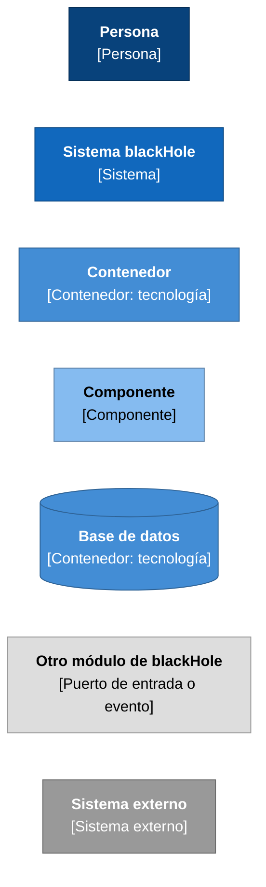
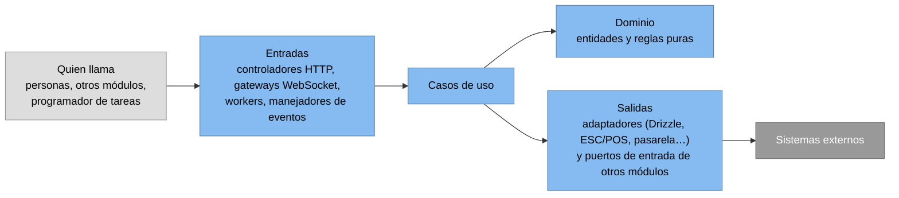

# Arquitectura · Diagramas C4 e infraestructura

| Campo | Valor |
|-------|-------|
| Estado | Borrador |
| Versión | 0.3 |
| Fecha | 2026-10-15 |
| Fuentes | [TRD-00](../trd/TRD-00-arquitectura-base.md), [TRD-01](../trd/TRD-01-infraestructura-y-operacion.md), [Flujos](../flujos/README.md) |

Vistas estructurales del sistema con el modelo [C4](https://c4model.com/): de lo general (quién usa el sistema y con qué se integra) a lo particular (qué componentes tiene cada módulo). Los [flujos](../flujos/README.md) cuentan **qué pasa** en cada funcionalidad; estos diagramas cuentan **dónde vive** cada pieza y **cómo se comunican**. Si un diagrama y un maestro no coinciden, manda el maestro.

## Cómo leerlos

| Nivel | Documento | Pregunta que responde |
|-------|-----------|-----------------------|
| 1 · Contexto | [Contexto y contenedores](c4-contexto-y-contenedores.md#nivel-1--contexto) | Quién usa blackHole y con qué sistemas externos habla |
| 2 · Contenedores | [Contexto y contenedores](c4-contexto-y-contenedores.md#nivel-2--contenedores) | Qué se despliega (apps, API, nodo, bases) en cada modo de sede |
| 3 · Componentes | Un archivo por módulo (abajo) | Qué entradas, casos de uso, dominio, puertos y adaptadores tiene cada módulo |
| Despliegue | [Infraestructura y comunicación](infraestructura-y-comunicacion.md) | En qué máquinas y redes corre todo, qué protocolos y puertos usa y quién inicia cada conexión |

El nivel 4 (código) no se dibuja: lo da la estructura del monorepo (TRD-00, sección 14). El orden en que se escribe cada comportamiento está en TRD-00, sección 16: una prueba que falla, de adentro hacia afuera.

## Componentes por módulo

| Módulo | Archivo | Corre en |
|--------|---------|----------|
| M0 Plataforma | [c4-m0-plataforma.md](componentes/c4-m0-plataforma.md) | Nube y nodo |
| M1 Pedidos y salón | [c4-m1-pedidos-y-salon.md](componentes/c4-m1-pedidos-y-salon.md) | Nodo (o nube en modo nube); pedido QR en la nube |
| M2 Caja | [c4-m2-caja.md](componentes/c4-m2-caja.md) | Nodo (o nube); pago QR en la nube |
| M3 Facturación e impresión | [c4-m3-facturacion.md](componentes/c4-m3-facturacion.md) | Documento e impresión en el nodo; emisión y portal en la nube |
| M4 Inventario | [c4-m4-inventario.md](componentes/c4-m4-inventario.md) | Nodo de sede, nodo de bodega y nube |
| M5 Domicilios | [c4-m5-domicilios.md](componentes/c4-m5-domicilios.md) | Hub en la nube; pedido interno en el nodo |
| M6 Reportes | [c4-m6-reportes.md](componentes/c4-m6-reportes.md) | Día en el nodo; consolidado en la nube |
| M7 SaaS | [c4-m7-saas.md](componentes/c4-m7-saas.md) | Nube |
| M8 Asistencia | [c4-m8-asistencia.md](componentes/c4-m8-asistencia.md) | Nodo (o nube) |
| M9 Reservas | [c4-m9-reservas.md](componentes/c4-m9-reservas.md) | Reserva y cobro en la nube; atención en el nodo |

## Notación

Los diagramas usan `flowchart` de Mermaid con los colores de C4, porque la sintaxis `C4Context` de Mermaid sigue siendo experimental y acomoda mal los diagramas grandes.

El gris claro marca otro módulo de blackHole, o un disparador interno como el programador de tareas. El gris oscuro queda solo para lo que está fuera del sistema.

- Los recuadros punteados son **límites**: la nube, la sede, un contenedor o una capa.
- Cada flecha dice **qué** viaja y, cuando importa, **por qué protocolo**.
- Las flechas punteadas (`-.->`) son asíncronas: eventos de la outbox, colas o mensajes que pueden esperar a que vuelva internet.

### Capas dentro de cada módulo (nivel 3)

Todos los módulos siguen la arquitectura hexagonal de TRD-00, sección 14. Cada diagrama de componentes se lee por columnas, de izquierda a derecha:

Dominio y salidas comparten columna: los casos de uso usan los dos. Todas las flechas van hacia la derecha; una flecha de un caso de uso a una salida significa "usa ese puerto", y el adaptador lo implementa. Los módulos que corren en los dos lados tienen un diagrama para la sede y otro para la nube.

La dependencia va siempre hacia adentro. Los adaptadores implementan los puertos que declara la aplicación; los casos de uso no saben si detrás hay PostgreSQL o SQLite. Un módulo habla con otro solo por su **puerto de entrada** (llamada en proceso) o por **eventos**, nunca importando su interior.

Los nombres de componentes y casos de uso los adopta el TRD de cada módulo. Si el diagrama y el TRD no coinciden, manda el TRD.
