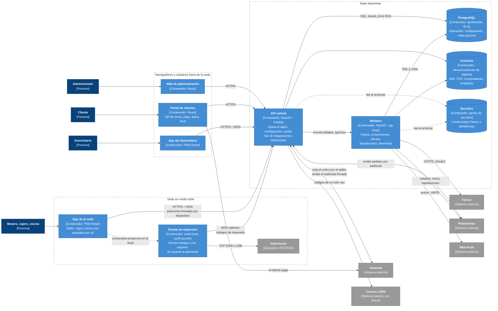
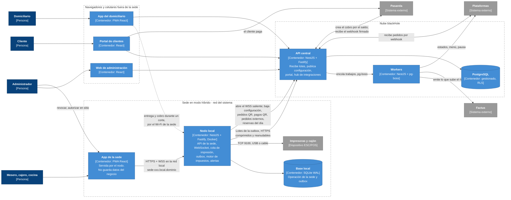
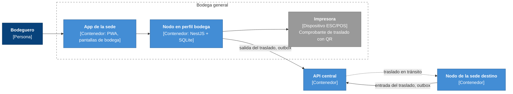

# C4 · Contexto y contenedores

| Campo | Valor |
|-------|-------|
| Estado | Borrador |
| Versión | 0.2 |
| Fecha | 2026-10-15 |
| Fuentes | [TRD-00 §3, §5, §13 y §14](../trd/TRD-00-arquitectura-base.md), [TRD-01 §3](../trd/TRD-01-infraestructura-y-operacion.md) |

## Nivel 1 · Contexto

blackHole es un solo sistema para el restaurante. Hacia afuera habla con la DIAN a través de Factus, con la pasarela del pago QR, con las plataformas de domicilio y con los servicios de avisos. Los bancos de las reservas no están integrados: el personal verifica la transferencia en la app del banco (ADR-012).

```mermaid
flowchart TB
  subgraph Personal["Personal del restaurante"]
    MES["<b>Mesero</b><br/>[Persona]<br/>Toma pedidos en su celular"]:::persona
    CAJ["<b>Cajero</b><br/>[Persona]<br/>Cobra, abre y cierra turnos"]:::persona
    COC["<b>Cocina y barra</b><br/>[Persona]<br/>Prepara por estación"]:::persona
    ANF["<b>Anfitrión</b><br/>[Persona]<br/>Reservas, recibe clientes, asigna mesas"]:::persona
    BOD["<b>Bodeguero y compras</b><br/>[Persona]<br/>Compras, traslados y conteos"]:::persona
    ADM["<b>Propietario, gerente y administrador</b><br/>[Persona]<br/>Configura, autoriza y revisa reportes"]:::persona
    CON["<b>Contador y auditor</b><br/>[Persona]<br/>Solo lectura: fiscal, auditoría, control"]:::persona
    DOM["<b>Domiciliario</b><br/>[Persona]<br/>Entrega y cobra domicilios propios"]:::persona
  end

  CLI["<b>Cliente del restaurante</b><br/>[Persona]<br/>Pide y paga desde el QR,<br/>deja sus datos de factura, reserva"]:::persona
  SOP["<b>Administrador de la plataforma y soporte</b><br/>[Persona, equipo blackHole]<br/>Crea empresas y planes; soporte entra<br/>solo con autorización del cliente"]:::persona

  BH["<b>blackHole</b><br/>[Sistema]<br/>Punto de venta mobile first, cocina, caja,<br/>inventario, facturación DIAN, domicilios,<br/>reservas, asistencia, roles y auditoría"]:::sistema

  FAC["<b>Factus</b><br/>[Sistema externo]<br/>Proveedor tecnológico DIAN:<br/>factura, nota crédito, adquirente"]:::externo
  DIAN["<b>DIAN</b><br/>[Sistema externo]"]:::externo
  PAS["<b>Pasarela de pagos</b><br/>[Sistema externo, ADR-016]<br/>Nequi, Daviplata, Bre-B, tarjeta"]:::externo
  PLAT["<b>Plataformas de domicilio</b><br/>[Sistema externo]<br/>Rappi, DiDi Food, integrador"]:::externo
  PUSH["<b>Servicios Web Push</b><br/>[Sistema externo]<br/>FCM, APNs, Mozilla"]:::externo
  MSG["<b>Correo y SMS</b><br/>[Sistema externo, por definir]<br/>Códigos de un solo uso"]:::externo
  IMP["<b>Impresoras térmicas y cajón</b><br/>[Dispositivo]<br/>ESC/POS por red o USB"]:::externo
  BANCO["<b>App del banco</b><br/>[Fuera del sistema]<br/>Verificación manual de anticipos"]:::externo

  MES -- "pedidos, avisos de listo" --> BH
  CAJ -- "cobros, arqueos, propinas" --> BH
  COC -- "estados por estación" --> BH
  ANF -- "reservas y llegadas" --> BH
  BOD -- "compras, traslados, conteos" --> BH
  ADM -- "configuración, autorizaciones, reportes" --> BH
  CON -- "reportes y exportaciones" --> BH
  DOM -- "entregas y cobros" --> BH
  CLI -- "pedido y pago QR, datos de factura, reservas" --> BH
  SOP -- "alta y soporte" --> BH

  BH -- "emite y consulta documentos<br/>HTTPS, OAuth2" --> FAC
  FAC -- "valida" --> DIAN
  BH -- "cobro por monto exacto" --> PAS
  PAS -. "webhook firmado" .-> BH
  PLAT -. "pedidos por webhook" .-> BH
  BH -- "estados, menú, disponibilidad, pausa" --> PLAT
  BH -- "avisos" --> PUSH
  BH -- "códigos y avisos" --> MSG
  BH -- "comandas, facturas, cierres, apertura de cajón" --> IMP
  ADM -. "quien tiene reserva.verificar_pago<br/>revisa la transferencia" .-> BANCO

  classDef persona fill:#08427b,stroke:#052e56,color:#fff
  classDef sistema fill:#1168bd,stroke:#0b4884,color:#fff
  classDef externo fill:#999999,stroke:#6b6b6b,color:#fff
  style Personal fill:none,stroke:#666,stroke-dasharray: 5 5
```

| Actor o sistema | Cómo se relaciona | Fase |
|-----------------|-------------------|------|
| Factus | Solo la nube lo llama. El token nunca queda en la sede (TRD-00, 8.1) | 1 |
| Pasarela de pagos | La API central crea el cobro por el saldo; el cliente paga en la pasarela y esta confirma por webhook. Sin webhook no hay pago (TRD-00, 6.4) | 1 (entrega 1.13) |
| Plataformas de domicilio | Entran por el hub de integraciones, un adaptador por plataforma (TRD-00, 6.1) | 3 |
| Impresoras | Las maneja el nodo o el puente. El navegador nunca habla ESC/POS (TRD-00, 7) | 1 |
| App del banco | No hay integración. El personal confirma que el dinero llegó (ADR-012) | 3 |

Los servicios de infraestructura (Cloudflare, Grafana Cloud, Sentry y el registro de imágenes) no aparecen en este nivel porque no son parte del negocio. Están en [Infraestructura y comunicación](infraestructura-y-comunicacion.md).

## Nivel 2 · Contenedores

Un contenedor es algo que se despliega por separado. Hay dos vistas, una por modo de sede (TRD-00, 5.0). Las apps, la API y las reglas son las mismas; cambia quién atiende el salón.

| Contenedor | Carpeta | Tecnología | Dónde corre |
|------------|---------|------------|-------------|
| API central | `apps/api-nube` | NestJS sobre Fastify, Node.js 24 | Contenedores gestionados en la nube (TRD-01, 3.1) |
| Workers | `apps/api-nube` (mismo código, otro proceso) | NestJS + pg-boss | Contenedores gestionados en la nube |
| PostgreSQL | — | PostgreSQL gestionado con Row Level Security | Nube, red privada |
| Almacenamiento de archivos | — | S3, Cloud Storage o Blob Storage | Nube |
| Secretos | — | Secrets Manager, Secret Manager o Key Vault | Nube |
| Colector OpenTelemetry | — | OpenTelemetry Collector | Nube, red privada |
| Nodo local | `apps/nodo-local` | NestJS sobre Fastify + SQLite (WAL), Docker | Mini PC o PC de la caja, en la sede |
| App de la sede | `apps/app-sede` | PWA React 19 + Vite | Celulares, tablets, PC de caja y TV de cocina |
| App del domiciliario | `apps/app-domicilios` | PWA React 19 + Vite | Celular del domiciliario |
| Web de administración | `apps/web-admin` | React 19 + Vite | Navegador |
| Portal de clientes | `apps/portal-clientes` | React 19 + Vite, liviano | Celular del cliente |

El nodo tiene tres perfiles con el mismo programa: **nodo** (sede híbrida), **puente** (solo imprime, sede en modo nube) y **bodega** (inventario sin salón ni caja, TRD-00 5.5).

Las apps web se publican desde la nube (la app de la sede, también desde el nodo en híbrido), pero **corren en el navegador** del dispositivo. Por eso los diagramas las dibujan donde corren, no donde se publican. El colector OpenTelemetry, Grafana Cloud y Sentry se ven en [Infraestructura y comunicación](infraestructura-y-comunicacion.md#8-observabilidad).

### Sede en modo nube (predeterminado)

El salón habla directo con la API central. Si la sede tiene impresora térmica, el puente recibe los trabajos de la nube. Un corte de internet detiene el salón.

### Sede en modo híbrido

El nodo es el dueño de la operación del salón. Las PWA de la sede hablan con el nodo dentro de la red del local, y el nodo sincroniza con la nube cuando hay internet. El portal, las plataformas y las reservas siguen naciendo en la nube y bajan al nodo.

Archivos, secretos, Web Push y correo funcionan igual que en modo nube; se omiten para no repetir.

Diferencias que se ven en el diagrama:

| | Modo nube | Modo híbrido |
|--|-----------|--------------|
| A quién habla la app de la sede | API central, por internet | Nodo, por la red del local |
| Dónde se guarda la operación | PostgreSQL | SQLite del nodo, con copia en PostgreSQL |
| Quién imprime | El puente, con trabajos que llegan de la nube | El nodo, con su cola local |
| Conexión entre la sede y la nube | Cada PWA abre la suya | Un solo canal del nodo: lotes hacia arriba y WebSocket saliente para lo que baja |
| Corte de internet | El salón se detiene | El salón sigue; facturas, pedidos QR y pagos QR esperan |

### Bodega general

La bodega general usa el mismo contenedor del nodo en **perfil bodega**: inventario, recepción, despacho e impresión de comprobantes, sin salón ni caja. Se conecta a la nube igual que una sede híbrida. Una bodega pequeña puede operar solo desde la web de administración, sin nodo, y entonces no registra movimientos sin internet (ADR-010).

### Qué módulo vive en qué contenedor

La columna "Nodo local" describe una sede en híbrido. **En modo nube, todo lo de esa columna corre en la API central** con los mismos casos de uso.

| Módulo | API central y workers | Nodo local | Apps cliente |
|--------|-----------------------|------------|--------------|
| M0 Plataforma | Organización, roles, sesión de administración, modo de la sede, recepción de lotes, verificación de la cadena de auditoría | PIN, dispositivos, permisos, outbox, auditoría de la sede | Todas |
| M1 Pedidos y salón | Menú y catálogo, intención de pedido QR | Salón, cocina y enrutamiento | App de la sede, web admin, portal |
| M2 Caja | Cobro y webhook del pago QR | Turnos, cobros, arqueos, propinas | App de la sede, portal |
| M3 Facturación | Emisión ante Factus, portal de datos, refacturación | Documento de venta, motor de impuestos, impresión | App de la sede, portal |
| M4 Inventario | Insumos y recetas, consolidado, niveles sugeridos, bodega sin nodo | Movimientos del punto y bodegas, alertas, unidades posibles | App de la sede, web admin |
| M5 Domicilios | Hub de integraciones, liquidaciones, app del domiciliario | Domicilio propio, aceptación de pedidos externos | App de la sede, app del domiciliario |
| M6 Reportes | Proyecciones, consolidado, detectores | Reportes del día | Web admin, app de la sede |
| M7 SaaS | Todo | — | Web admin. Falta definir si el panel de plataforma y soporte (entrega 4.5) es una vista de la web admin o una app aparte |
| M8 Asistencia | Horas consolidadas, exportación | Marcación con la hora del nodo, cierre automático | App de la sede |
| M9 Reservas | Reserva, cobro, políticas | Llegada, mesa, no llegada, reserva provisional | App de la sede, web admin, portal |
