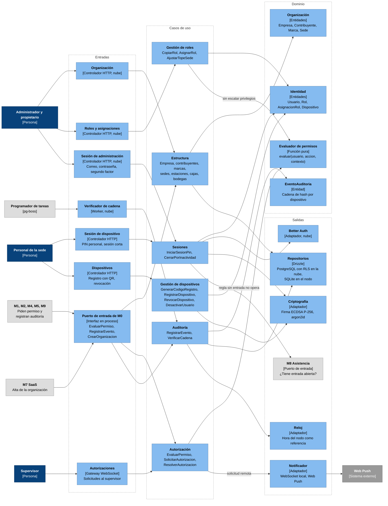
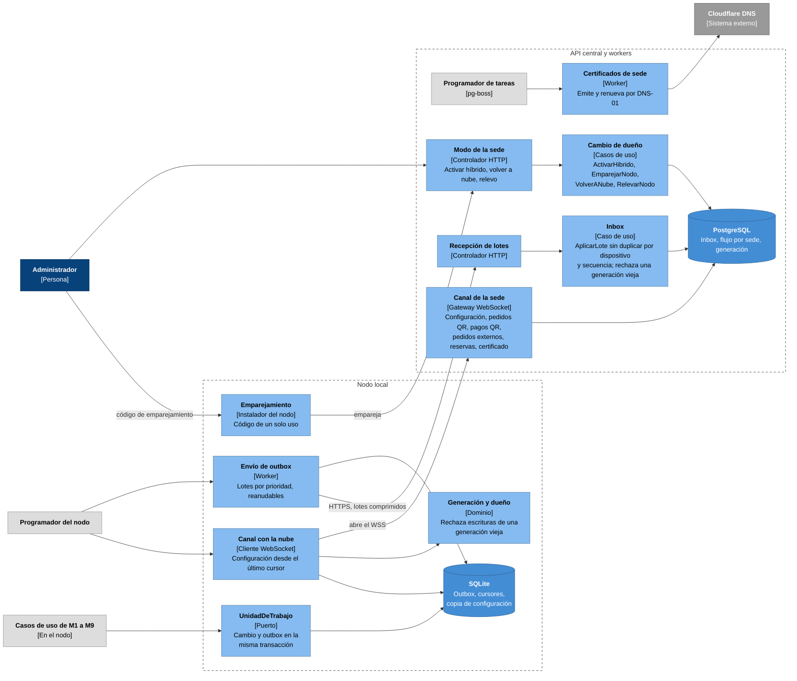

# C4 · Componentes de M0 Plataforma

| Campo | Valor |
|-------|-------|
| Estado | Borrador |
| Versión | 0.2 |
| Fecha | 2026-10-15 |
| Fuentes | [Flujos M0](../../flujos/m0-plataforma.md), [PRD-01](../../prd/PRD-01-roles-y-permisos.md), [TRD-00 §5, §10 y §12](../../trd/TRD-00-arquitectura-base.md) |

M0 es la base que usan los demás módulos: organización, identidad, dispositivos, permisos, auditoría, modo de la sede y sincronización. Corre en la API central y en el nodo con los mismos casos de uso; cada app enlaza sus adaptadores de persistencia.

## Organización, identidad, autorización y auditoría

Los controladores marcados "nube" solo existen en la API central. El resto corre en los dos lados.

Todos los casos de uso guardan por los repositorios; el diagrama solo dibuja dos de esas flechas.

## Modo de la sede y sincronización

El nodo abre todas las conexiones con la nube. Por eso las flechas van del nodo a la nube, aunque la configuración, los pedidos QR y las reservas bajen por ese mismo canal.

Orden de envío de la outbox: documentos DIAN y pagos QR confirmados, pedidos QR, auditoría, ventas y caja, inventario y telemetría (TRD-00, 5.5). El certificado de `sede-xxx` que emite el worker baja al nodo por el canal de la sede.

## Puertos y adaptadores

| Puerto | Nube | Nodo |
|--------|------|------|
| `RepositorioOrganizacion`, `RepositorioIdentidad`, `RepositorioDispositivos` | `adaptadores/postgres` con Row Level Security | `adaptadores/sqlite`, copia de su sede |
| `RepositorioAuditoria` | PostgreSQL, solo inserción | SQLite, solo inserción |
| `UnidadDeTrabajo` | Transacción que fija el `tenant_id` | Transacción con escritura en la outbox |
| `Outbox` / `Inbox` | Inbox con clave `(dispositivo_id, secuencia)` | Outbox y cursor de configuración |
| `VerificadorFirma` | WebCrypto ECDSA P-256 | WebCrypto ECDSA P-256 |
| `HashPin` | argon2id | argon2id, hashes de su sede |
| `Notificador` | Web Push (VAPID) | WebSocket local |
| `Reloj` | Hora del servidor | Hora del nodo, referencia de la sede |
| `Secretos` | Gestor de secretos de la nube | Archivo cifrado |

## Cómo lo usan los demás módulos

| Módulo | Mecanismo | Qué pide |
|--------|-----------|----------|
| M1, M2, M4, M5, M9 | Llamada en proceso a `EvaluarPermiso` | Permitido, pide autorización o denegado |
| M1, M2, M4, M5, M9 | Llamada en proceso a `RegistrarEvento` | Evento de auditoría encadenado |
| M8 | M0 consulta el puerto de entrada de M8 | Si la persona tiene entrada abierta |
| M6 | Eventos de auditoría | Métricas de control y detectores |
| M7 | Llamada en proceso al alta | Crear empresa, contribuyentes, sedes y propietario |
