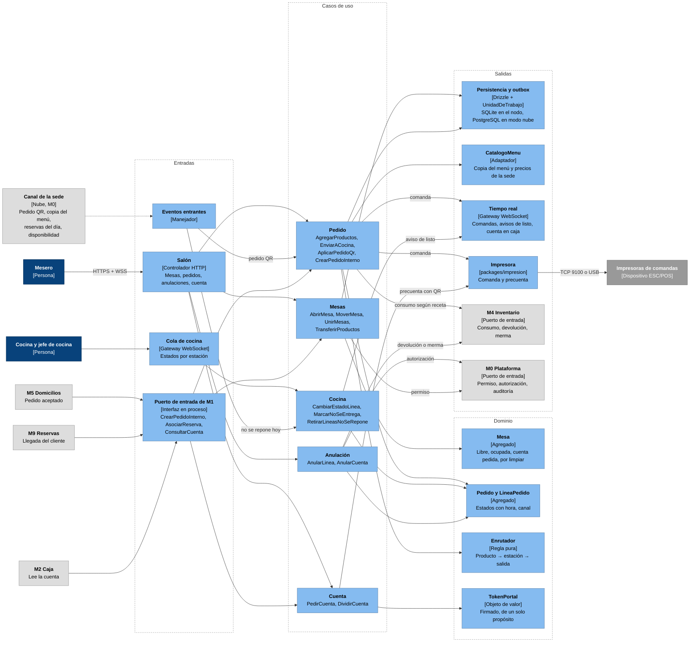
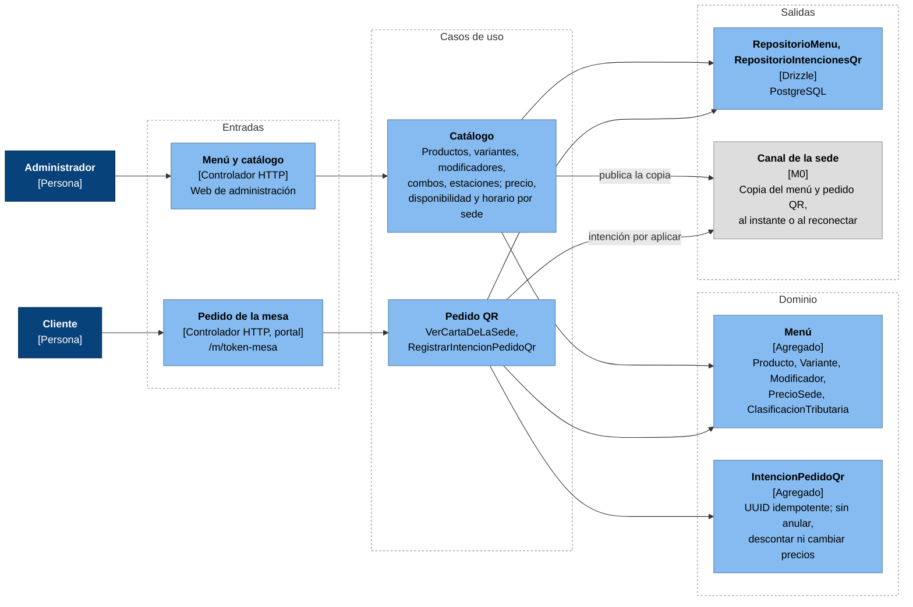

# C4 · Componentes de M1 Pedidos y salón

| Campo | Valor |
|-------|-------|
| Estado | Borrador |
| Versión | 0.2 |
| Fecha | 2026-10-15 |
| Fuentes | [Flujos M1](../../flujos/m1-pedidos-y-salon.md), [TRD-00 §6 y §6.4](../../trd/TRD-00-arquitectura-base.md) |

El salón corre en el nodo si la sede está en híbrido, o en la API central si está en modo nube. Los casos de uso son los mismos. Dos piezas viven siempre en la nube: el menú y catálogo, que es de la marca y se administra en la web (PRD-00, M1), y la intención de pedido QR, porque el celular del cliente no entra a la red del personal.

## En la sede

Corre en el nodo, o en la API central si la sede está en modo nube.

Todos los casos de uso guardan con la persistencia y dejan su evento en la outbox; el diagrama solo dibuja dos de esas flechas. M6 recibe los eventos por la outbox.

## En la nube: menú y pedido QR

En modo nube no hay canal hacia un nodo: el pedido QR lo aplica la misma API central.

## Puertos y adaptadores

| Puerto | Nube | Nodo |
|--------|------|------|
| `RepositorioPedidos`, `RepositorioMesas` | `persistencia-postgres` | `persistencia-sqlite` |
| `RepositorioIntencionesQr` | PostgreSQL | — (el nodo recibe la intención por el canal de la sede) |
| `RepositorioMenu` | `persistencia-postgres`; dueña del menú, precios y horarios | — |
| `CatalogoMenu` | Lectura directa del menú | Copia sincronizada desde la nube |
| `Impresora` | Trabajo hacia el puente de la sede | Cola local ESC/POS |
| `NotificadorTiempoReal` | Gateway WebSocket con `LISTEN/NOTIFY` entre instancias | Gateway WebSocket del nodo |
| `FirmadorTokens` | Llave de la nube | Llave de la sede, así la precuenta sale sin internet |
| `Reloj` | Hora del servidor | Hora del nodo |

## Contratos con otros módulos

| Con | Mecanismo | Qué viaja |
|-----|-----------|-----------|
| M4 | Llamada en proceso a su puerto de entrada | Consumo según receta al enviar; devolución o merma al anular |
| M4 → M1 | Evento `DisponibilidadCambiada` | Disponible, pocas unidades, agotado, no se repone hoy |
| M1 → M2 | M2 lee la cuenta por el puerto de entrada de M1 y por WebSocket | Cuenta en tiempo real y precuenta |
| M5 → M1 | Llamada en proceso a `CrearPedidoInterno` | Pedido aceptado de plataforma o domicilio propio |
| M9 → M1 | Evento `ReservasDelDia` y llamada en la llegada | Mesa bloqueada; mesa y cuenta asociadas |
| M0 | Llamada en proceso | Permiso, autorización y auditoría |
| M6 | Eventos de la outbox | Cada cambio de estado con la hora del nodo |
