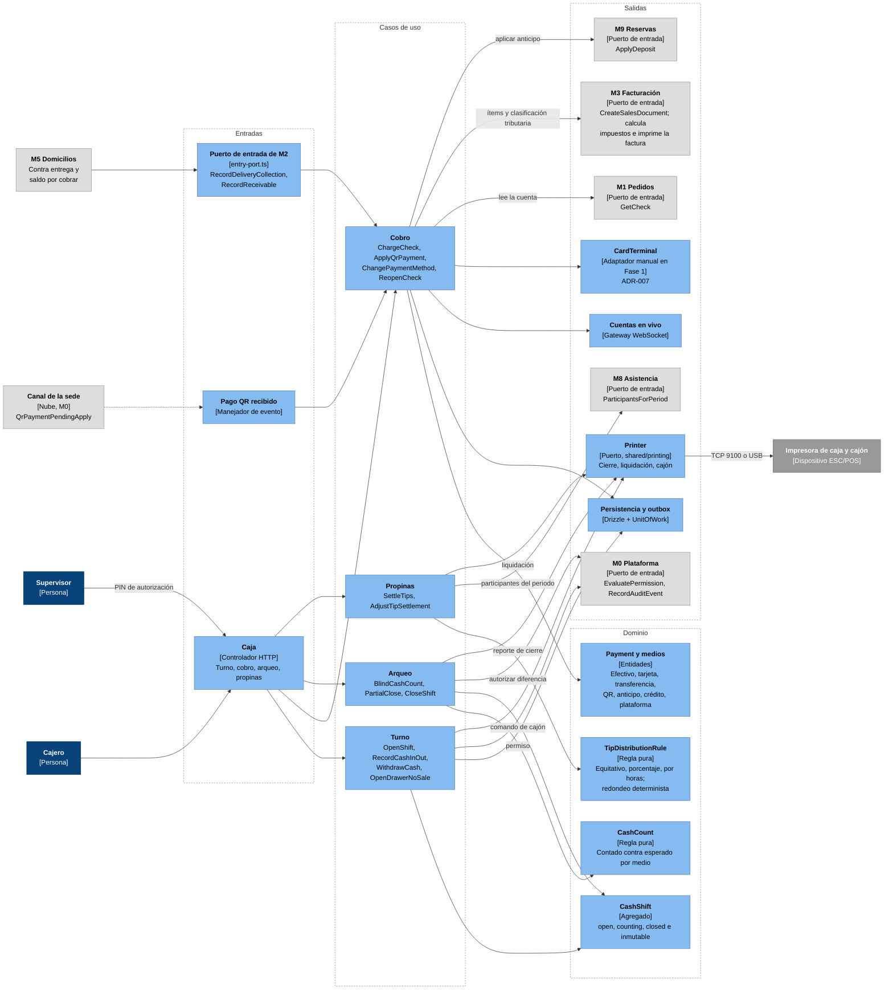
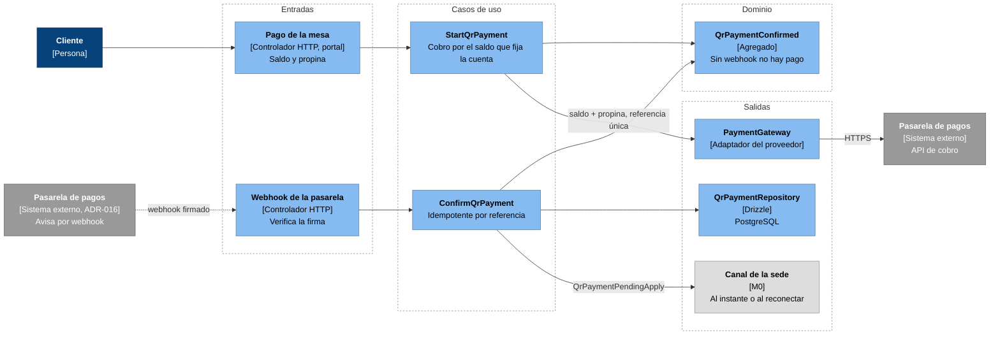

# C4 · Componentes de M2 Caja

| Campo | Valor |
|-------|-------|
| Estado | Borrador |
| Versión | 0.3 |
| Fecha | 2026-10-17 |
| Fuentes | [Flujos M2](../../flujos/m2-caja.md), [TRD-M2](../../trd/TRD-M2-caja.md), [TRD-00 §6.3 y §6.4](../../trd/TRD-00-arquitectura-base.md), [Glosario de código](../../glosario-codigo.md) |

La caja (`contexts/cash-register`) corre donde corre el salón: en el nodo si la sede es híbrida, o en la API central en modo nube. El pago QR siempre empieza en la nube, porque lo confirma la pasarela con un webhook; el nodo lo aplica al turno abierto. Los nombres son los de [TRD-M2](../../trd/TRD-M2-caja.md).

## En la sede

M2 envía a M3 los ítems con su clasificación tributaria, la propina, los pagos, los anticipos y el adquirente. M3 calcula los impuestos, responde con el número, el CUFE y el QR (o el comprobante si no hay internet) y dispara la impresión de la factura o del comprobante. M2 solo imprime el cierre, la liquidación de propinas y el comando de cajón.

## En la nube: pago QR en la mesa

La pasarela aparece dos veces porque cumple dos papeles: la API recibe sus avisos (izquierda) y también la llama para crear el cobro (derecha). En modo nube el pago lo aplica la misma API central, sin canal hacia un nodo.

## Puertos y adaptadores

| Puerto | Nube | Nodo |
|--------|------|------|
| `CashRegisterRepository` | `adapters/postgres` | `adapters/sqlite` |
| `QrPaymentRepository` | PostgreSQL | — (el pago llega por el canal de la sede) |
| `PaymentGateway` | Varios adaptadores. Bold es uno (D-46) | — (el nodo no habla con la pasarela) |
| `CardTerminal` | Manual (registro de aprobación, franquicia, últimos 4) | Manual; integración directa por proveedor en ADR-007 |
| `Printer` (`shared/printing`) | Trabajo hacia el puente | Cola local; comando de cajón solo a la impresora de caja |
| `Clock` | Hora del servidor | Hora del nodo |

## Contratos con otros módulos

| Con | Mecanismo | Qué viaja |
|-----|-----------|-----------|
| M1 → M2 | `GetCheck` por el puerto de entrada de M1 y WebSocket | Cuenta abierta, precuenta, división |
| M3 | Llamada en proceso a `CreateSalesDocument` | Ítems con su `TaxClassification`, propina, pagos, anticipos y adquirente. M3 calcula los impuestos e imprime |
| M8 | Llamada en proceso a `ParticipantsForPeriod` | Personas con marcación en el periodo |
| M9 | Llamada en proceso a `ApplyDeposit` | Valor del anticipo; no entra al efectivo |
| M5 → M2 | Llamada en proceso a `RecordDeliveryCollection` y `RecordReceivable` | Cobro contra entrega del domiciliario; saldo por cobrar a plataformas |
| M6 | Eventos de la outbox (`ShiftClosed`, `PaymentRecorded`) | Cierres, diferencias, medios de pago, propinas |
