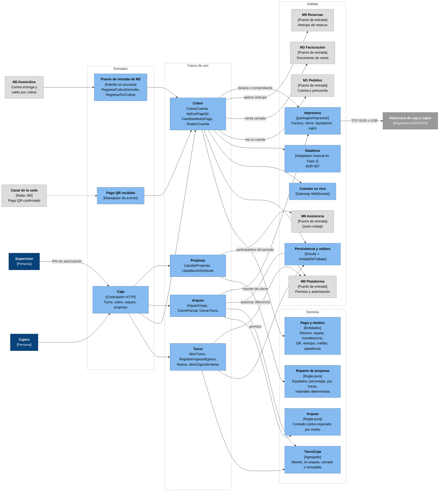
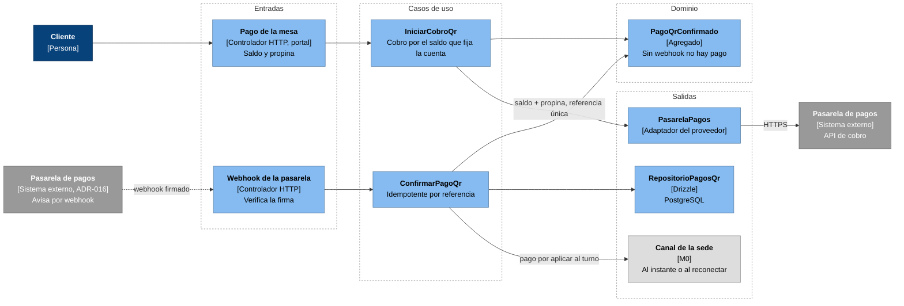

# C4 · Componentes de M2 Caja

| Campo | Valor |
|-------|-------|
| Estado | Borrador |
| Versión | 0.2 |
| Fecha | 2026-10-15 |
| Fuentes | [Flujos M2](../../flujos/m2-caja.md), [TRD-00 §6.3 y §6.4](../../trd/TRD-00-arquitectura-base.md) |

La caja corre donde corre el salón: en el nodo si la sede es híbrida, o en la API central en modo nube. El pago QR siempre empieza en la nube, porque lo confirma la pasarela con un webhook; el nodo lo aplica al turno abierto.

## En la sede

M3 devuelve el número, el CUFE y el QR (o el comprobante si no hay internet) como respuesta de la misma llamada, y el cobro lo manda a imprimir.

## En la nube: pago QR en la mesa

La pasarela aparece dos veces porque cumple dos papeles: la API recibe sus avisos (izquierda) y también la llama para crear el cobro (derecha). En modo nube el pago lo aplica la misma API central, sin canal hacia un nodo.

## Puertos y adaptadores

| Puerto | Nube | Nodo |
|--------|------|------|
| `RepositorioCaja` | `persistencia-postgres` | `persistencia-sqlite` |
| `PasarelaPagos` | Adaptador del proveedor elegido en ADR-016 | — (el nodo no habla con la pasarela) |
| `Datafono` | Manual (registro de aprobación, franquicia, últimos 4) | Manual; integración directa por proveedor en ADR-007 |
| `Impresora` | Trabajo hacia el puente | Cola local; comando de cajón solo a la impresora de caja |
| `Reloj` | Hora del servidor | Hora del nodo |

## Contratos con otros módulos

| Con | Mecanismo | Qué viaja |
|-----|-----------|-----------|
| M1 → M2 | Lectura por puerto de entrada y WebSocket | Cuenta abierta, precuenta, división |
| M3 | Llamada en proceso a `CrearDocumentoVenta` | Ítems, impuestos, propina, pagos, anticipos y adquirente |
| M8 | Llamada en proceso a `ParticipantesDelPeriodo` | Personas con marcación en el periodo |
| M9 | Llamada en proceso a `AplicarAnticipo` | Valor del anticipo; no entra al efectivo |
| M5 → M2 | Llamada en proceso | Cobro contra entrega del domiciliario; saldo por cobrar a plataformas |
| M6 | Eventos de la outbox | Cierres, diferencias, medios de pago, propinas |
