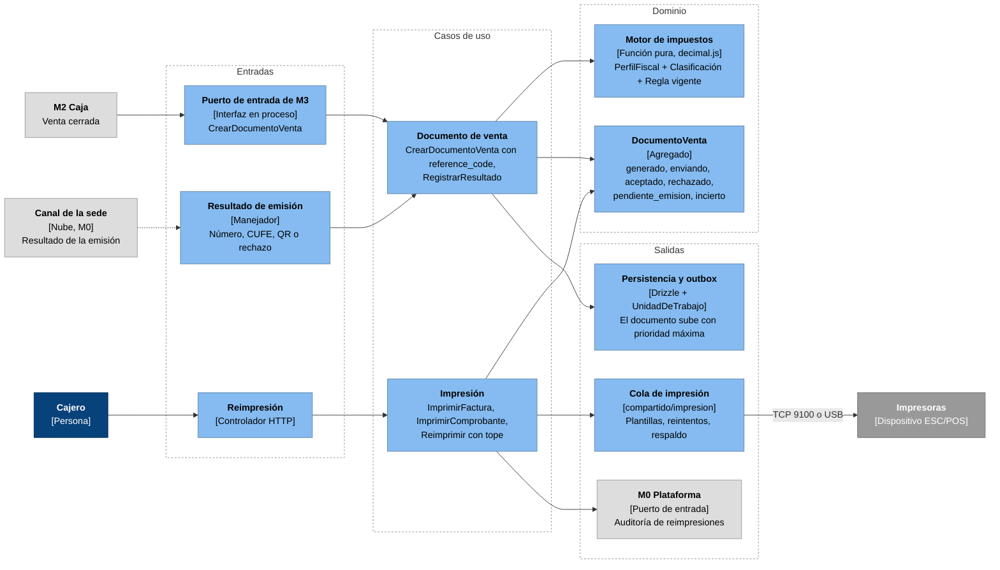
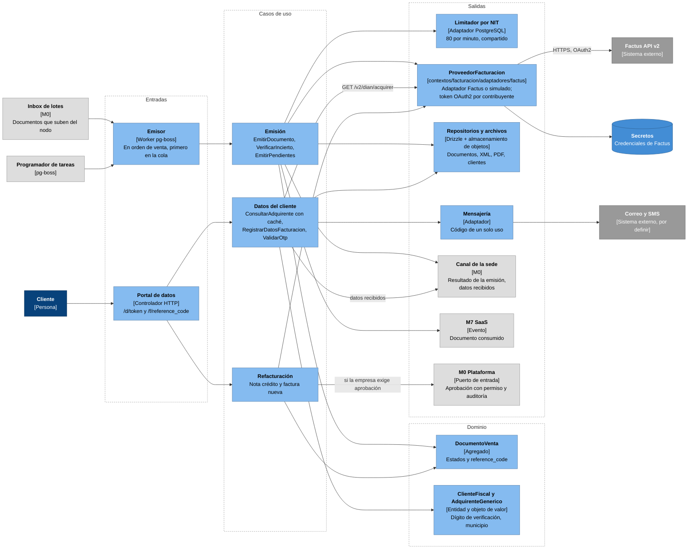

# C4 · Componentes de M3 Facturación e impresión

| Campo | Valor |
|-------|-------|
| Estado | Borrador |
| Versión | 0.2 |
| Fecha | 2026-10-15 |
| Fuentes | [Flujos M3](../../flujos/m3-facturacion.md), [TRD-00 §7 y §8](../../trd/TRD-00-arquitectura-base.md) |

M3 se parte en dos lados. En la sede (el nodo, o la nube en modo nube) se crea el documento, se calculan los impuestos y se imprime. En la nube se emite ante Factus, se atiende el portal del cliente y se refactura. El token de Factus nunca sale de la nube.

## En la sede: documento e impresión

Sin enlace con la nube, M2 imprime el comprobante con QR, que no es factura, y el documento queda `pendiente_emision`. Cuando llega el resultado, se imprime la factura si el cliente sigue en el local, o queda lista para reimprimir.

## En la nube: emisión, portal y refacturación

La cola de emisión siempre va antes que las consultas de adquirente: las dos comparten el límite de 80 solicitudes por minuto del NIT. La refacturación también pasa por el limitador.

## Puertos y adaptadores

| Puerto | Nube | Nodo |
|--------|------|------|
| `ProveedorFacturacion` | Factus (sandbox o producción) y simulado para pruebas | — |
| `LimitadorRitmo` | Contador por NIT en PostgreSQL, compartido por todas las instancias | — |
| `RepositorioDocumentos` | `adaptadores/postgres` | `adaptadores/sqlite` |
| `RepositorioClientesFiscales` | PostgreSQL, por empresa | Copia de lectura de los clientes frecuentes de la sede |
| `AlmacenamientoArchivos` | S3, Cloud Storage o Blob Storage | Disco local |
| `Secretos` | Gestor de secretos de la nube | — (sin credenciales de Factus en la sede) |
| `Impresora` | Trabajo hacia el puente | Cola local ESC/POS |
| `Mensajeria` | Proveedor de correo y SMS, por definir | — |

## Contratos con otros módulos

| Con | Mecanismo | Qué viaja |
|-----|-----------|-----------|
| M2 → M3 | Llamada en proceso a `CrearDocumentoVenta` | Venta cerrada con pagos, propina y anticipos |
| M3 → M2 | Respuesta, o evento al emitir un pendiente | Número, CUFE y QR, o comprobante |
| M7 | Evento `DocumentoConsumido` | Consumo de la bolsa por empresa, NIT y sede |
| M4 | Llamada en proceso (Fase 2) | Documento soporte de compras |
| M6 | Eventos | Emisiones, rechazos, pendientes y refacturaciones |
