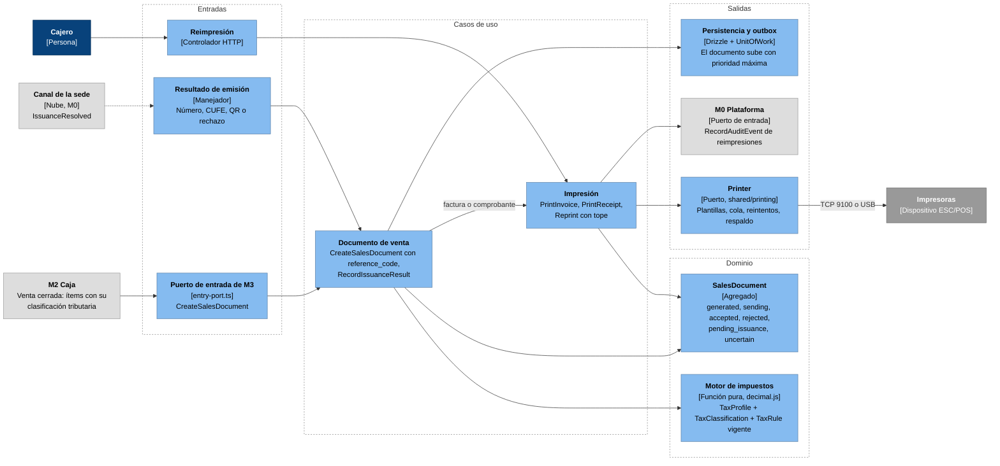
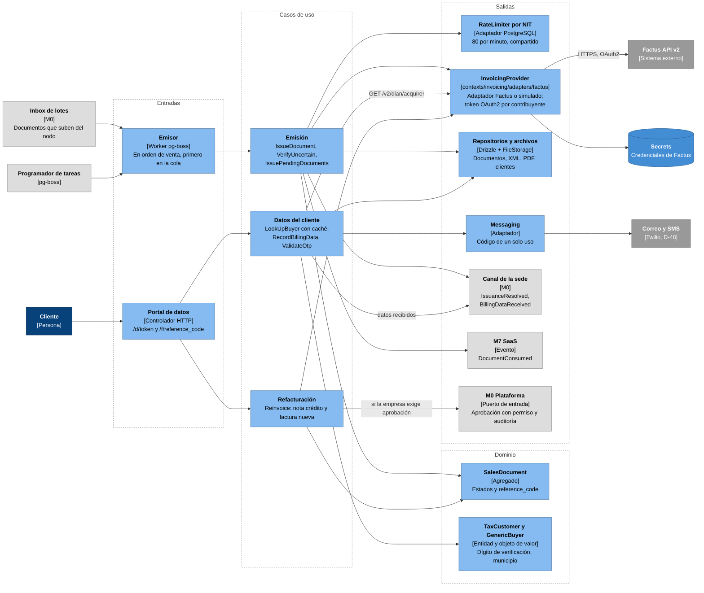

# C4 · Componentes de M3 Facturación e impresión

| Campo | Valor |
|-------|-------|
| Estado | Borrador |
| Versión | 0.4 |
| Fecha | 2026-11-19 |
| Fuentes | [Flujos M3](../../flujos/m3-facturacion.md), [TRD-M3](../../trd/TRD-M3-facturacion.md), [TRD-00 §7 y §8](../../trd/TRD-00-arquitectura-base.md), [Glosario de código](../../glosario-codigo.md) |

M3 (`contexts/invoicing`) se parte en dos lados. En la sede (el nodo, o la nube en modo nube) se crea el documento, se calculan los impuestos y se dispara la impresión de la factura o del comprobante. En la nube se emite ante Factus, se atiende el portal del cliente y se refactura. El token de Factus nunca sale de la nube. Los nombres son los de [TRD-M3](../../trd/TRD-M3-facturacion.md).

## En la sede: documento e impresión

Sin enlace con la nube, M3 imprime el comprobante con QR, que no es factura, y el documento queda `pending_issuance`. Cuando llega el resultado, M3 imprime la factura si el cliente sigue en el local, o queda lista para reimprimir. M3 solo dispara la factura y el comprobante; la comanda y la precuenta son de M1, y el cierre, las propinas y el cajón, de M2. Plantillas, cola y controlador viven en `shared/printing`.

## En la nube: emisión, portal y refacturación

La cola de emisión siempre va antes que las consultas de adquirente: las dos comparten el límite de 80 solicitudes por minuto del NIT. La refacturación también pasa por el limitador.

## Puertos y adaptadores

| Puerto | Nube | Nodo |
|--------|------|------|
| `InvoicingProvider` | Factus (sandbox o producción) y simulado para pruebas | — |
| `RateLimiter` | Contador por NIT en PostgreSQL, compartido por todas las instancias | — |
| `SalesDocumentRepository` | `adapters/postgres` | `adapters/sqlite` |
| `TaxCustomerRepository` | PostgreSQL, por empresa | Copia de lectura de los clientes frecuentes de la sede |
| `FileStorage` | S3, Cloud Storage o Blob Storage | Disco local |
| `Secrets` | Gestor de secretos de la nube | — (sin credenciales de Factus en la sede) |
| `Printer` (`shared/printing`) | Trabajo hacia el puente | Cola local ESC/POS |
| `Messaging` | Twilio para correo, SMS y WhatsApp (D-48). El sistema genera el código | — |

## Contratos con otros módulos

| Con | Mecanismo | Qué viaja |
|-----|-----------|-----------|
| M2 → M3 | Llamada en proceso a `CreateSalesDocument` | Ítems con su `TaxClassification`, pagos, propina, anticipos y adquirente. M3 calcula los impuestos |
| M3 → M2 | Respuesta, o evento `IssuanceResolved` al emitir un pendiente | Número, CUFE y QR, o comprobante. M3 dispara la impresión |
| M7 | Evento `DocumentConsumed` | Consumo de la bolsa por empresa, NIT y sede |
| M4 | Ninguna | El documento soporte de compras no se emite (D-14). La fase 2 cerró la compra como orden y recepción |
| M6 | Eventos | Emisiones, rechazos, pendientes y refacturaciones |
