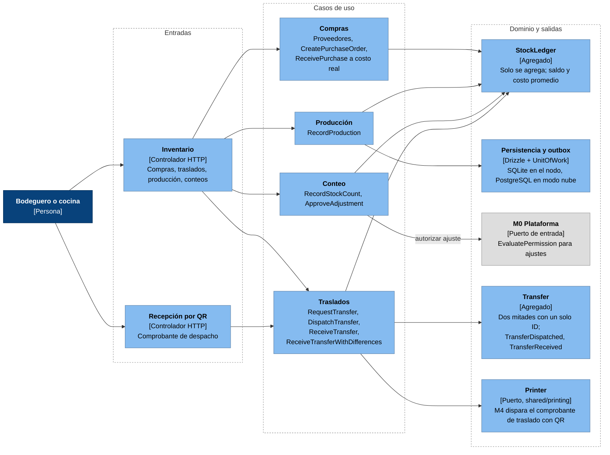
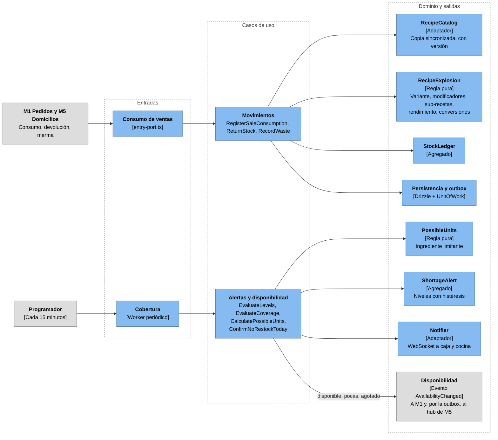
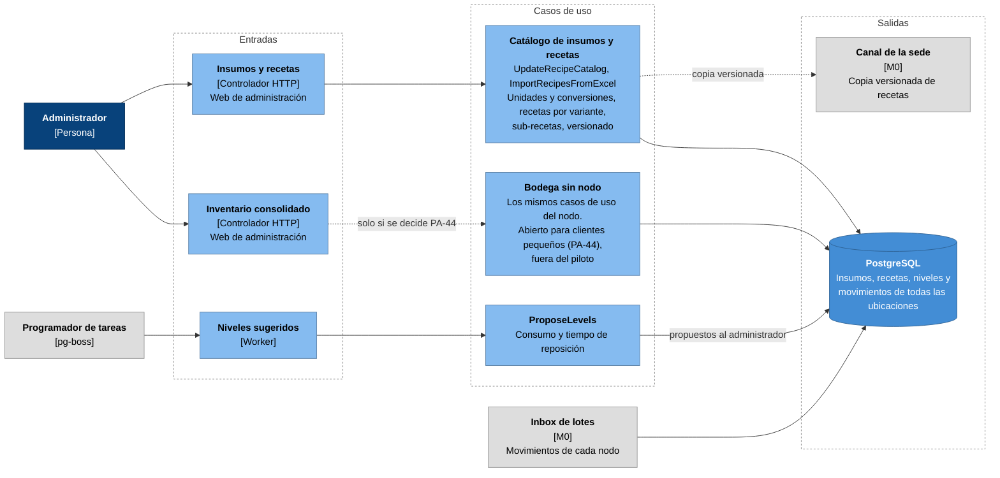

# C4 · Componentes de M4 Inventario, bodegas y recetas

| Campo | Valor |
|-------|-------|
| Estado | Borrador |
| Versión | 0.5 |
| Fecha | 2026-11-19 |
| Fuentes | [Flujos M4](../../flujos/m4-inventario.md), [TRD-M4](../../trd/TRD-M4-inventario.md), [TRD-00 §5.1, §5.5 y §9](../../trd/TRD-00-arquitectura-base.md), [Glosario de código](../../glosario-codigo.md) |

M4 (`contexts/inventory`) corre con los mismos casos de uso en el nodo de cada sede híbrida (punto y bodegas de la sede), en el nodo de la bodega general (perfil bodega) y en la nube. La bodega general del piloto tiene su propio nodo en modo bodega (D-04). En la nube vive siempre lo que es de la empresa: insumos, recetas, consolidado y niveles sugeridos. Operar una bodega sin nodo desde la web queda abierto para clientes pequeños (PA-44). En una sede en modo nube, la parte local también corre en la API central. Cada movimiento lo registra el dueño de esa ubicación. Los nombres son los de [TRD-M4](../../trd/TRD-M4-inventario.md).

El corte cerrado el 2026-11-19 es el de la nube: los casos de uso de esta página corren en la API central, con PostgreSQL. El nodo de sede, el nodo de bodega y el libro SQLite siguen dibujados porque son el producto híbrido, y todavía no están construidos.

## En el nodo de sede o de bodega

En modo nube, esta misma parte corre en la API central. Se divide en dos diagramas: lo que registra el bodeguero, y lo que pasa sola con cada venta.

### Compras, traslados, producción y conteos

Todos los casos de uso guardan el movimiento y el saldo en la misma transacción, con su evento (`StockMoved`) en la outbox; el diagrama solo dibuja una de esas flechas. Un traslado se despacha en el nodo origen (`TransferDispatched`) y se recibe en el destino con el mismo ID (`TransferReceived`).

### Consumo de ventas, alertas y disponibilidad

Cada saldo nuevo también dispara la evaluación de alertas, y una alerta puede proponer una orden de compra al bodeguero.

## En la nube

## Puertos y adaptadores

| Puerto | Nube | Nodo de sede o de bodega |
|--------|------|--------------------------|
| `StockMovementRepository`, `StockBalanceRepository` | `adapters/postgres`; vista consolidada (y bodegas sin nodo si se decide PA-44) | `adapters/sqlite`; saldo en la misma transacción |
| `RecipeRepository` | `adapters/postgres`; dueña de insumos, recetas y niveles | — |
| `RecipeCatalog` | Lectura directa | Copia sincronizada, con versión |
| `ShortageAlertRepository` | Vista consolidada | Alertas de sus ubicaciones |
| `Notifier` | Web Push al gerente; WhatsApp o correo en una fase posterior | WebSocket a caja y cocina |
| `Printer` (`shared/printing`) | — | Comprobante de traslado con QR |

## Contratos con otros módulos

| Con | Mecanismo | Qué viaja |
|-----|-----------|-----------|
| M1 y M5 → M4 | Llamada en proceso a `RegisterSaleConsumption`, `ReturnStock` o `RecordWaste` | Consumo por receta, devolución o merma |
| M4 → M1 | Evento `AvailabilityChanged` | Estado del plato y no se repone hoy |
| M4 → M5 | Mismo evento, por la outbox hacia el hub | Agotado o disponible en cada plataforma |
| Nodo origen → nodo destino | `TransferDispatched` y `TransferReceived` por la nube | Salida en el origen, entrada en el destino, reconciliadas por ID |
| M0 | Llamada en proceso a `EvaluatePermission` y `RecordAuditEvent` | Permiso y auditoría de ajustes y diferencias |
| M6 | Eventos (`StockMoved`) | Teórico contra real, mermas, margen, quiebres |
