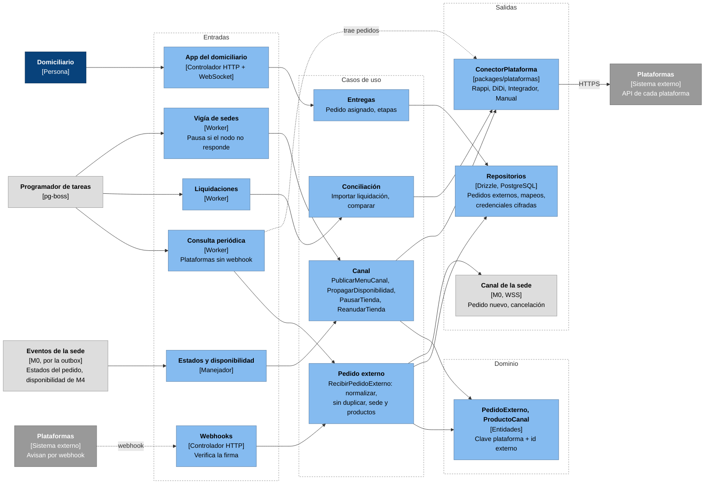
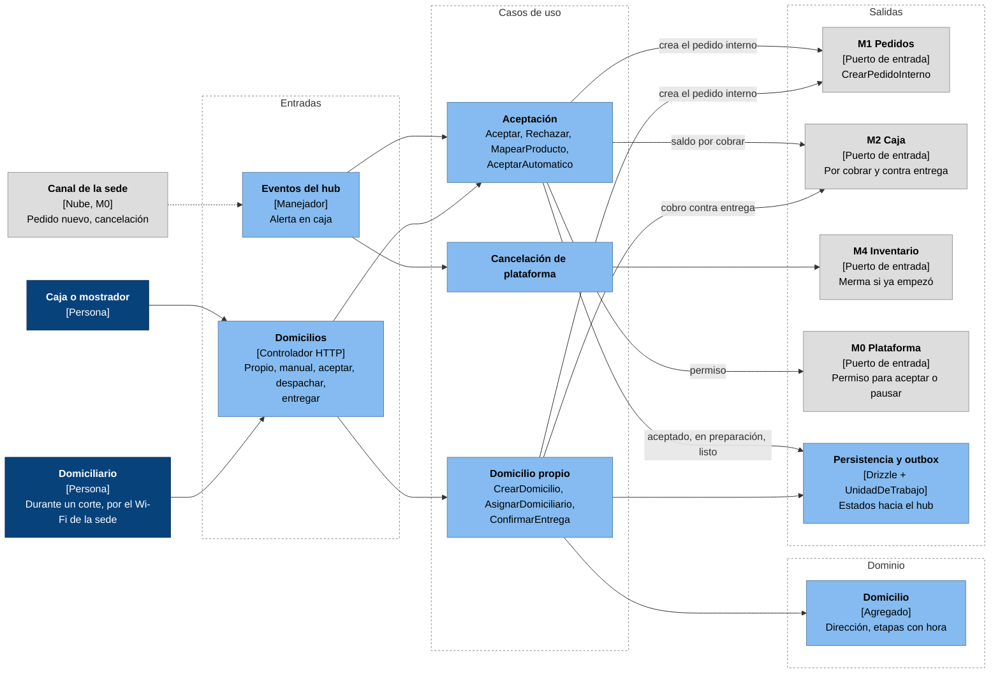

# C4 · Componentes de M5 Domicilios y plataformas

| Campo | Valor |
|-------|-------|
| Estado | Borrador |
| Versión | 0.2 |
| Fecha | 2026-10-15 |
| Fuentes | [Flujos M5](../../flujos/m5-domicilios.md), [TRD-00 §5.5 y §6.1](../../trd/TRD-00-arquitectura-base.md) |

El hub de integraciones vive en la nube: recibe pedidos de las plataformas, publica menú y disponibilidad, y concilia liquidaciones. Al aceptar, el nodo crea el pedido interno y pasa a ser su dueño. El domicilio propio y la captura manual nacen en la sede.

## En la nube: hub de integraciones

Las plataformas aparecen dos veces porque cumplen dos papeles: avisan por webhook (izquierda) y el conector llama a su API (derecha). Los estados aceptado, en preparación y listo suben desde la sede y el hub los propaga a la plataforma.

## En la sede

En modo nube, esta parte corre en la API central.

## Puerto `ConectorPlataforma`

Cada adaptador declara qué operaciones soporta (TRD-00, 6.1). Lo que no soporta se hace a mano.

| Adaptador | Pedidos | Estados | Menú | Disponibilidad | Pausa | Liquidación |
|-----------|---------|---------|------|----------------|-------|-------------|
| Rappi | Según acuerdo (ADR-011) | Según acuerdo | Según acuerdo | Según acuerdo | Según acuerdo | API o archivo |
| DiDi Food | Según acuerdo (ADR-011) | Según acuerdo | Según acuerdo | Según acuerdo | Según acuerdo | API o archivo |
| Integrador | Según el tercero | Según el tercero | Según el tercero | Según el tercero | Según el tercero | Según el tercero |
| Manual | La caja copia el pedido desde la tablet | La caja lo cambia en la tablet | En el portal de la plataforma | En el portal | En el portal | Archivo |

## Otros puertos

| Puerto | Nube | Nodo |
|--------|------|------|
| `RepositorioPedidosExternos` | `persistencia-postgres` | Copia del pedido por aceptar |
| `RepositorioDomicilios` | `persistencia-postgres` | `persistencia-sqlite` |
| `Secretos` | Credenciales de cada tienda, cifradas | — |
| `CanalSede` | Gateway WebSocket hacia el nodo | Cliente WebSocket saliente |

## Contratos con otros módulos

| Con | Mecanismo | Qué viaja |
|-----|-----------|-----------|
| M5 → M1 | Llamada en proceso a `CrearPedidoInterno` | Pedido con canal y código externo |
| M4 → M5 | Evento por la outbox hasta el hub | Agotado o disponible |
| M5 → M2 | Llamada en proceso | Saldo por cobrar a la plataforma; cobro contra entrega |
| M5 → M4 | Llamada en proceso | Devolución o merma por cancelación |
| M6 | Eventos | Tiempos por etapa, comisión, diferencias de liquidación |
