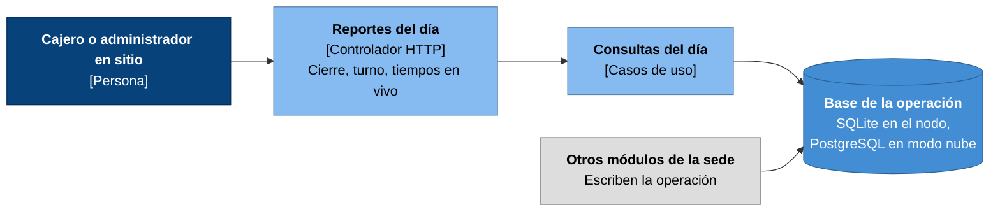
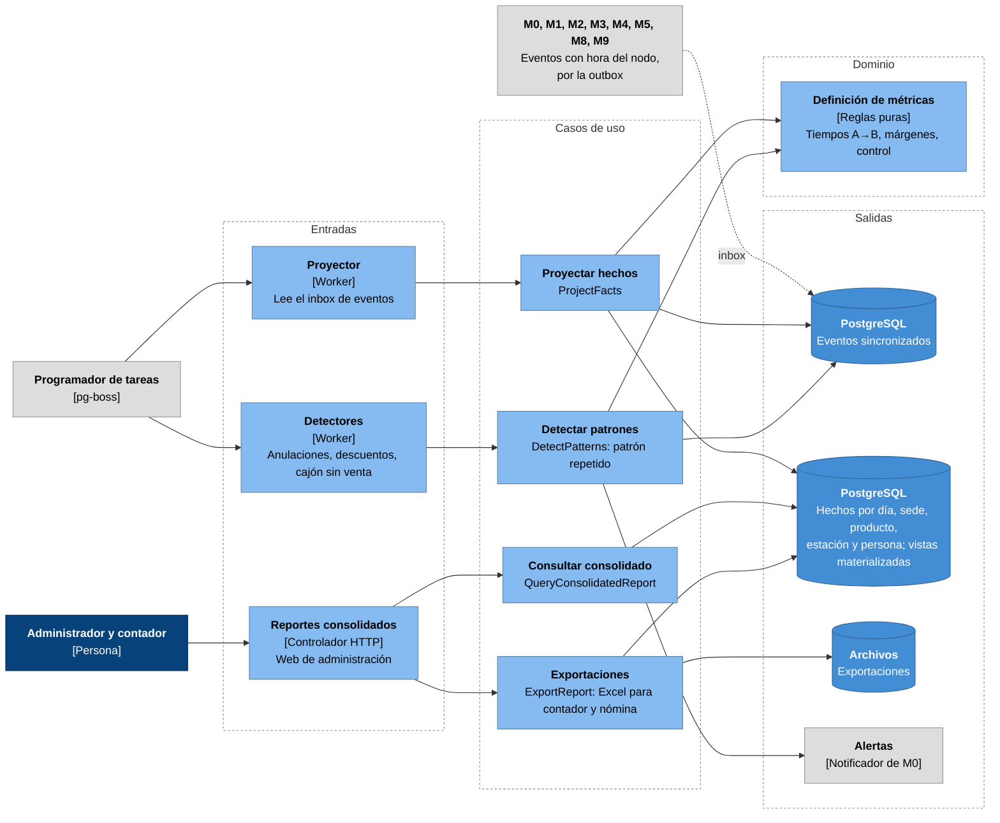

# C4 · Componentes de M6 Reportes y analítica

| Campo | Valor |
|-------|-------|
| Estado | Borrador |
| Versión | 0.3 |
| Fecha | 2026-10-17 |
| Fuentes | [Flujos M6](../../flujos/m6-reportes.md), [TRD-00 §11](../../trd/TRD-00-arquitectura-base.md) |

M6 no tiene escrituras propias de operación: lee los eventos que los demás módulos ya guardan. El nodo responde el día sin internet. La nube construye las proyecciones consolidadas y corre los detectores de comportamiento inusual.

## En la sede: reportes del día

En modo nube, esta parte corre en la API central y lee PostgreSQL.

## En la nube: proyecciones, detectores y consolidado

## Familias de reportes y su fuente

| Familia | Eventos de | Día (nodo) | Consolidado (nube) |
|---------|------------|------------|--------------------|
| Tiempos | M1, M5 | Tiempos en vivo | Por estación, producto y franja |
| Ventas y medios de pago | M2, M3 | Cierre y turno | Por sede, marca y periodo |
| Costos e inventario | M4 y costo de lo vendido en M1 | Stock y alertas | Teórico contra real, margen |
| Control | M0, M1, M2, M4 | Lo del día | Detectores y alertas |
| Personal y propinas | M8, M2 | Turno | Horas, tardanzas, ventas por hora |
| Reservas | M9 | Las del día | Ocupación, no llegadas, anticipos |
| Fiscal | M3 | Pendientes de emisión | Por contribuyente, para el contador |

## Puertos y adaptadores

| Puerto | Nube | Nodo |
|--------|------|------|
| `EventSource` | Inbox de PostgreSQL | Tablas de operación en SQLite |
| `ProjectionRepository` | Tablas de hechos y vistas materializadas; réplica de lectura cuando el volumen lo pida (TRD-01, 6) | — |
| `FileStorage` | S3, Cloud Storage o Blob Storage | — |

Una base analítica separada se evalúa solo si el volumen lo exige (TRD-00, 11).
