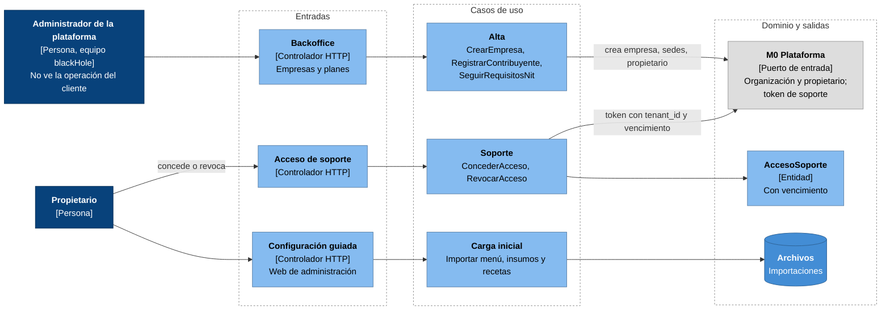
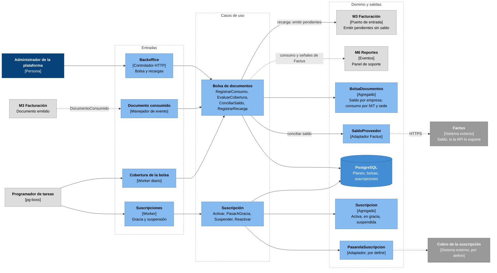

# C4 · Componentes de M7 SaaS comercial

| Campo | Valor |
|-------|-------|
| Estado | Borrador |
| Versión | 0.2 |
| Fecha | 2026-10-15 |
| Fuentes | [Flujos M7](../../flujos/m7-saas.md), [TRD-00 §8.2 y §8.4](../../trd/TRD-00-arquitectura-base.md) |

M7 vive solo en la nube: alta de empresas, configuración guiada, bolsa de documentos de Factus, suscripción y acceso de soporte. El alta y los planes los maneja el administrador de la plataforma; el soporte solo entra a una empresa con el acceso que concede su propietario (PRD-01, sección 4). El cobro de la suscripción y el efecto de una suspensión se definen en el PRD de M7 (Fase 4).

## Alta, configuración guiada y acceso de soporte

El soporte no tiene entrada propia en M7: entra a la empresa por M0 con el token vigente que concedió el propietario.

## Bolsa de documentos y suscripción

## Alertas de la bolsa

| Nivel | Condición | A quién |
|-------|-----------|---------|
| Amarilla | Saldo para 15 días o menos al ritmo de la empresa | Administrador de la empresa y soporte |
| Roja | 5 días o menos | Igual |
| Crítica | Saldo en cero: la venta sigue y la factura queda pendiente | Igual |

## Contratos con otros módulos

| Con | Mecanismo | Qué viaja |
|-----|-----------|-----------|
| M3 → M7 | Evento `DocumentoConsumido` | Empresa, NIT, sede y tipo de documento |
| M7 → M3 | Llamada en proceso al recargar | Emitir los pendientes con motivo "sin saldo" |
| M7 → M0 | Llamada en proceso | Alta de la organización; acceso de soporte |
| M7 → M6 | Eventos | Consumo y señales para renegociar con Factus |
