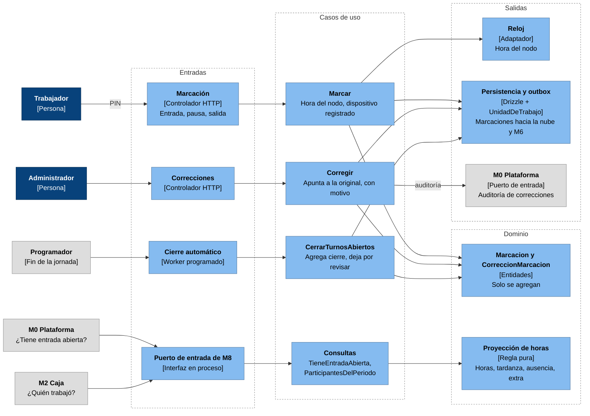
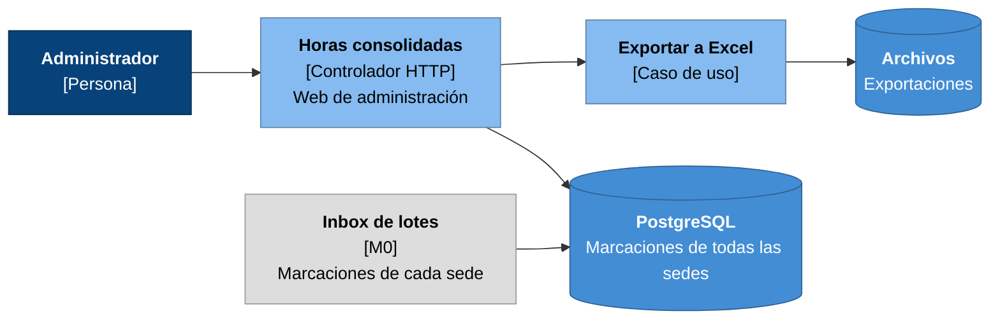

# C4 · Componentes de M8 Asistencia del personal

| Campo | Valor |
|-------|-------|
| Estado | Borrador |
| Versión | 0.2 |
| Fecha | 2026-10-15 |
| Fuentes | [Flujos M8](../../flujos/m8-asistencia.md), [TRD-00 §10.4](../../trd/TRD-00-arquitectura-base.md) |

La marcación corre en el nodo con la hora del nodo, y solo funciona dentro del local. En una sede en modo nube corre en la API central, con la hora del servidor, y se apoya en el puente para comprobar presencia; durante un corte no se marca (TRD-00, 5.0 y 10.4). Las horas son una proyección: no hay un campo que alguien edite.

## En la sede

La proyección de horas se calcula sobre las marcaciones y sus correcciones.

## En la nube

## Puertos y adaptadores

| Puerto | Nube | Nodo |
|--------|------|------|
| `RepositorioMarcaciones` | `adaptadores/postgres` | `adaptadores/sqlite` |
| `Reloj` | Hora del servidor | Hora del nodo; el celular no la pone |
| `PresenciaLocal` | Comprueba que el dispositivo llega al puente | La petición entra por la red del local |
| `AlmacenamientoArchivos` | Exportaciones | — |

## Contratos con otros módulos

| Con | Mecanismo | Qué viaja |
|-----|-----------|-----------|
| M0 → M8 | Llamada en proceso a `TieneEntradaAbierta` | Sí o no, antes de cada acción operativa si la sede lo exige |
| M2 → M8 | Llamada en proceso a `ParticipantesDelPeriodo` | Personas y horas del periodo |
| M8 → M0 | Llamada en proceso | Auditoría de correcciones |
| M8 → M6 | Eventos | Horas, tardanzas, ausencias |
