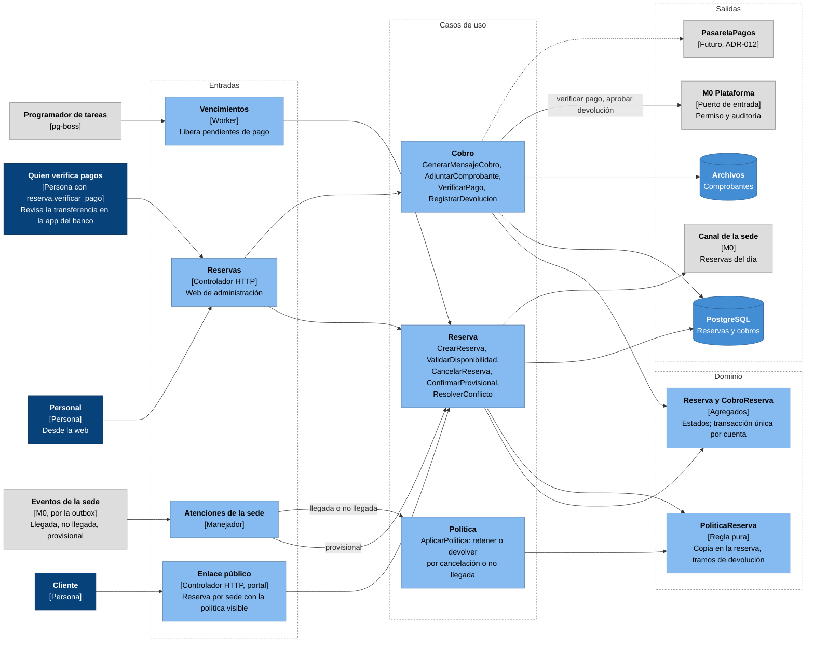
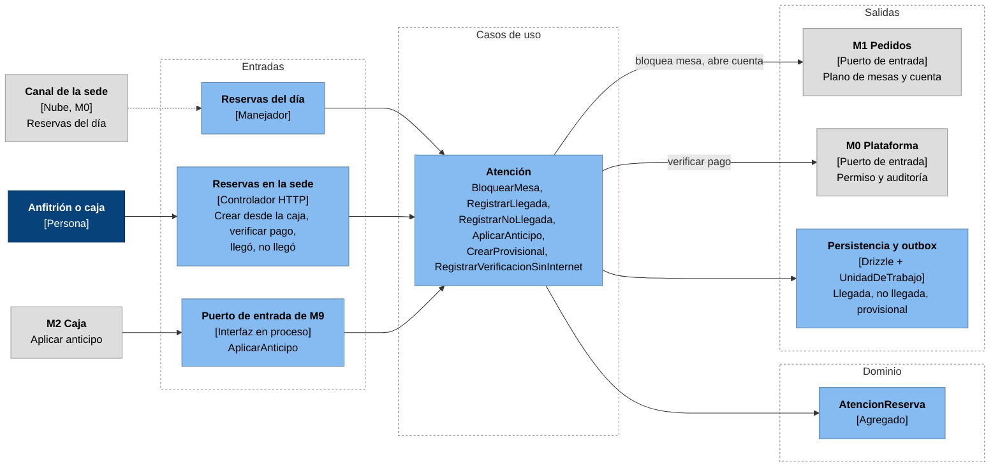

# C4 · Componentes de M9 Reservas

| Campo | Valor |
|-------|-------|
| Estado | Borrador |
| Versión | 0.2 |
| Fecha | 2026-10-15 |
| Fuentes | [Flujos M9](../../flujos/m9-reservas.md), [TRD-00 §6.2](../../trd/TRD-00-arquitectura-base.md) |

La reserva y su cobro son de la nube, porque pueden nacer fuera del local. Lo que pasa en el salón el día de la reserva (llegada, mesa, no llegada) es del nodo; en una sede en modo nube también es de la nube. El cobro es una transferencia que el personal verifica en la app del banco (ADR-012).

## En la nube: dueña de Reserva y CobroReserva

Una cancelación de la reserva también pasa por la política, que decide si se retiene o se devuelve el anticipo.

## En la sede: dueña de AtencionReserva

En modo nube, esta parte corre en la API central.

Con internet, una reserva creada desde la caja sube y la nube valida la disponibilidad. Sin internet, la caja crea una reserva provisional en el nodo y la verificación de un pago también se registra en el nodo. Las dos suben al reconectar; la nube confirma la provisional o marca un conflicto de disponibilidad para que el administrador lo resuelva.

## Puertos y adaptadores

| Puerto | Nube | Nodo |
|--------|------|------|
| `RepositorioReservas` | `persistencia-postgres` | Copia de las reservas del día |
| `RepositorioAtenciones` | Copia | `persistencia-sqlite` |
| `AlmacenamientoArchivos` | Comprobantes de pago y de devolución | — |
| `PasarelaPagos` | No se usa en el piloto. Una pasarela futura entra como otro adaptador (ADR-012) | — |

## Contratos con otros módulos

| Con | Mecanismo | Qué viaja |
|-----|-----------|-----------|
| M9 → M1 | Evento `ReservasDelDia` y llamada en la llegada | Mesa bloqueada; mesa y cuenta asociadas |
| M2 → M9 | Llamada en proceso a `AplicarAnticipo` | Anticipo como medio de pago; no entra al arqueo de efectivo |
| M9 → M3 | En el documento de venta | El anticipo viaja como `prepayment_details` |
| M9 → M0 | Llamada en proceso | Permiso para verificar pagos y aprobar devoluciones |
| M9 → M6 | Eventos | Ocupación, no llegadas, anticipos retenidos |
