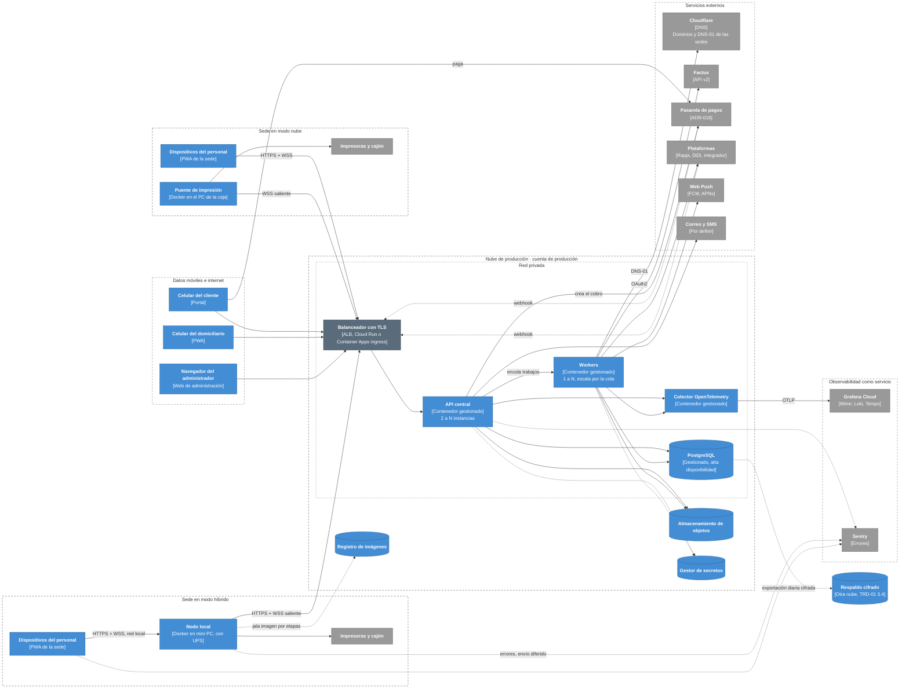
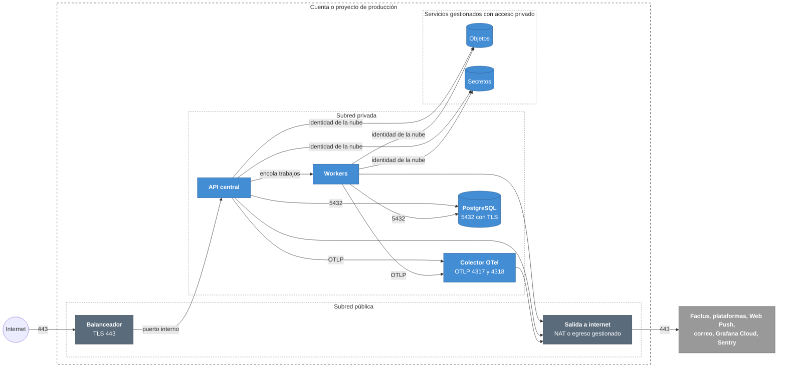
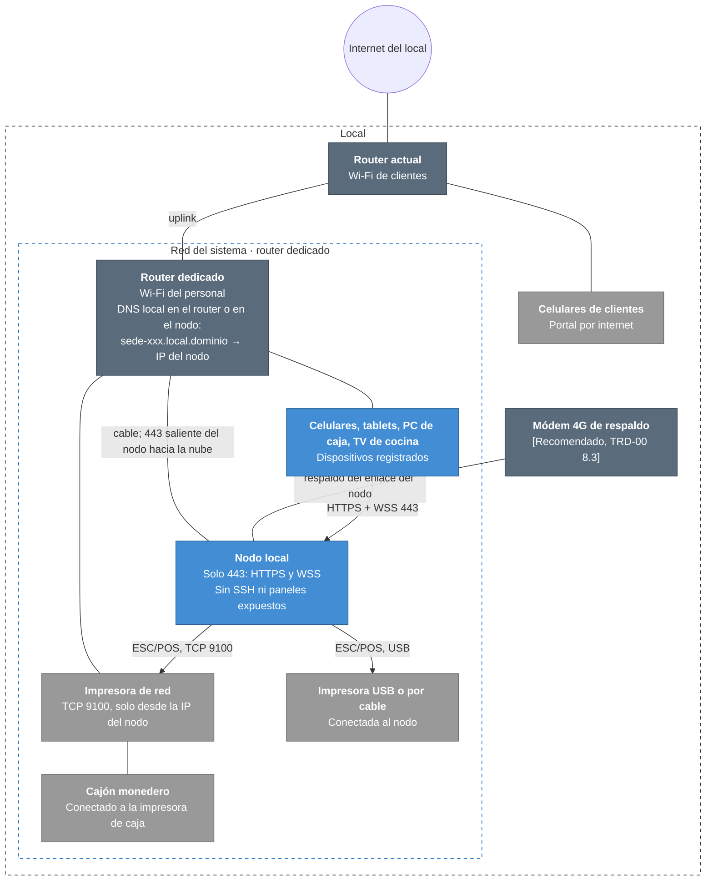
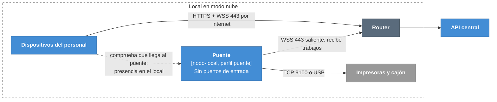
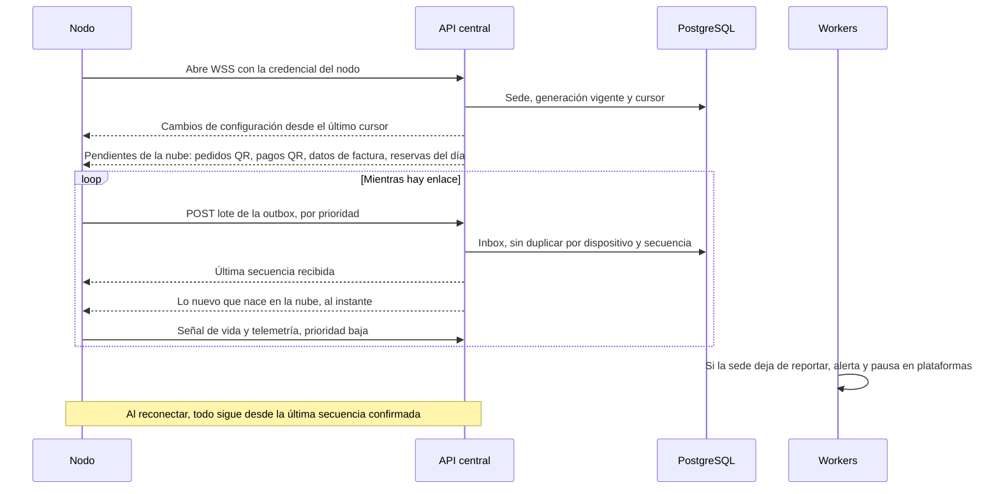
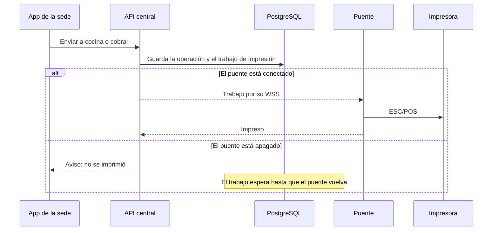
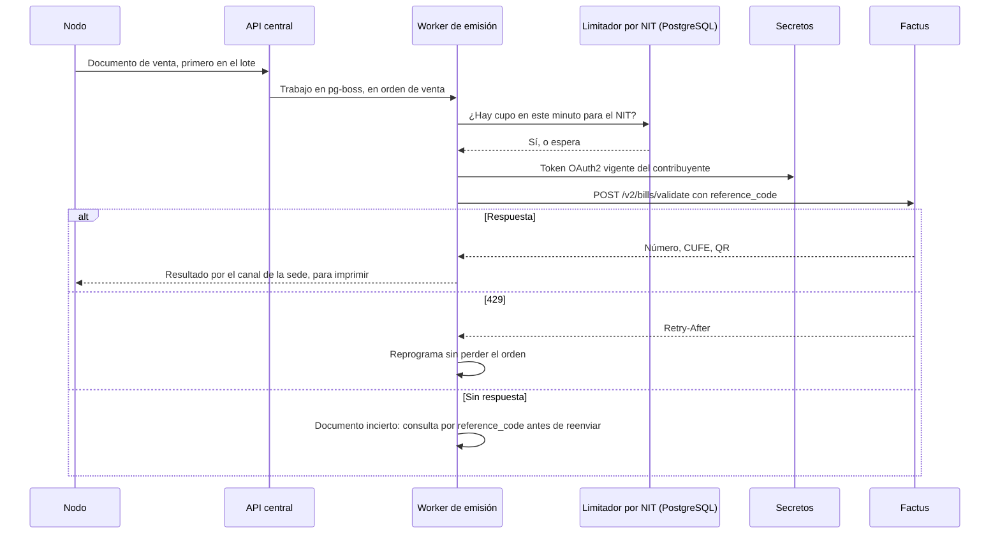
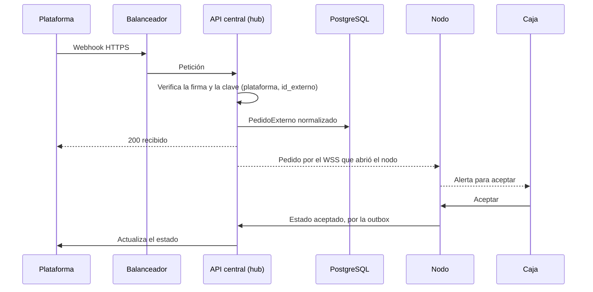
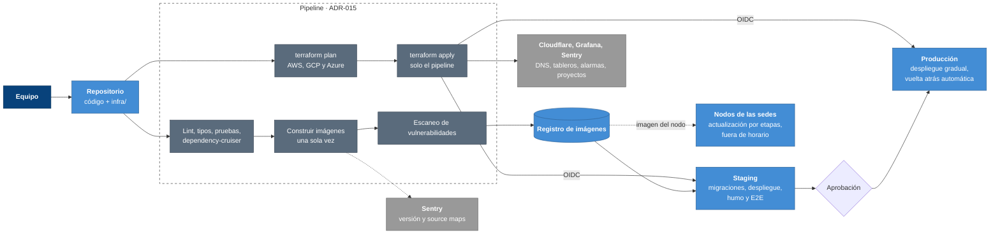
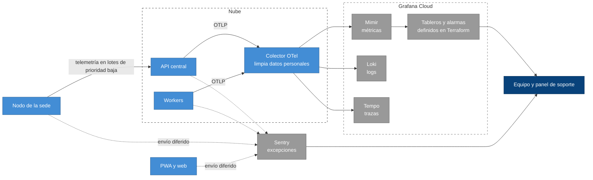

# Infraestructura y comunicación

| Campo | Valor |
|-------|-------|
| Estado | Borrador |
| Versión | 0.2 |
| Fecha | 2026-10-15 |
| Fuentes | [TRD-00 §5, §7, §10.1.2 y §13](../trd/TRD-00-arquitectura-base.md), [TRD-01](../trd/TRD-01-infraestructura-y-operacion.md) |

Vista de despliegue de C4: en qué máquinas y redes corre cada contenedor, por qué protocolo se habla cada par y **quién abre la conexión**. Esa última pregunta importa porque ninguna sede abre puertos en su router: todo lo que baja de la nube a la sede viaja por una conexión que la sede abrió.

## 1. Despliegue general

La nube de producción sale de ADR-005. Los nombres de servicio de cada proveedor están en TRD-01, sección 3.1; aquí se usan los genéricos.

## 2. Red de la nube

Reglas (TRD-01, sección 9):

- Solo el balanceador recibe tráfico de internet. PostgreSQL y los archivos solo se alcanzan desde la red privada.
- Los servicios usan identidades de la nube con permisos mínimos. No hay llaves en las imágenes ni en el repositorio.
- Staging vive en otra cuenta o proyecto, sin red ni credenciales compartidas con producción.
- El tiempo real entre instancias de la API se reparte con `LISTEN/NOTIFY` de PostgreSQL: un mensaje que llega a una instancia alcanza a los WebSocket abiertos en las demás.

## 3. Red de la sede híbrida

El diseño asume que cualquier cliente puede estar en la misma red que el nodo (TRD-00, 10.1.2). Por eso el kit recomienda un router dedicado del sistema (ADR-006).

| Protección | Cómo |
|------------|------|
| HTTPS dentro del local | Certificado real de `sede-xxx.local.dominio`, emitido en la nube por DNS-01 en Cloudflare, instalado y renovado en el nodo en cada conexión (ADR-003, opción A) |
| Dispositivo sin registrar | El nodo solo responde la pantalla de registro, y solo con un QR vigente de un solo uso |
| Peticiones | Firmadas con la llave ECDSA no exportable de cada dispositivo, más PIN y sesión corta |
| Impresoras | En la red del sistema, con reglas que solo dejan llegar al nodo, o por USB o cable |
| Aislamiento de clientes | Si el router actual lo tiene activo en la red del personal, los celulares no llegan al nodo. Se revisa en la visita técnica |
| Si no hay router dedicado | Aislamiento de clientes y reglas en el router actual, validado sede por sede (TRD-00, 10.1.2, opción 3) |

## 4. Sede en modo nube

No hay nodo. Los dispositivos van por internet a la API central. El puente, si existe, es el único programa en el local.

Si el puente está apagado, el trabajo espera en la nube y la pantalla avisa que no se imprimió. Una sede sin ningún equipo local acepta que un dispositivo registrado y con PIN opere desde donde tenga internet, hasta que se revoque (TRD-00, 5.0).

## 5. Matriz de comunicación

"Inicia" es quien abre la conexión. Todas las conexiones van cifradas con TLS, salvo ESC/POS hacia la impresora, que no lo soporta y se protege con la red.

| # | Origen | Destino | Protocolo y puerto | Inicia | Autenticación | Modo |
|---|--------|---------|--------------------|--------|---------------|------|
| 1 | App de la sede | Nodo | HTTPS + WSS 443, red local | Dispositivo | Certificado de la sede; firma ECDSA del dispositivo; PIN | Híbrido |
| 2 | App de la sede | API central | HTTPS + WSS 443 | Dispositivo | Firma ECDSA del dispositivo; PIN; presencia por el puente | Nube |
| 3 | Nodo | API central | HTTPS 443: lotes de la outbox, comprimidos y reanudables | Nodo | Credencial del nodo, limitada a su sede | Híbrido y bodega |
| 4 | Nodo | API central | WSS 443: configuración, pedidos QR, pagos QR, pedidos externos, reservas | Nodo (la nube empuja por esa conexión) | Credencial del nodo | Híbrido y bodega |
| 5 | Puente | API central | WSS 443: trabajos de impresión | Puente | Credencial del puente | Nube |
| 6 | Nodo o puente | Impresora | ESC/POS por TCP 9100, o USB | Nodo o puente | Ninguna en la impresora: aislamiento de red | Ambos |
| 7 | Dispositivo de la sede | DNS local (router o nodo) | DNS 53, red local | Dispositivo | — | Híbrido |
| 8 | Web de administración | API central | HTTPS 443 | Navegador | Better Auth, segundo factor opcional | Ambos |
| 9 | Portal de clientes | API central | HTTPS 443 | Celular del cliente | Token firmado de un solo propósito; límite por token e IP; captcha; código de un solo uso para datos guardados | Ambos |
| 10 | API central → pasarela, y celular del cliente → pasarela | Pasarela | HTTPS 443 | La API crea el cobro por el saldo; el celular paga en la pasarela | Credencial del comercio en el gestor de secretos; la del proveedor para el cliente | Ambos |
| 11 | Pasarela | API central | HTTPS 443, webhook | Pasarela | Firma del webhook; idempotente por referencia | Ambos |
| 12 | App del domiciliario | API central | HTTPS + WSS 443 | Celular | Dispositivo registrado | Ambos |
| 13 | App del domiciliario | Nodo | HTTPS 443, Wi-Fi de la sede | Celular | Dispositivo registrado | Híbrido, durante un corte |
| 14 | Plataformas | API central | HTTPS 443, webhook | Plataforma | Firma del webhook; clave `(plataforma, id_externo)` | Ambos |
| 15 | Workers | Plataformas | HTTPS 443 | Worker | Credenciales cifradas por tienda | Ambos |
| 16 | Workers | Factus | HTTPS 443 | Worker | OAuth2 por contribuyente, token de 60 minutos; 80 solicitudes por minuto por NIT | Ambos |
| 17 | Balanceador | API central | HTTP, puerto interno, red privada | Balanceador | Red privada | — |
| 18 | API y workers | PostgreSQL | TCP 5432 con TLS | Servicio | Credencial en el gestor de secretos; `tenant_id` fijado por transacción para RLS | — |
| 19 | API y workers | Objetos y secretos | HTTPS, API del proveedor | Servicio | Identidad de la nube; enlaces firmados con vencimiento para descargar | — |
| 20 | Workers | Web Push | HTTPS 443 | Worker | VAPID | Ambos |
| 21 | API | Correo y SMS | HTTPS 443 | API | Llave en el gestor de secretos | Ambos |
| 22 | Workers | Cloudflare | HTTPS 443, API de DNS | Worker | Token de API con alcance a la zona | Híbrido (certificados de sede) |
| 23 | API, workers | Colector OTel | OTLP gRPC 4317 o HTTP 4318 | Servicio | Red privada | — |
| 24 | Colector OTel | Grafana Cloud | OTLP sobre HTTPS 443 | Colector | Token de Grafana Cloud | — |
| 25 | API, workers, nodo, PWA | Sentry | HTTPS 443 | SDK | DSN del proyecto; envío diferido sin internet | Ambos |
| 26 | Nodo | Registro de imágenes | HTTPS 443 | Nodo | Credencial de solo lectura | Actualización por etapas, fuera de horario |
| 27 | Pipeline | Nube | HTTPS, API del proveedor | Pipeline | OIDC de corta duración | — |
| 28 | Respaldo | Otra nube | HTTPS 443 | Tarea programada | Identidad de la otra nube; copia cifrada | — |

El nodo no habla con Grafana: sus métricas y logs viajan como lotes de prioridad baja dentro del canal 3, y la nube los entrega al colector (TRD-01, 7.2).

## 6. Canales críticos

### 6.1 Conexión del nodo con la nube

El nodo abre las dos conexiones. Así la nube puede empujar pedidos QR, pagos y pedidos de plataformas sin abrir puertos en el router del local.

Cada escritura lleva la generación de la sede. Si la generación cambió (por ejemplo, la sede volvió a nube), la nube rechaza los lotes del dueño anterior y el administrador concilia (TRD-00, 5.0).

### 6.2 Orden del enlace de la sede

Cuando el internet de la sede es débil o vuelve después de un corte, lo que sube sale en este orden (TRD-00, 5.5; TRD-01, 2):

1. Documentos DIAN y pagos QR confirmados.
2. Pedidos QR.
3. Auditoría.
4. Ventas y caja.
5. Inventario.
6. Telemetría (métricas y logs). Si se llena su espacio en el nodo, se descartan los más viejos de menor severidad.

Los errores para Sentry van por su propio SDK, con tamaño máximo y envío diferido.

### 6.3 Impresión en modo nube

### 6.4 Emisión ante Factus

El límite por NIT vive en PostgreSQL y lo comparten todas las instancias de workers. Más workers no facturan más rápido (TRD-01, 6).

### 6.5 Pedido de plataforma hasta la cocina

## 7. Despliegue continuo e infraestructura como código

- La misma imagen pasa por staging y producción.
- La API de la nube acepta el contrato de sincronización de la versión actual y la anterior, porque los nodos se actualizan después (TRD-01, 5.3).
- Una vez al mes, staging se levanta desde cero en las dos nubes que no son de producción, con un respaldo restaurado (TRD-01, 5.4).

## 8. Observabilidad

Las métricas, tableros y alarmas están en TRD-01, sección 7. Las trazas siguen una petición de la PWA al nodo, a la nube y a Factus con el mismo identificador.

## 9. Pendientes que cambian estos diagramas

| Pendiente | Qué cambia |
|-----------|------------|
| ADR-003 | Si el spike de HTTPS local no valida la opción A, cambia el canal 1 y la red de la sede |
| ADR-005 | Nombres concretos de los servicios en la nube de producción |
| ADR-006 | Si el kit incluye o no el router dedicado en cada sede |
| ADR-015 | Servicio del pipeline |
| ADR-016 | Pasarela del pago QR: canales 10 y 11 |
| Por definir | Proveedor de correo y SMS (canal 21); cómo se sirven las PWA estáticas desde la nube |
