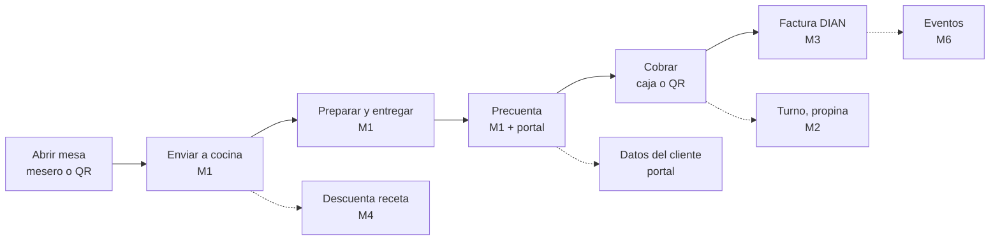
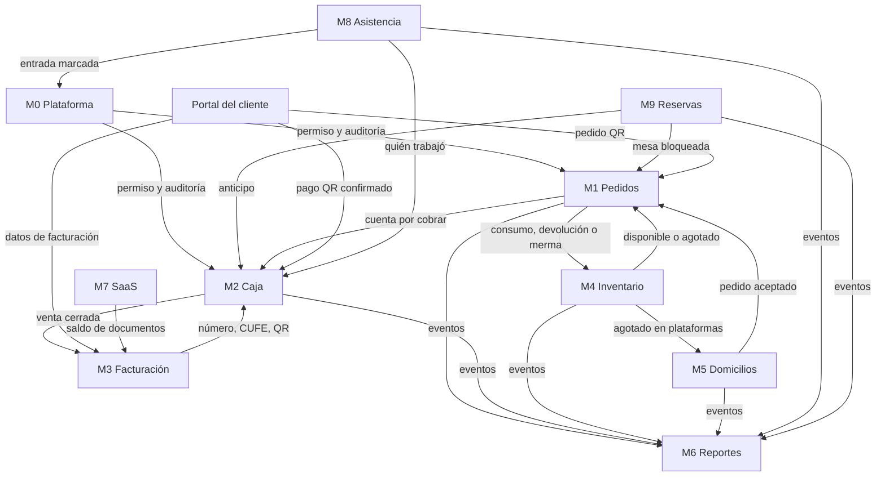

# Flujos

| Campo | Valor |
|-------|-------|
| Estado | Borrador |
| Versión | 0.2 |
| Fecha | 2026-10-15 |
| Fuentes | [PRD-00](../prd/PRD-00-vision-producto.md), [PRD-01](../prd/PRD-01-roles-y-permisos.md), [TRD-00](../trd/TRD-00-arquitectura-base.md) |

Diagramas de cada funcionalidad y de los puntos en los que una sección le entrega trabajo a otra. Describen el comportamiento ya acordado en los documentos maestros. Si un diagrama y un maestro no coinciden, manda el maestro.

## Cómo leerlos

1. Empieza por el recorrido de una venta, más abajo. Es el camino que cruza casi todos los módulos.
2. Abre el archivo del módulo que quieras ver en detalle.
3. Cuando una acción es sensible (anular, descontar, ajustar inventario), el permiso y la auditoría salen de [M0](m0-plataforma.md).

Cada archivo trae tres piezas: el camino principal, la tabla de conexiones con otros módulos y los estados de lo que ese módulo posee.

## Recorrido de una venta en mesa

M5 entra en este mismo camino cuando el pedido es de domicilio o de plataforma. M9 entra cuando la mesa venía de una reserva y el anticipo se abona al cobrar. M8 entra si la sede exige entrada marcada para operar, y otra vez al repartir propinas.

## Quién le entrega qué a quién

| De | A | Qué entrega | En qué momento |
|----|---|-------------|----------------|
| M0 | Operación | Permiso, alcance y evento de auditoría | En cada acción, y siempre en las sensibles |
| M8 | M0 | Entrada marcada | Antes de operar, si la sede activó la regla |
| M1 | M4 | Consumo según receta, en el inventario del punto | Al enviar el producto a cocina |
| M1 | M4 | Devolución del consumo | Si se anula antes de que cocina empiece |
| M1 | M4 | Merma con motivo | Si se anula después de empezar, o si una plataforma cancela un pedido ya empezado |
| M4 | M1 | Disponible, pocas unidades o agotado. Si confirman que hoy no se repone, aviso al mesero de cada mesa que ya lo pidió | Cuando cambia el stock del punto, y al marcar que no hay reposición en el servicio |
| M4 | M5 | Agotado o disponible en cada plataforma | El mismo cambio de stock, a través del hub |
| M5 | M1 | Pedido interno | Al crear un domicilio propio o al aceptar uno de plataforma |
| M9 | M1 | Mesa bloqueada; al llegar, mesa y cuenta asociadas | El día de la reserva |
| M9 | M2 | Anticipo como medio de pago | Al cobrar la cuenta |
| M1 | M2 | Cuenta visible en tiempo real | Desde que se abre la mesa |
| M2 | M3 | Documento de venta | Al cerrar la venta |
| M3 | M2 | Número, CUFE y QR, o comprobante si no hay internet | Al validar en Factus, o al dejar la factura pendiente |
| Portal | M1 | Pedido de la mesa, canal QR mesa | Al enviar desde el celular del cliente. Si la sede está en un corte, al reconectar |
| Portal | M2 | Pago confirmado por la pasarela, con propina | Cuando la pasarela avisa. Si la sede está en un corte, al reconectar |
| Portal | M3 | Datos de facturación de esa cuenta | Antes de emitir; si llegan tarde y la factura ya salió, aplica la refacturación |
| M8 | M2 | Personas que trabajaron en el periodo | Al liquidar propinas |
| M1, M2, M4, M5, M8, M9 | M6 | Eventos con hora | En cada cambio de estado |
| M7 | M3 | Saldo de la bolsa de documentos | Al emitir; si se agota, la venta sigue y la factura queda pendiente |

## Dónde vive cada flujo

Dentro del local, mesero, cocina, caja, inventario del punto, asistencia e impresión hablan con el **nodo**. La nube recibe copias, emite ante Factus, atiende el portal del cliente y recibe los pedidos de las plataformas. El detalle de dueños y de sincronización está en [M0](m0-plataforma.md). Los componentes de cada módulo y los canales de red están en [Arquitectura](../arquitectura/README.md).

## Índice

| Módulo | Archivo | Flujos que contiene |
|--------|---------|---------------------|
| M0 Plataforma | [m0-plataforma.md](m0-plataforma.md) | Ingreso, dispositivos, autorización, dueños de datos, sincronización |
| M1 Pedidos y salón | [m1-pedidos-y-salon.md](m1-pedidos-y-salon.md) | Mesa, cocina, pedido por QR, anulación, precuenta |
| M2 Caja | [m2-caja.md](m2-caja.md) | Turno, cobro, pago por QR, arqueo, propinas |
| M3 Facturación | [m3-facturacion.md](m3-facturacion.md) | Emisión, portal, envío cortado, refacturación |
| M4 Inventario | [m4-inventario.md](m4-inventario.md) | Receta, traslados, producción, alertas |
| M5 Domicilios | [m5-domicilios.md](m5-domicilios.md) | Domicilio propio, plataformas, conciliación |
| M6 Reportes | [m6-reportes.md](m6-reportes.md) | Qué evento alimenta cada familia de métricas |
| M7 SaaS | [m7-saas.md](m7-saas.md) | Alta, bolsa de documentos, suscripción |
| M8 Asistencia | [m8-asistencia.md](m8-asistencia.md) | Marcación, corrección, efecto en operación y propinas |
| M9 Reservas | [m9-reservas.md](m9-reservas.md) | Reserva con cobro, llegada, no llegada, anticipo |
