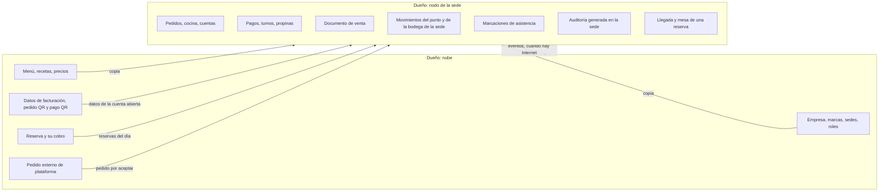
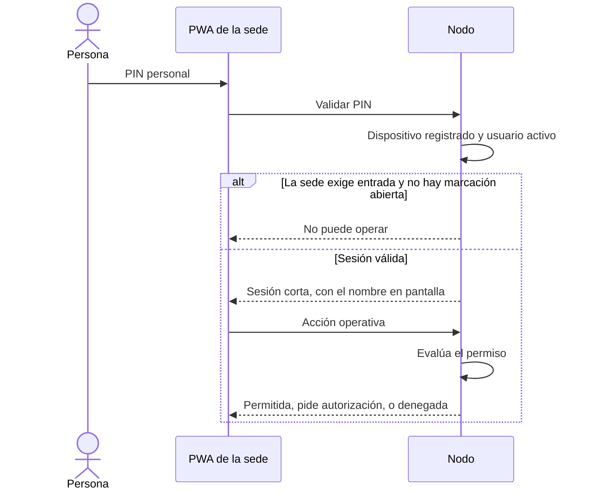
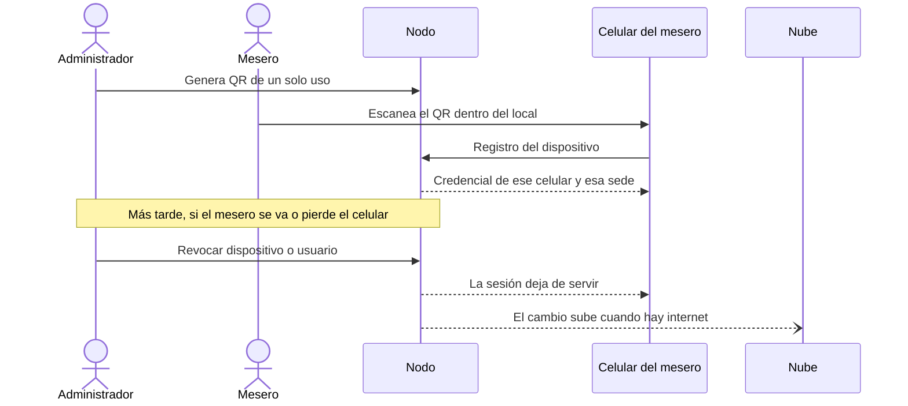
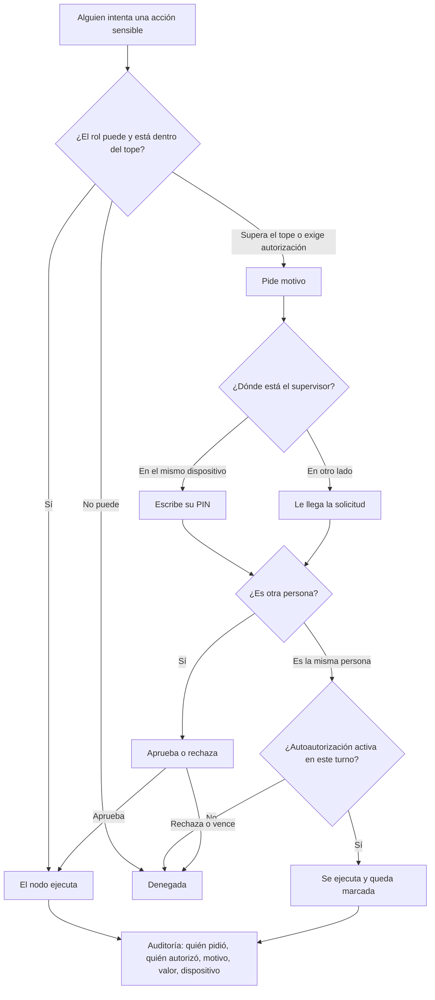
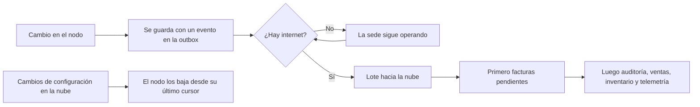

# Flujos · M0 Plataforma

| Campo | Valor |
|-------|-------|
| Estado | Borrador |
| Versión | 0.2 |
| Fecha | 2026-10-14 |
| Fuentes | [PRD-01](../prd/PRD-01-roles-y-permisos.md), [TRD-00 §5 y §10](../trd/TRD-00-arquitectura-base.md) |

M0 es la base que los demás módulos usan: quién entra, en qué dispositivo, qué puede hacer y qué queda registrado. También define el modo de cada sede y quién es el dueño de cada dato.

## Cómo se conecta

| Con | Qué pasa |
|-----|----------|
| Todos | Cada acción pasa por el permiso. Las sensibles dejan auditoría. |
| M8 | Si la sede lo configura, sin entrada marcada no hay acciones operativas. |
| Nube | En modo nube, la nube es la operación. En híbrido, la configuración (empresa, roles, menú) baja al nodo y la operación sube. |

## Modo de la sede

Cada sede nace en **nube**. Un administrador puede **activar el híbrido** para esa sede. El detalle del emparejamiento, la vuelta a nube y el puente de impresión está en [TRD-00, sección 5.0](../trd/TRD-00-arquitectura-base.md).

| Modo | La PWA del salón habla con | Un corte de internet |
|------|----------------------------|----------------------|
| Nube | La API central | Detiene el salón |
| Híbrido | El nodo, dentro de la red del local | El salón sigue. Al reconectar se sincroniza |

Solo hay un dueño de la operación a la vez. Activar o apagar el híbrido cambia ese dueño y sube un número de generación. El sitio anterior deja de aceptar escrituras nuevas.

## Dueños de los datos

Solo el dueño crea o modifica el dato. El otro lado recibe una copia. El diagrama de abajo es el **modo híbrido**. En modo nube, lo que aquí es del nodo es de la nube y no hay copia.

La bodega general tiene su propio nodo y es dueña de sus movimientos. Un traslado entre dos nodos se parte en dos mitades: salida en el origen y entrada en el destino. El detalle está en [M4](m4-inventario.md).

## Ingreso en un dispositivo de la sede

La administración web entra con correo y contraseña en la nube. El celular del mesero solo habla con el nodo, dentro de la red del local, y no guarda datos del negocio.

## Registro y revocación de un celular

Un celular en la misma red, sin registro y sin PIN, no opera. El nodo no responde nada útil a un dispositivo sin registrar, salvo la pantalla de registro con un QR vigente.

## Autorización en el momento

La usan M1, M2, M4 y M9 cuando la matriz de [PRD-01](../prd/PRD-01-roles-y-permisos.md) marca la acción con tope o con autorización.

Nadie autoriza su propia acción, salvo que el administrador haya activado la autoautorización para ese turno. Cada uso de esa excepción genera una alerta.

## Sincronización

En modo híbrido, la operación del local no espera a la nube. Lo que sí espera conexión: emitir ante la DIAN, ver la sede desde afuera, reportes consolidados, cambios de menú hechos en la web, pedidos de plataformas y reservas hechas en el enlace público. En modo nube, todo el salón espera conexión.
