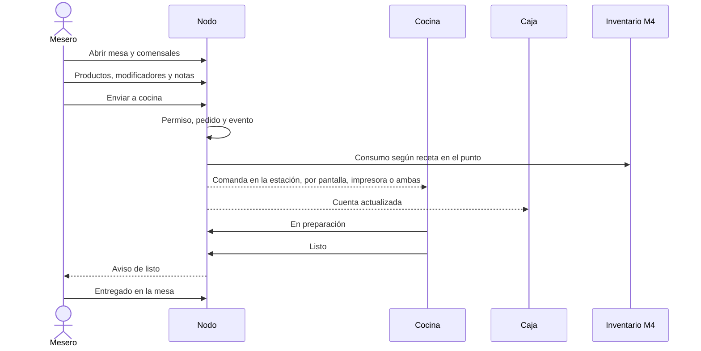
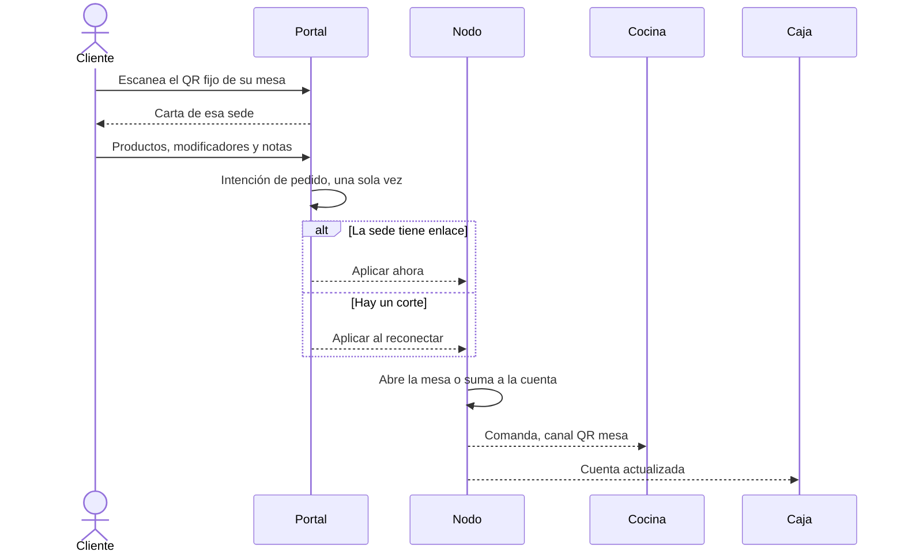
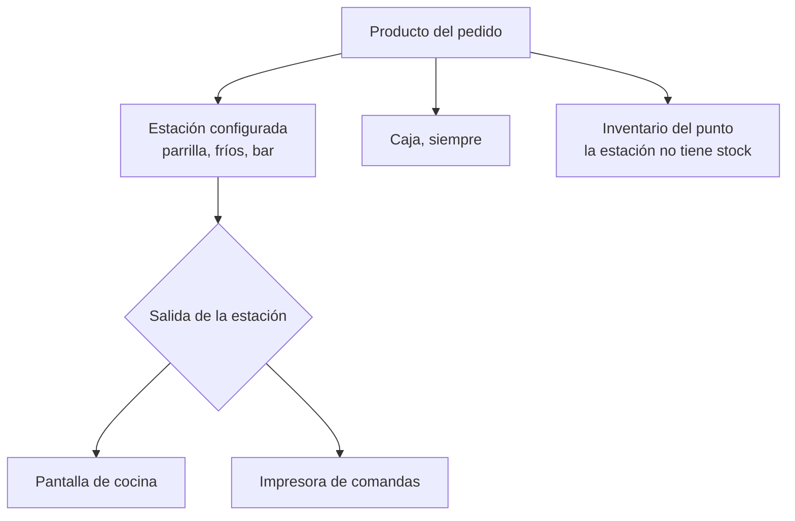
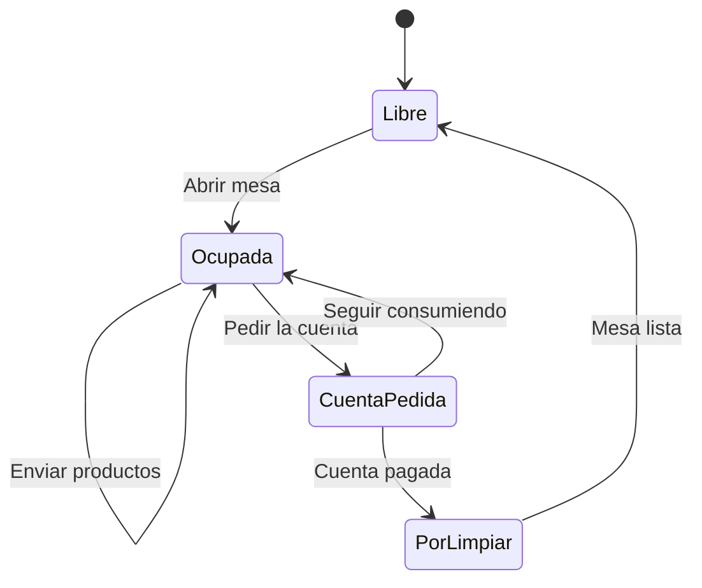
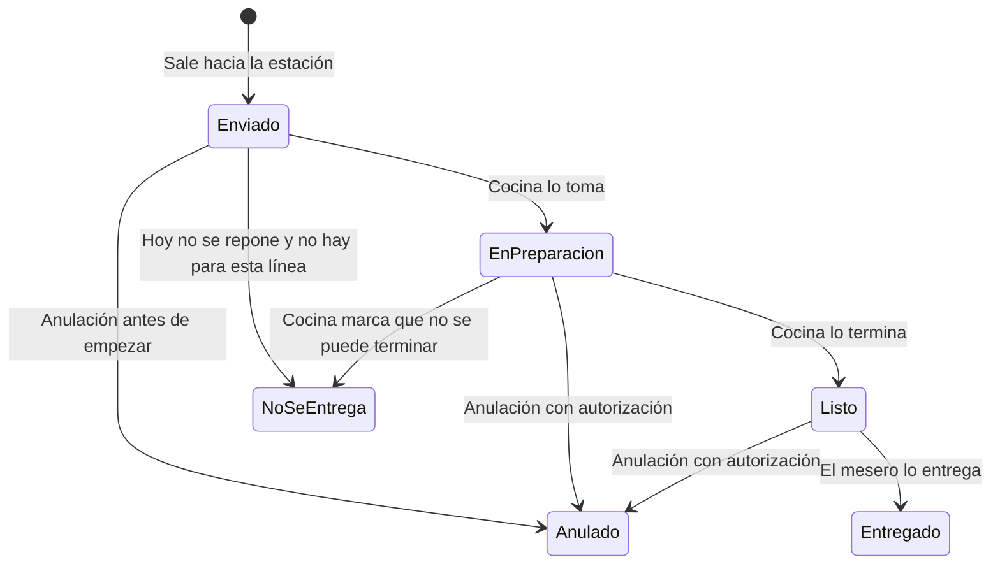
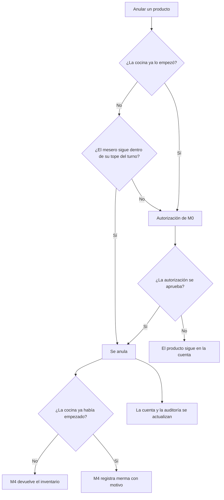
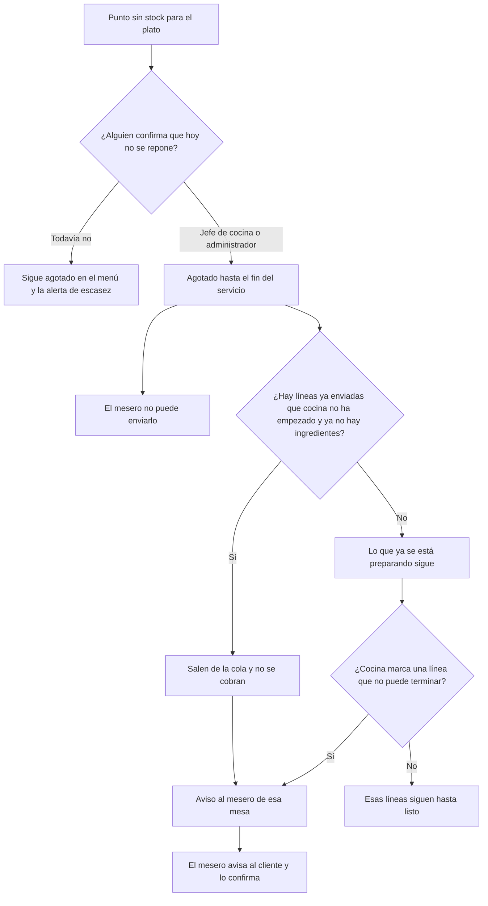
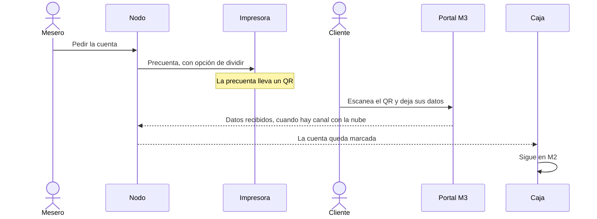

# Flujos · M1 Pedidos y salón

| Campo | Valor |
|-------|-------|
| Estado | Borrador |
| Versión | 0.2 |
| Fecha | 2026-10-15 |
| Fuentes | [PRD-00 §6.1 y M1](../prd/PRD-00-vision-producto.md), [TRD-00 §6](../trd/TRD-00-arquitectura-base.md) |

El mesero toma el pedido en el celular, o el cliente lo envía desde el QR de su mesa. El nodo lo guarda, lo reparte por estación de cocina, lo muestra en la caja y descuenta la receta. El pedido del mesero ocurre dentro del local. El del QR nace en la nube y el nodo lo aplica al instante, o al reconectar si hay un corte.

## Cómo se conecta

| Con | Qué pasa |
|-----|----------|
| M0 | El nodo valida el permiso antes de abrir mesa, anular, descontar o transferir. |
| M4 | Al enviar a cocina descuenta la receta. M4 le devuelve si el plato está agotado. |
| M2 | La cuenta se ve en la caja desde que existe. Pedir la cuenta abre el cobro. |
| M3 | La precuenta lleva el QR del portal de facturación. |
| Portal | El QR fijo de la mesa crea o amplía la cuenta. El canal es QR mesa. |
| M5 | Un domicilio o un pedido de plataforma, una vez aceptado, entra como pedido de esta sección. |
| M8 | Sin entrada marcada no se opera, si la sede lo exige. |
| M9 | La reserva bloquea la mesa y, al llegar el cliente, se asocia a la cuenta. |
| M6 | Cada cambio de estado guarda su hora. |

## Pedido en mesa

Si la impresora de comandas falla, la comanda sigue en la pantalla y se avisa a la caja. Un pedido puede enviarse por tiempos: primero entradas, después fuertes. Reenviar un producto vuelve a enrutar solo ese producto.

## Pedido desde el QR de la mesa

El cliente no anula, no descuenta y no cambia precios. Por defecto la comanda sale directo. Si la sede configuró aceptación en caja, la cocina la ve después de que la caja acepta. Al aplicar un pedido que esperó durante un corte, el nodo usa la disponibilidad de ese momento: si el plato ya no se puede enviar, no entra a cocina.

## A dónde va cada producto

El menú y las recetas son de la marca. La sede ajusta precio, disponibilidad y horario. La disponibilidad automática (agotado o pocas unidades) usa solo el inventario del punto. Si no alcanza, el plato se muestra agotado. La cuenta igual se puede cobrar: un faltante de conteo no detiene el servicio. Si alguien confirma que **hoy no se repone**, ese plato deja de enviarse y las mesas que ya lo pidieron reciben el aviso de abajo.

## Estados de la mesa

Mover una mesa, unir mesas o pasar productos entre cuentas ocurre mientras la mesa sigue ocupada. Esas acciones pasan por el permiso de M0.

## Estados de un producto en cocina

Cada flecha guarda la hora. Con esas horas se arman los tiempos de toma, espera, preparación, entrega y duración de la mesa.

## Anulación de un producto

Anular la cuenta completa, una cortesía, un descuento sobre el tope o un cambio de precio siguen la misma autorización. La matriz está en [PRD-01](../prd/PRD-01-roles-y-permisos.md).

## No se repone hoy

El plato no va a salir en este servicio. El aviso le llega al mesero de la mesa, no solo a la cocina, para que el cliente no se quede esperando.

El sistema propone la marca cuando el punto no alcanza, las bodegas que abastecen tampoco y no hay un traslado en camino. Hasta esa confirmación no se retiran platos de las mesas. Lo ya entregado, listo o en preparación no se toca, salvo que cocina marque esa línea. Si no habían empezado, [M4](m4-inventario.md) devuelve el inventario. Si ya habían empezado, queda como merma. En un pedido de plataforma, la caja avisa al canal.

## Pedir la cuenta

Dividir la cuenta (por comensal, por productos o en partes iguales) ocurre aquí y se cobra en [M2](m2-caja.md). El QR se genera en el nodo, así la precuenta se imprime aunque la sede esté sin internet. El cliente llena el portal con sus propios datos móviles.
