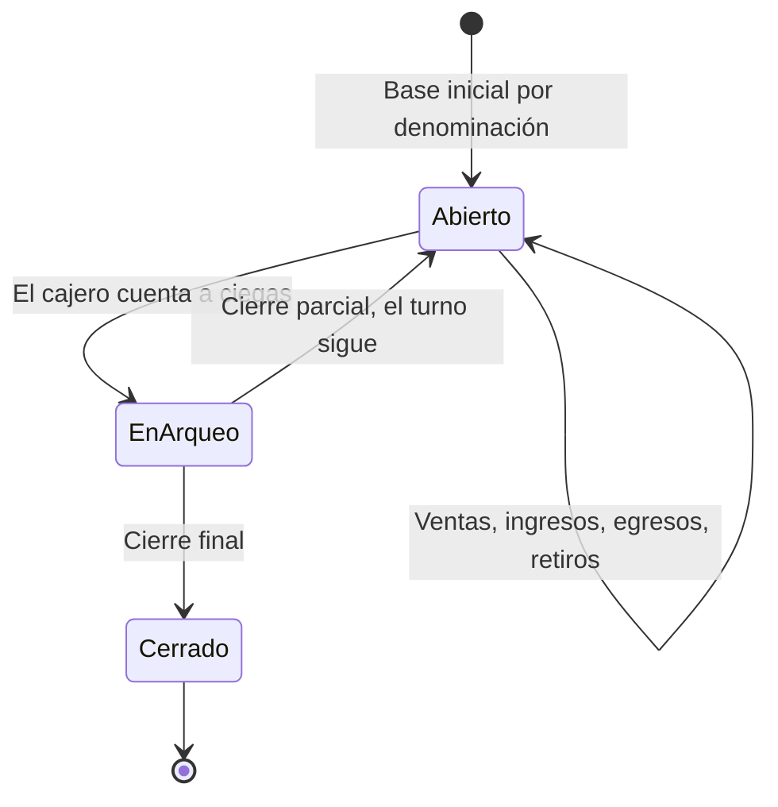
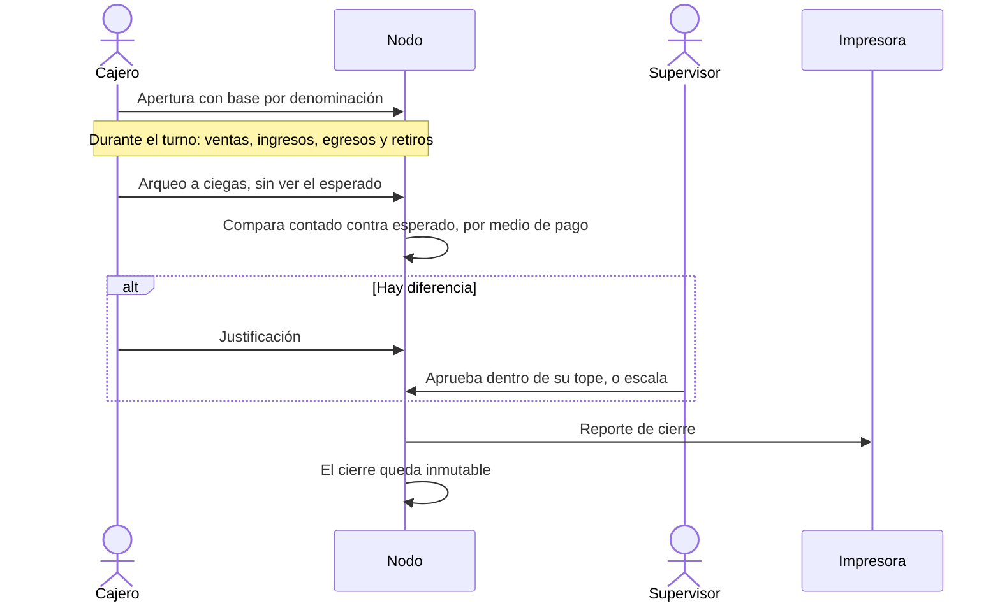
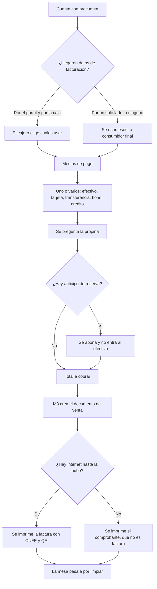
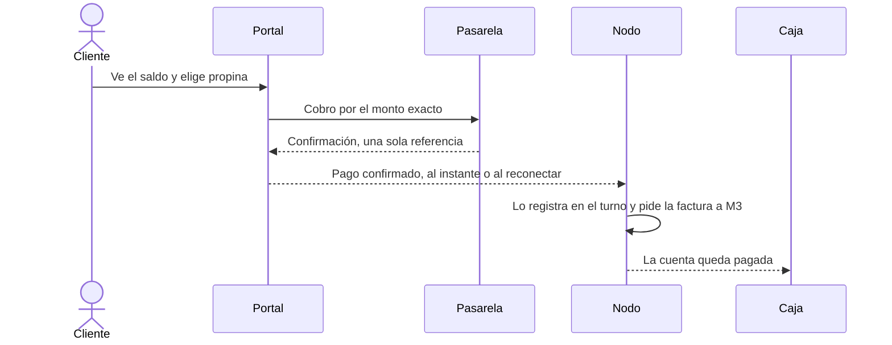
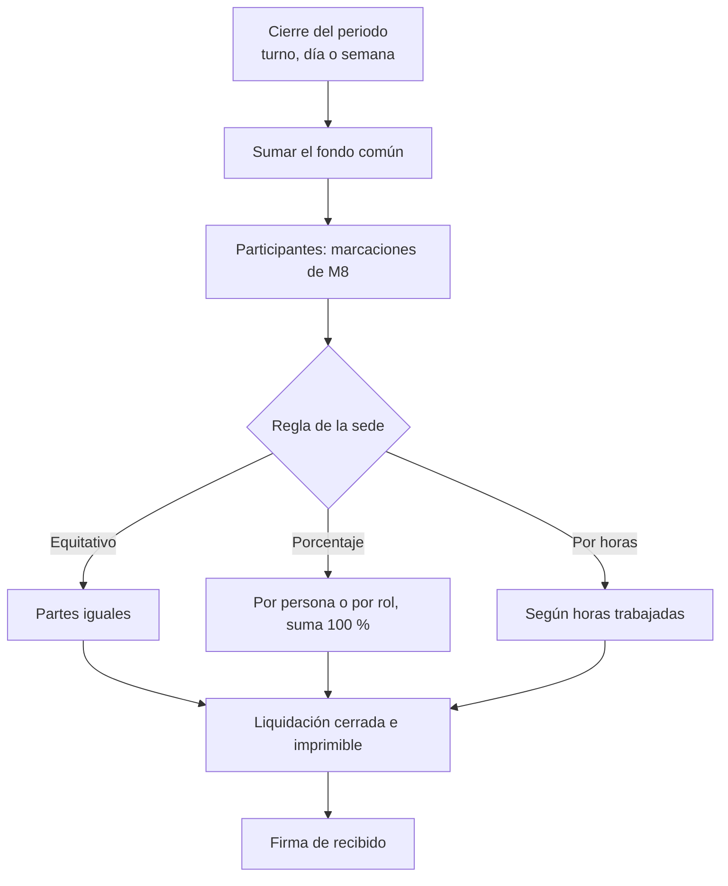

# Flujos · M2 Caja

| Campo | Valor |
|-------|-------|
| Estado | Borrador |
| Versión | 0.2 |
| Fecha | 2026-10-15 |
| Fuentes | [PRD-00 §6.5 y M2](../prd/PRD-00-vision-producto.md), [TRD-00 §6.3](../trd/TRD-00-arquitectura-base.md) |

La caja cobra la cuenta que armó el salón, registra cada medio de pago y cierra el turno con un arqueo a ciegas. El turno cerrado no se edita.

## Cómo se conecta

| Con | Qué pasa |
|-----|----------|
| M1 | Recibe la cuenta en tiempo real y la precuenta. |
| M0 | Apertura de cajón sin venta, egresos, diferencias y cambios de medio de pago piden permiso o autorización. |
| M3 | Al cerrar la venta crea el documento. M3 devuelve la factura o el comprobante para imprimir. |
| Portal | Un pago QR confirmado por la pasarela cierra el saldo, con su propina. |
| M8 | El reparto de propinas toma a quienes marcaron asistencia en el periodo. |
| M9 | Un anticipo de reserva se abona como medio de pago y no entra al efectivo del arqueo. |
| M5 | El cobro contra entrega del domiciliario se concilia en el turno. El pago de una plataforma queda por cobrar. |
| M6 | El cierre y las diferencias alimentan el control de caja. |

## Turno de caja

Un turno cerrado no se modifica. Una corrección es un movimiento nuevo, con motivo y auditoría.

## Apertura, arqueo y cierre

El cajero y el supervisor no pueden ver el total esperado antes de contar. En tarjetas, el total de cada datáfono (Credibanco, Bold o Redeban) se compara con el cierre de ese datáfono. En la Fase 1 el pago con tarjeta se registra: datáfono, aprobación, franquicia y últimos 4 dígitos. El monto no viaja solo al datáfono.

## Cobro de una cuenta

El cambio en efectivo sale del mismo cobro. Abrir el cajón sin una venta exige permiso y queda auditado. Cambiar el medio de pago de una venta ya cobrada, reabrir una cuenta pagada o emitir una nota crédito son acciones aparte, con autorización de M0.

## Pago desde el QR de la mesa

Sin la confirmación de la pasarela el pago no existe. Un segundo aviso con la misma referencia no cobra dos veces. El dinero no entra al efectivo: en el arqueo se compara el total QR contra el reporte de la pasarela. Efectivo y datáfono siguen en la caja, y pueden convivir con un pago QR si la cuenta ya estaba dividida.

## Propinas

La propina es voluntaria, se registra por venta y por medio de pago, y queda fuera de la venta.

La regla usada se guarda dentro de la liquidación. Un cambio posterior de la regla no altera un periodo ya cerrado. Una corrección es una liquidación de ajuste. Cambiar la regla queda auditado.
