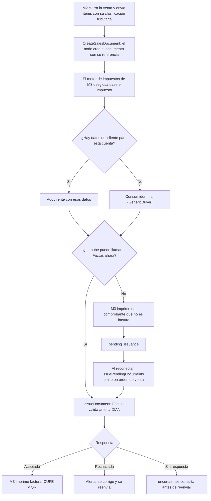
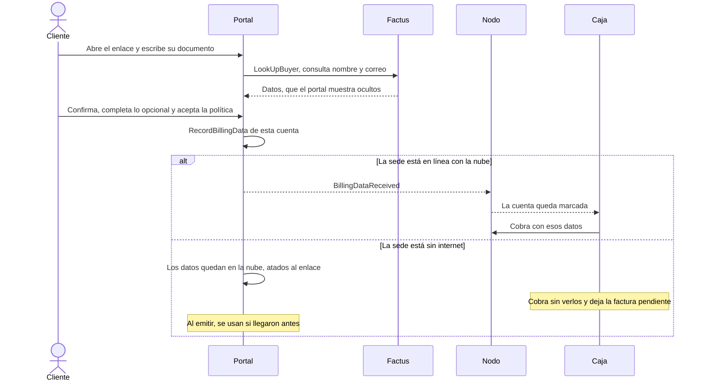
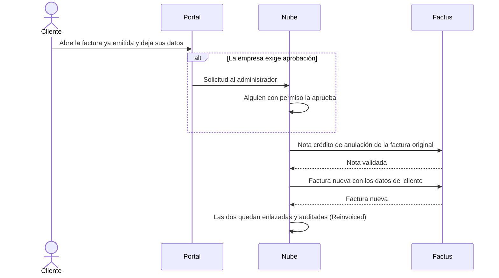
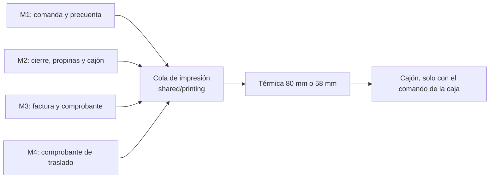

# Flujos · M3 Facturación e impresión

| Campo | Valor |
|-------|-------|
| Estado | Borrador |
| Versión | 0.2 |
| Fecha | 2026-10-17 |
| Fuentes | [PRD-00 §6.1.1 y M3](../prd/PRD-00-vision-producto.md), [PRD-M3](../prd/PRD-M3-facturacion.md), [TRD-M3](../trd/TRD-M3-facturacion.md), [TRD-00 §7 y §8](../trd/TRD-00-arquitectura-base.md) |

Cada venta tiene su factura electrónica, emitida por Factus desde la nube. En la sede, M3 arma el documento, calcula los impuestos e imprime la factura o el comprobante. Sin internet, el cliente se lleva un comprobante con QR y la factura sale sola al volver la conexión. Los nombres de casos de uso y estados son los de [TRD-M3](../trd/TRD-M3-facturacion.md).

## Cómo se conecta

| Con | Qué pasa |
|-----|----------|
| M2 | Entrega la venta cerrada (`CreateSalesDocument`): ítems con su clasificación tributaria, propina, pagos, anticipos y adquirente. No entrega impuestos: los calcula M3. |
| Portal | Entrega los datos del cliente, atados a esa cuenta. |
| M7 | Si la bolsa de documentos se agota, la venta sigue y la factura queda pendiente. Cada documento aceptado emite `DocumentConsumed`. |
| M9 | El anticipo viaja en la factura como anticipo. |
| M6 | Emisiones, rechazos y refacturaciones alimentan el reporte fiscal. |
| Impresoras | M3 dispara la factura y el comprobante. La comanda y la precuenta las dispara M1; el cierre, las propinas y el cajón, M2; el comprobante de traslado, M4. Plantillas, cola y controlador viven en `shared/printing`. |

## Emisión de la factura

La llamada a Factus sale solo de la nube. El token no se guarda en la sede. La propina va como recargo, separada de la venta. Un domicilio a consumidor final lleva la dirección de entrega. No existe una factura que agrupe varias ventas.

## Envío cortado a mitad de camino

La referencia es única. Una venta no queda con dos facturas.

## Portal de datos del cliente

El portal vive en la nube. Se abre desde el QR de la precuenta, el QR del comprobante o un enlace de domicilio o reserva. El cliente no crea cuenta.

Si el cliente pide recordar sus datos, la próxima vez confirma con un código enviado a su correo o celular (`ValidateOtp`). Los datos son de esa empresa y sirven en todas sus sedes.

En la caja, el cajero también puede escribir el documento y traer los datos guardados, o consultar el nombre y el correo. Si portal y caja traen datos distintos para la misma cuenta, elige el cajero antes de cobrar.

## Refacturación

Aplica cuando la factura ya salió a consumidor final y el cliente pide una a su nombre, dentro del plazo de la empresa (`Reinvoice`).

La nota se emite primero. La factura nueva reutiliza su referencia si hay que reintentarla. El par consume dos documentos de la bolsa.

## Impresión

El navegador no habla con la impresora: cada módulo dispara su impresión en el nodo (o en el puente, en modo nube) y la cola compartida la entrega. Si una impresora de red tiene respaldo, la cola lo usa cuando la principal falla. Reimprimir la factura queda auditado y tiene tope; la precuenta sigue la misma regla en M1.
