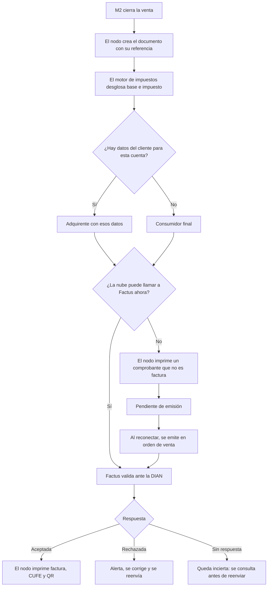
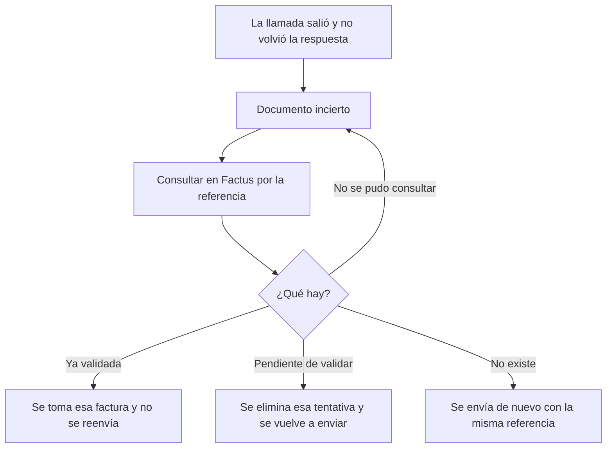
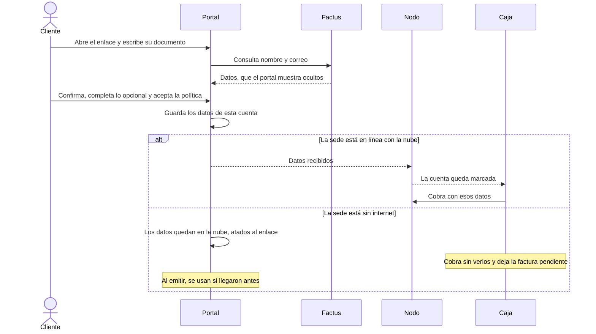
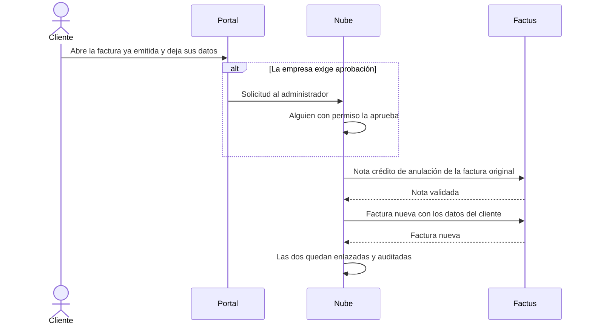
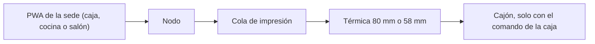

# Flujos · M3 Facturación e impresión

| Campo | Valor |
|-------|-------|
| Estado | Borrador |
| Versión | 0.1 |
| Fecha | 2026-10-14 |
| Fuentes | [PRD-00 §6.1.1 y M3](../prd/PRD-00-vision-producto.md), [TRD-00 §7 y §8](../trd/TRD-00-arquitectura-base.md) |

Cada venta tiene su factura electrónica, emitida por Factus desde la nube. El nodo arma el documento e imprime. Sin internet, el cliente se lleva un comprobante con QR y la factura sale sola al volver la conexión.

## Cómo se conecta

| Con | Qué pasa |
|-----|----------|
| M2 | Entrega la venta cerrada: ítems, impuestos, propina, pagos y anticipos. |
| Portal | Entrega los datos del cliente, atados a esa cuenta. |
| M7 | Si la bolsa de documentos se agota, la venta sigue y la factura queda pendiente. |
| M9 | El anticipo viaja en la factura como anticipo. |
| M4 | El documento soporte de una compra a quien no factura sale por el mismo proveedor, en la Fase 2. |
| M6 | Emisiones, rechazos y refacturaciones alimentan el reporte fiscal. |
| Impresoras | Comandas, precuenta, factura, cierre, traslado y propinas salen del nodo. |

## Emisión de la factura

La llamada a Factus sale solo de la nube. El token no se guarda en la sede. La propina va como recargo, separada de la venta. Un domicilio a consumidor final lleva la dirección de entrega. No existe una factura que agrupe varias ventas.

## Envío cortado a mitad de camino

La referencia es única. Una venta no queda con dos facturas.

## Portal de datos del cliente

El portal vive en la nube. Se abre desde el QR de la precuenta, el QR del comprobante o un enlace de domicilio o reserva. El cliente no crea cuenta.

Si el cliente pide recordar sus datos, la próxima vez confirma con un código enviado a su correo o celular. Los datos son de esa empresa y sirven en todas sus sedes.

En la caja, el cajero también puede escribir el documento y traer los datos guardados, o consultar el nombre y el correo. Si portal y caja traen datos distintos para la misma cuenta, elige el cajero antes de cobrar.

## Refacturación

Aplica cuando la factura ya salió a consumidor final y el cliente pide una a su nombre, dentro del plazo de la empresa.

La nota se emite primero. La factura nueva reutiliza su referencia si hay que reintentarla. El par consume dos documentos de la bolsa.

## Impresión

El navegador no habla con la impresora. Si una impresora de red tiene respaldo, la cola lo usa cuando la principal falla. Reimprimir queda auditado y, para factura y precuenta, tiene tope.
