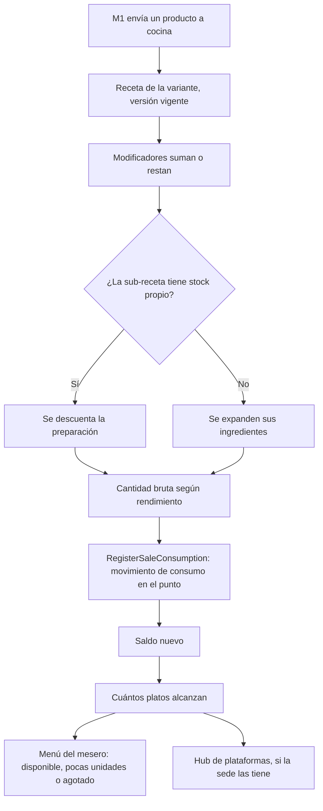
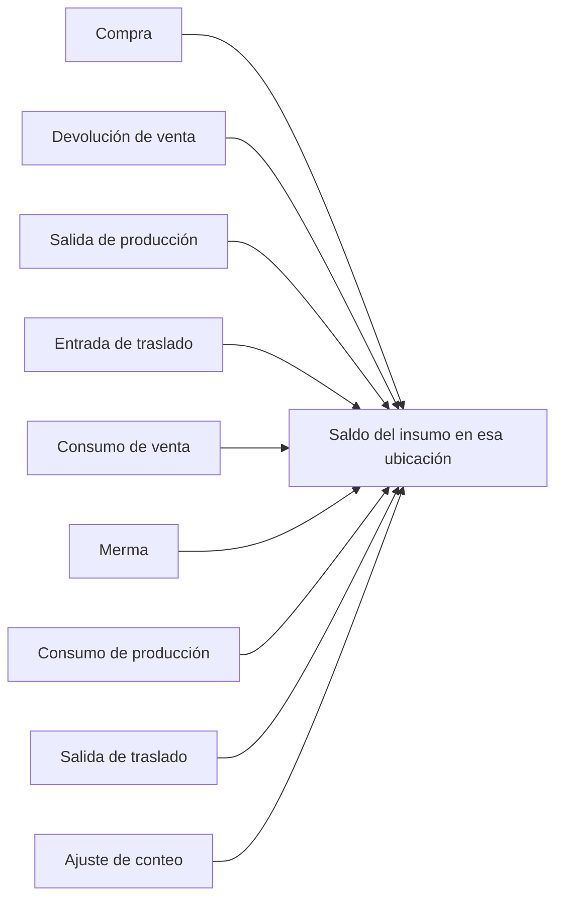
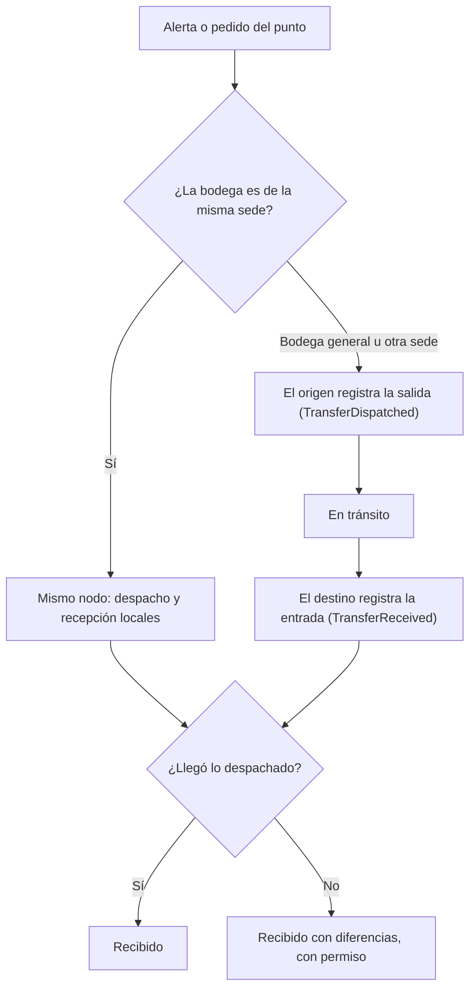
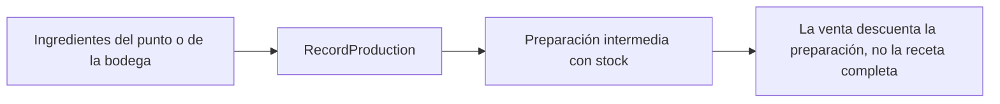
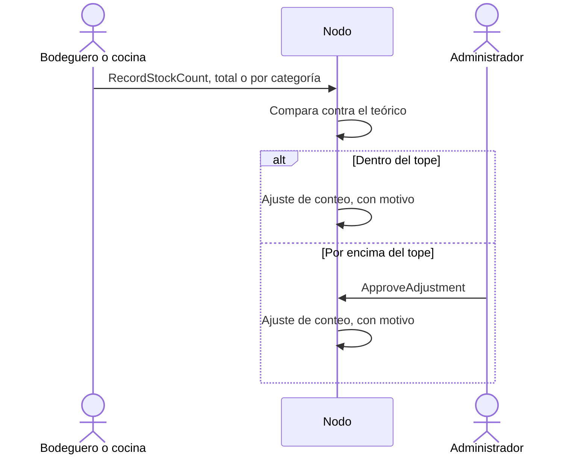
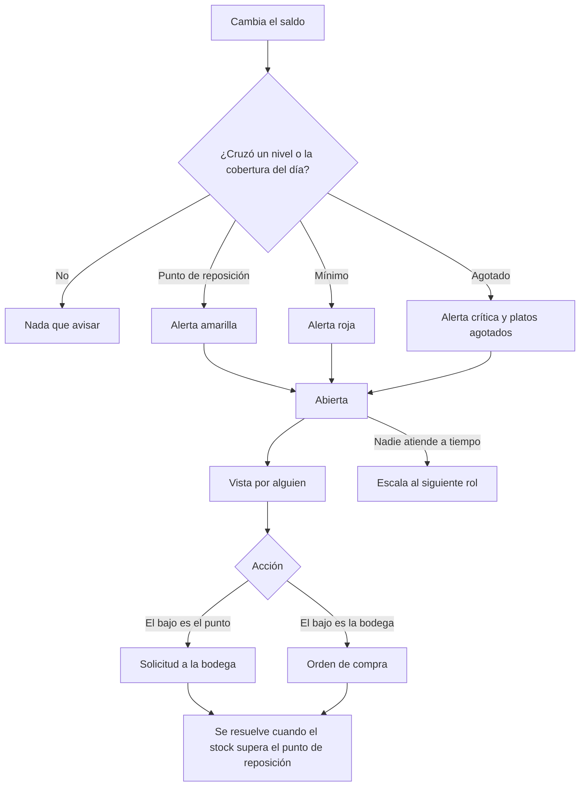
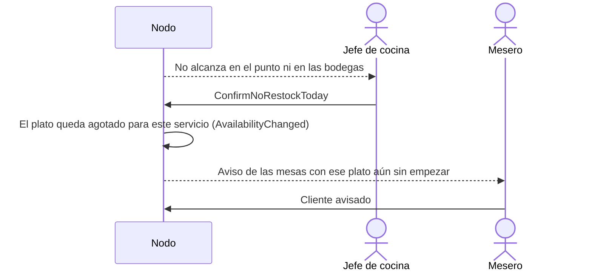

# Flujos · M4 Inventario, bodegas y recetas

| Campo | Valor |
|-------|-------|
| Estado | Borrador |
| Versión | 0.4 |
| Fecha | 2026-11-19 |
| Fuentes | [PRD-00 §6.6 y M4](../prd/PRD-00-vision-producto.md), [PRD-M4](../prd/PRD-M4-inventario.md), [TRD-M4](../trd/TRD-M4-inventario.md), [TRD-00 §9](../trd/TRD-00-arquitectura-base.md) |

Cada sede tiene un inventario de punto. Las bodegas lo reabastecen. Las ventas descuentan ingredientes al enviar a cocina, según la receta. El stock puede quedar negativo: la venta no se detiene. Los nombres de casos de uso y eventos son los de [TRD-M4](../trd/TRD-M4-inventario.md).

Desde el 2026-11-19 estos recorridos están cerrados en la nube: compras, producción, traslado, recepción, conteo, merma, consumo de la venta, unidades posibles y alertas. El documento soporte del proveedor no forma parte (D-14). El despacho de un traslado lo deja en tránsito; no hay un estado guardado distinto llamado despachado. Recibir sin internet y el nodo de la bodega general siguen en la fase híbrida.

## Cómo se conecta

| Con | Qué pasa |
|-----|----------|
| M1 | Envía el consumo al mandar un producto a cocina (`RegisterSaleConsumption`), la devolución o la merma al anular (`ReturnStock`, `RecordWaste`), y recibe si el plato se puede vender (`AvailabilityChanged`). |
| M5 | El mismo agotado se publica en las plataformas. Una cancelación ya empezada se registra como merma. |
| M0 | Ajustes, conteos y traslados con diferencia piden permiso. |
| M6 | Teórico contra real, mermas, margen y quiebres de stock. |

## De la venta al stock

La estación de cocina no tiene inventario. Cocina y barra descuentan del mismo punto. El movimiento guarda la versión de la receta. Si se anula antes de que cocina empiece, entra un movimiento de devolución (`ReturnStock`). Si se anula después, entra una merma con motivo (`RecordWaste`).

## Tipos de movimiento

Ningún movimiento se edita ni se borra. El saldo es la suma, actualizada en la misma operación. El costo es el promedio de esa ubicación.

## Reabastecimiento y traslados

La bodega general del piloto opera con su propio nodo en modo bodega (D-04), así que un traslado desde ella siempre tiene dos dueños. Operarla desde la web, sin nodo, sigue abierto para clientes pequeños (PA-44).

Si el destino todavía no tiene internet, el comprobante impreso del despacho lleva un QR. El punto lo escanea y registra la recepción sin esperar la sincronización. M4 dispara ese comprobante; la plantilla y el controlador viven en `shared/printing`.

Estados guardados del traslado: solicitado, en tránsito, recibido, recibido con diferencias. El despacho lo deja en tránsito. El costo que viaja es el del origen en el despacho, sin sumarle nada (D-27).

## Producción

El costo de lo producido lo elige la empresa: promedio de los insumos consumidos, o costo estándar (D-26).

## Conteo

El conteo es a ciegas, como el arqueo (D-49): quien cuenta ve los insumos y la unidad, y la diferencia aparece al enviar y al aprobar. Un ajuste por encima del tope pide aprobación. El tope es configurable y, por defecto, $1.000 (D-28).

## Alerta de escasez

Se evalúa en el nodo, también sin internet.

Los niveles son máximo, punto de reposición, mínimo y agotado, por insumo y por ubicación. Además, la cobertura avisa si al ritmo de ese día de la semana el stock no alcanza el resto del servicio, aunque todavía esté sobre el mínimo.

## Cuánto se puede producir

Para cada plato, el límite es el ingrediente que menos alcanza.

- Con el punto: eso es lo que ve el mesero.
- Con el punto más las bodegas que lo abastecen: eso alimenta la sugerencia de reabastecimiento.
- El stock de la bodega general se conoce hasta la última sincronización, y el reporte muestra esa fecha.

## No se repone hoy

Un plato agotado en el menú evita pedirlo de nuevas. La marca **no se repone hoy** evita que una mesa se quede esperando algo que ya no va a salir. La confirma el jefe de cocina o el administrador. El sistema la propone cuando el punto no alcanza para una porción, las bodegas que abastecen la sede tampoco y no hay un traslado en camino.

El detalle de qué líneas se retiran y cuáles siguen en cocina está en [M1](m1-pedidos-y-salon.md).
