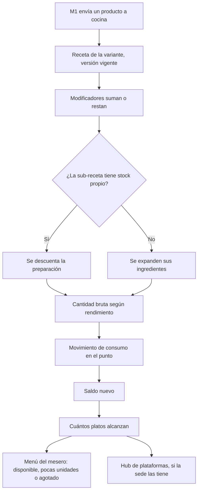
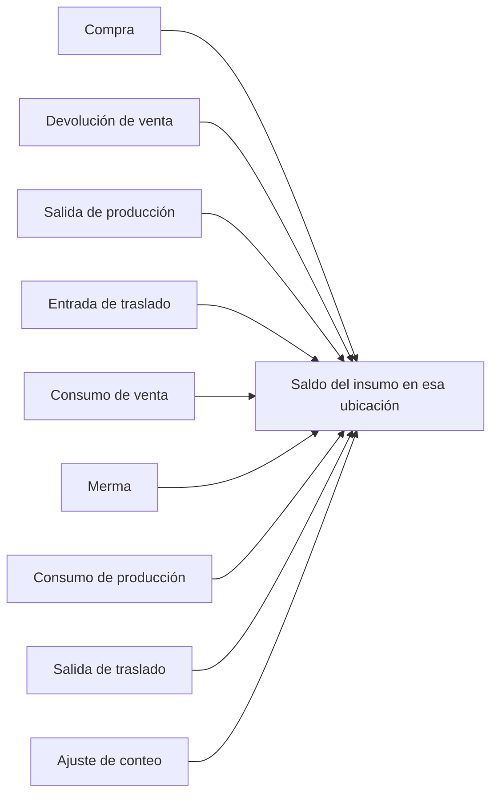
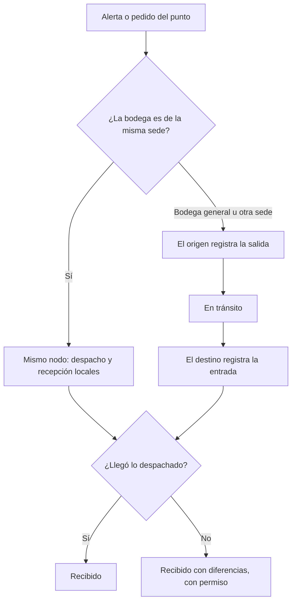
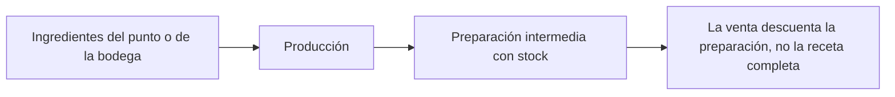
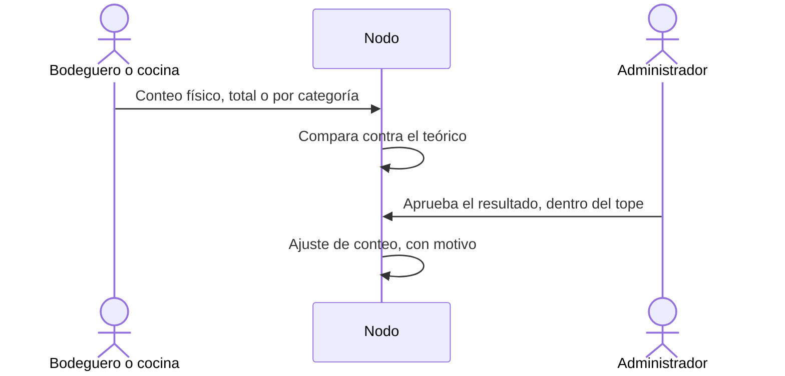
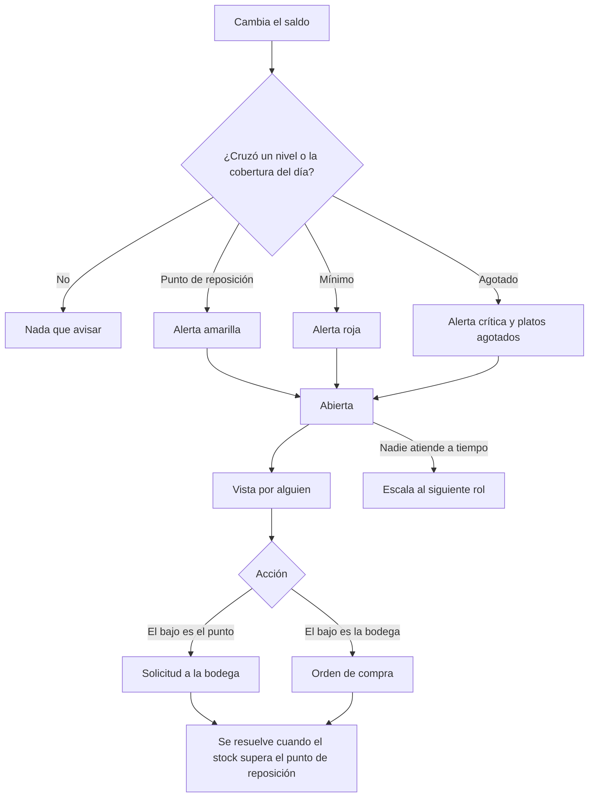
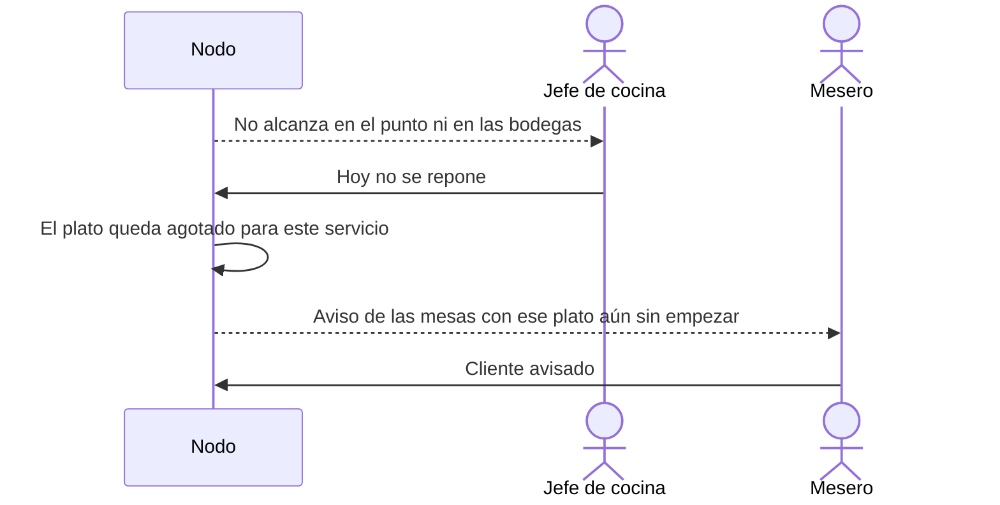

# Flujos · M4 Inventario, bodegas y recetas

| Campo | Valor |
|-------|-------|
| Estado | Borrador |
| Versión | 0.1 |
| Fecha | 2026-10-14 |
| Fuentes | [PRD-00 §6.6 y M4](../prd/PRD-00-vision-producto.md), [TRD-00 §9](../trd/TRD-00-arquitectura-base.md) |

Cada sede tiene un inventario de punto. Las bodegas lo reabastecen. Las ventas descuentan ingredientes al enviar a cocina, según la receta. El stock puede quedar negativo: la venta no se detiene.

## Cómo se conecta

| Con | Qué pasa |
|-----|----------|
| M1 | Envía el consumo al mandar un producto a cocina, y recibe si el plato se puede vender. |
| M5 | El mismo agotado se publica en las plataformas. Una cancelación ya empezada se registra como merma. |
| M0 | Ajustes, conteos y traslados con diferencia piden permiso. |
| M3 | Compras a quien no factura pueden generar documento soporte. La recepción de facturas de proveedores se evalúa en la Fase 2. |
| M6 | Teórico contra real, mermas, margen y quiebres de stock. |

## De la venta al stock

La estación de cocina no tiene inventario. Cocina y barra descuentan del mismo punto. El movimiento guarda la versión de la receta. Si se anula antes de que cocina empiece, entra un movimiento de devolución. Si se anula después, entra una merma con motivo.

## Tipos de movimiento

Ningún movimiento se edita ni se borra. El saldo es la suma, actualizada en la misma operación. El costo es el promedio de esa ubicación.

## Reabastecimiento y traslados

Si el destino todavía no tiene internet, el comprobante impreso del despacho lleva un QR. El punto lo escanea y registra la recepción sin esperar la sincronización.

Estados del traslado: solicitado, despachado, en tránsito, recibido, recibido con diferencias.

## Producción

## Conteo

## Alerta de escasez

Se evalúa en el nodo, también sin internet.

Los niveles son máximo, punto de reposición, mínimo y agotado, por insumo y por ubicación. Además, la cobertura avisa si al ritmo de ese día de la semana el stock no alcanza el resto del servicio, aunque todavía esté sobre el mínimo.

## Cuánto se puede producir

Para cada plato, el límite es el ingrediente que menos alcanza.

- Con el punto: eso es lo que ve el mesero.
- Con el punto más las bodegas que lo abastecen: eso alimenta la sugerencia de reabastecimiento.
- El stock de la bodega general se conoce hasta la última sincronización, y el reporte muestra esa fecha.

## No se repone hoy

Un plato agotado en el menú evita pedirlo de nuevas. La marca **no se repone hoy** evita que una mesa se quede esperando algo que ya no va a salir. La confirma el jefe de cocina o el administrador. El sistema la propone cuando el punto no alcanza para una porción, las bodegas que abastecen la sede tampoco y no hay un traslado en camino.

El detalle de qué líneas se retiran y cuáles siguen en cocina está en [M1](m1-pedidos-y-salon.md).
