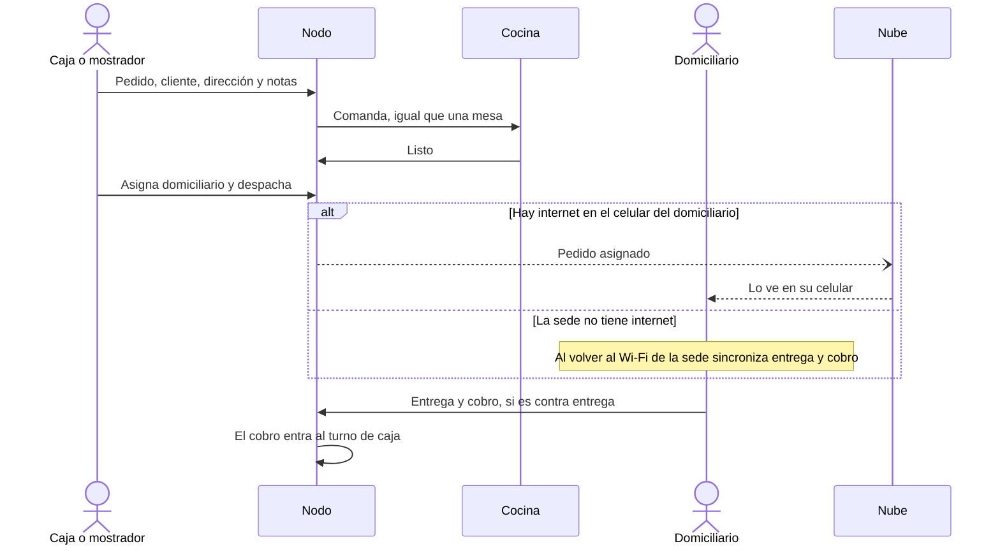
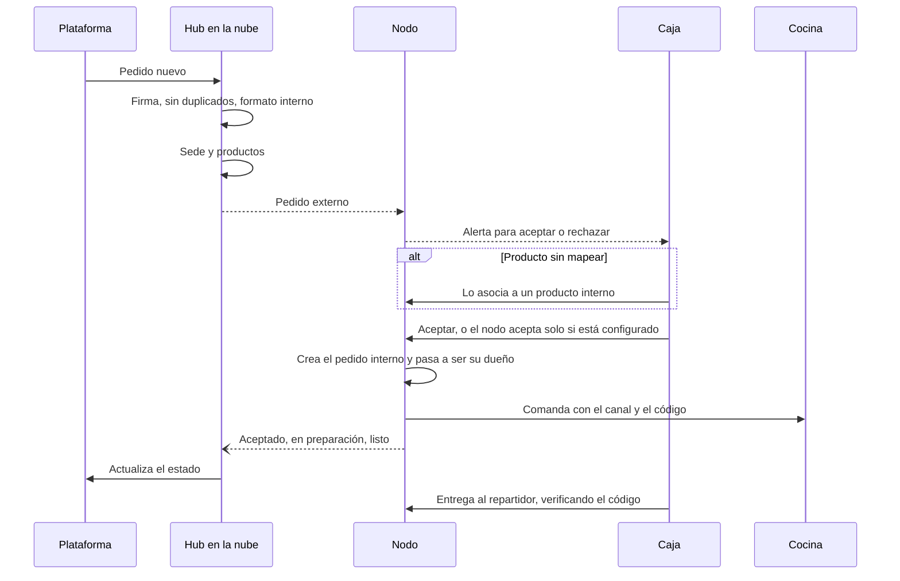
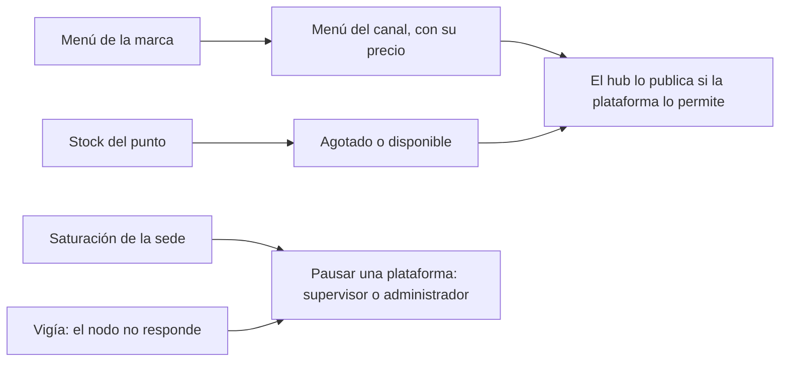
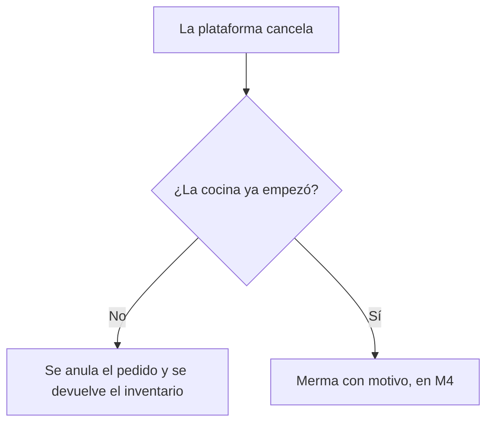
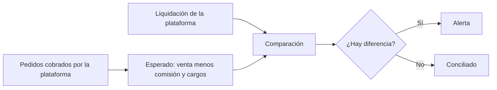

# Flujos · M5 Domicilios

| Campo | Valor |
|-------|-------|
| Estado | Borrador |
| Versión | 0.3 |
| Fecha | 2026-10-17 |
| Fuentes | [PRD-00 §6.2 y M5](../prd/PRD-00-vision-producto.md), [TRD-00 §6.1](../trd/TRD-00-arquitectura-base.md), [TRD-M5](../trd/TRD-M5-domicilios.md) |

Un domicilio propio lo crea la sede. Un pedido de Rappi, DiDi Food u otra plataforma llega solo al hub y, al aceptarlo, se vuelve un pedido interno igual que uno de mesa. La captura manual cubre el hueco cuando no hay conector o no hay internet.

## Cómo se conecta

| Con | Qué pasa |
|-----|----------|
| M1 | El pedido aceptado entra a cocina por estación, con los mismos estados. |
| M4 | Descuenta receta al enviar a cocina. Si el plato se agota, se publica en las plataformas. |
| M2 | Contra entrega se concilia con el domiciliario. El pago de plataforma queda por cobrar. |
| M3 | La factura de un domicilio a consumidor final lleva la dirección de entrega. La bolsa plástica va como línea solo si la sede tiene el impuesto encendido (D-29). El enlace del portal puede ir por WhatsApp. |
| M0 | Aceptar, rechazar o pausar una plataforma tiene permiso. Pausar lo pueden el supervisor y el administrador, además del vigía. |
| M6 | Tiempos por etapa, comisión y diferencias de liquidación. |

## Domicilio propio

Teléfono, WhatsApp o mostrador.

## Pedido de plataforma

El pago no entra a la caja física. Queda como saldo por cobrar a la plataforma.

Si la sede pierde conexión, el hub sigue recibiendo y el vigía de sedes, en la nube, pausa la tienda en las plataformas que lo permiten cuando el silencio del nodo pasa el umbral, para no recibir pedidos que nadie ve. Al volver el nodo, la reanuda ([TRD-M5, sección 7](../trd/TRD-M5-domicilios.md)). Una persona también puede pausar: el supervisor o el administrador ([PRD-01, 6.4](../prd/PRD-01-roles-y-permisos.md)).

## Captura manual

Cuando no hay conector, el conector falla o la sede está sin internet, la caja copia el pedido desde la tablet de la plataforma. Indica el canal y el código. A partir de ahí el flujo es el mismo: cocina, tiempos y pago por cobrar. La clave para no duplicar es la plataforma más el código externo.

## Menú y disponibilidad por canal

Si la plataforma no deja publicar el menú por API, se publica en su portal y aquí solo se mapean los productos.

## Cancelación que viene de la plataforma

## Conciliación

La rentabilidad del canal es la venta neta, después de comisión, contra el costo de los platos. La factura de la comida la emite el restaurante. La factura de comisión de la plataforma no entra al sistema (D-13).
