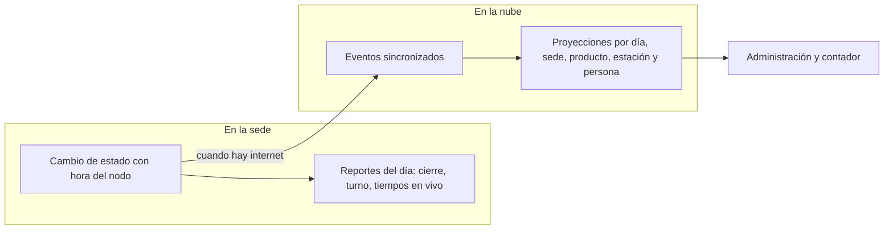
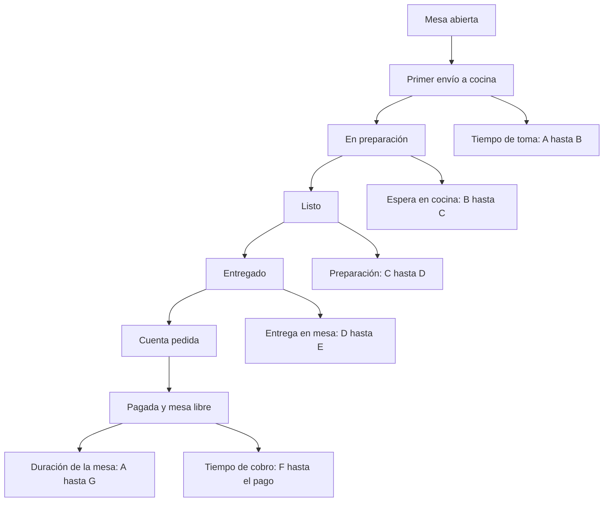

# Flujos · M6 Reportes y analítica

| Campo | Valor |
|-------|-------|
| Estado | Borrador |
| Versión | 0.1 |
| Fecha | 2026-10-14 |
| Fuentes | [PRD-00 §8](../prd/PRD-00-vision-producto.md), [TRD-00 §11](../trd/TRD-00-arquitectura-base.md) |

Los reportes no tienen un recorrido propio de caja o de salón. Leen los eventos que los otros módulos ya guardan. Si un cambio de estado no guarda su hora desde la Fase 1, esa historia no se puede reconstruir después.

## Cómo se conecta

| Familia | La alimentan | Dónde se consulta el día | Dónde se consolida |
|---------|--------------|--------------------------|--------------------|
| Tiempos | M1 y M5, en cada cambio de estado | Nodo | Nube |
| Ventas y medios de pago | M2 y M3 | Nodo, cierre y turno | Nube |
| Costos e inventario | M4, con el costo de lo vendido en M1 | Nodo, stock y alertas | Nube |
| Control | M0, M1, M2 y M4, en cada acción sensible | Nodo, lo del día | Nube, con detectores |
| Personal y propinas | M8 y la liquidación de M2 | Nodo | Nube |
| Reservas | M9 | Nodo, las del día | Nube |
| Fiscal | M3, por contribuyente | Nodo, pendientes de emisión | Nube, para el contador |

## Del evento al reporte

El nodo responde el día de operación sin internet. El consolidado de varias sedes, el histórico y las alertas de comportamiento salen de la nube, con los datos ya sincronizados.

## Qué hora usa cada tiempo

En domicilio y plataforma se agregan aceptación, espera del repartidor, despacho y ruta. Esas marcas las escribe [M5](m5-domicilios.md) sobre el mismo pedido.

## Control

Las métricas de control salen de la auditoría de [M0](m0-plataforma.md), no de un reporte que alguien diligencia: anulaciones, descuentos, cortesías, diferencias de arqueo, cajón sin venta, cuentas reabiertas, traslados con diferencia y ajustes de inventario. La nube agrupa esos eventos y avisa cuando un patrón se repite, por ejemplo muchas anulaciones en un turno.
