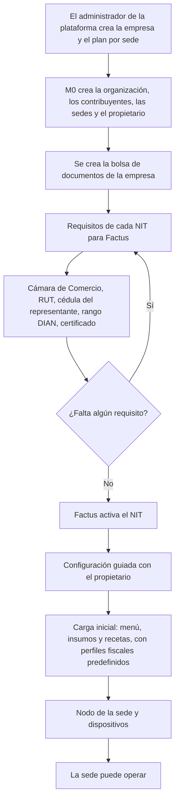
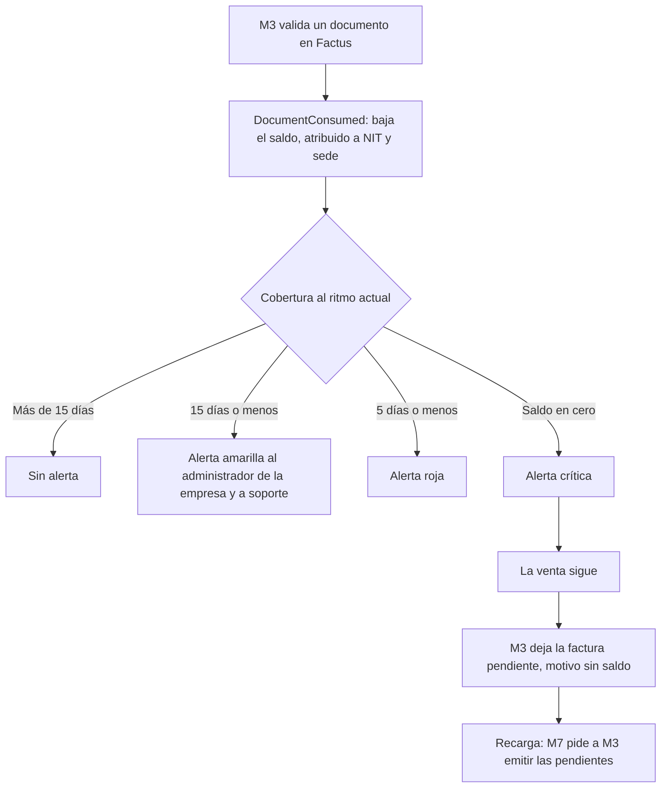
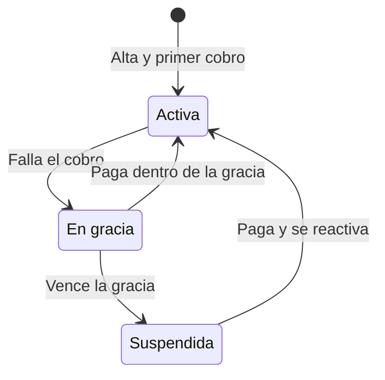
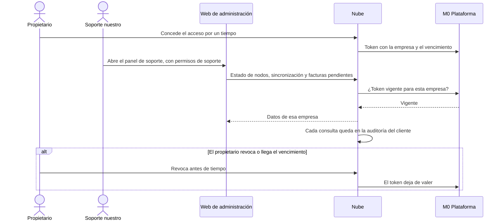

# Flujos · M7 SaaS comercial

| Campo | Valor |
|-------|-------|
| Estado | Borrador |
| Versión | 0.3 |
| Fecha | 2026-10-17 |
| Fuentes | [PRD-M7](../prd/PRD-M7-saas.md), [TRD-M7](../trd/TRD-M7-saas.md), [PRD-00 M7 y §11](../prd/PRD-00-vision-producto.md), [TRD-00 §8.2 y §8.4](../trd/TRD-00-arquitectura-base.md) |

M7 es la relación con el cliente que paga la suscripción: alta, configuración guiada, bolsa de documentos de Factus, suscripción y acceso de soporte. Corre solo en la nube. El administrador de la plataforma no ve la operación del cliente, y el soporte entra solo con el acceso que concede el propietario.

## Cómo se conecta

| Con | Qué pasa |
|-----|----------|
| M0 | El alta llama a `CreateOrganization`: empresa, contribuyentes, sedes y primer propietario. M0 evalúa el token de soporte y recibe `SubscriptionChanged` para saber si la sede está suspendida. |
| M1 y M4 | La carga inicial de menú, insumos y recetas usa sus casos de uso. |
| M3 | Cada documento validado emite `DocumentConsumed` y baja la bolsa. Al recargar, M7 pide `IssuePendingDocuments` para las facturas pendientes por falta de saldo. |
| M6 | El consumo de documentos y las señales de Factus salen en el panel de soporte. |

## Alta de una empresa

La activación de un NIT en Factus tarda de 1 a 3 días hábiles. Hasta entonces esa sede no emite factura electrónica. El resto de la operación local no depende de ese trámite. El administrador de la plataforma no queda con una sesión dentro de la operación.

## Bolsa de documentos

Una refacturación consume dos documentos del cupo de ese NIT. El saldo se lleva en el sistema y se concilia con `GET /v2/subscriptions` de cada NIT. La empresa ve la suma de los cupos (D-16). La alerta de cobertura se calcula por NIT. El límite de 80 solicitudes por minuto es por NIT. Los días de cada alerta se configuran por empresa.

## Suscripción

La suscripción no salta la gracia. Suspendida, los datos y los documentos ya emitidos siguen; al reactivar vuelve el acceso y se retoman las facturas pendientes si hay saldo. Qué puede hacer todavía la sede suspendida, cerrar el servicio del día o solo consultar, sigue abierto (PA-40). El cobro va por una pasarela propia de la suscripción, distinta de la del QR de la mesa (PA-38).

La suspensión se decide en la nube y llega al nodo con la configuración. Si la sede está sin internet, sigue vendiendo hasta reconectar, y el desfase queda auditado.

## Soporte

El panel de soporte es una vista de la web de administración, visible solo con permisos de soporte (D-05). No es una aplicación aparte ni un escritorio remoto.

Sin acceso concedido, ni el soporte ni el administrador de la plataforma abren la operación del cliente.
