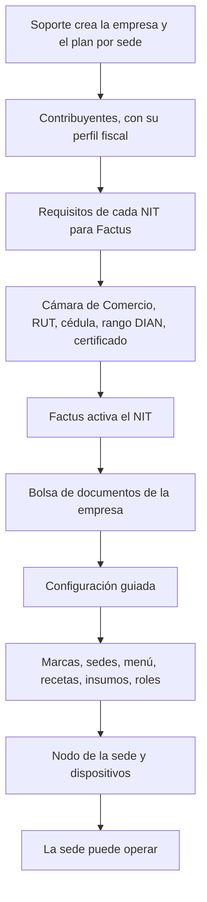
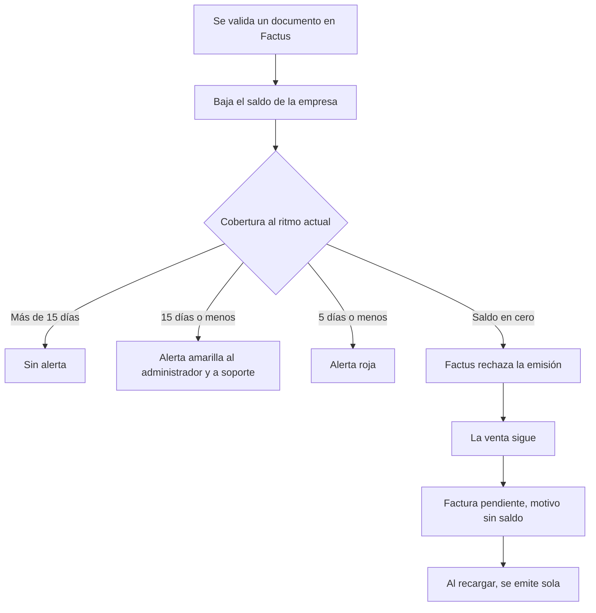
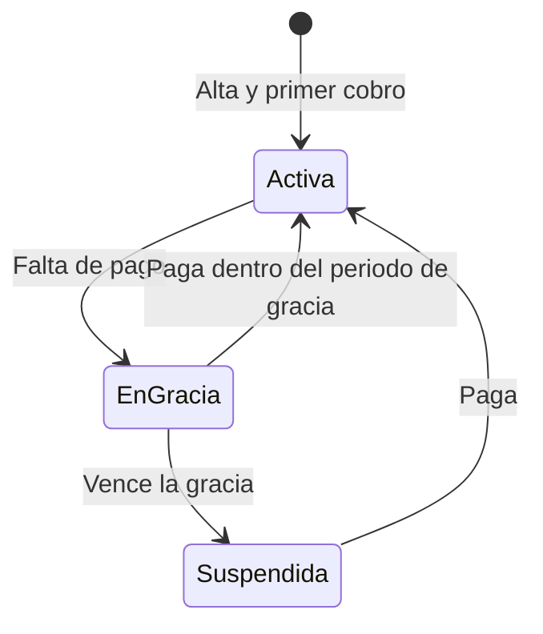
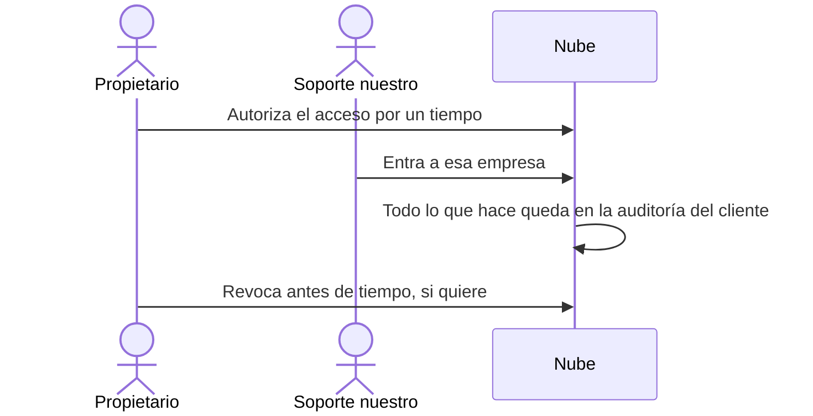

# Flujos · M7 SaaS comercial

| Campo | Valor |
|-------|-------|
| Estado | Borrador |
| Versión | 0.1 |
| Fecha | 2026-10-14 |
| Fuentes | [PRD-00 M7 y §11](../prd/PRD-00-vision-producto.md), [TRD-00 §8.2 y §8.4](../trd/TRD-00-arquitectura-base.md) |

M7 es la relación con el cliente que paga la suscripción: alta, configuración, bolsa de documentos de Factus y soporte. El precio se define en la Fase 4. El efecto operativo de una suspensión por falta de pago se detalla en el PRD de este módulo, cuando se escriba.

## Cómo se conecta

| Con | Qué pasa |
|-----|----------|
| M0 | Crea la empresa, los contribuyentes, las sedes y el primer propietario. El soporte entra solo con autorización del cliente. |
| M3 | Cada factura, nota crédito y documento soporte consume la bolsa. |
| M4 | La carga inicial incluye insumos y recetas. |
| M6 | El consumo de documentos y las señales de Factus salen en el panel de soporte. |

## Alta de una empresa

La activación de un NIT en Factus tarda de 1 a 3 días hábiles. Hasta entonces esa sede no emite factura electrónica. El resto de la operación local no depende de ese trámite.

## Bolsa de documentos

Una refacturación consume dos documentos. El saldo se lleva en el sistema a partir de las respuestas de Factus y se concilia con lo que Factus reporte. El límite de 80 solicitudes por minuto sigue siendo por NIT, aunque la bolsa sea de la empresa.

## Suscripción

Qué puede hacer una sede suspendida (seguir vendiendo en el nodo, bloquear la administración, o las dos) queda para el PRD de M7. Este diagrama solo fija los estados comerciales.

## Soporte

El administrador de la plataforma crea empresas y planes. No ve la operación del cliente sin ese acceso autorizado.
