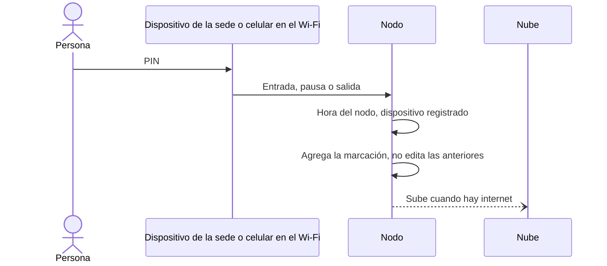
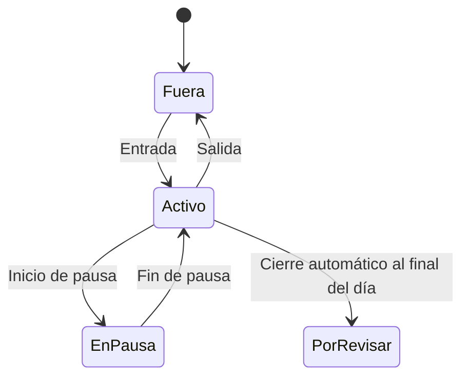
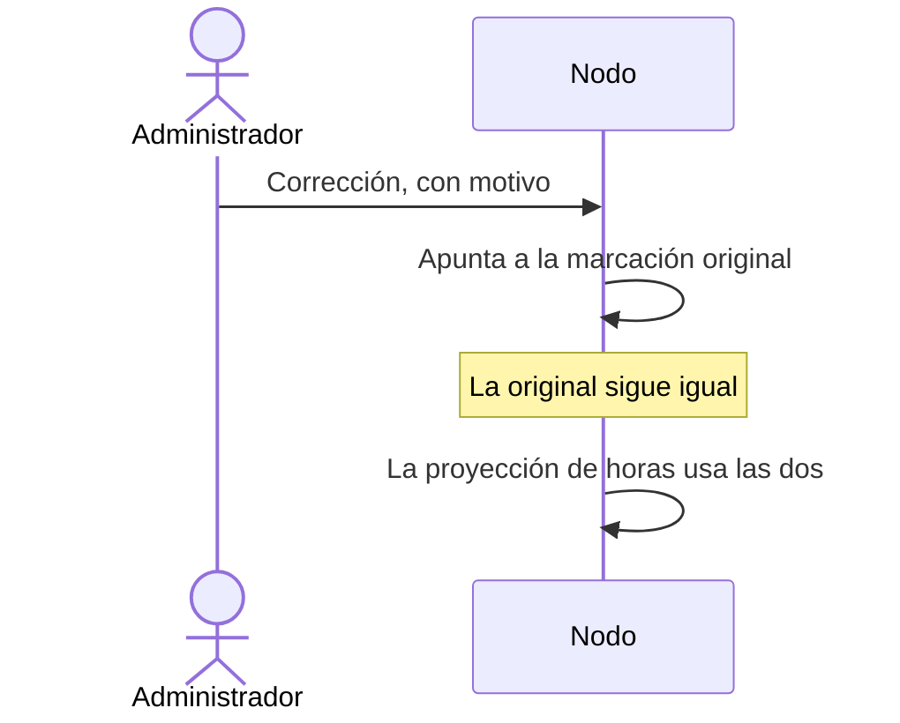
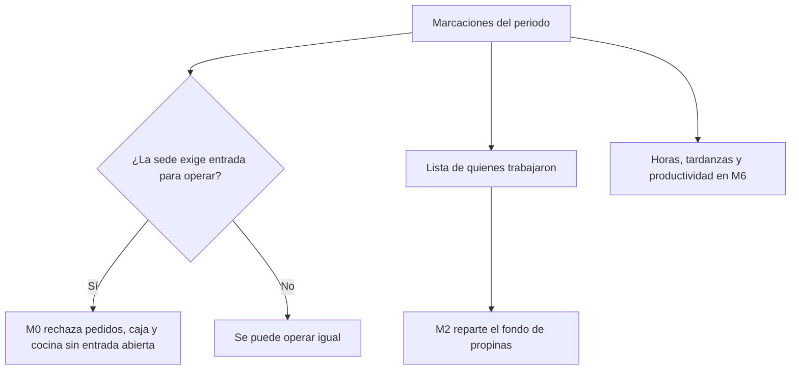

# Flujos · M8 Asistencia del personal

| Campo | Valor |
|-------|-------|
| Estado | Borrador |
| Versión | 0.1 |
| Fecha | 2026-10-14 |
| Fuentes | [PRD-00 §6.4 y M8](../prd/PRD-00-vision-producto.md), [TRD-00 §10.4](../trd/TRD-00-arquitectura-base.md) |

Registra entrada, salida y pausas. No liquida nómina. La hora la pone el nodo, así el reloj del celular no adelanta la marcación. Solo se puede marcar dentro del local.

## Cómo se conecta

| Con | Qué pasa |
|-----|----------|
| M0 | El PIN es el de la plataforma. Una corrección queda auditada. Si la sede lo activa, sin entrada no hay acciones operativas. |
| M1 y M2 | Esas acciones operativas son las que la regla puede bloquear. |
| M2 | Al liquidar propinas, los participantes salen de las marcaciones del periodo. |
| M6 | Horas, tardanzas, ausencias y ventas por hora trabajada. |

## Marcación

Dos modos conviven, por trabajador:

- **Solo horas.** Se cuentan desde la entrada hasta la salida, menos las pausas.
- **Con horario.** Además se calculan tardanza, ausencia, salida anticipada y horas por fuera del turno.

El cierre automático no borra la marcación abierta: agrega el cierre y lo deja para que el administrador lo revise.

## Corrección

## Efecto en el resto del sistema

Las horas son una proyección. No hay un campo de horas que alguien edite a mano. La exportación a Excel es para quien liquida la nómina fuera de este sistema.
