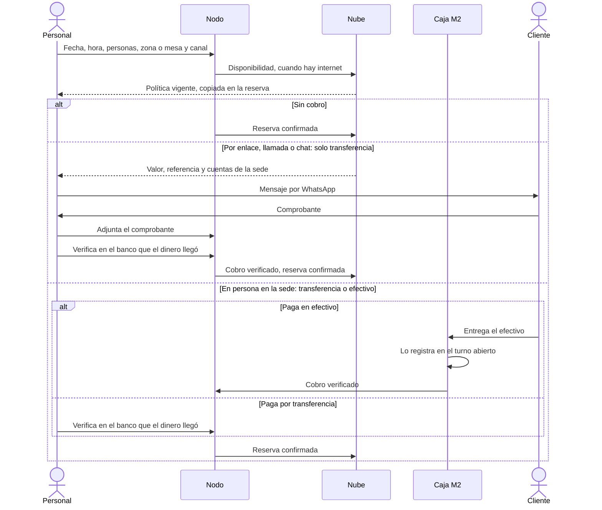
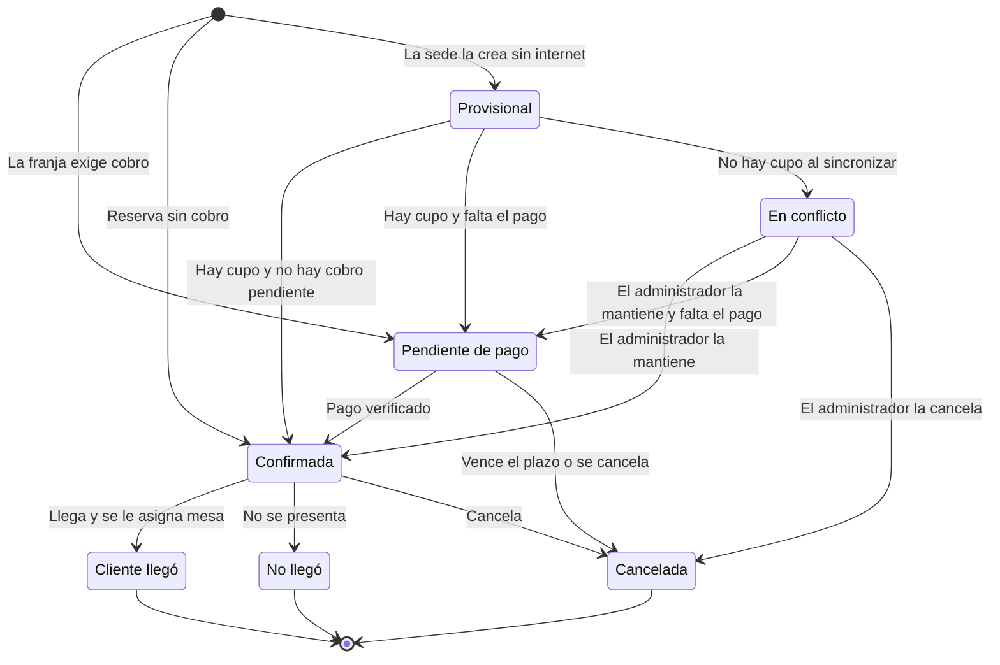
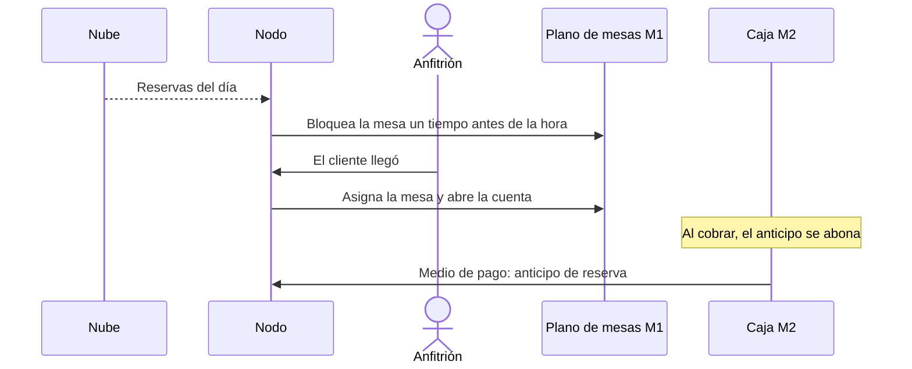
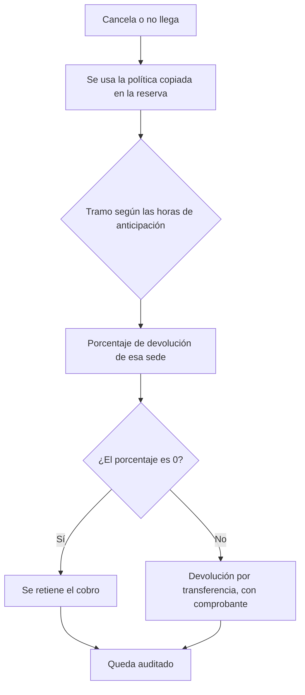

# Flujos · M9 Reservas

| Campo | Valor |
|-------|-------|
| Estado | Borrador |
| Versión | 0.2 |
| Fecha | 2026-10-17 |
| Fuentes | [PRD-00 §6.3 y M9](../prd/PRD-00-vision-producto.md), [TRD-00 §6.2](../trd/TRD-00-arquitectura-base.md), [PRD-M9](../prd/PRD-M9-reservas.md), [TRD-M9](../trd/TRD-M9-reservas.md) |

La reserva y su cobro viven en la nube, porque pueden nacer fuera del local. Lo que ocurre el día de la reserva en el salón vive en el nodo: llegada, mesa y cuenta. El medio de cobro depende de cómo entra la reserva (D-01): por enlace, llamada o chat, solo transferencia a Nequi, Daviplata o Bre-B, que alguien verifica en la cuenta; en persona en la sede, transferencia verificada o efectivo, que la caja registra en el turno abierto.

## Cómo se conecta

| Con | Qué pasa |
|-----|----------|
| M1 | La mesa se bloquea antes de la hora. Al llegar, se abre o se asocia la cuenta. |
| M2 | El anticipo se abona al cobrar. El de transferencia no entra al efectivo del arqueo; el de efectivo se arquea en el turno que lo recibió y no se cuenta otra vez. |
| M3 | El anticipo va en la factura. El enlace del portal puede ir con la reserva. |
| M0 | Verificar el pago y aprobar una devolución tienen permiso, y quedan auditados. |
| M6 | Ocupación, no llegadas, anticipos retenidos e ingresos por reservas. |

## Reserva con cobro

Sin turno de caja abierto no se recibe efectivo. El enlace público solo ofrece transferencia.

Sin internet, el nodo crea una reserva provisional. Al sincronizar, la nube la confirma o la marca en conflicto de disponibilidad para que el administrador lo resuelva. Quien verifica una transferencia necesita ver la cuenta del banco, así que esa comprobación usa la conexión de esa persona.

El mismo número de transacción no puede verificar dos reservas de la misma cuenta de recaudo.

## Estados

El cobro, por su lado: pendiente, comprobante recibido, verificado, rechazado. La reserva solo pasa a confirmada cuando el cobro está verificado: una transferencia, cuando alguien la ve en la cuenta; el efectivo, cuando la caja lo registra en el turno. El pantallazo no alcanza. Un conflicto nunca se resuelve solo.

## El día de la reserva

Una tarifa de reserva no se abona al consumo. Un anticipo sí.

## Cancelación y no llegada

Un cambio posterior de la política no altera las reservas ya creadas. La devolución la aprueba quien tiene el permiso.
