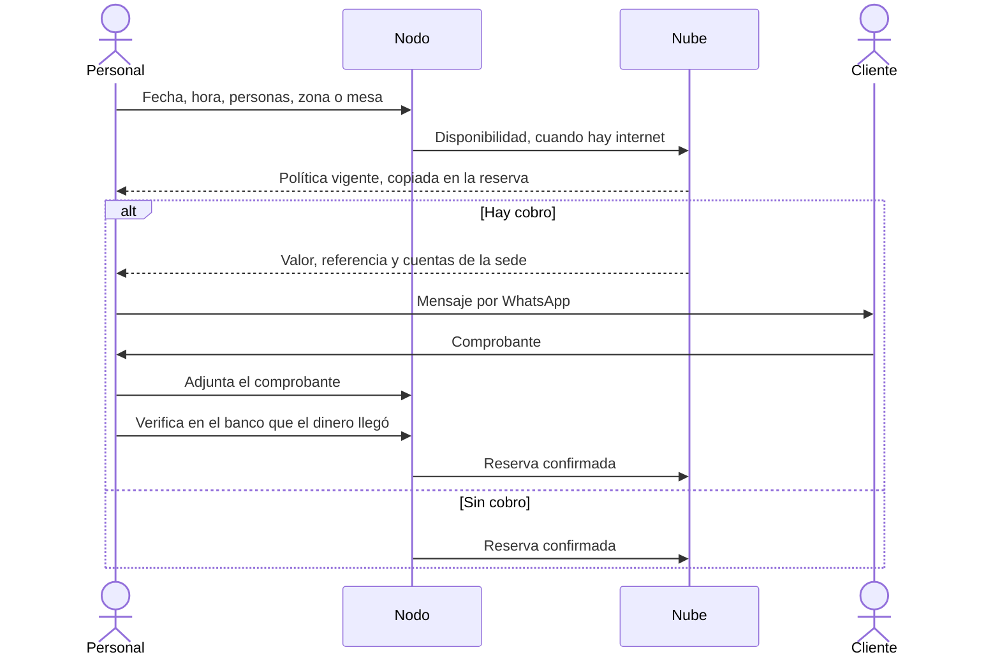
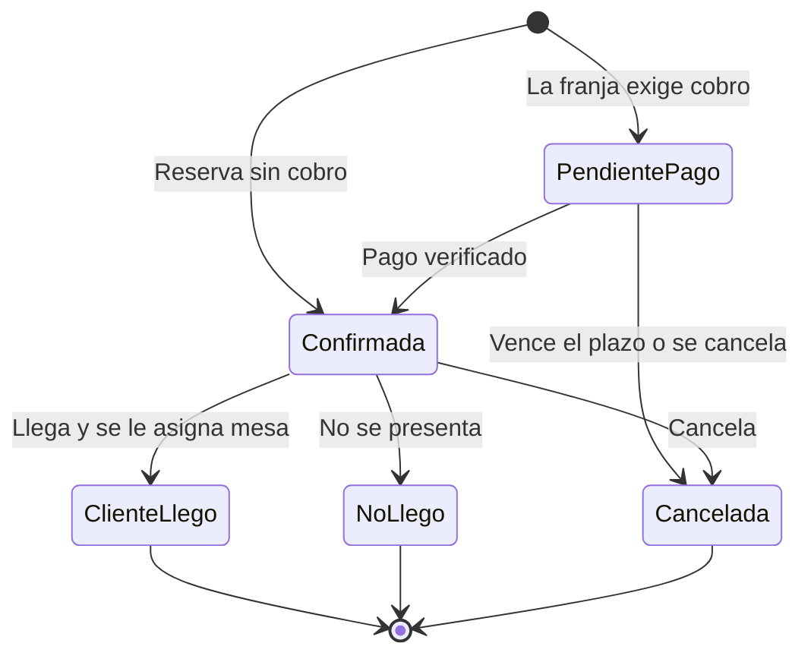
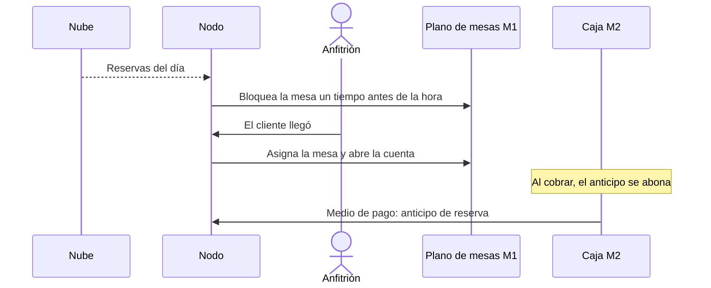
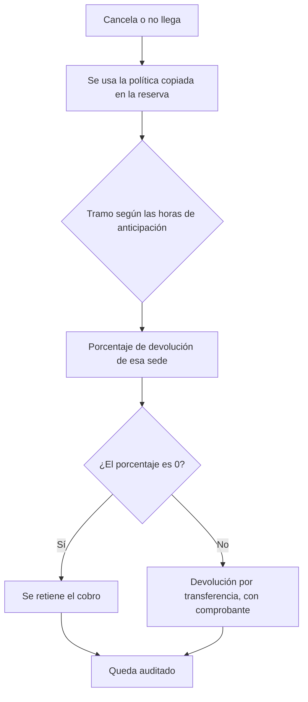

# Flujos · M9 Reservas

| Campo | Valor |
|-------|-------|
| Estado | Borrador |
| Versión | 0.1 |
| Fecha | 2026-10-14 |
| Fuentes | [PRD-00 §6.3 y M9](../prd/PRD-00-vision-producto.md), [TRD-00 §6.2](../trd/TRD-00-arquitectura-base.md) |

La reserva y su cobro viven en la nube, porque pueden nacer fuera del local. Lo que ocurre el día de la reserva en el salón vive en el nodo: llegada, mesa y cuenta. El cobro es una transferencia a Nequi, Daviplata o Bre-B, o efectivo en la sede. Alguien verifica que el dinero llegó.

## Cómo se conecta

| Con | Qué pasa |
|-----|----------|
| M1 | La mesa se bloquea antes de la hora. Al llegar, se abre o se asocia la cuenta. |
| M2 | El anticipo se abona al cobrar y no entra al efectivo del arqueo. |
| M3 | El anticipo va en la factura. El enlace del portal puede ir con la reserva. |
| M0 | Verificar el pago y aprobar una devolución tienen permiso, y quedan auditados. |
| M6 | Ocupación, no llegadas, anticipos retenidos e ingresos por reservas. |

## Reserva con cobro

Sin internet, el nodo crea una reserva provisional. Al sincronizar, la nube la confirma o marca un conflicto de disponibilidad para que el administrador lo resuelva. Quien verifica el pago necesita ver la cuenta del banco, así que esa comprobación usa la conexión de esa persona.

El mismo número de transacción no puede verificar dos reservas de la misma cuenta de recaudo.

## Estados

El cobro, por su lado: pendiente, comprobante recibido, verificado, rechazado. La reserva solo pasa a confirmada cuando el cobro está verificado. El pantallazo no alcanza.

## El día de la reserva

Una tarifa de reserva no se abona al consumo. Un anticipo sí.

## Cancelación y no llegada

Un cambio posterior de la política no altera las reservas ya creadas. La devolución la aprueba quien tiene el permiso.
