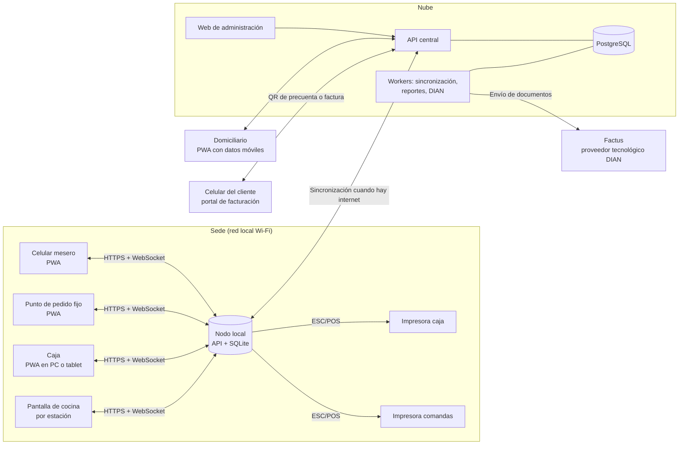
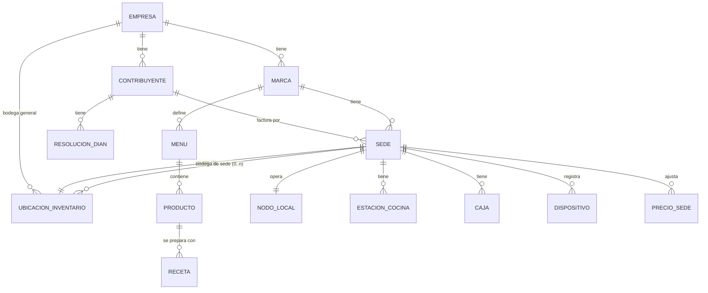
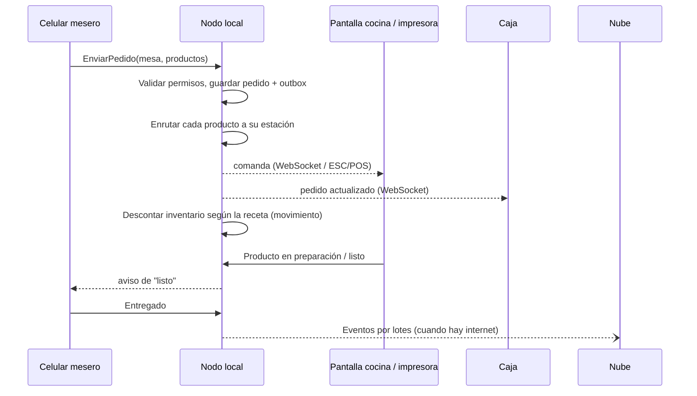
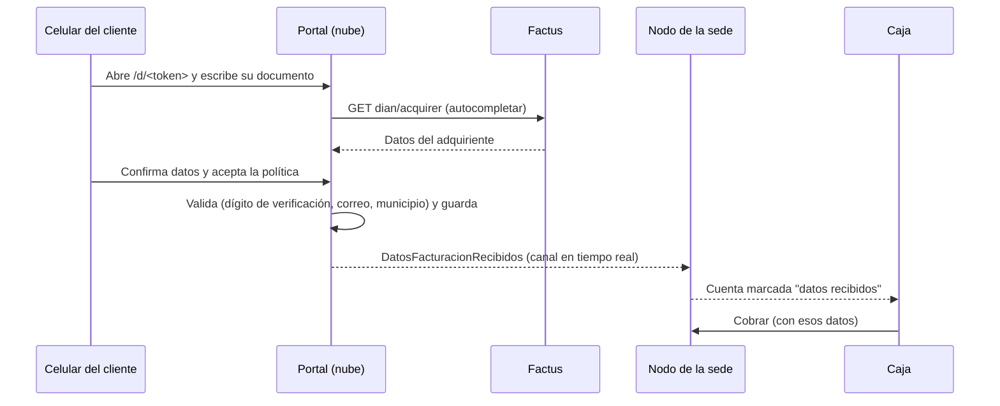

# TRD-00 · Arquitectura base

| Campo | Valor |
|-------|-------|
| Estado | Borrador |
| Versión | 0.2 |
| Fecha | 2026-10-14 |
| Documento de producto asociado | [PRD-00 Visión de producto](../prd/PRD-00-vision-producto.md) |

## 1. Resumen de decisiones

| Tema | Decisión | Estado |
|------|----------|--------|
| Topología | **Nube central + un nodo local por sede** (un mini PC en el local) | Propuesta |
| Operación sin internet | La sede opera completa contra su nodo local; la nube recibe los datos al sincronizar. El internet no es obligatorio (perfiles de conectividad) | Decidido (PRD-00) |
| Clientes | Apps web instalables (PWA) mobile first para mesero, caja, cocina y domiciliario; web para la administración. Los meseros usan su celular personal, Android o iPhone | Decidido; el spike de ADR-003 valida HTTPS local |
| Sincronización | Cada dato tiene **un solo dueño** (nodo o nube). Se envían eventos que solo se agregan, nunca se editan | Propuesta |
| Separación de clientes | Una base de datos compartida, con `tenant_id` y Row Level Security en PostgreSQL | Propuesta |
| Lenguaje | TypeScript de punta a punta, en un monorepo | Propuesta |
| Base de datos | PostgreSQL en la nube; SQLite en el nodo local | Propuesta |
| DIAN | **Factus**, detrás del puerto `ProveedorFacturacion`. Toda venta es **factura electrónica de venta** (a consumidor final si no hay datos). Sin internet: comprobante con QR y **emisión diferida** al reconectar; sin factura de papel | Decidido |
| Impuestos | Motor de impuestos basado en reglas como datos, con vigencias; corre en el nodo y en la nube | Decidido (PRD-00) |
| Impresión | El nodo local imprime en ESC/POS por red o USB | Propuesta |
| Inventario | Un inventario por punto + bodegas. Libro de movimientos que solo se agrega; el stock es un cálculo derivado | Propuesta |
| Auditoría | Eventos encadenados por hash por dispositivo, que no se pueden modificar | Propuesta |
| Código | Monolito modular; arquitectura hexagonal solo en los módulos con reglas de negocio | Propuesta |
| Infraestructura y operación | Terraform con módulos para AWS, GCP y Azure; despliegue continuo; escalado automático; OpenTelemetry y Sentry. Detalle en [TRD-01](TRD-01-infraestructura-y-operacion.md) | Propuesta |

## 2. Restricciones que guían el diseño

1. **Sin internet, la sede sigue operando.** El celular del mesero tiene que llegar a la cocina y a la caja aunque se caiga el internet. Por eso necesitamos un nodo dentro del local, conectado por la red Wi-Fi.
2. **Mobile first.** El mesero usa un celular de gama media. Las pantallas se diseñan para eso.
3. **Equipo pequeño.** Un solo lenguaje, un solo repositorio y poca infraestructura que operar.
4. **Muchos clientes.** Desde el primer día el modelo de datos soporta varias empresas.
5. **La DIAN no es nuestro núcleo.** Nos integramos con un proveedor habilitado.

## 3. Vista general



### Componentes

| Componente | Responsabilidad | Dónde corre |
|------------|-----------------|-------------|
| **Nodo local** | API de la sede, tiempo real (WebSocket), base local, cola de impresión, cola DIAN, sincronización con la nube | Mini PC en la sede (o el PC de la caja) |
| **PWA de salón** | Mesero, punto de pedido fijo, mesas | Celulares y tablets |
| **PWA de caja** | Cobro, turnos, arqueos, propinas | PC o tablet de la caja |
| **Pantalla de cocina** | Cola por estación, cambios de estado y tiempos | Tablet o TV con navegador |
| **PWA de domiciliario** | Pedidos asignados y confirmación de entrega | Celular con datos móviles (habla con la nube) |
| **Portal de clientes** | Datos de facturación del cliente y consulta de facturas, desde un QR o un enlace (8.5) | Nube, web pública |
| **Web de administración** | Configuración, menú, recetas, inventario, reportes y usuarios | Navegador (nube) |
| **API central** | Configuración de la organización, consolidación de datos, reportes y SaaS | Nube |
| **Workers** | Procesar la sincronización, proyecciones de reportes, reintentos DIAN, alertas | Nube |
| **Hub de integraciones** | Recibir pedidos de Rappi, DiDi Food y otras plataformas; publicar menú y disponibilidad; conciliar liquidaciones; llamadas a Factus | Nube |

## 4. Modelo de la organización



- `Contribuyente` es la razón social con NIT, perfil fiscal (sección 8.6) y resoluciones DIAN. Una empresa puede tener varios. Cada sede factura por exactamente uno.
- `UbicacionInventario` es donde vive el stock. Hay dos tipos:
  - `PUNTO`: **exactamente uno por sede**. Todas las ventas de la sede, de cocina o de barra, descuentan de aquí.
  - `BODEGA`: de reabastecimiento. Puede pertenecer a una sede (por ejemplo, en el segundo piso del local) o a la empresa (bodega general que abastece a varias sedes).
- `EstacionCocina` (parrilla, fríos, bar…) solo define **a dónde se enruta** cada producto. No tiene inventario.
- `PrecioSede` permite que una sede ajuste el precio y la disponibilidad del menú de su marca.

## 5. Operación sin internet y sincronización

### 5.1 Cada dato tiene un solo dueño

Evitamos los conflictos definiendo quién es el dueño de cada dato. Solo el dueño lo crea o lo modifica; los demás reciben copias.

| Dato | Dueño | Dirección de la copia |
|------|-------|-----------------------|
| Empresa, marcas, sedes, usuarios, roles | Nube | Nube → nodo |
| Menú, productos, recetas, precios | Nube (web de administración) | Nube → nodo |
| Pedidos, comandas, estados de cocina | Nodo de la sede | Nodo → nube |
| Pagos, turnos, arqueos, propinas | Nodo de la sede | Nodo → nube |
| Documentos DIAN (numeración por caja) | Nodo de la sede | Nodo → nube |
| Movimientos del punto y de las bodegas de la sede | Nodo de la sede | Nodo → nube |
| Movimientos de una bodega general | El nodo de la bodega (ver 5.5) | Nodo → nube |
| Eventos de auditoría | El dispositivo y el nodo que los generan | Nodo → nube |
| Pedidos de domicilio creados por el domiciliario | Nube | Nube → nodo |
| Marcaciones de asistencia | Nodo de la sede | Nodo → nube |
| Datos de facturación de clientes (portal) | Nube, por empresa (ver 8.5) | Nube → nodo: los de la cuenta abierta al instante, y los clientes frecuentes de la sede como copia |
| Reservas y sus pagos en línea | Nube (ver 6.2) | Nube → nodo |
| Llegada, mesa asignada y no llegada de una reserva | Nodo de la sede | Nodo → nube |

Traslados según quién es dueño de cada lado:

- **Bodega de la sede → punto**: los dos lados pertenecen al mismo nodo. El despacho y la recepción son operaciones locales y funcionan sin internet.
- **Bodega general → punto, o entre sedes**: hay dos dueños. **Cada uno registra su mitad**: la salida en el origen y la entrada en el destino. Se reconcilian con el ID del traslado. Mientras no llegue la recepción, el traslado queda "en tránsito".

### 5.2 Mecanismo

- Los IDs son **UUIDv7**: se generan en cualquier dispositivo sin coordinar y se ordenan por tiempo.
- Los cambios se escriben en la base local junto con un registro en una tabla **outbox**, en la misma transacción.
- El nodo envía los eventos de la outbox a la nube en lotes. La nube responde con el último número de secuencia recibido.
- Cada evento lleva `tenant_id`, `sede_id`, `dispositivo_id`, `secuencia`, `ocurrido_en` (reloj del dispositivo) y `recibido_en` (reloj del nodo).
- Al recibir, la nube no procesa dos veces el mismo evento: la clave es `(dispositivo_id, secuencia)`.
- La nube publica los cambios de configuración en un flujo por sede. El nodo los descarga desde su último cursor.
- **Los relojes**: el nodo es la referencia de hora de la sede. Los dispositivos ajustan su desfase al conectarse. Los reportes de tiempos usan la hora del nodo.

### 5.3 Si el nodo local falla

El nodo es un punto único de falla dentro de la sede. Mitigaciones para la Fase 1:

1. Equipo dedicado con UPS y reinicio automático del servicio.
2. Respaldo continuo a la nube (la outbox) y una restauración documentada en menos de 30 minutos con un equipo de repuesto.
3. Si hay internet, los dispositivos pueden operar en **modo nube** como respaldo. La viabilidad se evalúa en la Fase 0 (ADR-004).

Un segundo nodo en espera queda fuera de alcance hasta tener datos reales de fallas.

### 5.4 Riesgo técnico clave: HTTPS dentro del local

Una PWA necesita un contexto seguro (HTTPS) para instalarse y funcionar sin internet. Dentro de la red local sin internet, eso no es trivial. Opciones a validar en el **spike de la Fase 0** (ADR-003):

| Opción | Cómo funciona | Pros | Contras |
|--------|---------------|------|---------|
| A. Certificado real para un subdominio por sede | `sede-xxx.local.dominio.com` apunta a la IP local. La nube emite el certificado por DNS-01 y lo instala en el nodo. El nodo o el router resuelven ese nombre localmente | La PWA funciona en cualquier navegador | Requiere controlar el DNS local (router o DNS del nodo) |
| B. App nativa ligera (Capacitor) para Android | La app se comunica con el nodo por la red local sin depender del navegador | Más control: impresión, notificaciones, kiosko | Hay que publicarla en las tiendas; iOS es más complejo |
| C. Híbrido | PWA para la administración y la cocina, app nativa para el mesero y la caja | Lo mejor de cada opción | Dos formas de distribuir |

**Decisión: opción A.** Los meseros usan **su celular personal** y algunos tienen iPhone. Una PWA evita publicar y mantener una app en las tiendas, y no obliga a instalar nada desde la tienda en un celular personal. La opción B queda solo como alternativa para equipos fijos de la empresa con Android (caja o punto de pedido), si alguna vez hace falta.

Qué hay que tener en cuenta con iPhone (Safari):

- La PWA se instala desde Safari con "Agregar a pantalla de inicio". Necesitamos una guía de instalación de un minuto para el personal.
- Las notificaciones push solo funcionan con la PWA instalada y en iOS 16.4 o superior. Mientras la app está abierta, los avisos de "pedido listo" llegan por WebSocket desde el nodo y no dependen de push.
- Safari no permite vibrar desde la web. Los avisos al mesero en iPhone usan sonido y una señal visual.
- iOS puede borrar los datos de una PWA que no se usa. Por eso **el celular del mesero no guarda datos de negocio**: es un cliente liviano del nodo, y todo vive en el nodo.

Si la sede no tiene internet, la opción A también necesita que el certificado se renueve en una ventana de conexión, antes de vencer. Lo resuelve la sincronización por ventanas de la sección 5.5, pero el spike debe probarlo.

### 5.5 Perfiles de conectividad

El internet no es obligatorio en la sede (PRD-00, sección 9.1). La arquitectura es la misma en todos los perfiles. Solo cambia el **transporte de la sincronización**.

| Perfil | Cómo sincroniza | Hardware adicional |
|--------|-----------------|--------------------|
| Conectada | De forma continua por el internet de la sede | Ninguno |
| Intermitente | Continua, con reintentos y espera creciente entre intentos | Opcional: módem 4G de respaldo en el nodo |
| Sin internet fijo | Por **módem 4G** en el nodo. Como no hay factura de papel, la conexión 4G debe estar activa durante el servicio para facturar al instante; el resto de la sincronización puede ir por ventanas | Módem 4G en el nodo (obligatorio en este perfil) |

Detalles:

- La sincronización envía lotes **comprimidos y reanudables**: si la conexión se corta a mitad de un lote, continúa desde el último evento confirmado.
- **Prioridad de envío**: primero los documentos DIAN, luego la auditoría, luego ventas y caja, luego inventario, y por último la telemetría.
- El nodo envía una señal de vida cada vez que se conecta. La nube alerta si una sede pasa demasiado tiempo sin sincronizar o si tiene facturas pendientes de emisión.
- **Traslados que llegan a una sede sin internet**: el comprobante impreso del despacho lleva un QR con el detalle del traslado. El punto destino lo escanea y registra la recepción aunque todavía no lo haya recibido por la sincronización.
- **Bodega general**: en el piloto tiene internet y personal propio. Lleva **su propio nodo en modo bodega**: es el mismo software del nodo de sede, con los módulos de inventario, recepción, despacho e impresión de comprobantes, y sin salón ni caja. Puede correr en un equipo pequeño.
  - Así la bodega sigue operando si se le cae el internet, con la misma regla que las sedes.
  - Para un cliente con una bodega pequeña y poco movimiento, existe la alternativa de operarla desde la web de administración, sin nodo. En ese caso, sin internet no puede registrar movimientos.
- **Domiciliario en una sede sin internet**: la asignación y el despacho se registran en el nodo. La app del domiciliario guarda la confirmación de entrega y el cobro en el celular, y los sincroniza cuando vuelve a la red Wi-Fi de la sede.

## 6. Flujo del pedido



- El enrutamiento sale de la configuración: un producto pertenece a una estación, y la estación tiene sus pantallas e impresoras.
- Cada cambio de estado (`enviado`, `en_preparacion`, `listo`, `entregado`) guarda su hora. Con eso se calculan los reportes de tiempos del PRD-00, sección 8.1.
- Si una impresora de comandas falla, la comanda sigue en la pantalla de cocina y se avisa a la caja.

### 6.1 Pedidos de plataformas de domicilio

Rappi, DiDi Food y cualquier otra plataforma entran por un **hub de integraciones** en la nube. Cada plataforma es un adaptador de un mismo puerto.

```mermaid
sequenceDiagram
    participant Plat as Plataforma (Rappi, DiDi…)
    participant Hub as Hub de integraciones (nube)
    participant Nodo as Nodo de la sede
    participant Caja as Caja
    participant Cocina as Cocina

    Plat->>Hub: Pedido nuevo (webhook o consulta periódica)
    Hub->>Hub: Verificar firma, evitar duplicados, normalizar a PedidoExterno
    Hub->>Hub: Identificar la sede por el ID de tienda; mapear productos
    Hub-->>Nodo: PedidoExterno (canal en tiempo real nube → nodo)
    Nodo-->>Caja: Alerta: aceptar o rechazar
    Caja->>Nodo: Aceptar
    Nodo->>Nodo: Crear Pedido interno (canal = plataforma)
    Nodo-->>Cocina: Comanda
    Nodo--)Hub: Estado: aceptado, en preparación, listo
    Hub->>Plat: Actualizar estado
```

**Puerto `ConectorPlataforma`**

| Operación | Para qué |
|-----------|----------|
| `normalizarPedido(payload)` | Convertir el formato de la plataforma a nuestro `PedidoExterno` |
| `aceptar` / `rechazar(motivo)` | Responder a la plataforma |
| `actualizarEstado(estado)` | En preparación, listo para recoger |
| `publicarMenu(menuCanal)` | Enviar el menú, los precios y los modificadores del canal |
| `actualizarDisponibilidad(productos)` | Marcar como agotado o disponible |
| `pausarTienda` / `reanudarTienda` | Dejar de recibir pedidos por saturación o porque la sede perdió conexión |
| `obtenerLiquidacion(periodo)` | Traer lo que la plataforma va a pagar, para conciliar |

- Cada conector declara **qué operaciones soporta**, porque no todas las plataformas ofrecen todo. Lo que no soporta se resuelve a mano. Por ejemplo, si la plataforma no permite publicar el menú por API, se publica en su portal y solo se mapean los productos.
- Adaptadores previstos: **Rappi**, **DiDi Food**, **Integrador** (un tercero que ya está conectado a varias plataformas, ver ADR-011) y **Manual**.
- **El adaptador Manual** usa el mismo flujo: la caja captura el pedido desde la tablet de la plataforma, con el canal y el código. Funciona sin internet y es el respaldo de cualquier conector.

**Mapeo de productos**

- `ProductoCanal` relaciona el producto interno con su ID en cada plataforma, con el precio del canal y el mapeo de modificadores.
- Si llega un producto **sin mapear**, el pedido no se pierde: entra con una alerta y la caja lo asocia a mano antes de aceptarlo. Ese mapeo queda guardado para la próxima vez.

**Reglas técnicas**

- **No duplicar pedidos**: la clave única es `(plataforma, id_pedido_externo)`.
- **Seguridad**: se verifica la firma de cada webhook. Las credenciales de cada tienda en cada plataforma se guardan cifradas en la nube.
- **Dueño de los datos**: el `PedidoExterno` pertenece a la nube. Al aceptarlo, el nodo crea el `Pedido` interno y pasa a ser su dueño, igual que cualquier pedido de la sede (sección 5.1).
- **Canal en tiempo real**: el nodo mantiene una conexión WebSocket saliente con la nube. Como sale desde el local, no hay que abrir puertos en el router.
- **Si la sede pierde conexión**: después de un tiempo configurable, el hub **pausa la tienda en las plataformas** que lo permiten, para no recibir pedidos que nadie va a ver. La reanuda cuando el nodo vuelve.
- **Tiempo límite de aceptación**: si se acerca el límite de la plataforma, el nodo sube la alerta en la caja. Si la sede tiene aceptación automática, el nodo acepta solo.
- **Disponibilidad**: cuando cambia `unidades_posibles_punto` (sección 9.3) a agotado o disponible, el nodo emite el evento y el hub lo propaga a todas las plataformas de la sede.
- **Pago**: el medio de pago es la plataforma y queda como cuenta por cobrar. Un worker importa las liquidaciones (por API o archivo), calcula lo esperado con la comisión configurada y marca las diferencias.
- **A validar con el contador**: quién emite el documento DIAN al consumidor final en los pedidos de plataforma, y cómo se registra la factura de comisión que emite la plataforma al restaurante.

### 6.2 Reservas

Las reservas se pueden crear desde fuera del local (enlace público, pago en línea), así que **su dueño es la nube**. Lo que pasa en el local el día de la reserva es del nodo.

| Entidad | Dueño | Contenido |
|---------|-------|-----------|
| `Reserva` | Nube | Cliente, fecha, hora, personas, zona o mesa, estado, política aplicada |
| `CobroReserva` | Nube | Tipo (anticipo o tarifa), valor, cuenta de recaudo, número de transacción, comprobante, quién verificó, estado, devoluciones |
| `AtencionReserva` | Nodo | Llegada, mesa asignada, no llegada, cuenta asociada |

**Flujo**

1. El personal crea la reserva desde la caja o la web. Con internet, el nodo la envía a la nube y la nube valida la disponibilidad.
2. Si hay cobro, el sistema arma el mensaje para el cliente con el valor, la **referencia de la reserva** y las cuentas de recaudo de la sede (Nequi, Daviplata, llave Bre-B o QR). El personal lo envía por WhatsApp. La reserva queda `pendiente_pago` con una fecha límite; si se vence, se libera.
   - El cliente envía el comprobante; se adjunta a la reserva y el cobro pasa a `comprobante_recibido`.
   - Alguien con el permiso `reserva.verificar_pago` revisa en la app del banco que el dinero llegó y lo marca `verificado`. Solo entonces la reserva queda `confirmada`. Se guarda quién verificó, cuándo y el número de la transacción.
   - Por ahora no hay confirmación automática: Nequi, Daviplata y Bre-B no ofrecen de forma general una API de notificación para comercios pequeños. Si más adelante se usa una pasarela, entra como otro adaptador del puerto `PasarelaPagos` (ADR-012).
3. Las reservas del día bajan al nodo y aparecen en el plano de mesas.
4. Cuando el cliente llega, el nodo registra la `AtencionReserva` y asocia la mesa y la cuenta.
5. Al cobrar, el anticipo se aplica como un medio de pago especial (**anticipo de reserva**). No entra al arqueo de efectivo, porque no pasó por la caja. Se informa en el documento DIAN como anticipo (`prepayment_details` en Factus).
6. Si el cliente no llega, el nodo marca la no llegada y la nube aplica la política: retiene el cobro o calcula la devolución, que el personal hace por transferencia y registra con su comprobante.

**Sin internet**

- El nodo puede crear una reserva **provisional**. Al sincronizar, la nube la confirma o marca un **conflicto de disponibilidad**, que el administrador resuelve.
- El cobro por transferencia funciona igual: el mensaje se arma en el nodo y la verificación se registra en el nodo y se sincroniza después. Quien verifica necesita su propia conexión para revisar la app del banco.

**Reglas técnicas**

- **No duplicar pagos**: el número de transacción del banco es único por cuenta de recaudo. Si alguien intenta verificar dos reservas con el mismo número, el sistema lo bloquea y alerta. Esto frena el reuso de un mismo comprobante.
- Los comprobantes adjuntos se guardan en almacenamiento de objetos en la nube, asociados a la reserva.
- Los cambios de estado de un cobro (pagado, retenido, devuelto) son eventos que solo se agregan y quedan en la auditoría.
- `PoliticaReserva` por sede: tipo de cobro (ninguno, anticipo, tarifa), cálculo del valor (fijo, por persona, porcentaje de un consumo mínimo) y **tramos de devolución** `(horas_de_anticipación_mínimas, porcentaje_devolución)` de 0 % a 100 %.
- Al crear la reserva se guarda una **copia de la política vigente** en la reserva. La devolución se calcula siempre con esa copia.
- Devolución = cobro × porcentaje del tramo que corresponde a la hora de cancelación. Se hace por transferencia y se registra con su comprobante.

### 6.3 Caja: datáfonos y propinas

**Datáfonos (Credibanco, Bold, Redeban)**

- Fase 1: **registro** del pago con tarjeta en la caja (datáfono, número de aprobación, franquicia, últimos 4 dígitos). Nada de datos completos de la tarjeta: así no entramos al alcance de PCI DSS.
- En el arqueo, el total por datáfono se compara con el reporte de cierre del datáfono, que se ingresa o se fotografía.
- Integración directa (el monto viaja solo al datáfono y vuelve la aprobación): se evalúa por proveedor en ADR-007, según lo que ofrezca cada uno. Queda detrás de un puerto `Datafono`, con un adaptador por proveedor y uno manual.

**Reparto de propinas**

- `Propina` se registra por pago, con su medio de pago. Va separada de la venta y fuera de la base gravable.
- `ReglaReparto` por sede: periodo (turno, día, semana), modo (`EQUITATIVO`, `PORCENTAJE`, `POR_HORAS`) y porcentajes por rol o persona, que deben sumar 100 %.
- `LiquidacionPropinas` por periodo:
  1. Suma el fondo común del periodo.
  2. Toma como participantes a quienes tienen marcación de asistencia en el periodo (10.4), y el administrador puede ajustar la lista con un motivo.
  3. Aplica la regla y reparte. El redondeo al peso se asigna de forma determinista, para que el total cuadre exacto.
  4. Queda **cerrada e inmutable**. Una corrección es una liquidación de ajuste.
- La regla usada se guarda en la liquidación, así un cambio posterior de la regla no altera liquidaciones pasadas.

## 7. Impresión térmica

- Protocolo **ESC/POS**. Impresoras de red (TCP 9100) o USB conectadas al nodo. Papel de 80 mm y 58 mm.
- La impresión siempre sale del **nodo**, porque los navegadores no pueden enviar ESC/POS directamente a la impresora.
- Cola de impresión con reintentos, estado de cada impresora y reimpresión auditada.
- Plantillas: comanda, precuenta, documento DIAN (con QR y CUDE/CUFE), cierre de caja, traslado y comprobante de propinas.
- El comando para abrir el cajón monedero va a la impresora de la caja. Toda apertura queda auditada.
- Una impresora de red puede tener una impresora de respaldo configurada.

## 8. Facturación electrónica DIAN

### 8.1 Diseño

**Proveedor elegido: [Factus](https://www.factus.com.co/)** (ADR-002).

```
Dominio de facturación  ──usa──▶  Puerto ProveedorFacturacion
                                        ▲
                       ┌────────────────┼────────────────┐
               Adaptador Factus    Adaptador simulado    (otro proveedor, si hiciera falta)
```

**Documento único: factura electrónica de venta** (`document: "01"`) en todas las ventas y todas las sedes. No se usa el documento equivalente electrónico POS. Lo único que cambia de una venta a otra es el adquirente: el cliente identificado o el genérico.

- **Adquirente genérico** cuando el cliente no da datos: tipo de documento `13`, número `222222222222`, nombre "Consumidor final", responsabilidad `R-99-PN` y un correo interno configurable por contribuyente. Es un objeto de valor del dominio, no un registro editable.
- **Invariante: una venta tiene exactamente un documento principal** (más sus notas crédito). No existe una operación que agrupe varias ventas en un documento. Esto cumple el artículo 5 de la Resolución 000165 de 2023, que pide expedir el documento "por todas y cada una de las operaciones… al momento de efectuarse estas".
- Si la venta es un domicilio (fuera del local) y el adquirente es genérico o solo tiene nombre y cédula, el documento incluye la **dirección de entrega**, como pide el artículo 11, numeral 3.3, de la misma resolución.

- El dominio arma el documento (ítems, impuestos, propina separada, anticipos, totales, comprador) **sin depender de Factus**.
- El adaptador lo traduce a la API de Factus. Si algún día hay que cambiar de proveedor, solo se escribe otro adaptador.
- **Las llamadas a Factus salen solo desde la nube.** El nodo envía el documento en su sincronización, con prioridad máxima. Así el token de Factus nunca queda guardado en el local.

### 8.2 Integración con Factus

Fuente: [documentación de Factus API v2](https://developers.factus.com.co/coleccion) y sus [preguntas frecuentes](https://developers.factus.com.co/buenas-practicas/preguntas-frecuentes/), revisadas el 2026-10-14.

**Decisión clave: toda venta se emite como factura electrónica de venta.** Factus **no emite el documento equivalente electrónico POS** (confirmado de nuevo en sus preguntas frecuentes el 2026-10-14), y el negocio decidió no usarlo. Para puntos de venta, Factus indica usar la **factura electrónica de venta** (`document: "01"`), que es válida ante la DIAN y se puede emitir a **consumidor final** (cédula `13`, número `222222222222`, nombre "Consumidor Final"). Si el cliente pide factura a su nombre o NIT, se envían sus datos. **Pendiente: que el contador confirme este enfoque** (8.4).

| Tema | Lo que dice Factus | Cómo lo usamos |
|------|--------------------|----------------|
| Autenticación | OAuth2. El token vence cada 60 minutos y se renueva con el token de refresco | Un token por contribuyente, renovado por la nube antes de vencer |
| URL base | Sandbox `https://api-sandbox.factus.com.co/`; producción `https://api.factus.com.co/` | Configuración por ambiente |
| Emisión | `POST /v2/bills/validate`: crea y envía a la DIAN en la misma llamada. Respuesta en unos **2,5 segundos** para pocos ítems | Llamada síncrona desde la nube; la respuesta vuelve al nodo para imprimir |
| No duplicar | `reference_code` único por factura. Si se repite, Factus devuelve la factura existente. Un `409` indica una factura sin validar que hay que eliminar por su referencia antes de reintentar | `reference_code` = ID (UUIDv7) de nuestro documento. Reintentos seguros |
| Límite de uso | **80 solicitudes por minuto por usuario (NIT)**. Responde `429` con `Retry-After`. Ampliable según el volumen | Cola por NIT en la nube con control de ritmo; pedir ampliación para NIT con muchas sedes |
| Webhooks | **No tiene** | No hace falta para emitir, porque la respuesta es síncrona. El estado de otros documentos se consulta |
| Numeración | Rangos de factura y documento soporte autorizados por la DIAN y asociados a Factus; se listan por API (`numbering-ranges`). **Factus asigna el consecutivo**. Un NIT puede tener rangos ilimitados | Un rango por sede, o por caja si se quiere separar. Los rangos de notas crédito se crean en la API |
| Varias sedes, un NIT | Un rango por sucursal y el objeto `establishment` (nombre, dirección, teléfono, municipio) en cada factura | Cada sede envía su `establishment` y su `numbering_range_id` |
| Medios de pago | `payment_details`, uno por medio. Códigos: `10` efectivo, `48` tarjeta crédito, `49` tarjeta débito, `47` transferencia (también Nequi y Daviplata), `71` bonos, `72` vales, `ZZZ` otro. Forma de pago `1` contado, `2` crédito | Tabla de mapeo de nuestros medios a códigos DIAN |
| Redondeo | `cash_rounding_amount` de hasta ±500 para cuadrar los pagos con el total | Cuadra el total con el precio del menú (8.6) |
| Propina | Va en `allowance_charges` como **recargo** (`concept_type: "03"`, `is_surcharge: true`, `reason: "propina"`) | La propina de la venta se envía así |
| Anticipo | `prepayment_details`: referencia, fecha y monto | Anticipos de reservas (6.2) |
| Impuestos | Por ítem, con código y tarifa: `01` IVA, `04` INC, `35` ultraprocesados. Exento: `01` al 0 % o `is_excluded`. **No responsable de IVA: los productos van excluidos.** Varios impuestos se calculan uno tras otro con redondeo bancario | Salida directa del motor de impuestos (8.6) |
| Bolsas plásticas | No es un código de impuesto: se envía como **un ítem más**, con el valor por bolsa | El motor genera una línea "bolsa" |
| Responsabilidades del RUT | `O-13` gran contribuyente, `O-15` autorretenedor, `O-23` agente de retención de IVA, `O-47` régimen simple, `R-99-PN` no responsable | Parte del `PerfilFiscal` |
| Datos del cliente | `GET /v2/dian/acquirer?identification_document_code=&identification_number=` usa un servicio nuevo de la DIAN y devuelve **solo el nombre o razón social y el correo** de recepción de facturas. No trae dirección, teléfono ni municipio. Sin costo publicado; cuenta dentro del límite de 80 solicitudes por minuto del NIT. En sandbox solo responde con los números de prueba de la documentación | Autocompletar nombre y correo en la caja y en el portal (8.5) |
| Notas crédito de anulación | `POST /v2/credit-notes/validate` con `correction_concept_code: "2"` (anulación), `customization_id: "20"` (referencia una factura) y `bill_number`. Si no se envía `customer`, toma el de la factura. Los rangos de notas crédito se crean en la API, no en la DIAN. **Cada nota validada consume un documento** del paquete. La documentación no fija un plazo para emitirla | Anulaciones, devoluciones y refacturación desde el portal (8.5) |
| Correo | Factus envía el PDF, el XML y un enlace público. Con `send_email: false` no lo envía y se puede mandar un PDF propio | Correo de Factus por defecto; envío por WhatsApp en una fase posterior |
| Representación gráfica | Se puede generar con los datos de la respuesta | **Representación térmica propia** con los datos de la respuesta (número, CUFE, QR) |
| Documento soporte | `POST support-documents/validate` | Compras a proveedores que no facturan (M4) |
| Recepción de facturas | `POST receptions/upload` (cargar el XML del proveedor) y eventos RADIAN; consulta de XML por CUFE | Cargar compras de proveedores al inventario (M4, Fase 2) |
| Almacenamiento | Factus guarda los documentos 5 años | Nosotros guardamos el número, el CUFE y el XML para consulta propia |

**Ambientes**

- **Sandbox compartido**: gratis, sin límite de documentos. Es **público entre integradores**: nunca enviar datos reales de clientes ahí.
- **Sandbox privado y producción**: se activan al comprar un paquete. Las pruebas no consumen documentos.
- En pruebas, la DIAN permite **un solo rango** de facturación.

**Credenciales**: cada contribuyente tiene su propia cuenta en Factus. Las credenciales se guardan cifradas en la nube y nunca en el nodo.

**Bolsa de documentos por empresa** (decisión del negocio)

- Cada **empresa** cliente del SaaS tiene **su propia bolsa** de documentos en Factus, y todos sus NIT consumen de ella. Falta confirmar con Factus que una bolsa se puede compartir entre varios NIT (8.4). Si no se puede, cada NIT tendrá su bolsa y el sistema las mostrará sumadas como el saldo de la empresa.
- **Qué consume un documento**: cada factura, cada nota crédito y cada documento soporte validados. Una refacturación consume 2. Las pruebas en el sandbox no consumen.
- **Saldo en el sistema**: llevamos un contador propio de documentos consumidos por empresa, NIT y sede, a partir de las respuestas de Factus. Se concilia con el saldo que reporte Factus, si su API lo expone (8.4), o con su panel.
- **Alerta temprana de saldo**, con la misma idea que la de inventario (9.4):
  - Amarilla cuando el saldo cubre menos de N días al ritmo de facturación de la empresa (por defecto, 15 días).
  - Roja con menos de 5 días.
  - Avisa al administrador de la empresa y a nuestro equipo de soporte.
- **Si la bolsa se agota**: Factus rechaza la emisión, pero **la venta nunca se bloquea**. El documento queda `pendiente_emision` con el motivo "sin saldo", el cliente recibe el comprobante con QR (8.3) y la factura se emite sola cuando se recarga la bolsa. Se dispara una alerta crítica.
- **Reporte de consumo** por NIT y sede, para repartir el costo de la bolsa entre las sedes y para definir el precio de la suscripción en la Fase 4 (M7).
- El **límite de 80 solicitudes por minuto sigue siendo por NIT**, aunque la bolsa sea de la empresa. La cola de emisión controla el ritmo por NIT (8.3).

### 8.3 Numeración y emisión sin internet

**Decisiones del negocio**

- **Cada venta lleva su propia factura electrónica de venta.** Si el cliente no da datos, va a **consumidor final** (cédula `13`, número `222222222222`, nombre "Consumidor final").
- **No se acumulan ventas en facturas globales**, ni diarias ni mensuales. No es configurable.
- **No se usa factura de papel en contingencia.** No hay rango de contingencia ni transmisión tipo 03.

Como Factus asigna el consecutivo, **sin internet no se puede emitir la factura en el momento**. El sistema hace una **emisión diferida**:

| Situación | Qué recibe el cliente | Qué pasa con la factura |
|-----------|-----------------------|-------------------------|
| Con internet | Factura electrónica impresa (número, CUFE, QR) en unos 2,5 segundos | Emitida al instante |
| Sin internet | **Comprobante de venta** impreso, que dice claramente "no es factura", con un **QR de consulta** | Queda en cola como `pendiente_emision` y se emite sola al volver la conexión, en orden de venta |
| Al volver internet | Si dejó correo o celular, le llega la factura | Factus la valida; el QR del comprobante pasa a mostrar la factura |

- El **QR de consulta** apunta a una URL nuestra (por ejemplo `/f/<reference_code>`). Mientras la factura está pendiente muestra "en proceso"; cuando Factus la valida, muestra la factura con su enlace público de Factus y el PDF.
- La caja puede **reimprimir** la factura electrónica cuando ya esté emitida (por ejemplo, si el cliente vuelve).
- La factura queda con la **fecha y hora de la validación**, no de la venta. Nuestro `DocumentoVenta` guarda las dos.

**Flujo de emisión**

1. La caja cierra la venta y el nodo crea el `DocumentoVenta` con su `reference_code` (UUIDv7 del documento).
2. **Con conexión a la nube**: la nube llama a `POST /v2/bills/validate`. Con la respuesta, el nodo imprime la factura.
3. **Sin conexión**: el nodo imprime el comprobante con QR y deja el documento en `pendiente_emision`.
4. Al reconectar, la nube emite los pendientes **en orden de venta, antes que cualquier otro dato**, respetando el límite de 80 solicitudes por minuto del NIT.

**Envío cortado a mitad de camino**

Si la llamada a Factus salió pero no llegó la respuesta, el documento queda `incierto`. **Antes de reintentar, se verifica si se emitió**:

1. Consultar `GET /v2/bills?filter[reference_code]=<reference_code>`.
2. Según el resultado:
   - **Validada** (`status = 1`): se toma esa factura (número, CUFE, QR). No se reenvía.
   - **Pendiente por validar** (`status = 0`, o un `409` al reenviar): se elimina con `DELETE bills/destroy/reference/<reference_code>` y se vuelve a enviar.
   - **No existe**: se vuelve a enviar con el mismo `reference_code`.
3. Si la verificación falla por falta de internet, el documento sigue `incierto` y se reintenta la verificación con espera creciente.

Como el `reference_code` es idempotente en Factus (si se repite, devuelve la factura existente), **una venta nunca queda con dos facturas**.

**Estados del documento**: `generado`, `enviando`, `aceptado`, `rechazado`, `pendiente_emision`, `incierto`. Los rechazos generan una alerta; se corrigen los datos y se reenvía con una referencia nueva, o se emite una nota crédito si ya estaba validada.

**Alertas**:
- Documentos `pendiente_emision` o `incierto`, con cuántos son y su antigüedad.
- Rango de numeración por agotarse y resolución por vencerse.
- `429` repetidos de Factus.

**Riesgo asumido**: la norma pide entregar la factura al momento de la venta. Al no usar contingencia, las ventas sin internet se facturan con retraso. Mitigaciones:
- **Módem 4G de respaldo recomendado en todas las sedes**, para que el tiempo sin conexión sea mínimo.
- Emisión inmediata y automática al reconectar.
- Alerta al administrador si hay pendientes por más de un tiempo configurable (por ejemplo, 1 hora).

### 8.4 Pendientes con Factus y con el contador

La mayoría de las preguntas a Factus quedaron respondidas con su documentación (8.2). Quedan:

**Para Factus**

1. **Bolsa por empresa**: ¿una misma bolsa la pueden consumir varios NIT de una empresa? ¿La API expone el **saldo de documentos** para consultarlo automáticamente? (No bloquea: se arranca con lo que ofrezcan hoy.)
2. **Precio por volumen y ampliación del límite de 80 solicitudes por minuto por NIT**: **no se negocian para arrancar.** Se empieza con las condiciones estándar y se revisan al crecer, cuando se cumpla alguna de las señales de abajo.

**Cuándo volver a negociar con Factus**

El sistema mide estas señales desde el primer día, para negociar con datos reales:

| Señal | Umbral sugerido para pedir más | Qué se pide |
|-------|--------------------------------|-------------|
| Respuestas `429` (límite alcanzado) de un NIT | Más de unas pocas por semana en hora pico | Ampliar el límite de ese NIT |
| Pico de facturas por minuto de un NIT | Por encima del 60 % del límite (unas 50 por minuto) | Ampliar el límite antes de llegar al tope |
| Tiempo para vaciar la cola de pendientes al reconectar | Más de 15 minutos | Ampliar el límite |
| Documentos consumidos por mes, sumando todas las empresas | Cada vez que se duplique | Precio por volumen o un acuerdo de integrador |
| Número de empresas clientes | Al llegar a unas 10 empresas | Acuerdo comercial de SaaS con Factus |

Estas métricas salen en el panel de soporte (M7) y generan una alerta interna cuando se cruza un umbral.
3. ¿Se pueden enviar facturas en paralelo sobre el mismo rango sin conflicto de consecutivos?
4. ¿La fecha de emisión se puede enviar con la fecha real de la venta, o siempre es la de validación?
5. **Confirmar por escrito** que `GET dian/acquirer` no consume documentos del paquete. La documentación no publica costo ni límite propio: solo aplica el límite general de 80 solicitudes por minuto del NIT, compartido con la emisión.

**Decididas por el negocio**

- Factura electrónica de venta en todas las ventas, a consumidor final `222222222222` cuando no hay datos del cliente.
- Envío cortado: verificar por `reference_code` y reintentar solo si no se emitió (8.3).
- Sin factura de papel en contingencia: emisión diferida al volver internet (8.3).

**Para el contador** (recomendado, aunque no bloquea el desarrollo)

1. La propina como recargo en `allowance_charges`, y si afecta o no la base de los impuestos.
2. El tratamiento de los anticipos de reservas y de los montos retenidos por cancelación o no llegada.
3. Conocer el riesgo de la emisión diferida sin contingencia, y si el comprobante de venta necesita algún texto obligatorio. Como referencia: la norma de contingencia da 48 horas, desde que se restablece el servicio, para transmitir lo emitido en contingencia; nosotros no usamos ese mecanismo.
4. **Refacturación** (PRD-00, regla 10). Técnicamente Factus lo permite: nota crédito de anulación (código `2`) que referencia la factura, y una factura nueva con los datos del cliente. La documentación de Factus **no fija un plazo**; el plazo es una decisión fiscal. Preguntas:
   - ¿Es válido anular una factura de consumidor final para reemplazarla por una a nombre del cliente?
   - ¿Qué plazo máximo usar? Recomendación técnica: **dentro del mismo mes calendario**, para no mover declaraciones ya presentadas de IVA o INC ni cierres contables. Por defecto, en el sistema: el mismo día.
   - ¿La nota crédito y la factura nueva deben llevar alguna observación que las relacione?
**Requisitos para activar cada NIT en Factus** (onboarding de un cliente):

- Cámara de Comercio con menos de 30 días.
- Cédula del representante legal.
- RUT.
- Rango de numeración autorizado por la DIAN y asociado a Factus. Lo solicita, desde el usuario DIAN de la empresa, quien tenga acceso a ese usuario.
- Certificado digital: viene incluido en los paquetes individuales; en las bolsas se compra aparte (unos $130.000 al año por NIT, según Factus).
- La activación tarda de 1 a 3 días hábiles.

### 8.5 Portal de datos de facturación

Página web pública donde **el cliente registra sus datos de facturación desde su celular**, para que nadie los digite en la caja (PRD-00, sección 6.1.1).

**Dónde vive**

- App `portal-clientes` en la nube, mobile first, liviana (sin instalar nada). La misma app atiende la consulta de facturas `/f/<reference_code>` (8.3).
- **No corre en el nodo.** El cliente usa sus datos móviles, y el nodo no atiende dispositivos sin registrar (10.1.2).

**Enlaces**

| Entrada | URL | Atada a | Vence |
|---------|-----|---------|-------|
| QR de la precuenta | `/d/<token>` | La cuenta abierta | Cuando se emite la factura, o a las 24 h |
| QR del comprobante o de la factura | `/f/<reference_code>` | El documento de venta | Si está pendiente: hasta que se emite. Si ya se emitió: al terminar el plazo de refacturación (PRD-00, regla 10) |
| Enlace por WhatsApp (domicilio, reserva) | `/d/<token>` | El pedido o la reserva | Igual que la precuenta |

El `token` es aleatorio, de un solo propósito y firmado. El nodo lo genera al imprimir la precuenta, así funciona aunque la sede esté sin internet en ese momento.

**Flujo con la sede en línea**



**Si la sede está sin internet**

- El cliente igual llena el portal con sus datos móviles. Los datos quedan en la nube, asociados al token.
- La caja cobra sin verlos, y la factura queda `pendiente_emision` (8.3).
- Cuando la nube emite los pendientes, **usa los datos del portal si llegaron antes de la emisión**. Si no, emite a consumidor final.

**Datos y dueños**

| Entidad | Dueño | Notas |
|---------|-------|-------|
| `ClienteFiscal` | Nube, por empresa (`tenant_id`) | Campos del objeto `customer` de Factus. Solo se guarda si el cliente marcó "recordar mis datos" |
| `DatosFacturacionCuenta` | Nube | Copia de los datos usados en una cuenta o documento. Se guarda siempre, porque respalda la factura |
| Copia en el nodo | Nodo (solo lectura) | Clientes frecuentes de la sede (por ejemplo, los de los últimos 6 meses), para buscarlos en la caja sin internet |

**Autocompletado desde la DIAN**

- `GET dian/acquirer` devuelve **solo nombre y correo**. El resto (persona natural o jurídica, dirección, teléfono, municipio) lo completa el cliente. Solo son obligatorios el documento, el tipo de persona y el nombre o razón social; dirección, teléfono y municipio son opcionales en Factus.
- **Privacidad**: la consulta devuelve el nombre y el correo de **cualquier** documento. Por eso el portal **no muestra los datos completos**: muestra el nombre y el correo enmascarados (por ejemplo, "J*** P***" y "j***@gmail.com") y pregunta "¿Usar estos datos?". Si el cliente quiere otro correo, lo escribe completo.
- **Límite compartido**: las consultas cuentan dentro de las 80 solicitudes por minuto del NIT, igual que la emisión. La cola de la nube **siempre prioriza la emisión de facturas**. El resultado se guarda en caché por documento y por empresa, para no repetir consultas.
- Si la consulta no responde o no encuentra datos, el formulario sigue funcionando a mano.

**Validaciones**

- Dígito de verificación del NIT (módulo 11). Si no se envía, Factus lo calcula; para cédula no se envía.
- Formato del correo.
- Municipio desde el JSON de municipios de Factus (catálogo DANE), incluido en la app.
- Nombre obligatorio para persona natural y razón social para persona jurídica.

**Clientes que vuelven**

- En el portal: el cliente escribe su documento. Si tiene datos guardados, se le envía un **código de un solo uso** al correo o al celular registrado, y solo después de validarlo se muestran sus datos (enmascarados hasta confirmar). Así nadie ve los datos de otra persona con solo saber su cédula.
- En la caja: el cajero busca por documento entre los clientes guardados (copia en el nodo) o consulta la DIAN.

**Refacturación desde el portal** (si la empresa la activa y el contador la valida)

1. El cliente abre `/f/<reference_code>` de una factura ya emitida a consumidor final, dentro del plazo.
2. Registra sus datos.
3. Según la configuración: la nube emite la **nota crédito** de anulación y la **nueva factura** con sus datos, o crea una solicitud para que el administrador la apruebe.
   - Nota crédito: `POST /v2/credit-notes/validate` con `correction_concept_code: "2"`, `customization_id: "20"`, `bill_number` de la factura original y los mismos ítems. Sin `customer`, para que tome el de la factura (consumidor final).
   - Factura nueva: los mismos ítems, impuestos, propina y pagos, con el `customer` del portal y un `reference_code` nuevo.
   - Orden: primero la nota crédito. Solo si queda validada se emite la factura nueva. Si la factura nueva falla, se reintenta con el mismo `reference_code`; la venta nunca queda sin factura vigente por más tiempo del necesario.
4. Las dos operaciones quedan enlazadas al documento original y en la auditoría.
5. **Costo**: cada refacturación consume **2 documentos** del paquete de Factus (la nota y la factura nueva). El reporte de refacturaciones lo muestra por sede, para controlarlo.

**Seguridad y privacidad**

- Límite de solicitudes por token y por IP, y captcha si se detecta abuso.
- `GET dian/acquirer` solo se llama desde un token válido, para que el portal no sirva para consultar a la DIAN sin control.
- Autorización de tratamiento de datos (Ley 1581) guardada con fecha, versión de la política y el token. El titular puede pedir la eliminación de sus datos guardados. Los datos que respaldan facturas ya emitidas se conservan por obligación legal.
- Los datos de una empresa nunca se usan en otra (Row Level Security, sección 12).

### 8.6 Motor de impuestos

El motor soporta todos los regímenes de PRD-00, sección 7.1. **Las reglas son datos, no código.**

```
PerfilFiscal (contribuyente)  ┐
ClasificacionTributaria (producto) ├──▶ ReglaImpuesto (con vigencia) ──▶ Impuestos de la línea
Contexto (canal, fecha, bolsa)  ┘
```

- **`PerfilFiscal`**: tipo de persona, régimen (ordinario o SIMPLE), responsabilidad de IVA, responsabilidad de INC, responsabilidades del RUT, franquicia y municipio de cada sede.
- **`ClasificacionTributaria`**: cada producto tiene una clasificación (por ejemplo "servicio de restaurante", "bebida empacada", "bolsa"). Así no hay que configurar el impuesto producto por producto.
- **`ReglaImpuesto`**: combina el perfil, la clasificación y el contexto, y devuelve uno o varios impuestos (tipo, tarifa porcentual o valor fijo, código DIAN). Tiene `vigente_desde` y `vigente_hasta`.
- **El motor es una función pura** en el paquete `dominio`. Se ejecuta igual en el nodo, sin internet, y en la nube.
- Las reglas se sincronizan de la nube al nodo como el resto de la configuración. Cada línea de venta guarda **qué regla y qué versión** se aplicaron, para poder auditar después.
- **Precio con impuestos incluidos**: el menú muestra el precio final, pero Factus recibe el **precio sin impuestos** (`price`, con máximo 2 decimales).
  - base = precio del menú ÷ (1 + suma de tarifas porcentuales), con 2 decimales.
  - Los impuestos se calculan uno tras otro con **redondeo bancario**, igual que Factus.
  - La diferencia entre el total calculado y lo que paga el cliente se envía en `cash_rounding_amount` (máximo ±500).
  - El motor replica el cálculo de Factus para que el total impreso y el validado coincidan. Se prueba con casos reales en el sandbox.
- **Impuestos de valor fijo** (bolsas plásticas): no van como impuesto sino como **una línea de ítem** con el valor por bolsa, como indica Factus.
- **No responsable de IVA**: si el contribuyente no es responsable de IVA, todos sus productos se envían excluidos.
- **Retenciones**: no se calculan en la venta al consumidor final. Se registran al recibir el pago de un cliente corporativo (cartera).
- **Perfiles predefinidos**: plantillas de `PerfilFiscal` y `ReglaImpuesto` para las combinaciones comunes, validadas por un contador. Un cliente nuevo elige su plantilla en la configuración inicial.
- **Pruebas**: una tabla de casos por régimen, con el precio, el desglose y el documento esperados. Esos casos se usan como pruebas automáticas en cada cambio.

## 9. Inventario

### 9.1 Modelo

- **Libro de movimientos**: cada entrada o salida es un registro que no se modifica. Tiene `ubicacion_id`, `insumo_id`, `cantidad` (con signo, en la unidad base), `costo_unitario`, `tipo`, `referencia` y `ocurrido_en`.
- Tipos de movimiento: `COMPRA`, `CONSUMO_VENTA`, `DEVOLUCION_VENTA`, `MERMA`, `PRODUCCION_CONSUMO`, `PRODUCCION_SALIDA`, `TRASLADO_SALIDA`, `TRASLADO_ENTRADA`, `AJUSTE_CONTEO`.
- **Stock actual** = suma de los movimientos, guardada en una tabla de saldos que se actualiza en la misma transacción.
- **Costo**: promedio ponderado por ubicación.
- **Unidades**: cada insumo tiene una unidad base (g, ml o unidad) y conversiones a su unidad de compra y de receta.
- El stock **puede quedar negativo**. La venta nunca se bloquea (PRD-00, regla 1) y se genera una alerta.

### 9.2 Descuento por receta

1. Al enviar un producto a cocina, se toma su receta (según la variante) y se aplican los modificadores.
2. Se expanden las sub-recetas en el momento solo si no se manejan con stock propio. Si la preparación intermedia tiene stock, se descuenta la preparación, no sus ingredientes.
3. Se aplica el rendimiento: cantidad bruta = cantidad neta ÷ rendimiento.
4. Se genera un movimiento `CONSUMO_VENTA` por insumo, en la ubicación `PUNTO` de la sede. La estación no cambia la ubicación de la que se descuenta.
5. La receta queda **versionada**: el movimiento guarda qué versión se usó.

### 9.3 Cuánto se puede producir

Para cada producto de una sede:

```
unidades_posibles_punto   = mínimo, entre los ingredientes, de (stock_punto ÷ cantidad_por_unidad)
unidades_con_reabastecer  = igual, usando stock_punto + stock de las bodegas que abastecen la sede
ingrediente_limitante     = el que da el mínimo
```

- La **disponibilidad en el menú** usa solo `unidades_posibles_punto`, porque es lo que la cocina tiene a la mano.
- `unidades_con_reabastecer` alimenta las sugerencias de reabastecimiento: "con lo de la bodega alcanzan 40 más; pide 3 kg de carne".
- El stock de la bodega general solo se conoce hasta la última sincronización. El reporte muestra la fecha de ese dato.
- Se recalcula cuando cambia el stock de un ingrediente. Se lleva un índice de qué productos usa cada insumo.
- El resultado se envía en tiempo real a la PWA del mesero: `disponible`, `pocas unidades` o `agotado`.
- El umbral de "pocas unidades" es configurable por producto.

### 9.4 Alerta temprana de escasez

**Configuración**

- `NivelStock` por `(insumo, ubicacion)`: `maximo`, `punto_reposicion` y `minimo`, en la unidad base. Se pueden heredar de una plantilla por marca y ajustar por ubicación.
- `NivelPlato` opcional por `(producto, sede)`: mínimo de unidades posibles.
- `ReglaNotificacion` por sede y nivel: a qué roles, por qué canales y tiempo de escalamiento.

**Evaluación**

- **Por nivel**: se evalúa en la misma transacción que actualiza el saldo de la ubicación (9.1). Es barato: solo se revisa el insumo que cambió.
- **Por cobertura**: un proceso periódico en el nodo (por ejemplo, cada 15 minutos) calcula:

  ```
  consumo_esperado_por_hora = promedio de las últimas N semanas, para ese día de la semana y esa franja horaria
  cobertura_horas            = stock_actual ÷ consumo_esperado_por_hora del resto del día
  ```

  Si la cobertura no alcanza para el resto del servicio más un margen configurable, se abre una alerta de cobertura.
- **Platos**: cuando cambia `unidades_posibles_punto` (9.3) y cruza el `NivelPlato`.
- **Histéresis**: una alerta abierta no se repite mientras siga abierta. Se resuelve sola cuando el stock supera el `punto_reposicion`, no apenas sube del `minimo`. Así no parpadea con cada venta.

**Dónde corre**

| Ubicación | Evalúa | Notifica |
|-----------|--------|----------|
| Punto y bodega de la sede | Nodo de la sede (funciona sin internet) | Pantallas de caja y cocina por WebSocket; push en el celular cuando hay internet |
| Bodega general | Nodo de la bodega | Igual |
| Vista consolidada | Nube, con los datos sincronizados | Push, y en una fase posterior WhatsApp o correo; escalamiento al gerente |

**Ciclo y acciones**

- `AlertaEscasez`: `abierta` → `vista` (quién y cuándo) → `resuelta` (automática o manual con motivo). Cada cambio queda en la auditoría.
- Desde la alerta se crea una `SolicitudReabastecimiento` a la bodega que abastece esa ubicación, o una `OrdenCompra` si la ubicación es una bodega. La cantidad sugerida es `maximo − stock_actual`, redondeada a la unidad de compra.
- **Niveles sugeridos**: un worker en la nube propone `punto_reposicion` y `maximo` a partir del consumo de las últimas semanas y del tiempo de reposición de cada proveedor. El administrador los acepta o los ajusta.

## 10. Identidad, roles y auditoría

### 10.1 Autenticación

| Contexto | Mecanismo |
|----------|-----------|
| Administración web | Correo y contraseña, con segundo factor opcional; sesión en la nube |
| Dispositivo de sede | **Registro del dispositivo** con un código de un solo uso; queda con su propia credencial |
| Usuario en un dispositivo compartido | **PIN personal** validado por el nodo, con sesión corta y cierre por inactividad |
| Autorización de supervisor | PIN del supervisor para esa acción puntual; queda en la auditoría |

El nodo guarda una copia de los usuarios y los hashes de los PIN de su sede, para validar sin internet.

### 10.1.1 Celulares personales de los meseros

No controlamos esos celulares, así que la seguridad no puede depender de ellos.

- **El celular solo funciona dentro del local**: la PWA del mesero habla únicamente con el nodo, por la red Wi-Fi de la sede. Desde la casa no puede tomar pedidos ni ver información.
- **Registro del dispositivo**: el administrador autoriza cada celular escaneando un QR que muestra el nodo. El celular queda con una credencial propia, asociada al usuario y a la sede.
- **Revocación inmediata**: si un mesero deja de trabajar o pierde el celular, el administrador revoca el dispositivo y el usuario desde el nodo o desde la web.
- **Nada sensible en el celular**: no se guardan ventas, reportes ni datos de clientes. Solo la sesión y la credencial del dispositivo.
- **Sesión corta**: el PIN se pide al abrir la app y después de un tiempo de inactividad configurable.
- **Permisos mínimos**: el rol de mesero no puede cobrar, anular después de cocina ni aplicar descuentos sin la autorización de un supervisor.
- Estar en la red del local **no basta** para operar: además se necesita un dispositivo registrado y un PIN válido (ver 10.1.2).

### 10.1.2 Red Wi-Fi compartida con los clientes

Lo más probable es que las sedes **no** tengan una red separada para el personal. El diseño asume lo peor: **cualquier cliente puede estar en la misma red que el nodo y las impresoras.**

**Protección del nodo**

- El nodo **no responde nada** a un dispositivo sin registrar, salvo la pantalla de registro. Esa pantalla solo funciona con un QR de un solo uso que genera un administrador, y vence en minutos.
- Todo el tráfico va por TLS (5.4). Cada dispositivo registrado tiene su propia credencial, y cada petición se firma con ella.
- Límite de intentos de PIN y de registro, con bloqueo temporal y alerta al administrador.
- El nodo solo abre los puertos necesarios: HTTPS y WebSocket. Nada de SSH ni paneles expuestos en la red.

**Protección de las impresoras y del cajón monedero**

Una impresora de red escucha en el puerto 9100 **sin autenticación**. Si un cliente llega a ella, podría imprimir o **abrir el cajón**. En orden de preferencia:

1. **Router dedicado del sistema en cada sede (recomendado)**: un router o punto de acceso económico solo para el nodo, las impresoras y los dispositivos del personal. La red de clientes sigue en el router actual. Va en el kit de hardware (ADR-006).
2. **Impresoras por USB o por cable al nodo**, que no quedan accesibles desde el Wi-Fi.
3. Si nada de lo anterior es posible: activar en el router actual el aislamiento entre clientes y reglas que solo permitan llegar a las impresoras desde la IP del nodo. Esto depende del router de cada sede y se valida en la visita técnica.

**Cuidado con el aislamiento de clientes**: muchos routers lo traen activo en la red de invitados. Si está activo, los celulares de los meseros **no podrán llegar al nodo**. La visita técnica debe revisarlo, y el router dedicado lo evita.

**Visita técnica por sede** (checklist antes de instalar):

- [ ] Cobertura Wi-Fi en salón, cocina, caja y segundo piso.
- [ ] Router actual: modelo, aislamiento de clientes, posibilidad de reglas o VLAN.
- [ ] Decidir si se instala el router dedicado (recomendado).
- [ ] Conexión de cada impresora: red, USB o cable al nodo.
- [ ] Prueba: desde un celular **no registrado** conectado a la red, verificar que no se puede usar el nodo ni imprimir.

### 10.2 Autorización

El modelo funcional (roles, matriz, topes y reglas) está en [PRD-01](../prd/PRD-01-roles-y-permisos.md). Aquí va cómo se implementa.

**Modelo de datos**

| Entidad | Campos principales | Notas |
|---------|--------------------|-------|
| `Permiso` | `codigo` (`pedido.anular_despues_cocina`), `modulo`, `sensible`, `admite_tope`, `unidad_tope` (`PORCENTAJE`, `VALOR`, `CANTIDAD_POR_TURNO`), `alcances_validos` | **Se define en el código**, versionado con el producto. No es editable por el cliente |
| `Rol` | `id`, `tenant_id` (nulo en los predefinidos), `nombre`, `tipo` (`PREDEFINIDO`, `PERSONALIZADO`), `basado_en` | Los predefinidos no se editan; se copian |
| `RolPermiso` | `rol_id`, `permiso`, `modo` (`SI`, `CON_TOPE`, `CON_AUTORIZACION`), `tope` | La ausencia de fila significa "no puede" |
| `AsignacionRol` | `usuario_id`, `rol_id`, `alcance_tipo` (`EMPRESA`, `MARCA`, `SEDE`, `BODEGA`, `CONTRIBUYENTE`), `alcance_id`, `vigente_desde`, `vigente_hasta` | Un usuario tiene varias asignaciones |
| `AjusteSede` | `sede_id`, `rol_id`, `permiso`, `tope` | Solo puede **bajar** topes, nunca subirlos |
| `SolicitudAutorizacion` | `accion`, `permiso`, `solicitante_id`, `autorizador_id`, `valor`, `motivo_id`, `motivo_texto`, `estado` (`PENDIENTE`, `APROBADA`, `RECHAZADA`, `VENCIDA`), `canal` (`PIN_LOCAL`, `REMOTA`) | Genera un evento de auditoría al resolverse |

Cada permiso sensible tiene su par para autorizar: `pedido.anular_despues_cocina` y `pedido.anular_despues_cocina.autorizar`.

**Evaluación**

- Una función pura en `packages/dominio`: `evaluar(usuario, accion, contexto) → Permitido | RequiereAutorizacion(permiso, tope_excedido) | Denegado(motivo)`. El contexto trae la sede, el valor de la acción y los acumulados del turno (por ejemplo, anulaciones ya hechas).
- Resolución del alcance: una asignación en la empresa cubre sus marcas, sedes y bodegas; en una marca, sus sedes. Si el usuario tiene varias asignaciones aplicables, gana la más permisiva, y luego se aplica el `AjusteSede`.
- **El mismo código corre en el nodo y en la nube.** El nodo evalúa las acciones de su sede sin internet, y la nube las de la administración web.
- El nodo guarda una copia de los roles, las asignaciones y los ajustes de su sede (dueño: la nube, sección 5.1). Excepción: **desactivar un usuario o revocar un dispositivo** se puede hacer en el nodo sin internet; el cambio se aplica al instante y sube después.
- Validación de la autorización: el autorizador debe tener el permiso `.autorizar` con un tope que cubra el valor, y debe ser **distinto del solicitante**, salvo que la sede tenga activa la autoautorización para el turno.
- Las rutas de la API declaran el permiso que exigen. Una prueba automática falla si hay una ruta que modifica datos sin permiso declarado.
- La interfaz oculta lo que no se puede hacer usando la misma función, pero la decisión siempre es del servidor.

**Gestión de roles**

- Al asignar un rol o editar uno personalizado se valida que sus permisos y topes sean un subconjunto de los del usuario que hace el cambio, dentro de su alcance (sin escalar privilegios).
- Cada cambio genera un `EventoAuditoria` con el antes y el después, y una notificación al propietario.
- La base de datos impide quitar el último propietario activo de una empresa.
- Al agregar un permiso nuevo en una versión, una migración lo asigna a los roles predefinidos que correspondan. Los roles personalizados no lo reciben automáticamente; el propietario recibe un aviso para decidir.

**Acceso de soporte**

- El propietario concede el acceso desde la web por un tiempo limitado (por ejemplo, 4 horas) y lo puede revocar.
- El token de soporte lleva el `tenant_id` y el vencimiento; RLS lo respeta. Todo lo que hace soporte se audita en la cuenta del cliente.

### 10.3 Auditoría

- Cada acción sensible genera un `EventoAuditoria` con: actor, quién autorizó, dispositivo, sede, acción, entidad, valores antes y después, motivo y hora.
- **Cadena de hash por dispositivo**: cada evento incluye el hash del anterior. Alterar o borrar un evento rompe la cadena, y eso se detecta en la nube.
- Solo se agregan registros. No existe una API para modificarlos o borrarlos.
- La nube corre detectores de comportamiento inusual y genera alertas (PRD-00, sección 8.4).

### 10.4 Asistencia del personal

- `Marcacion` es un evento que solo se agrega: `usuario_id`, `sede_id`, `dispositivo_id`, `tipo` (`ENTRADA`, `SALIDA`, `INICIO_PAUSA`, `FIN_PAUSA`) y la hora.
- **La hora es la del nodo, no la del celular.** Así nadie marca adelantando el reloj de su teléfono.
- Solo se marca contra el nodo de la sede, así que solo funciona dentro del local (sección 10.1.1). Funciona sin internet.
- **Correcciones**: el administrador crea una `CorreccionMarcacion` que apunta a la marcación original, con motivo. Nunca se edita la original.
- **Cierre automático**: a una hora configurable, el nodo cierra los turnos que quedaron abiertos y los marca para revisión.
- **Regla "sin entrada no opera"** (configurable por sede): la capa de autorización del nodo rechaza las acciones operativas de un usuario sin entrada marcada. Se exceptúan los roles administrativos.
- Las horas trabajadas son una **proyección** calculada a partir de las marcaciones y las correcciones. No se guardan como un dato que se edita.
- `HorarioProgramado` es opcional por trabajador: turnos por día con hora de inicio y fin. Sin horario, solo se cuentan horas. Con horario, la proyección también calcula tardanzas, ausencias, salidas anticipadas y horas por fuera del turno, con tolerancias configurables por sede.

## 11. Reportes y analítica

- Las métricas salen de los **eventos** (los cambios de estado con su hora), no de tablas que se sobrescriben.
- La nube construye **proyecciones** de lectura (tablas de hechos por día, sede, producto, estación y usuario) con los workers.
- El nodo tiene reportes operativos del día (cierre de caja, ventas del turno, tiempos en vivo), para consultarlos sin internet.
- Los reportes consolidados y los históricos salen de la nube.
- Al principio basta con PostgreSQL y vistas materializadas. Una base analítica separada se evalúa solo si el volumen lo exige.

## 12. Separación de clientes y seguridad

- Cada tabla de la nube con datos de un cliente lleva `tenant_id`. **Row Level Security** en PostgreSQL impide leer los datos de otro cliente aunque haya un error en el código.
- El nodo solo tiene los datos de su sede. Su credencial solo permite sincronizar esa sede.
- Todo tráfico va cifrado (TLS). Los secretos (credenciales DIAN, certificados) se guardan cifrados y nunca en la PWA.
- Los datos personales de los clientes de domicilio se tratan según la Ley 1581: finalidad, consentimiento y eliminación a solicitud.
- Respaldos diarios de la nube con restauración probada.

## 13. Stack propuesto

| Capa | Propuesta | Alternativa | Por qué |
|------|-----------|-------------|---------|
| Monorepo | pnpm + Turborepo | Nx | Simple y rápido para un equipo pequeño |
| Lenguaje | TypeScript estricto | — | Un solo lenguaje; el dominio se comparte entre el nodo y la nube |
| API (nube y nodo) | Node.js + Fastify | NestJS | Liviano; el mismo servidor corre en el nodo |
| ORM / SQL | Drizzle | Kysely, Prisma | Soporta PostgreSQL y SQLite con el mismo esquema |
| Base de datos de la nube | PostgreSQL gestionado (RDS, Cloud SQL o Azure Database for PostgreSQL), solo con extensiones disponibles en las tres | — | Row Level Security, JSONB, madurez; portable entre nubes |
| Base de datos del nodo | SQLite (modo WAL) | — | Sin administración; suficiente para una sede |
| Tiempo real | WebSocket (en el nodo) | Server-Sent Events | Comunicación en ambas direcciones con cocina, caja y mesero |
| Frontend | React + Vite (PWA), Tailwind | — | Un solo stack para todas las apps |
| Estado y datos en el cliente | TanStack Query + Zustand | — | Caché y estado local simples |
| Validación | Zod (esquemas compartidos) | — | Los contratos entre cliente, nodo y nube son el mismo código |
| Workers en la nube | Colas en PostgreSQL (pg-boss) | SQS | Sin infraestructura extra al inicio |
| Despliegue del nodo | Contenedor Docker con actualización automática controlada | Servicio de Windows | Instalación y actualización repetibles |
| Nube | Contenedores gestionados en AWS (ECS Fargate), GCP (Cloud Run) o Azure (Container Apps), con módulos equivalentes desde el inicio | — | No quedar atados a un proveedor (TRD-01, sección 3) |
| Infraestructura como código | Terraform | OpenTofu | Toda la nube se crea y se cambia desde el repositorio |
| Despliegue continuo | Pipeline con staging automático y producción con aprobación y vuelta atrás automática | — | Desplegar seguido sin romper a los nodos de versiones anteriores (TRD-01, sección 5) |
| Observabilidad | OpenTelemetry (logs, métricas y trazas) hacia Grafana Cloud; los nodos envían su estado periódicamente | Servicio nativo de cada nube | Un solo backend sin importar la nube; ver qué sedes están sin conexión o con la cola atrasada |
| Errores | Sentry en la nube, los nodos y las PWA, con envío diferido sin internet | Sentry alojado | Saber qué error vive cada sede y qué despliegue lo introdujo |

## 14. Organización del código

```
apps/
  api-nube/          # API central + workers
  nodo-local/        # Servidor de la sede (API, WebSocket, impresión, sincronización)
  app-salon/         # PWA de mesero y punto de pedido
  app-caja/          # PWA de caja
  app-cocina/        # Pantalla de cocina
  app-domicilios/    # PWA del domiciliario
  web-admin/         # Administración y reportes
  portal-clientes/   # Web pública: datos de facturación y consulta de facturas
packages/
  dominio/           # Reglas de negocio puras (pedidos, caja, inventario, facturación)
  contratos/         # Esquemas Zod, eventos y DTOs compartidos
  sincronizacion/    # Outbox e inbox, cursores
  impresion/         # Plantillas y driver ESC/POS
  facturacion/       # Puerto + adaptadores del proveedor DIAN
  plataformas/       # Puerto ConectorPlataforma + adaptadores (Rappi, DiDi, integrador, manual)
  ui/                # Componentes compartidos
infra/               # Terraform: módulos por nube y ambientes (TRD-01, sección 4)
```

- **Monolito modular**: cada módulo (M0 a M7) es una carpeta con su dominio, sus casos de uso y sus adaptadores. Un módulo no importa el interior de otro.
- **Arquitectura hexagonal solo donde hay reglas**: pedidos, caja, inventario y facturación. Los catálogos y la configuración pueden ser CRUD simple.
- El paquete `dominio` no depende de la base de datos ni de HTTP, porque corre igual en el nodo y en la nube.

## 15. Requisitos no funcionales

| Atributo | Objetivo |
|----------|----------|
| Latencia del pedido a cocina en la red local | p90 < 2 s |
| Respuesta de la API del nodo | p95 < 200 ms |
| Tiempo sin internet | Sin límite técnico: el nodo guarda todo hasta la próxima conexión. Las facturas quedan pendientes y se emiten al reconectar, así que el objetivo es que ese tiempo sea mínimo (módem 4G de respaldo) |
| Vaciado de la cola de facturas | Al reconectar, todas las facturas pendientes de una sede se emiten en menos de 10 minutos para 200 facturas, dentro del límite de Factus |
| Capacidad local | Al menos 90 días de operación de una sede guardados en el nodo, sin depender de la nube |
| Retraso de la sincronización con internet | p95 < 1 min |
| Disponibilidad de la nube | 99,5 % al inicio |
| Pérdida de datos | Cero en eventos ya confirmados por el nodo |
| Recuperación del nodo | Menos de 30 minutos con equipo de repuesto |
| Dispositivos de referencia | Android de gama media con 3 GB de RAM y Chrome actualizado; iPhone con iOS 16.4 o superior y Safari |

## 16. Pruebas

- **Dominio**: pruebas unitarias de las reglas (cálculo de totales, impuestos, propina, descuento por receta, unidades posibles, arqueo).
- **Sincronización**: pruebas de cortes de internet simulados, eventos duplicados, desorden de eventos y reinicio del nodo.
- **DIAN**: adaptador simulado y ambiente de habilitación del proveedor.
- **Impresión**: plantillas probadas en las impresoras reales del piloto.
- **E2E**: Playwright para los flujos de mesero, cocina y caja.
- **Ensayo en sede**: un servicio completo con internet desconectado antes de salir a producción.

## 17. Riesgos técnicos

| Riesgo | Probabilidad | Mitigación |
|--------|--------------|------------|
| HTTPS de la PWA dentro del local (sección 5.4) | Alta | Spike en la Fase 0 antes de cualquier otra cosa |
| Wi-Fi débil en el salón o en la cocina | Media | Revisar la red en cada sede; reintentos y aviso visible de conexión en la PWA |
| Falla del hardware del nodo | Media | UPS, equipo de repuesto, restauración desde la nube |
| Diferencias de reloj entre dispositivos | Media | El nodo es la referencia de hora; se guarda el desfase |
| Cambios en el proveedor DIAN | Baja | Puerto y adaptador; adaptador simulado para pruebas |
| Actualizar nodos en muchas sedes | Media | Actualizaciones por etapas, solo fuera de horario, con vuelta atrás automática |
| Rendimiento de SQLite en horas pico | Baja | Modo WAL; volumen de una sede bajo; pruebas de carga en la Fase 0 |
| Una sede pasa mucho tiempo sin internet y acumula facturas sin emitir | Media | Módem 4G de respaldo, facturas primero en la cola, alertas de pendientes por antigüedad |
| Error en el cálculo de impuestos de un régimen | Media | Reglas como datos, casos de prueba por régimen validados por un contador, versión de la regla guardada en cada venta |
| Ventas sin internet facturadas con retraso, sin contingencia de papel | Media | Módem 4G de respaldo en cada sede, emisión automática al reconectar, alertas de pendientes, QR de consulta en el comprobante |
| Costo por documento de Factus: cada venta consume un documento | Alta | Una bolsa por empresa con condiciones estándar para arrancar; negociar precio por volumen al crecer (8.4); incluir el costo en el precio de la suscripción |
| La bolsa de una empresa se agota y sus sedes no pueden facturar | Media | Alerta temprana de saldo por días de cobertura; la venta sigue y la factura queda pendiente hasta la recarga (8.2) |
| Límite de 80 solicitudes por minuto por NIT en hora pico | Media | Cola con control de ritmo por NIT; pedir ampliación a Factus para NIT con varias sedes |
| Reservas duplicadas creadas sin internet | Baja | Reservas provisionales con detección de conflicto al sincronizar |
| Un cliente en la misma red Wi-Fi imprime o abre el cajón por la impresora de red | Alta si no se mitiga | Router dedicado del sistema, o impresoras por USB o cable al nodo (10.1.2) |
| El aislamiento de clientes del router impide que los celulares lleguen al nodo | Media | Revisarlo en la visita técnica; el router dedicado lo evita |
| Abuso del portal de facturación para consultar datos de terceros | Media | Enlaces atados a una cuenta y con vencimiento, código de un solo uso para ver datos guardados, límite de solicitudes, captcha |
| Comprobantes de transferencia falsos o reusados | Media | Verificación en la cuenta del banco antes de confirmar; número de transacción único |
| Las API de las plataformas requieren un acuerdo comercial y una certificación que tardan | Alta | Iniciar el trámite en la Fase 0; adaptador Manual desde el primer día; evaluar un integrador (ADR-011) |
| Una plataforma cambia su API o su formato | Media | Un adaptador por plataforma, pruebas de contrato con ejemplos reales, alertas de pedidos que no se pudieron normalizar |
| El certificado HTTPS local vence en una sede sin internet | Media | Renovación en las ventanas de conexión con margen amplio; alerta de vencimiento |
| Mantener la infraestructura en tres nubes cuesta más de lo que aporta | Media | Módulos con la misma interfaz, `terraform plan` en cada cambio y ensayo mensual en las nubes que no son de producción (TRD-01) |

## 18. ADRs pendientes

| ADR | Tema | Se decide en |
|-----|------|--------------|
| ADR-001 | Nodo local por sede frente a solo nube | Fase 0 (este documento lo propone) |
| ADR-002 | Proveedor tecnológico DIAN: **Factus** (decidido). Factura electrónica de venta para todas las ventas, sin documento equivalente POS; emisión diferida sin internet, sin factura de papel. **Una bolsa de documentos por empresa**. Falta el precio por volumen y confirmar que la bolsa se comparte entre NIT | Fase 0 |
| ADR-003 | HTTPS local para la PWA (certificado por sede y DNS local). La PWA ya está decidida; falta validar el mecanismo | Spike de la Fase 0 |
| ADR-004 | Modo nube como respaldo cuando falla el nodo | Fase 0 |
| ADR-005 | Nube: módulos para AWS, GCP y Azure desde el inicio (decidido); falta elegir cuál corre producción (TRD-01) | Fase 0 |
| ADR-006 | Kit de hardware por sede: nodo, impresoras, UPS y **router dedicado del sistema** (por la red Wi-Fi compartida, 10.1.2) | Fase 0, con el piloto |
| ADR-007 | Integración directa con los datáfonos del piloto (Credibanco, Bold, Redeban) y QR de pagos, frente a solo registro | Después de la Fase 1 |
| ADR-008 | Conectividad de respaldo (módem 4G) y política de ventanas de sincronización | Fase 0 |
| ADR-009 | Modelo del motor de impuestos y catálogo de perfiles predefinidos | Antes de la Fase 1, con el contador |
| ADR-010 | Bodega general con nodo propio en modo bodega (propuesto); operación desde la web como alternativa para clientes pequeños | Fase 2 |
| ADR-011 | Plataformas de domicilio: conectores directos con cada plataforma frente a un integrador de terceros | Fase 0 (iniciar el trámite de acceso), decisión antes de la Fase 3 |
| ADR-012 | Cobro de reservas: **transferencia directa con verificación manual** (decidido para el piloto). Una pasarela con confirmación automática queda como mejora futura | Revisar después del piloto |
| ADR-013 | Backend de observabilidad: Grafana Cloud (propuesto) frente al servicio nativo de cada nube o Grafana propio (TRD-01) | Fase 0 |
| ADR-014 | Sentry como servicio (propuesto) frente a alojado en nuestra nube (TRD-01) | Fase 0 |
| ADR-015 | Servicio del pipeline de despliegue continuo, según dónde quede el repositorio (TRD-01) | Fase 0 |
## 19. Plan de la Fase 0

1. **Spike de HTTPS local** con un celular Android, un iPhone, un mini PC y el router de una sede real.
2. **Spike de impresión**: ESC/POS en las impresoras del piloto, incluido el cajón monedero.
3. Esqueleto del monorepo, la API del nodo, la API de la nube y la sincronización outbox/inbox.
4. Organización, usuarios, roles, PIN, registro de dispositivos y auditoría con cadena de hash.
5. Prueba sin internet: crear pedidos, desconectar 2 h, reconectar y verificar que no se pierde nada.
6. Prueba del perfil "sin internet fijo": operar varios días y sincronizar solo por una ventana con módem 4G.
7. **Factus**: obtener credenciales del sandbox compartido, emitir un documento de prueba desde el adaptador y resolver las preguntas de la sección 8.4.
8. **Trámite con las plataformas**: solicitar el acceso a las API de integración de Rappi y DiDi Food, y cotizar al menos un integrador. No es desarrollo, pero tarda y define la Fase 3.

Criterio de salida: el mismo de la Fase 0 en PRD-00.
