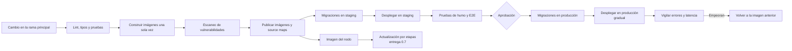

# TRD-01 · Infraestructura y operación

| Campo | Valor |
|-------|-------|
| Estado | Borrador |
| Versión | 0.2 |
| Fecha | 2026-10-15 |
| Fase | 0 |
| Hereda de | [TRD-00](TRD-00-arquitectura-base.md) |
| Entregas | [Roadmap](../roadmap.md) 0.8 y 0.9 |

## 1. Resumen de decisiones

| Tema | Decisión | Estado |
|------|----------|--------|
| Infraestructura como código | **Terraform**. Nada de la nube se crea a mano | Propuesta |
| Nubes | **AWS, GCP y Azure** con módulos de Terraform equivalentes desde el inicio. Una sola nube corre producción; las otras se prueban en staging | Propuesta (ADR-005) |
| Cómputo | Contenedores sin servidores que administrar: ECS Fargate, Cloud Run o Container Apps. Sin Kubernetes al inicio | Propuesta |
| Base de datos | PostgreSQL gestionado, solo con funciones y extensiones disponibles en las tres nubes | Propuesta |
| Despliegue continuo | Cada cambio en la rama principal llega a staging solo; a producción, con una aprobación | Propuesta |
| Escalado | La API y los workers suben y bajan de instancias solos; los workers según la cola de trabajos | Propuesta |
| Métricas, logs y trazas | **OpenTelemetry** hacia **Grafana Cloud**. Un solo lugar para las tres nubes (ADR-013) | Decidido |
| Errores | **Sentry** en la nube, en los nodos y en las PWA, con envío diferido sin internet (ADR-014) | Propuesta |
| Tableros y alarmas | En Grafana, definidos como código con Terraform, junto con la infraestructura | Decidido |

## 2. Restricciones que guían el diseño

1. **Cambiar de nube no reescribe la aplicación.** Lo que cambia son los módulos de Terraform y los adaptadores, no el dominio.
2. **Equipo pequeño** (TRD-00, sección 2). Se eligen servicios gestionados y se evita operar Kubernetes.
3. **Los nodos de las sedes no son la nube.** No escalan ni se despliegan con Terraform; se actualizan por etapas (entrega 0.7). Pero sí reportan errores y métricas.
4. **El monitoreo no puede competir con la operación.** En una sede con internet débil, las facturas y los eventos van antes que la telemetría.

## 3. Portabilidad entre nubes

Terraform no hace portable la infraestructura por sí solo: cada proveedor tiene sus propios recursos. La portabilidad sale de dos reglas:

- **En la aplicación**, todo lo que depende del proveedor va detrás de un puerto con un adaptador por nube.
- **En Terraform**, cada nube tiene un módulo con **las mismas variables de entrada y las mismas salidas**. Un ambiente se arma combinando módulos de una sola nube.

### 3.1 Equivalencias

| Pieza | AWS | GCP | Azure |
|-------|-----|-----|-------|
| Contenedores (API y workers) | ECS Fargate | Cloud Run (servicios y worker pools) | Container Apps |
| PostgreSQL | RDS for PostgreSQL | Cloud SQL for PostgreSQL | Azure Database for PostgreSQL (Flexible Server) |
| Archivos (XML y PDF de facturas, respaldos, importaciones) | S3 | Cloud Storage | Blob Storage |
| Secretos (credenciales de Factus, certificados) | Secrets Manager | Secret Manager | Key Vault |
| Registro de imágenes | ECR | Artifact Registry | Container Registry |
| Red privada | VPC | VPC | VNet |
| Balanceador y TLS | ALB | Balanceador de Cloud Run | Ingress de Container Apps |
| Estado de Terraform | S3 | Cloud Storage | Blob Storage |

Lo que **no** depende de la nube y se comparte entre las tres:

- **DNS**: Cloudflare delante de todo. Pasar de una nube a otra es cambiar el destino de los registros, no los dominios. También sirve para emitir los certificados de las sedes por DNS (ADR-003).
- **Colas**: pg-boss sobre PostgreSQL (TRD-00, sección 13). No se usan SQS, Pub/Sub ni Service Bus.
- **Observabilidad y errores**: Grafana Cloud (OpenTelemetry) y Sentry (secciones 7 y 8).

### 3.2 Puertos en la aplicación

| Puerto | Para qué | Adaptadores |
|--------|----------|-------------|
| `AlmacenamientoArchivos` | Guardar y leer archivos; enlaces firmados con vencimiento | S3, Cloud Storage, Blob Storage, disco local (desarrollo y nodo) |
| `Secretos` | Leer credenciales y certificados al arrancar y al rotarlos | Secrets Manager, Secret Manager, Key Vault, archivo cifrado (nodo) |

La configuración llega por variables de entorno. Ningún módulo del dominio sabe en qué nube corre.

### 3.3 Reglas para PostgreSQL

- Solo extensiones disponibles en las tres nubes (por ejemplo `pgcrypto`, `pg_trgm`). Una extensión nueva se agrega solo después de comprobarla en las tres.
- Row Level Security, JSONB y las colas de pg-boss funcionan igual en las tres.
- No se usan funciones propias del proveedor (Aurora, AlloyDB, Cosmos DB).
- Mover los datos de una nube a otra se hace con replicación lógica de PostgreSQL, con una ventana corta de corte.

### 3.4 Respaldos fuera de la nube principal

Además de los respaldos diarios del proveedor (TRD-00, sección 12), se exporta una copia cifrada al almacenamiento de **otra** nube. Si se pierde la cuenta o la región principal, se restaura en la otra con sus módulos de Terraform.

## 4. Terraform

### 4.1 Organización

```
infra/
  modulos/
    aws/              # red, postgres, servicio, almacenamiento, secretos, registro
    gcp/              # los mismos módulos, mismas variables y salidas
    azure/            # los mismos módulos, mismas variables y salidas
    comun/            # Cloudflare (DNS), Grafana (tableros y alarmas), Sentry (proyectos y alertas)
  ambientes/
    staging-aws/
    staging-gcp/
    staging-azure/
    produccion-<nube>/
```

- Cada ambiente tiene su propio estado remoto, cifrado y con bloqueo, guardado en la nube de ese ambiente.
- Los módulos llevan versión. Un ambiente fija la versión que usa.
- Los tableros, alarmas y proyectos de Sentry también son código: un servicio nuevo llega con su tablero.
- OpenTofu queda como alternativa si cambia la licencia o el precio de Terraform; los módulos se mantienen compatibles con ambos.

### 4.2 Cómo se aplica

- `terraform plan` corre en cada cambio dentro de `infra/` y su resultado queda en la revisión del cambio.
- `terraform apply` lo corre solo el pipeline, nunca una persona desde su equipo.
- Las credenciales del pipeline en cada nube son de corta duración (OIDC); no hay llaves guardadas.
- Un chequeo periódico compara la nube real con el código y alerta si alguien cambió algo a mano.

## 5. Despliegue continuo

### 5.1 Ambientes

| Ambiente | Para qué | Datos |
|----------|----------|-------|
| Local | Desarrollo, con Docker Compose (PostgreSQL, API, workers, un nodo simulado) | De prueba |
| Staging | Validar cada cambio antes de producción; Factus en sandbox | De prueba, nunca datos reales de clientes |
| Producción | Clientes reales | Reales |

Staging existe en las tres nubes. El de la nube de producción está siempre arriba; los otros dos se levantan desde cero en cada ensayo (sección 5.4) y se destruyen al terminar.

### 5.2 Pipeline



- La misma imagen pasa por staging y producción; no se reconstruye.
- Producción se actualiza de forma gradual (una parte de las instancias primero). Si los errores en Sentry o la latencia p95 empeoran frente a la versión anterior, se vuelve atrás sola.
- Los source maps de las PWA se suben a Sentry y no se publican.
- Las PWA se publican con versión; el nodo las sirve a los celulares de la sede.

### 5.3 Compatibilidad con los nodos

Los nodos se actualizan por etapas y fuera de horario, así que la nube convive con nodos de versiones anteriores.

- La API de la nube acepta el contrato de sincronización de la **versión actual y la anterior**. Un cambio que rompe el contrato se hace en dos despliegues.
- Las migraciones de la base de datos son en dos pasos: primero se agrega lo nuevo, y lo viejo se quita solo cuando ningún nodo ni servicio lo usa. Las migraciones no se revierten; se corrigen con otra hacia adelante.
- Volver atrás en la nube es volver a la imagen anterior, sin tocar la base de datos.

### 5.4 Ensayo de cambio de nube

Para que los módulos de las otras dos nubes no se queden viejos:

- En cada cambio de `infra/`, `terraform plan` corre para las tres nubes.
- Una vez al mes, el pipeline levanta staging desde cero en las dos nubes que no son de producción, restaura un respaldo, corre las pruebas de humo y lo destruye.

## 6. Escalado

| Servicio | Cómo escala | Mínimo en producción |
|----------|-------------|----------------------|
| API de la nube | Horizontal, por CPU y solicitudes concurrentes | 2 instancias (disponibilidad de 99,5 %, TRD-00 sección 15) |
| Workers | Horizontal, por la cantidad de trabajos esperando en pg-boss y su antigüedad | 1 instancia |
| PostgreSQL | Vertical (más CPU y memoria). Réplica de lectura para reportes cuando el volumen lo pida | 1 instancia con alta disponibilidad |
| Nodo de la sede | No escala: un equipo por sede (TRD-00) | — |

- En staging los servicios bajan a cero cuando no hay uso.
- Cada servicio tiene un **máximo** de instancias para que un error no dispare el costo.
- **Más workers no facturan más rápido.** Factus permite 80 solicitudes por minuto por NIT (TRD-00, sección 8). El control de ritmo por NIT se guarda en PostgreSQL y lo comparten todas las instancias; si cada worker llevara su propio conteo, al escalar se pasaría el límite.
- La profundidad de la cola se publica como métrica. En Container Apps escala directamente (KEDA con PostgreSQL); en ECS y Cloud Run, a partir de esa métrica publicada.

## 7. Métricas, logs y trazas

Grafana Cloud es donde se mira la operación, en cualquiera de las tres nubes. La aplicación no habla con Grafana: habla OpenTelemetry, y un colector entrega métricas, logs y trazas. Los tableros y las alarmas viven en `infra/modulos/comun/` y se aplican con Terraform. Un servicio nuevo no queda desplegado si no trae su tablero.

Grafana no reemplaza los reportes del restaurante (ventas, tiempos de cocina, márgenes). Esos salen de los eventos y se ven en el producto (M6). Tampoco reemplaza a Sentry: Grafana dice que algo se degradó; Sentry dice qué excepción fue y qué versión la introdujo.

| Señal | Dónde | Para qué |
|-------|-------|----------|
| Métricas | Grafana (Mimir) | Umbrales, tendencias y alarmas |
| Logs | Grafana (Loki) | Qué pasó en un pedido, una factura o una sede |
| Trazas | Grafana (Tempo) | Seguir una petición de la PWA al nodo, a la nube y a Factus |
| Excepciones | Sentry | Error nuevo, con versión, sede y rol, sin datos personales |

Alojar Grafana nosotros queda descartado: el equipo es pequeño y no hay Kubernetes. El servicio nativo de cada nube (CloudWatch, Cloud Monitoring, Azure Monitor) también: habría un tablero distinto por proveedor, y cambiar de nube dejaría la operación a ciegas.

### 7.1 OpenTelemetry

La API, los workers y el nodo usan el SDK de OpenTelemetry. En la nube, un colector (un contenedor más, la misma imagen en las tres nubes) recibe todo y lo envía por OTLP a Grafana Cloud. Cambiar de backend es cambiar la configuración del colector, no el código.

- **Logs** estructurados en JSON, con `tenant_id`, sede, dispositivo y el identificador de la traza.
- **Trazas** de punta a punta: la PWA, el nodo, la sincronización, la nube y la llamada a Factus.
- **Métricas** del catálogo de la sección 7.3. Cada una responde una de cuatro preguntas: si la sede puede atender, si las facturas salen, si la nube aguanta y si el último despliegue rompió algo. Una métrica que no responde ninguna no se agrega.
- Las métricas solo llevan etiquetas de baja cardinalidad: `servicio`, `ambiente`, `tenant_id`, `sede_id`, `nit`, `tipo_trabajo`, `estado`. Cada una usa solo las que necesita: la API de la nube no se etiqueta por sede. El dispositivo, el usuario y el pedido van en logs y trazas.
- Nunca se registran datos personales (cédulas, nombres, direcciones, teléfonos), secretos ni tokens (Ley 1581). El nombre de la sede se resuelve en el tablero a partir de `sede_id`.

### 7.2 Telemetría de los nodos

- Con internet, el nodo envía su estado cada minuto: versión, retraso de la sincronización, eventos y facturas pendientes, espacio en disco, estado de las impresoras.
- El nodo no habla con Grafana. Las métricas y los logs viajan como **lotes de prioridad baja** en la sincronización (TRD-00): nunca van antes que las facturas ni los eventos. La nube los publica en el colector.
- Sin internet se guardan en el nodo con un tamaño máximo; si se llena, se descartan los más viejos de menor severidad.

### 7.3 Métricas

**¿La sede puede atender?**

| Métrica | Qué mide |
|---------|----------|
| `nodo.conectado` | 1 si el nodo reportó en el último minuto; 0 si no |
| `nodo.sin_conexion_segundos` | Cuánto lleva la sede sin reportar, en horario de operación |
| `sync.retraso_segundos` | Edad del evento más viejo que una sede conectada aún no entregó |
| `sync.eventos_pendientes` | Eventos en la outbox del nodo |
| `nodo.disco_libre_ratio` | Espacio libre sobre el total |
| `nodo.impresora_disponible` | 1 por impresora que responde; 0 si no |
| `http.server.request.duration` del nodo | p95 de la API local. Objetivo: menos de 200 ms (TRD-00, sección 15) |

**¿Las facturas salen?**

| Métrica | Qué mide |
|---------|----------|
| `facturas.pendientes` | Documentos en `pendiente_emision` o `incierto`, por sede y estado |
| `facturas.antiguedad_maxima_segundos` | Edad de la factura pendiente más vieja de una sede conectada |
| `factus.solicitudes` | Solicitudes por minuto de un NIT, contra el límite de 80 |
| `factus.respuestas` | Por código: `429`, rechazo y error del servidor |
| `factus.cola_vaciado_segundos` | Desde que la sede reconecta hasta que no quedan facturas pendientes |
| `factus.bolsa_saldo` | Documentos restantes de la bolsa de la empresa |
| `factus.bolsa_dias_cobertura` | Saldo dividido por el consumo diario reciente |

`factus.respuestas`, `factus.solicitudes` y `factus.cola_vaciado_segundos` son las señales para volver a negociar con Factus (TRD-00, sección 8.4).

**¿La nube aguanta?**

| Métrica | Qué mide |
|---------|----------|
| `http.server.request.duration` de la API | p95 por servicio |
| `http.server.requests` | Tasa de solicitudes y porcentaje de respuestas 5xx |
| `servicio.instancias` | Instancias activas, contra el mínimo y el máximo de la sección 6 |
| `postgres.conexiones_en_uso` | Conexiones abiertas contra el límite |
| `pgboss.trabajos_esperando` | Profundidad de la cola por tipo de trabajo. También alimenta el escalado (sección 6) |
| `pgboss.trabajo_mas_viejo_segundos` | Antigüedad del trabajo que más lleva esperando |
| `pgboss.trabajos_fallidos` | Fallos y reintentos por tipo de trabajo |

**¿El último despliegue lo rompió?**

| Métrica | Qué mide |
|---------|----------|
| `despliegue.info` | Versión que corre en cada servicio y ambiente |
| Tasa de errores y p95 | Comparadas con la versión anterior durante el despliegue gradual (sección 5.2) |

En la Fase 3 se agregan `plataformas.pedidos` (recibidos por conector) y `plataformas.pedidos_rechazados` (los que no se pudieron normalizar). Hasta entonces ese tablero no existe.

### 7.4 Tableros

Cada tablero usa solo métricas de la sección 7.3. El de costos no sale de la aplicación: sale de la factura de la nube que esté en producción.

| Tablero | Qué muestra |
|---------|-------------|
| Sedes y nodos | Quién está sin conexión y desde cuándo, retraso de la sincronización, versión, disco e impresoras |
| Facturación | Facturas pendientes por antigüedad y por sede, rechazos, `429`, ritmo contra 80 por minuto, saldo y días de cobertura de la bolsa |
| Salud de la nube | Solicitudes, errores, latencia p95 por servicio, instancias activas, conexiones a PostgreSQL |
| Colas y workers | Trabajos esperando, antigüedad del más viejo, fallos y reintentos por tipo |
| Despliegues | Versión en cada ambiente, y errores y latencia antes y después de cada despliegue |
| Plataformas de domicilio | Pedidos recibidos y pedidos que no se pudieron normalizar, por conector. Fase 3 |
| Costos | Gasto por servicio y por ambiente contra el presupuesto |

### 7.5 Alarmas

Son reglas de Grafana, en el mismo Terraform que los tableros. Cada una tiene dueño, umbral y lo que hay que hacer cuando suena. Las primeras:

| Alarma | Métrica | Umbral inicial |
|--------|---------|----------------|
| Disponibilidad de la API de la nube | `http.server.requests` | Por debajo del objetivo de 99,5 % en el mes, o más de 5 minutos sin responder |
| Latencia de la API del nodo | `http.server.request.duration` del nodo | p95 por encima de 200 ms (TRD-00, sección 15) |
| Retraso de la sincronización | `sync.retraso_segundos` | p95 por encima de 1 minuto con la sede conectada |
| Facturas pendientes | `facturas.antiguedad_maxima_segundos` | Una factura con más de 30 minutos pendiente en una sede conectada |
| Rechazos de Factus | `factus.respuestas` | Más de 3 rechazos en 10 minutos para un mismo NIT |
| Bolsa por agotarse | `factus.bolsa_dias_cobertura` | Menos de 7 días al ritmo reciente |
| Nodo sin conexión | `nodo.sin_conexion_segundos` | Más de 15 minutos en horario de operación |
| Errores nuevos | Sentry | Un error que Sentry no había visto, en producción |
| Presupuesto | Factura de la nube | 80 % del presupuesto mensual |

Las alarmas de la nube avisan al equipo. Las que tocan la operación de un cliente (facturas pendientes, saldo de la bolsa) también llegan al panel de soporte (entrega 4.5).

## 8. Errores con Sentry

| Dónde | Qué captura |
|-------|-------------|
| PWA (mesero, caja, cocina, domiciliario) | Errores de JavaScript, promesas rechazadas, fallos de red, con la versión publicada |
| Web de administración y portal de clientes | Lo mismo, más el rendimiento de las páginas |
| Nodo | Errores del servidor, de impresión y de sincronización |
| API y workers de la nube | Errores del servidor y de cada trabajo, con la traza de OpenTelemetry |

- **Sin internet**, el SDK guarda los errores en el dispositivo o en el nodo y los envía al reconectar, con un tamaño máximo.
- Cada error lleva empresa, sede, rol y versión; **no lleva** datos personales. Los nombres, cédulas, teléfonos y direcciones se limpian en el SDK antes de enviar.
- Cada versión desplegada se registra en Sentry para saber qué despliegue introdujo un error.
- Sentry se usa como servicio al inicio; alojarlo en una nube propia queda como alternativa si la ley o un cliente lo exige (ADR-014).

## 9. Seguridad

- Cuentas o proyectos separados por ambiente en cada nube; producción no comparte red ni credenciales con staging.
- Los servicios usan identidades de la nube con los permisos mínimos; no hay llaves en las imágenes ni en el repositorio.
- PostgreSQL y los archivos solo se alcanzan desde la red privada.
- Las imágenes se escanean en el pipeline y periódicamente; una vulnerabilidad crítica bloquea el despliegue.

## 10. Pruebas

- [ ] `terraform plan` sin errores para las tres nubes en cada cambio de `infra/`
- [ ] Staging levantado desde cero en cada nube, con un respaldo restaurado y pruebas de humo
- [ ] Un despliegue con un error provocado vuelve solo a la versión anterior
- [ ] Prueba de carga: los workers suben con la cola llena, respetan el límite por NIT y bajan al vaciarse
- [ ] Un error en una PWA sin internet llega a Sentry al reconectar, sin datos personales
- [ ] Un nodo desconectado aparece en el tablero de Grafana y dispara su alarma
- [ ] Cada métrica de la sección 7.3 tiene un panel, y una factura pendiente de más de 30 minutos dispara su alarma en un ensayo

## 11. Riesgos y ADRs

| Riesgo / ADR | Mitigación / Estado |
|--------------|---------------------|
| Mantener módulos para tres nubes cuesta tiempo de un equipo pequeño | Mismas variables y salidas por módulo, `plan` en cada cambio y ensayo mensual; si el costo no se justifica, se baja a una nube de respaldo (revisión en ADR-005) |
| Los módulos de las nubes que no están en producción se quedan viejos | Ensayo mensual de la sección 5.4 |
| Costo de la nube sin control | Máximo de instancias, staging en cero sin uso, alarma de presupuesto |
| La telemetría satura el internet de una sede | Prioridad baja en la sincronización y tamaño máximo en el nodo |
| Datos personales en logs o en Sentry | Limpieza en el SDK y en el colector; prueba automática que busca patrones de cédula y teléfono |
| ADR-005 | Nube de producción y portabilidad. Pendiente: cuál de las tres arranca en producción |
| ADR-013 | Backend de observabilidad: **Grafana Cloud** (decidido, sección 7). Descartados el servicio nativo de cada nube y Grafana alojado por nosotros |
| ADR-014 | Sentry como servicio (propuesto) frente a alojado. Pendiente, Fase 0 |
| ADR-015 | Servicio del pipeline: depende de dónde quede el repositorio. Pendiente, Fase 0 |
