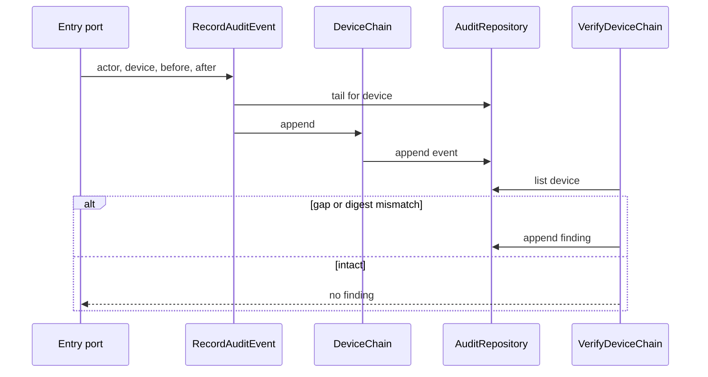

# Design: Audit

## Technical Approach

Cloud slice only (D-37), inside-out ([ADR-017](../../../docs/adr/ADR-017-tdd-sobre-hexagonal.md)): domain chain, memory use case, PGlite append-only role, thin HTTP ([ADR-018](../../../docs/adr/ADR-018-screaming-y-bounded-context.md)). Spec: `specs/audit/spec.md`. No relative imports.

## Architecture Decisions

| Option | Tradeoff | Decision |
|--------|----------|----------|
| `DeviceChain` per tenant and device | Smaller than a company snapshot | **Chosen.** Link rules live on the chain |
| One tenant aggregate, like `Organization` | One save, unbounded load | Rejected |
| Caller-supplied hash | A caller can lie | Rejected. The cloud digests |
| `AuditDigest` port, SHA-256 | Extra adapter | **Chosen.** Domain does not import `node:crypto` |
| Genesis: sequence 1, previous hash 64 zero hex digits | Fixed anchor | **Chosen** |
| `audit_app` SELECT+INSERT, UPDATE/DELETE trigger, forced RLS | TRD-M0 §6 | **Chosen.** Grants alone let the table owner through |
| `VerifyDeviceChain` on stored rows | Sees a direct SQL edit | **Chosen.** Altered or deleted appends a finding |
| Node batch and last verified hash | Needs sync | Deferred. Hybrid section |
| Mutable finding status | A dismiss deletes evidence | Rejected. Findings append only |
| `audit.view` plus a site filter | Matrix `with_limit` is not a money cap (PRD-01) | **Chosen.** Company, own site, or auditor read; else 403 |
| Public POST to record | Clients forge history | Rejected. Entry port only |
| Next unused `NNNN_*.sql` at apply time | Pin-lock may take `0006_pin_lock.sql` | **Chosen.** Do not reserve 0006 |

## Data Flow

`RecordAuditEvent` appends with `Clock` server time. A broken tail appends a finding and is not extended. `VerifyDeviceChain` re-reads the device. `ReadAudit` returns events for the 0.4 session.

## File Changes

| File | Action | Description |
|------|--------|-------------|
| `contexts/platform/domain/audit.ts`, `audit.test.ts`, `domain/index.ts` | Create / Modify | `DeviceChain`, `MissingActor`, link check |
| `contexts/platform/application/ports/audit-repository.ts`, `audit-repository.contract.ts`, `audit-digest.ts` | Create | `append` and `list` only |
| `contexts/platform/application/record-audit-event/*`, `verify-device-chain/*`, `read-audit/*` | Create | Three use cases |
| `contexts/platform/application/entry-port.ts`, `package.json` | Modify | Export `RecordAuditEvent` and the import maps |
| `contexts/platform/adapters/memory/in-memory-audit-repository.ts` | Create | Memory adapter runs the contract |
| `contexts/platform/adapters/postgres/NNNN_audit.sql`, `drizzle-audit-repository.ts`, `schema.ts` | Create / Modify | Next unused `NNNN_*.sql` at apply time, plus `schema.ts`. Not `0006` |
| `contexts/platform/adapters/crypto/sha256-audit-digest.ts` | Create | SHA-256 hex |
| `shared/contracts/audit.ts`, `index.ts` | Create / Modify | Zod command and read result |
| `apps/api-cloud/src/http/read-audit.controller.ts`, `composition/application-module.ts` | Create / Modify | `GET /audit`, `x-session-id`, `audit.view` |

## Interfaces / Contracts

`append(event)` and `list(tenantId, deviceId: string | null)`. A null device lists every device of that tenant so a company read can use the same port. No update or delete. Fields: actor, authorizer or null, device, site, action, entity, before, after, reason, `occurredAt`, `sequence`, `previousHash`, `digest`. `before` and `after` use `z.json()`.

Digest input: UTF-8 JSON, sorted keys, no whitespace, including `previousHash`. First link: 64 zero hex digits. Sequence starts at 1 and steps by 1.

`VerifyDeviceChain` appends `altered` when the digest or previous hash disagrees, and `deleted` when a sequence is missing. Same device, sequence, and kind inserts once. No delete and no dismiss.

`ReadAudit` denies another site for a site administrator. `auditor` reads the company, with no write action. `audit_app` sees only `app.tenant_id`.

## Testing Strategy

| Layer | What to Test | Approach |
|-------|----------------|----------|
| Domain | Missing actor, three-link chain, two devices, altered digest, sequence gap | Pure |
| Use case | Server time, broken tail, idempotent finding, site and auditor scope | Memory |
| Contract | Append, round-trip, hidden tenant, UPDATE and DELETE refused | Memory and PGlite. Drizzle is not mocked |
| HTTP | 200 for owner, auditor, and own site; 403 for the other site and a cashier; no Post, Put, or Delete | `inject`. No `listen` |

## Threat Matrix

N/A — no routing, shell, subprocess, VCS/PR automation, executable-file classification, or process-integration boundary.

## Migration / Rollout

Apply adds the next unused `NNNN_*.sql` in `contexts/platform/adapters/postgres` (tables, `audit_app`, forced RLS, row triggers for update and delete, and a statement trigger for truncate). Do not hardcode `0006`: `0006_pin_lock.sql` may already exist. Rollback does not drop the tables. The proposal keeps production audit tables: revert the application commit and leave the stored events.

## Deferred to the hybrid phase (D-37)

Not file changes of this design:

- Node and SQLite hash chain, and the insert-only store under `adapters/sqlite`
- Binding that store in `apps/local-node`
- Offline append during a cut, and upload after invoice documents and confirmed QR payments, before sales
- Batch verification of a node, the last verified hash per device, and a finding when confirmed history is rewritten
- The `AuditRepository` contract suite on SQLite

## Open Questions

- [ ] PA-41 (long-term retention and archive) stays open. It does not block 0.6.
