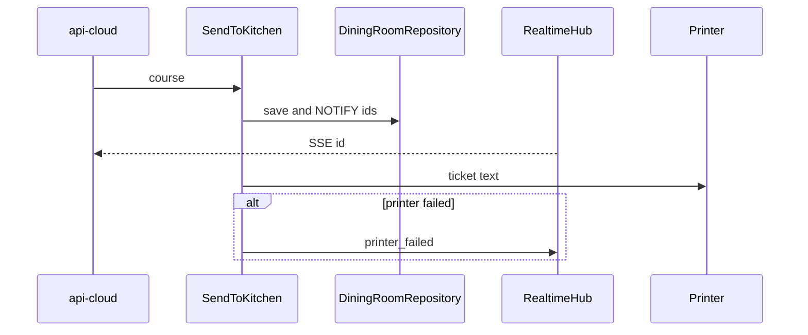

# Design: Dining Room and Kitchen

## Technical Approach

Cloud-only (D-37) in `contexts/orders` ([ADR-018](../../../docs/adr/ADR-018-screaming-y-bounded-context.md)). Specs: dining-room and kitchen. Inside-out ([ADR-017](../../../docs/adr/ADR-017-tdd-sobre-hexagonal.md)). Cloud `Clock` stamps changes. `api-cloud` runs them. `local-node` returns 403 `DiningRoomRejected` and stores nothing. Use cases exit `entry-port.ts`. One import segment per star. Domain has no Nest, SQL, or Zod.

## Architecture Decisions

| Option | Tradeoff | Decision |
|--------|----------|----------|
| New context | Splits the table from `Menu` | **Extend `orders`** (TRD-M1 sec. 2) |
| `Table` and `Check`, with `Order` and `OrderLine` on the check | A join touches two roots | **One Postgres transaction** for the touched roots |
| Venue `StationRoute` | `KitchenStation` is id, venue, name | **Per venue.** Not a brand `Menu` field |
| Combo send | Components can differ by station | **`ComboNotSent`.** Products only |
| `MoveTable` swaps the two tables' checks | A free table cannot take part | **States stay.** Merge shares the target check. Transfer moves lines. `originTableId` stays |
| Stock, outbox, SQLite | D-37 and delivery 2.2 | **Deferred** |
| `shared/printing` | Skeleton forbids it. 1.6 owns queue, backup, pre-bill template | **`Printer` in orders.** Text in, UTF-8 out. No ESC/POS |
| WebSocket, poll, in-process emit, `pg-boss` | No gateway in repo. Two API instances (TRD-01). A job is not fan-out | **SSE `@Sse` plus `NOTIFY orders_realtime` on save.** Ids only. Port: `RealtimeHub` |
| Node clock | D-37 | **`Clock.now()` as UTC ISO** |
| `sale.open-table` for kitchen advance | The kitchen chief is denied | **Session only** to prepare or mark ready. `sale.open-table`: open, add, send, resend, deliver, release, bill. `sale.move-items`: move, join, transfer. `organization.structure`: floor and routes |
| Audit every kitchen click | PRD audits open and send | **After save:** open, send, bill, reassignment |

## Data Flow

`x-session-id` required. A bad body is 400. A rejection saves nothing. Held lines skip queue and total. First send copies `Menu.quote`. Resend keeps price and state. Send restores `occupied`. `ReleaseTable` frees `to_clean`. Payment sets that state.

Color and queue use `sentAt`. SSE and `GetCheck` expose ids. A failed print keeps the line; a printer-only station alerts the register. `NOTIFY` runs at commit.

## File Changes

| File | Action | Description |
|------|--------|-------------|
| `contexts/orders/domain/{dining-table,check,station-router,kitchen-ticket}.ts`, tests, `domain/index.ts` | Create / Modify | States, router, ticket text |
| `contexts/orders/application/ports/{dining-room-repository,station-route-repository,station-directory,printer,realtime-hub}.ts`, contracts | Create | Save, route, print, publish |
| `contexts/orders/application/{place-table,open-table,release-table,take-order,reassign-check,request-check,change-line-state,view-table-map,view-station-queue,get-check,configure-station-route}/*` | Create | Use-case groups |
| `contexts/orders/application/entry-port.ts`, `package.json` | Modify | Exports; one import pattern per folder |
| `contexts/orders/adapters/memory/*` | Create | Memory ports; printer can fail |
| `contexts/orders/adapters/postgres/0002_dining_room.sql`, `schema.ts`, Drizzle repos, contracts | Create / Modify | Forced RLS. Reuse `orders_app` |
| `shared/contracts/dining-room.ts`, `index.ts` | Create / Modify | Zod commands and reads |
| `apps/api-cloud` HTTP, SSE, tests, composition, `package.json` | Create / Modify | `inject`, then audit |
| `apps/local-node` controller, test, module | Create / Modify | 403, no store |
| `tools/skeleton/skeleton.test.ts` | Modify | Allow the node file. Printing, sync, sqlite, outbox stay absent |

No deletions. Integer COP. Id prefixes `table_`, `check_`, `order_`, `line_`.

## Interfaces / Contracts

Table: `free`, `occupied`, `check_requested`, `to_clean`. Line: `held`, `sent`, `in_preparation`, `ready`, `delivered`. Output: `screen`, `printer`, `both`. Channel: `waiter`, `fixed_point`. Errors: `TableAlreadyOccupied`, `TableNotOpen`, `ProductNotOrderable`, `MissingStation`, `EmptyOrder`, `ComboNotSent`, `LineTransitionRejected`, `DuplicateStationProduct`.

`tenant_id` on `dining_tables`, `checks`, `orders`, `order_lines` (timestamp per state), `station_routes`, `station_route_products`.

## Testing Strategy

Red then green ([ADR-017](../../../docs/adr/ADR-017-tdd-sobre-hexagonal.md)). `strict_tdd` stays false. Given / When / Then. One work unit per later apply. Chain `stacked-to-main`.

| Layer | What to Test | Approach |
|-------|----------------|----------|
| Domain | No step back; origin kept; free and `to_clean` rejected; resend keeps total; 190 s | Pure instants |
| Use case | Missing station saves nothing; failed print keeps the line; held stays off the queue; red at 16 min | Memory |
| Contract | Round-trip; other tenant hidden | Memory and PGlite. No Drizzle mock |
| HTTP | 200; 403 on permission or node; 400; 409; SSE id after send | `inject`, no `listen` |

p90 timing waits for a display. The hub must see the id on commit.

## Migration / Rollout

`0002_dining_room.sql` adds forced-RLS tables. Rollback drops them. No new role or site flag.

## Deferred

Not files. Hybrid (D-37): node operation, SQLite, outbox, sync, node clock, and a cut. UI: `apps/venue-app`, `apps/admin-web`. p0-01 is blocked, so no ESC/POS proof and no locked-phone notice (PA-30). The domain still emits the notice and the ticket text. Cloud mode stops if the API is unreachable.

## Open Questions

None.
