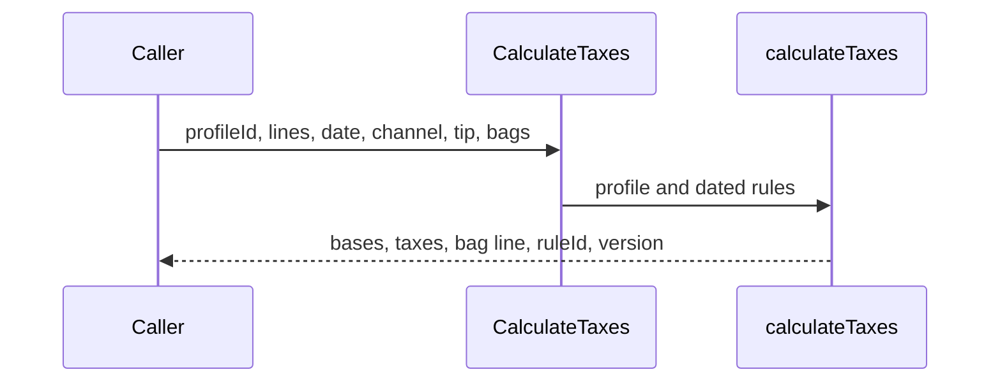

# Design: Tax Engine

## Technical Approach

New context `contexts/invoicing` (ADR-018, TRD-M3 §1–2, ADR-009). Cloud only (D-37): Postgres rules and pure `calculateTaxes` ([spec](specs/tax-engine/spec.md), PRD-00 §7.1, TRD-00 §8.6). Menu's `taxClassification` stays an opaque string. Platform keeps `taxProfileId`; invoicing owns the profile and does not change `Organization`. Later cash calls the entry port with lines and the site profile. No sale, shift, payment, or check. Factus HTTP stays in 1.5.

## Architecture Decisions

| Option | Tradeoff | Decision |
| --- | --- | --- |
| Tax logic in cash | Cash does not exist | `calculateTaxes` on entry-port `CalculateTaxes` |
| Hardcoded 8 % / 19 % | A new rate must be data (D-09) | Insert a `TaxRule` version; never overwrite a rate |
| SQLite, outbox, sync | D-37; ADR-017's second dialect waits | Postgres, memory, PGlite. `local-node` returns 403 and stores nothing |
| Payment aggregate | 1.3 is absent | `assessWithholdings` returns income, VAT, and ICA. Invoice taxes stay unchanged. Final consumer is rejected. Nothing is stored |
| Shared template | One edit would change every taxpayer | Adopt copies rows onto that taxpayer |
| First matching rule | Hides a bad catalog | Publish rejects an overlapping date on the same key |

Match keys are regime, VAT and INC responsibility, franchise, classification, optional channel, and date. No VAT responsibility excludes every product line.

## Data Flow

Integer COP in, `decimal.js` half-even inside. Base = price / (1 + sum of rates), two decimals; each tax is `rate * base`. No rule throws `NoMatchingTaxRule`. `cashRoundingAmount` is rejected past ±500. Voluntary tip is ignored (D-08). Restaurant delivery and other mandatory charges are taxable lines. A bag is a fixed item line, no DIAN code: take-out when `bagCount > 0`, delivery only when the venue flag is on (D-29). Each product line carries `ruleId` and `version`.

## File Changes

| File | Action | Description |
| --- | --- | --- |
| `contexts/invoicing/**` | Create | Domain, entry port, `AdoptFiscalTemplate`, `PublishTaxRule`, `CalculateTaxes`, contracts, memory and postgres. Package imports. No sqlite |
| `apps/api-cloud` HTTP, postgres, composition, `package.json` | Create / Modify | Zod boundary. Permission `tax.configure` |
| `apps/local-node` HTTP, test, composition | Create | 403 `TaxRejected`, no repository |
| `contexts/platform/domain/permission-catalog.ts` | Modify | `tax.configure` for owner |
| `vitest.config.ts`, root `tsconfig.json`, `pnpm-workspace.yaml` | Modify | Vitest project `invoicing`. Catalog `decimal.js` |
| Orders, cash, Factus, `shared/contracts` | None | No menu change, no sync schema, no sale document |

## Interfaces / Contracts

`calculateTaxes({ profile, rules, lines: { priceCop, taxClassification }, soldOn, channel, bagCount, deliveryBagsEnabled, voluntaryTipCop })` returns per line `base`, `taxes[{ code, rate, amount }]`, `excluded`, `ruleId`, `version`, plus `bagLine` and `cashRoundingAmount`. Channel is `dine-in`, `take-out`, or `delivery`. `assessWithholdings({ income, vat, ica })` accepts only a withholding agent.

Seeded rules match classification `restaurant service`: `independent-restaurant` (ordinary, INC, not franchise, 8 %, `04`); `franchise` (VAT 19 %, `01`); `simple-inc` (SIMPLE, INC 8 %, `O-47`). Also publishable: VAT 5 % (`01`), exempt (`01` at 0 %), excluded (`is_excluded`), not taxed, ultra-processed (`35`, rate on the row), plastic bag (fixed item). RUT `O-13`, `O-15`, `O-23`, `O-47`, `R-99-PN` is stored only. Municipality is not an ICA rate.

1.5 compares `G-INC-8` (10800 → 10000 + 800), `G-VAT-19` (11900 → 10000 + 1900), `G-TIP` (+1000, taxes unchanged), `G-BAG` (66 × 2 = 132), `G-DATE` (5 % through March 31, 19 % from April 1), `G-EXCLUDED` (non-VAT drink). `G-VAT-5` (10500 → 10000 + 500) is formula-only.

## Testing Strategy

| Layer | What to Test | Approach |
| --- | --- | --- |
| Unit | Spec scenarios and golden cases | Domain only. RED then GREEN (ADR-017). `given …, when …, then …` |
| Application | Copy isolation and version stamp | In-memory ports |
| Contract | Both repositories | Memory and PGlite. No SQLite |
| HTTP | Cloud quote and node 403 | `api-cloud` and `local-node`. No Factus call |

## Migration / Rollout

New tables only. Current `taxProfileId` values stay until adopt, then the existing structure command links them. No rules means `NoMatchingTaxRule`. Rollback removes the routes. A bad rate ends with a new validity row. No sale rows to migrate.

## Open Questions

- [ ] Accountant table is absent. Further Factus equality waits for 1.5.
- [ ] Ultra-processed rate comes from the rule row.
- [ ] `not_taxed` versus `is_excluded` is a 1.5 mapping.
- [ ] Bag line for a non-VAT taxpayer is unconfirmed.
- [ ] Fixture `iva_19` misses until a rule uses that string.
