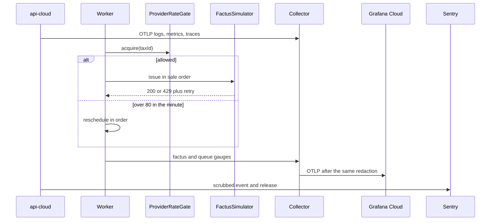

# Design: Monitoring and errors

Cloud MVP only (D-37). API and workers emit OpenTelemetry to one collector, then Grafana Cloud (TRD-01 §7, §11). Sentry is SaaS on the free plan (D-41). `GET /health` stays `{ "status": "ok" }`. `RuntimeMetrics.publishQueue` still records queue depth and age. `metrics-{log,aws,gcp,azure}` stay fail-closed, with no provider SDK. PWAs stay in the static bucket; Cloudflare stays DNS (D-40). No retention number (PA-41 is p0-06).

## Architecture Decisions

| Option | Tradeoff | Decision |
|--------|----------|----------|
| Per-cloud monitors as Grafana | Three backends | Rejected. Scaler names stay. Grafana reads OTLP |
| SDK inside `metrics-*` | Opens `closed()` | Rejected. No provider package |
| Sentry bake | Changes the 0.8 rollback | Rejected. 5xx ratio and p95 stay |
| Node, sync, SQLite, offline queue | Spec still says this | Rejected (D-37). No `apps/local-node` edits |
| Our own collector image | Custom scrubber | Rejected. Pinned contrib image. Azure plan-only (D-39) |
| Wallet and cost panels | Catalog lists them | Deferred. M7 and PA-39. No budget figure |
| Real Factus HTTP | Live `429` | Rejected. Simulator. D-19 stays in 1.5 |
| New invoicing context | Extra boundary | Rejected. Ports beside `RuntimeMetrics`, off `entry-port.ts` ([ADR-018](../../../docs/adr/ADR-018-screaming-y-bounded-context.md)) |
| PWA packages here | Browser Sentry | Rejected. Apps are absent. Support view stays 4.5 |

## Data Flow

Empty `OTEL_EXPORTER_OTLP_ENDPOINT` or `SENTRY_DSN` skips that export. Export failure does not fail the request or `/health`. `publishQueue` does not call Grafana.

Emitted: `invoices.pending`, `invoices.max_age_seconds`, `factus.requests`, `factus.responses`, `http.server.request.duration`, `http.server.requests`, `postgres.connections_in_use`, `pgboss.jobs_waiting`, `pgboss.oldest_job_seconds`, `pgboss.jobs_failed`, `deployment.info`. `service.instances` counts `target_info`. HTTP has no `venue_id`. Invoice labels: `tenant_id`, `venue_id`, `tax_id`, `status`. The digest is `service.version`, not a label. No device, user, or order labels.

Alarms use owner `blackhole`: under 99.5% this month or silent 5 minutes; invoice age over 30 minutes; over 3 rejections in 10 minutes per tax id; first production Sentry issue. No node, sync, wallet, platform-order, or cost panels.

## File Changes

| File | Action | Description |
|------|--------|-------------|
| `contexts/platform/domain/{telemetry-scrub,metric-catalog}.ts` and tests | Create | Redaction and allow-list |
| `contexts/platform/application/ports/{provider-rate-gate,pending-issuance}.ts` and contracts | Create | Shared minute window and pending age. Off `entry-port.ts` |
| `contexts/platform/adapters/memory/in-memory-{provider-rate-gate,pending-issuance}.ts` | Create | Doubles |
| `contexts/platform/adapters/postgres/drizzle-*.ts`, `0005_provider_rate.sql` | Create | Window and synthetic rows. Do not edit `0001`–`0004` |
| `contexts/platform/package.json` | Modify | Exports and `#adapters/<folder>/*` |
| `apps/api-cloud/src/{telemetry,factus-simulator}.ts`, `worker.ts`, `main.ts`, `application-module.ts` | Modify | SDK plus `issue-pending`. Health and `metricsFrom` stay |
| `infra/modules/common/{collector,grafana,sentry}` | Create | Collector, four dashboards, alarms, project `api-cloud` |
| `infra/modules/{aws,gcp,azure}/service` | Modify | Collector endpoint only |
| `tools/observability/check-catalog.mjs`, `tools/load/factus-rate.mjs` | Create | Panel parity and the limit |
| `.github/workflows/ci.yml` | Modify | Run those tools. Bake unchanged |

Leave `apps/local-node`, `metrics-*`, `health.controller.ts`, `tools/delivery/*`, `common/dns`, and folders `p0-04` and `p0-05`. Renumber only if `0005` is taken.

## Interfaces / Contracts

`scrubTelemetry(value) → string` drops authorization, cookie, password, token, secret, name, phone, address, identification, and the phone and ID digit runs. `ProviderRateGate.acquire(taxId, at) → { allowed: true } | { allowed: false, retryAfterSeconds }`. `PendingIssuance.snapshot() → { venueId, status, ageSeconds }[]` (`pending_issuance` or `uncertain`). `FactusSimulator.issue()` returns `200` or `429` plus `retryAfterSeconds`. `factus.responses` status: `429`, `rejected`, `server_error`. Optional env: `OTEL_EXPORTER_OTLP_ENDPOINT`, `SENTRY_DSN`, `SENTRY_ENVIRONMENT`.

## Testing Strategy

| Layer | What to Test | Approach |
|-------|----------------|----------|
| Unit | Scrub, labels, gate, 429 order, health | Vitest `platform` and `api-cloud`. Given / When / Then |
| Integration | Two callers, one window; collector matches fixtures | pglite. `node tools/observability/check-catalog.mjs` |
| E2E | Smoke | Unchanged `smoke.mjs`. `tools/load/factus-rate.mjs` is not a cloud scale-out |

`strict_tdd` stays false ([ADR-017](../../../docs/adr/ADR-017-tdd-sobre-hexagonal.md)). Failing test first.

## Threat Matrix

N/A — no routing, shell, subprocess, VCS/PR automation, executable-file classification, or process-integration boundary. The load tool matches `smoke.mjs`.

## Migration / Rollout

Forward SQL only. Exports stay off when unset. Dashboards revert by Terraform. Maps stay out of `static_bucket`. The 0.8 upload step is unchanged.

## Deferred

Hybrid: node telemetry, offline buffer, node and sync alarms, deferred Sentry. M7: wallet. Cost alarm needs a budget. Browser Sentry waits for the apps. Real Factus and D-19 are 1.5.

## Open Questions

None block this design. Not invented: retention (PA-41, p0-06), the monthly budget, a wallet source (PA-39).
