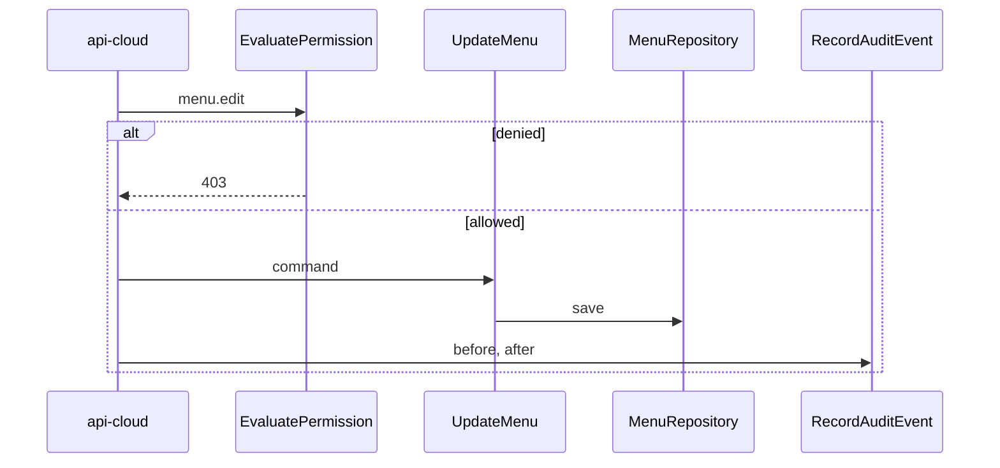

# Design: Menu and Catalog

## Technical Approach

Cloud slice only (D-37), inside-out ([ADR-017](../../../docs/adr/ADR-017-tdd-sobre-hexagonal.md)). New context `contexts/orders` ([ADR-018](../../../docs/adr/ADR-018-screaming-y-bounded-context.md)). Spec: `specs/catalog/spec.md`. The cloud owns and serves `Menu`. Imports: `#domain/*`, `#application/*`. Public surface: `application/entry-port.ts`. Domain has no Nest, SQL, Zod, or `node:crypto`.

## Architecture Decisions

| Option | Tradeoff | Decision |
|--------|----------|----------|
| `contexts/orders` | Skeleton lists only `platform` | **Chosen.** Not a folder of `platform` |
| One `Menu` per brand; `VenuePrice` is the override only | One save | **Chosen.** A site price does not write the product |
| `UpdateMenu` command union | Same shape as `UpdateStructure` | **Chosen.** Not one route per entity |
| `ViewVenueMenu` on the cloud | The cloud operates the site | **Chosen** |
| `EvaluatePermission` (`menu.edit`) in the controller | Keeps `orders` off platform interiors | **Chosen.** Cruiser allows only `entry-port.ts` |
| A peso cap | PRD-01 §7 has none. `permissionLimit` skips `menu.edit`, so `with_limit` is allowed in coverage | Rejected. The admin cap is scope |
| `RecordAuditEvent` after save | Entry port; no second chain in the menu tables | **Chosen.** Action `menu.edit`, before and after |
| `VenueDirectory` in `api-cloud` over `OrganizationRepository` | Extra adapter | **Chosen.** The use case checks the brand |
| `0001_menu.sql`, `orders_app`, forced RLS | Matches organization | **Chosen.** PGlite. Not a platform migration |
| Node copy | D-37 | Rejected. 403 `{ error: "MenuRejected" }`, no store |
| Bogota minute via `Intl` (TRD-00) | Domain receives the minute | **Chosen.** Not `date-fns-tz` |

## Data Flow

`POST /tenants/:tenantId/menu` with `x-session-id`. Brand target `{ kind: "brand", id }`. Site target `{ kind: "site", id: venueId, brandId }`. A denial does not save. `GET /tenants/:tenantId/venues/:venueId/menu` needs a session; a pin session reads only its venue.

`Clock.now()` becomes the `America/Bogota` minute. Outside the window, or manually off, the item stays listed with `orderable: false`. A combo follows a missing component. `Menu.quote` uses the site price, else the brand price, plus modifiers. A foreign modifier throws `ForeignModifier`. Publish without a classification throws `MissingTaxClassification`. No tax math.

## File Changes

| File | Action | Description |
|------|--------|-------------|
| `contexts/orders/package.json`, `tsconfig.json`, layer `index.ts` | Create | Package `@blackhole/orders` |
| `contexts/orders/domain/menu.ts`, `menu.test.ts` | Create | `Menu`, `VenuePrice`, `quote` |
| `contexts/orders/application/ports/menu-repository.ts`, `.contract.ts`, `venue-directory.ts` | Create | `load`, `save`, brand of a venue |
| `contexts/orders/application/update-menu/*`, `view-venue-menu/*`, `entry-port.ts` | Create | Two use cases |
| `contexts/orders/adapters/memory/in-memory-menu-repository.ts`, contract test, `in-memory-venue-directory.ts` | Create | Memory runs the contract |
| `contexts/orders/adapters/postgres/0001_menu.sql`, `schema.ts`, `drizzle-menu-repository.ts`, contract test | Create | RLS and PGlite |
| `shared/contracts/menu.ts`, `index.ts` | Create / Modify | Zod command and read model |
| `apps/api-cloud` controllers, HTTP tests, `composition/organization-venue-directory.ts`, `postgres/postgres-menus.ts`, module, `create-application.ts`, `package.json`, `tsconfig.json` | Create / Modify | `inject`, no `listen`. POST permission `menu.edit` |
| `apps/local-node/src/http/update-menu.controller.ts`, test, `application-module.ts` | Create / Modify | 403 on both routes |
| `tsconfig.json`, `vitest.config.ts`, `tools/skeleton/skeleton.test.ts` | Modify | Allow `orders` and the node controller. Keep deferred paths absent |

No deletions. Integer COP. Id prefix `menu_`.

## Interfaces / Contracts

`load(tenantId, brandId)`, `save(menu)`. Commands: `publishProduct`, `publishCombo`, `setVenuePrice`. Product: optional variants, modifiers (`0` is free), required `taxClassification`. Combo: one price and component ids. `VenuePrice`: price, manual availability, optional `HH:mm` window. Read model adds the price in force and `orderable`. Zod → 400. Domain → 409. Audit `siteId` is the venue, or the brand id on a brand edit.

Tables with `tenant_id`: `menus`, `products`, `variants`, `modifiers`, `combos`, `combo_components`, `venue_prices`.

## Testing Strategy

Failing test first. `strict_tdd` stays false.

| Layer | What to Test | Approach |
|-------|----------------|----------|
| Domain | Modifiers, foreign modifier, combo, classification, site price leaves the brand price | Pure |
| Use case | Other brand hidden; 12:00 not orderable; no save on rejection | Memory `Clock` |
| Contract | Round-trip; other tenant hidden | Memory and PGlite. No Drizzle mock |
| HTTP | 200 in scope; 403 other site or cashier; 400; 409; node 403 | `inject`. No `listen` |

## Threat Matrix

N/A — no routing, shell, subprocess, VCS/PR automation, executable-file classification, or process-integration boundary.

## Migration / Rollout

`0001_menu.sql` adds the tables, `orders_app`, and forced RLS. Rollback drops those tables.

## Deferred to the hybrid phase (D-37)

Not files here: versioned copy, outbox, sync cursor, delivery during a cut, SQLite, `adapters/sqlite`, the node as menu owner, the node clock, and selling through a cut.

## Deferred UI

Not files here. The waiter phone and a loaded pilot menu stay exit criteria of 1.1: `apps/admin-web`, `apps/venue-app`.

## Open Questions

None.
