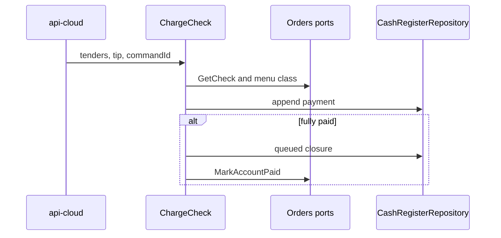

# Design: Cash Register

## Technical Approach

New context `contexts/cash-register` ([ADR-018](../../../docs/adr/ADR-018-screaming-y-bounded-context.md), TRD-M2 §1–2) for [cash-register](specs/cash-register/spec.md). Cloud only (D-37): `api-cloud` uses Postgres; `local-node` returns 403 `CashRegisterRejected` and stores nothing, as dining and tax do. Inside-out ([ADR-017](../../../docs/adr/ADR-017-tdd-sobre-hexagonal.md)). Integer COP. Callers use `entry-port.ts`. Imports are `#domain/*`, `#application/*`, `#adapters/*`, one segment per star. Domain has no Nest, SQL, or Zod. The register id stays on organization. HTTP authorizes like `OpenTableController`. `RecordAuditEvent` runs after save.

## Architecture Decisions

| Option | Tradeoff | Decision |
| --- | --- | --- |
| Fold into `orders` | Mixes the account with the drawer | **New `cash-register` context** |
| SQLite, outbox, sync, hybrid cut | D-37; the spec's offline outbox waits | **Postgres and memory.** The node stores nothing |
| Split mutates lines | `originTableId` must stay | **Cash allocation.** Lines stay in orders |
| Reuse `ReleaseTable` | A second release throws | **`MarkAccountPaid`**: `to_clean`, idempotent if already clean |
| `CalculateTaxes` or Factus | 1.5 is absent | **One `sale_closures` row, `queued`.** No tax math, no emission |
| Live card host | 5.2 | **`CardTerminal` manual adapter.** Last 4, brand, approval, terminal |
| Expected via `cash.view-expected-total` | Breaks the blind count | **`GET` omits expected.** Only the count response, after submit |
| Charges while `counting` | Moves the total under an open count | **`counting` rejects charges** |
| Import other interiors | ADR-018 | **Ports.** Host calls `GetCheck`, `ViewVenueMenu`, `MarkAccountPaid`, `OrganizationRepository` |
| `venue-app` | Not in the repo | **Deferred**, with print, drawer-without-sale, tender change, reopen, tip pool, QR, deposits |

Equal split: first `total % n` parts get one extra peso (100000 / 3 → 33334, 33333, 33333). Product and diner splits assign each payable line once and copy `originTableId`. No diner field. Held lines follow `Check.total`. Change is cash, capped by the cash tender. Tips stay off the sale. Partial close stays `open`. A difference waits in `counting` for another user within `varianceCop`. Recount only then. Closed shifts reject payment edits; a correction is a new movement.

## Data Flow

`x-session-id` is required. A bad body is 400 and saves nothing. Full payment inserts one closure per check, then `MarkAccountPaid`. A repeated `commandId` does not pay twice. Only `dining_tables` becomes `to_clean`.

## File Changes

| File | Action | Description |
| --- | --- | --- |
| `contexts/cash-register/**` | Create | Domain, entry port, use cases, ports, memory, manual terminal, Postgres. `@blackhole/cash-register` |
| `contexts/cash-register/adapters/postgres/0010_cash_register.sql`, `schema.ts` | Create | Role `cash_register_app`, forced RLS, `tenant_id`. Follows `0009_tax.sql` |
| `contexts/orders/application/mark-account-paid/*`, `entry-port.ts`, `package.json` | Create / Modify | Idempotent `to_clean`. Import `#application/mark-account-paid/*` |
| `shared/contracts/cash-register.ts`, `index.ts` | Create / Modify | Zod commands and reads. Shift read has no expected total |
| `apps/api-cloud` HTTP, `register-directory.ts`, `orders-account.ts`, composition, `package.json`, tests | Create / Modify | `safeParse`, permission, then audit |
| `apps/local-node` `cash-register.controller.ts`, module, test | Create / Modify | 403, no repository |
| `vitest.config.ts`, root `tsconfig.json`, `tools/skeleton/skeleton.test.ts` | Modify | Project `cash-register`. Allow the node controller |

No deletions. Prefixes: `shift_`, `movement_`, `payment_`, `part_`, `count_`, `closure_`.

## Interfaces / Contracts

States: `open`, `counting`, `closed`. Methods: `cash`, `card`, `transfer`, `wallet`, `voucher`, `customer_credit`, `corporate_credit`. Denominations: 50, 100, 200, 500, 1000, 2000, 5000, 10000, 20000, 50000, 100000. Errors: `ShiftAlreadyOpen`, `ShiftClosed`, `IncompleteCard`, `SplitImbalance`, `MissingTip`, `MissingReason`, `ChangeExceedsCash`, `VarianceNeedsApproval`, `SelfApprovalRejected`, `UnknownRegister`.

`sale_closures` stores check, table, line id, product id, price, `originTableId`, the menu class copied at charge, tenders, and tips. Payments and movements are insert-only. `cash_shifts` updates status only. One open or counting shift per register. Routes under `tenants/:tenantId/venues/:venueId` use `cash.open-shift` (open, count, close), `cash.movement` or `cash.partial-withdrawal`, `sale.charge` (charge, split), and `cash.approve-variance` with `abs(difference)`. Audit after save: open, charge, movement, variance, close.

## Testing Strategy

Red then green ([ADR-017](../../../docs/adr/ADR-017-tdd-sobre-hexagonal.md)). Titles: `given …, when …, then …`.

| Layer | What to Test | Approach |
| --- | --- | --- |
| Unit | Spec cases, remainder, blind omission, closed shift | Domain |
| Application | One closure; retry; variance waits | Memory ports |
| Contract | Forced RLS, hidden tenant | Memory and PGlite. No SQLite |
| HTTP | 200; 403 on permission or node; 400; 409 | `inject`, no `listen` |

## Migration / Rollout

`0010_cash_register.sql` adds the tables and `cash_register_app`. Rollback drops them and removes the routes. No new permission and no site flag.

## Open Questions

- [ ] 1.5 may add `sale_closures` columns. This delivery does not emit and does not call `CalculateTaxes`.
- [ ] Denominations are the circulating COP series. The PRD does not list them.
