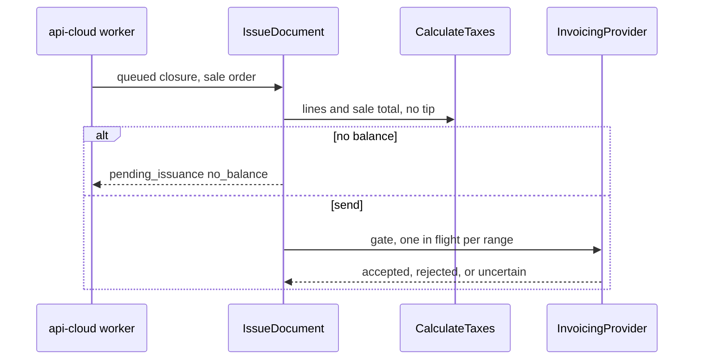

# Design: Electronic Invoicing

## Technical Approach

Cloud slice of [e-invoicing](specs/e-invoicing/spec.md) ([ADR-017](../../../docs/adr/ADR-017-tdd-sobre-hexagonal.md), [ADR-018](../../../docs/adr/ADR-018-screaming-y-bounded-context.md), ADR-002, TRD-M3, TRD-00 §8.1–8.4). D-37 matches tax and cash: `api-cloud` emits through Factus; `local-node` returns 403 `InvoicingRejected` and stores nothing. The proposal's hybrid owner, SQLite, outbox, and sync are out of this design: a venue outage stops the site. Deferred emission and the contingency receipt stay D-10, not tasks.

A host port reads the `queued` closure. Invoicing calls `CalculateTaxes`. Credentials stay in `Secrets`. The 0.9 probe does not emit.

## Architecture Decisions

| Option | Tradeoff | Decision |
| --- | --- | --- |
| Node documents and sync | Breaks D-37 | **Cloud only.** No SQLite, outbox, or `shared/sync` |
| Emit inside `ChargeCheck` | Blocks the sale on Factus | **Worker** over queued closures |
| Edit `sale_closures` | Status is only `queued` | **Idempotent** on closure id |
| Venue queue; 200 in 10 minutes | Needs D-10 | **Deferred.** Not tasks |
| Empty bundle | Sale must finish | **`pending_issuance` / `no_balance`** |
| Buyer on the charge | Edits cash | **`AttachBuyer`.** Else `GenericBuyer` |
| New credit-note permission | `sale.credit-note` is PRD-01 §6.2 | **Reuse it** |
| Factus JSON in the domain | Leaks the provider | **ACL in `adapters/factus`.** Not the 0.9 probe |

`GenericBuyer` is `13` / `222222222222` / "Consumidor final" / `R-99-PN` / taxpayer email. A bad NIT check digit fails closed. Lookup returns name and email (D-21). Emission takes the 80/minute gate first, with one `POST /v2/bills/validate` in flight per range (D-19). Tip is surcharge `03` / `propina`, outside `CalculateTaxes` (D-08). Codes: cash `10`, card `48`, transfer and wallet `47`, voucher `72`, credit `ZZZ` form `2`; else form `1`. Excluded markers carry no tax code. Exempt stays `01` at 0. Channel and bags are not invented.

`uncertain` means Factus returned nothing. By `reference_code`: validated keeps number and CUFE; pending is deleted and resent on that reference; missing resends it; a failed query backs off. Rejection alerts, then a new reference. A credit note points at the original. Each acceptance counts one per company, NIT, and site. Days = remaining / pace (0 hides color; under 15 yellow; under 5 red). `SetDocumentBalance` (`tax.configure`) sets the opening remaining. Pricing stays 4.3.

## Data Flow

## File Changes

| File | Action | Description |
| --- | --- | --- |
| `contexts/invoicing` domain, application, factus, postgres, memory | Create | Lifecycle, entry port, `#adapters/factus/*`. `0011_electronic_invoicing.sql` reuses `invoicing_app` |
| `contexts/invoicing/package.json`, `shared/contracts` | Modify | Export ports and adapters. Zod 4, `z.email()`, no `z.any()` |
| `apps/api-cloud` HTTP, composition, worker, tests | Modify | `safeParse`, permission, `IssueDocument` |
| `apps/local-node` `invoicing.controller.ts`, module, test; `tools/skeleton/skeleton.test.ts` | Create / Modify | 403 every route, no store, no invoicing import. Allow the controller |
| Cash, `shared/sync`, printing, portal | None | Untouched or deferred |

## Interfaces / Contracts

Const statuses: `generated`, `sending`, `accepted`, `rejected`, `pending_issuance`, `uncertain`. `reference_code` is the UUIDv7. One row per closure; a repeat returns it. `pending_issuance` means `no_balance` only.

`InvoicingProvider`: `validate`, `findByReference`, `deleteAttempt`, `lookupAcquirer`, `validateCreditNote`. Lookup and attach use `sale.charge`. Ranges and balance use `tax.configure`. Credit notes use `sale.credit-note` and audit after save. Routes under `tenants/:tenantId/venues/:venueId` require `x-session-id`. A bad body is 400 and stores nothing. The node returns 403 for those same routes.

## Testing Strategy

RED then GREEN (ADR-017).

| Layer | What to Test | Approach |
| --- | --- | --- |
| Unit | One document, check digit, tip off the base, excluded markers | Domain |
| Application | Uncertain branches, repeat, empty balance, denied note | Memory ports, not the 0.9 simulator |
| Contract | RLS, hidden tenant | Memory and PGlite. No SQLite |
| HTTP | Cloud 200 and 403; node 403 and empty module | `inject`, no `listen` |

## Threat Matrix

N/A — no routing, shell, subprocess, VCS/PR automation, executable-file classification, or process-integration boundary.

## Migration / Rollout

`0011` adds tables. Rollback drops them and the routes. Accepted rows stay. A correction is a credit note. No sync schema.

## Deferred

Not tasks: venue queue and contingency receipt (D-10), node documents and sync (D-37), the 200-document drain, printing, portal, reinvoicing, delivery address, deposits, bundle pricing, support documents, WhatsApp.

## Open Questions

- [ ] `card` maps to `48`. Code `49` waits until cash stores debit versus credit.
- [ ] Invoice email is a new setting. The fiscal profile has no email column.
