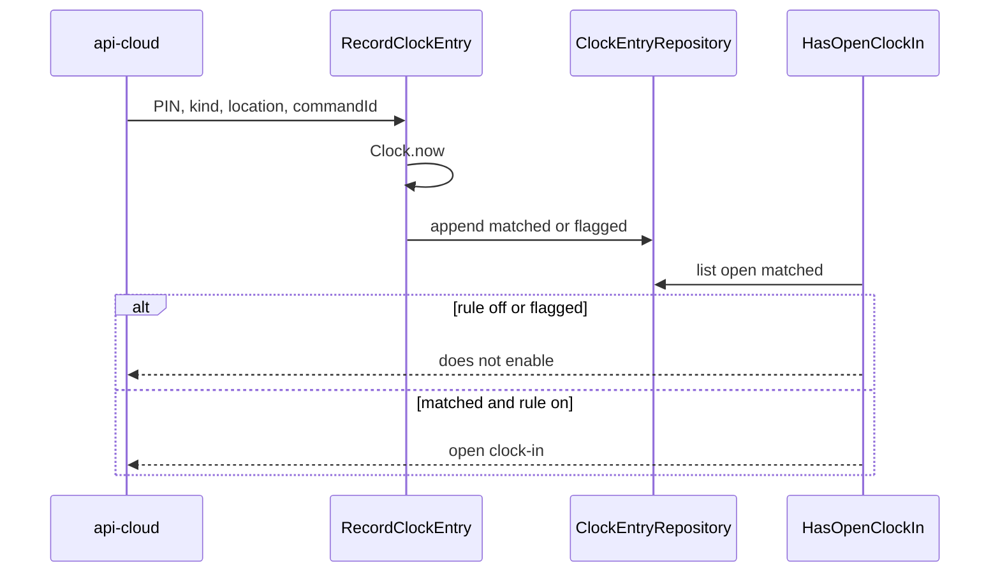

# Design: Attendance

## Technical Approach

Cloud slice only (D-37), inside-out ([ADR-017](../../../docs/adr/ADR-017-tdd-sobre-hexagonal.md)): derived shift and hours, memory use cases, PGlite append-only store, thin HTTP in `apps/api-cloud` ([ADR-018](../../../docs/adr/ADR-018-screaming-y-bounded-context.md)). Spec: `specs/attendance/spec.md`. Package `@blackhole/attendance`. Domain has no Nest and no SQL. No relative imports. Callers use only `application/entry-port.ts`.

## Architecture Decisions

| Option | Tradeoff | Decision |
|--------|----------|----------|
| `contexts/attendance` | New package | **Chosen.** ADR-018. Not rows inside platform |
| Client `occurredAt` | Phone clock can lie | Rejected. `Clock.now()` on the server |
| Drop a location miss | No row to correct | Rejected. **D-43:** haversine vs geofence. Match stores `matched`. Miss stores `flagged` and does not enable operation. No geofence stores `flagged` |
| Editable hours | Two sources of truth | Rejected. Append `ClockEntry` and `ClockEntryCorrection`. Hours are `projectHours` |
| `HasOpenClockIn` on the entry port | Callers must ask | **Chosen.** `operationRuleEnabled` defaults false. Admins never call it (TRD-M8 §4) |
| Rule inside `EvaluatePermission` | Redesigns authorization | Rejected. Same for D-33. `HasClockedInCashier` is separate. Composition sets `cashRegisterId` only for a cashier; it stays until clock-out |
| Second open clock-in | Two shifts | Rejected. One per worker per venue. `commandId` retry returns the same row |
| `attendance_app` insert-only, forced RLS | Matches audit | **Chosen.** Next unused `NNNN_*.sql`. Do not reserve a number (`0007_audit.sql` exists) |
| SheetJS in the domain | Library on a rule | Rejected. Adapter writes xlsx. No salary columns |

## Data Flow

`RecordClockEntry` takes PIN, kind, device, coordinates, and `commandId`. `PinCheck` adapts `PinVerifier`. `WorkerShift` stamps `Clock.now()` and appends, or rejects a second clock-in. Queries ignore `flagged`. `CorrectClockEntry` appends and calls `RecordAuditEvent`. A normal clock-in does not. `projectHours` applies a later correction. `CloseOpenShifts` appends `clock_out` with `pending_review`. A cut fails the call. Nothing is queued.

## File Changes

| File | Action | Description |
|------|--------|-------------|
| `contexts/attendance/package.json`, `tsconfig.json` | Create | `@blackhole/attendance`. Imports `#domain/*`, `#application/*`, `#application/ports/*`, each use-case folder, `#adapters/*` |
| `contexts/attendance/domain/worker-shift.ts`, `worker-shift.test.ts`, `project-hours.ts`, `project-hours.test.ts`, `domain/index.ts` | Create | Kinds `clock_in`, `clock_out`, `break_start`, `break_end`. States `off_shift`, `on_shift`, `on_break`, `pending_review`. 7h30. 08:07 within 10 minutes is not lateness |
| `contexts/attendance/application/ports/clock.ts`, `pin-check.ts`, `clock-entry-repository.ts`, `clock-entry-repository.contract.ts`, `attendance-policy-repository.ts`, `hours-workbook.ts` | Create | Entries: `append` and `list` only. Policy: geofence, tolerance, close time, rule default false, `hours_only` or `scheduled`, `ScheduledShift` |
| `contexts/attendance/application/record-clock-entry/*`, `correct-clock-entry/*`, `close-open-shifts/*`, `set-venue-attendance-policy/*`, `read-attendance/*`, `export-hours/*`, `entry-port.ts` | Create | Entry port exports `HasOpenClockIn` and `HasClockedInCashier` only |
| `contexts/attendance/adapters/memory/*contract.test.ts`, `adapters/postgres/NNNN_attendance.sql`, `schema.ts`, `drizzle-*-repository.ts`, `*.contract.test.ts`, `adapters/xlsx/hours-workbook.ts` | Create | Memory and PGlite share the contract. Insert-only. RLS `attendance_app`. xlsx has no salary |
| `shared/contracts/attendance.ts`, `index.ts` | Create / Modify | Zod at the boundary. `z.enum` for kind and presence. No trusted timestamp |
| `apps/api-cloud/src/http/attendance.controller.ts`, `test/http/attendance.controller.test.ts`, `src/composition/attendance-access.ts`, `application-module.ts`, `close-open-shifts.ts` | Create / Modify | Routes below. pg-boss runs close. `inject`, no `listen` |
| `apps/api-cloud/package.json`, `apps/api-cloud/tsconfig.json`, `tsconfig.json`, `vitest.config.ts`, `package.json` | Modify | Dependency, references, vitest `contexts/attendance/**/*.test.ts` |

Routes, header `x-session-id`: `POST /tenants/:tenantId/venues/:venueId/clock-entries`; `POST .../clock-entries/:entryId/corrections`; `PUT .../attendance/policy`; `GET .../attendance`; `POST .../attendance/export`. Read, export, policy, and correction use `attendance.correct` (own site, else 403). Clock uses PIN and a registered device. No new permission code.

## Interfaces / Contracts

`HasOpenClockIn` returns `{ ruleEnabled, counting }`. Callers block only when the rule is on and `counting` is false. `HasClockedInCashier` is independent: a matched open clock-in with `cashRegisterId`. Fields: tenant, venue, user, device, kind, `presence`, `occurredAt`, `commandId`, optional `cashRegisterId`. A correction stores `entryId`, reason, and the replacement. `projectHours` prefers it.

## Testing Strategy

| Layer | What to Test | Approach |
|-------|----------------|----------|
| Domain | Second clock-in, 7h30, tolerance, flagged ignored, both rows kept | Pure |
| Use case | Server time, retry, rule off, cashier register, auto-close, flagged miss | Memory |
| Contract | Append, hidden tenant, same `commandId`, UPDATE and DELETE refused | Memory and PGlite. Drizzle is not mocked |
| HTTP | Clock 200, second open 409, cashier correct 403, export without salary | `inject`. No `listen` |

## Threat Matrix

N/A — no routing, shell, subprocess, VCS/PR automation, executable-file classification, or process-integration boundary.

## Migration / Rollout

Apply adds the next unused `NNNN_attendance.sql`: tables, `attendance_app`, forced RLS, and update, delete, and truncate triggers. Rollback does not drop tables. Turning the rule off unblocks operation.

## Deferred (D-37)

Not file changes here: offline clock on `apps/local-node`; `adapters/sqlite`; `shared/sync`; photo (5.4); `ParticipantsForPeriod` and tips (1.10); payroll; `apps/admin-web`; `apps/venue-app`. Hybrid outage behavior waits for that phase. A cloud cut stops the site. Devices do not queue clock events.

## Open Questions

None.
