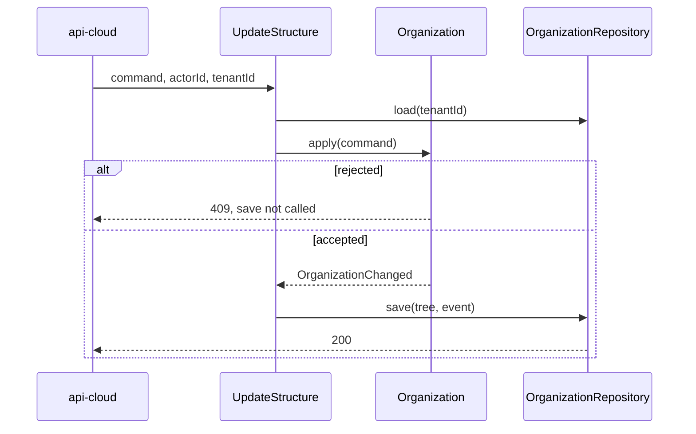

# Design: Organization

Delivery 0.3 is cloud structure (D-37, TRD-M0 §4 `UpdateStructure`). Inside-out ([ADR-017](../../../docs/adr/ADR-017-tdd-sobre-hexagonal.md)): domain, memory use case, PGlite port, thin HTTP ([ADR-018](../../../docs/adr/ADR-018-screaming-y-bounded-context.md)). Glossary `Venue` is the spec's site. `VenueOperation` stays the 0.2 record.

One `Organization` per tenant. Taxpayers: unique NIT, `taxProfileId` only. Venues: one brand, one invoicing taxpayer, mode `cloud`, one point. Warehouses are optional. Stations hold no stock. `UpdateStructure` emits `OrganizationChanged` (`actorId`, before, after) only after save. Absent: `apps/admin-web`, `shared/sync`, `adapters/sqlite`.

## Architecture Decisions

| Option | Tradeoff | Decision |
|--------|----------|----------|
| `UpdateStructure` | One command union | **Chosen.** Not `CreateOrganization` or `CreateCompany` |
| One aggregate | Load is the tenant tree | **Chosen.** Domain keeps the invariants |
| Per-entity services | SQL owns the rules | Rejected |
| Glossary `Venue` | Spec says site | **Chosen** |
| RLS, non-superuser | Superuser bypasses RLS | **Chosen.** `SET ROLE organization_app`, force RLS |
| Filter in `WHERE` only | Omitted filter leaks | Rejected |
| Event in the same `save` | No outbox | **Chosen.** Rejection never saves |
| One `POST .../structure` | Same style as the venue write | **Chosen.** 400 Zod, 409 domain |
| Many REST routes | Second HTTP style | Rejected |
| Node 403 `StructureEditRejected` | No SQLite needed | **Chosen.** Node has no repository |
| Owner required now | Users are 0.4 | Rejected here |
| Real NITs in git | Unknown | Rejected. `sample` NITs only |

## Data Flow

`local-node` returns 403 for that POST and stores nothing.

## File Changes

| File | Action | Description |
|------|--------|-------------|
| `domain/organization.ts`, test, `index.ts` | Create / Modify | Aggregate and errors. Keep `layer` |
| `application/ports/organization-repository.ts`, contract, `update-structure/*`, `entry-port.ts` | Create / Modify | `load`, `save`, export the use case |
| `adapters/memory/in-memory-organization-repository.ts`, contract test | Create | Maps. Imports the suite |
| `adapters/postgres/schema.ts`, `0002_organization.sql`, Drizzle repository, contract test | Create / Modify | Tables, RLS, PGlite |
| `contexts/platform/package.json` | Modify | Exports and `#application/update-structure/*` |
| `shared/contracts/update-structure.ts`, `index.ts` | Create / Modify | Zod command and event |
| `apps/api-cloud` controller, test, `postgres-organizations.ts`, `sample-pilot-structure.ts`, module, `create-application.ts` | Create / Modify | Route and binding. No `listen` |
| `apps/local-node` reject controller, test, module, `bootstrap.test.ts` | Create / Modify | 403. No repository. Drop empty tree |
| `tools/skeleton/skeleton.test.ts` | Modify | Allow these files. Keep absences |

Platform paths omit `contexts/platform/`. Imports use package maps. No deletions. Leave layer `index.ts` files and `strict_tdd`.

## Interfaces / Contracts

`load(tenantId)`, `save(organization, event)`. Postgres sets `organization_app` and `app.tenant_id` first. Commands: `registerCompany`, `addTaxpayer`, `addBrand`, `openVenue`, `replaceInvoicingTaxpayer`, `addKitchenStation`, `addCashRegister`, `renameCashRegister`, `addSiteWarehouse`, `addGeneralWarehouse`, `assignStock`. `openVenue` adds the point at `cloud`. `assignStock` and a second taxpayer throw. 409 writes nothing. Prefix `organization_`. Unique `(company_id, nit)`. One `point` per venue. `0002` leaves `venue_operations`. Fixture: six venues, `SAMPLE-NIT-01`–`06`, `label: "sample"`, posted by an API test.

## Testing Strategy

Given / When / Then. Failing test first. `strict_tdd` stays false.

| Layer | What to test | Approach |
|-------|----------------|----------|
| Domain | NIT, second taxpayer, replace, point, stock, `cloud` | Pure |
| Use case | Event on success; none on rejection | Memory |
| Contract | Round-trip; other tenant hidden; one point | Memory and PGlite |
| Postgres | `SELECT` without `tenant_id` | `organization_app`. No mock |
| HTTP | Cloud 200/400/409 and six venues; node 403 | `inject`. No `listen`, no SQLite |

## Threat Matrix

| Boundary | Applicability | Design response | Planned RED tests |
|---|---|---|---|
| Documentation-like paths | N/A. JSON body. No path is opened. | — | — |
| Git repository selection | N/A. No `git`. | — | — |
| Commit state | N/A. No commit. | — | — |
| Push state | N/A. No push. | — | — |
| PR commands | N/A. No `gh`. | — | — |

## Migration / Rollout

No production data. `0002_organization.sql` creates tables, role `organization_app`, and forced RLS. PGlite runs it fresh. Rollback drops those tables.

## Deferred to the hybrid phase

No files, as 0.1 left local HTTPS: `shared/sync`, cursor, outbox, SQLite copy, pairing, reconnect delivery, hybrid mode, admin scope (0.5), `apps/admin-web`, users, roles, last owner, hash chain (0.6), tax rules (1.4), DIAN ranges, menus, `CreateOrganization`, warehouse node (D-04).

## Open Questions

- [ ] Pilot NITs are unknown. The fixture stays `sample` until the owner supplies them.
