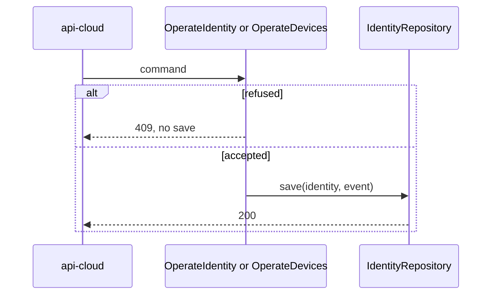

# Design: Identity and Devices

Delivery 0.4 is the cloud MVP (D-37). Inside-out ([ADR-017](../../../docs/adr/ADR-017-tdd-sobre-hexagonal.md)): domain, memory use case, PGlite RLS, thin HTTP ([ADR-018](../../../docs/adr/ADR-018-screaming-y-bounded-context.md)). Absent: `apps/admin-web`, `apps/venue-app`, `shared/sync`, `adapters/sqlite`.

`Identity` is one tenant aggregate (users, devices, codes, sessions), saved like `Organization`. Events and logs omit PINs, passwords, hashes, and private keys.

## Architecture Decisions

| Option | Tradeoff | Decision |
|--------|----------|----------|
| Cloud PIN and signature | Node returns 403 | **Chosen** |
| SQLite, offline revoke | Needs sqlite | Rejected. No files |
| Two POSTs, one union each | Not many routes | **Chosen.** 400 / 409 |
| One aggregate | Not split saves | **Chosen** |
| `PinHasher`, `PasswordHasher`, factor, verifier, clock | Domain stays pure | **Chosen.** Fast doubles |
| WebAuthn, SMS, email, slow cost | External or slow | Rejected. Cost unset. Tests skip `SlowSaltedHasher` |
| Public key on the row | Private key in tests | **Chosen** |
| `siteOffline` on the command | No probe | **Chosen** |
| Station binding only | No kitchen queue | **Chosen** |
| Strict session object | No phone app | **Chosen** |
| `identity_app`, forced RLS | Own role | **Chosen.** `0003_identity.sql` |
| Enroll and `secondFactorRequired` (D-38) | No roles | **Chosen.** Required once enrolled |

## Data Flow

A refusal does not save.

## File Changes

| File | Action | Description |
|------|--------|-------------|
| `domain/user.ts`, `device.ts`, `identity.ts`, tests, `index.ts` | Create / Modify | Aggregate. Keep `layer` |
| `application/ports/` hashers, factor, verifier, `clock`, repository, contract | Create | `load`, `save` |
| `application/operate-identity/*`, `operate-devices/*`, `entry-port.ts` | Create / Modify | Not named `use-case` |
| `adapters/memory/` repository, fast doubles, clock, contract test | Create | Memory only |
| `adapters/crypto/slow-salted-hasher.ts`, `node-public-key-verifier.ts` | Create | Slow hash unused by tests |
| `adapters/postgres/schema.ts`, `0003_identity.sql`, Drizzle repository, contract test | Create / Modify | PGlite. No mock |
| `package.json`, `shared/contracts/identity.ts`, `devices.ts`, `index.ts` | Modify / Create | Maps `#application/operate-*/*`, `#adapters/crypto/*`, Zod |
| `apps/api-cloud` controllers, tests, `postgres-identity.ts`, module | Create / Modify | `inject`. No `listen` |
| `apps/local-node` reject controllers, tests, module | Create / Modify | 403. No repository |
| `tools/skeleton/skeleton.test.ts` | Modify | Allowlist plus `apps/venue-app` absent |

No deletions. `strict_tdd` stays false. Platform paths omit `contexts/platform/`.

## Interfaces / Contracts

`load(tenantId)`, `save(identity, event)`. Role `identity_app` and `app.tenant_id` first. Tables: `users`, `devices`, `registration_codes`, `sessions`, `identity_changes`. Hashes and `public_key` are columns. Events are public snapshots.

Identity POST: `signInAdministration`, `enrollSecondFactor`, `requireSecondFactor`, `startPinSession`, `recordActivity`, `deactivateUser`. Devices POST: `issueRegistrationCode`, `registerDevice`, `revokeDevice`, `openFixedStation`, `authorizeOperation`. Prefixes: `user_`, `device_`, `session_`, `registration_`.

Code: hashed, shown once, five-minute TTL, five bad redeems lock it. Device calls are signed minus the signature; unsigned, bad, and revoked fail. Five bad PINs emit `PinAttemptsLocked`; a good PIN resets and replaces the session. The clock locks idle sessions. `siteOffline` blocks PIN and authorize, the print gate. Fixed station: no PIN, one existing station. Deactivate ends that user's sessions in the same save. Admin sends `x-session-id`. A 409 does not save. Session keys: `sessionId`, `userId`, `displayName`, `deviceId`, `venueId`, `kind`. Factor: `enroll`, `verify`, fixed code.

## Testing Strategy

Failing test first. Given / When / Then.

| Layer | What to Test | Approach |
|-------|----------------|----------|
| Domain | Factor, PIN lock, code, station, snapshot | Pure |
| Use case | Offline, signatures, switch, idle, deactivate | Memory clock |
| Contract | Round-trip, hidden tenant, no event secrets | PGlite and memory |
| HTTP | 200/400/409, node 403, no sales, reports, or customer fields | `inject`. No `listen` |
| Skeleton | New files in; admin web, venue app, sync, sqlite out | Allowlist |

## Threat Matrix

| Boundary | Applicability | Design response | Planned RED tests |
|---|---|---|---|
| Documentation-like paths | N/A. JSON only. No path is opened. | — | — |
| Git repository selection | N/A. No `git`. | — | — |
| Commit state | N/A. No commit. | — | — |
| Push state | N/A. No push. | — | — |
| PR commands | N/A. No `gh`. | — | — |

Snapshot and session tests cover secrets.

## Migration / Rollout

No production data. `0003_identity.sql` adds tables, `identity_app`, and forced RLS. Rollback drops those objects.

## Deferred to the hybrid phase

No files, as 0.3 left the node copy: offline PIN, offline revoke, upload, shared Wi-Fi, local HTTPS, port scan, SQLite, Playwright, `apps/admin-web`, `apps/venue-app`. Also out: roles, supervisor PIN, hash chain, attendance, print templates, kitchen queue, SMS, email, WebAuthn.

## Open Questions

None.
