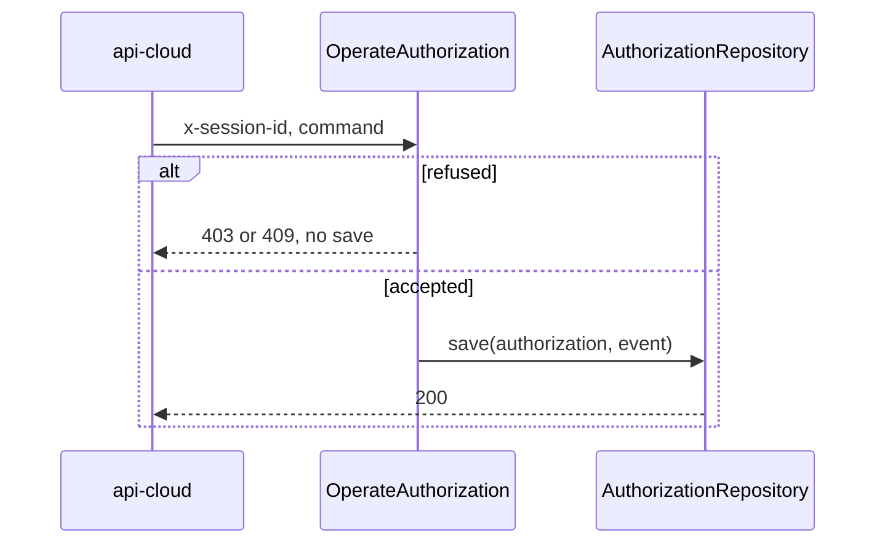

# Design: Roles and Permissions

Cloud MVP (D-37), inside-out ([ADR-017](../../../docs/adr/ADR-017-tdd-sobre-hexagonal.md)): domain, memory use case, PGlite RLS, thin HTTP ([ADR-018](../../../docs/adr/ADR-018-screaming-y-bounded-context.md)). See `specs/authorization/spec.md`. Login stays in 0.4 (D-38). Absent: `apps/admin-web`, `apps/venue-app`, `shared/sync`, `adapters/sqlite`.

`Authorization` is one tenant aggregate, saved like `Organization`: `load(tenantId)`, `save(authorization, event)`. Predefined roles stay in code.

## Architecture Decisions

| Option | Tradeoff | Decision |
|--------|----------|----------|
| One aggregate | Large snapshot | **Chosen.** Same save as Organization |
| Catalog in SQL | Editable by clients | Rejected. Code catalog |
| SQLite copy, Web Push, node socket | Needs sqlite or venue-app | Rejected. Node 403. Cloud POST |
| `.authorize` per matrix row | More codes | **Chosen.** `yes` and `with_limit`, up to their cap |
| Most permissive, then lower-only | Spec | **Chosen** |
| Bartender charge flag, default off | Role stays fixed | **Chosen** (D-22) |
| Self-auth from assignments | Not attendance | **Chosen.** Attendance is 1.9 |
| Support grant header | Not a session kind | **Chosen** |
| Notice row, not a hash chain | 0.6 owns the chain | **Chosen** |
| Enforce on structure and writes | Breaks `x-actor-id` | Rejected. Declare only |
| `0004_authorization.sql` | `0003` is identity | **Chosen.** Role `authorization_app` |
| PRD-01 §7 caps | D-30 | **Chosen.** Percent, COP, counts |

## Data Flow

`x-session-id` loads the 0.4 session for the route `tenantId`. Grants are assignments in Organization scope. `pin` acts only at `session.venueId`. Administration does not treat `venueId` as a grant. Denied is 403. `requires_authorization` is 200. Refusal is 409. Expiry is lazy. Node returns 403 `PermissionCommandRejected` and stores nothing. Remote resolve uses the authorizer session.

## File Changes

| File | Action | Description |
|------|--------|-------------|
| `domain/permission-catalog.ts`, `authorization.ts`, `evaluate.ts`, tests, `index.ts` | Create / Modify | Catalog and aggregate. Keep `layer` |
| `application/ports/` repository, contract, reader, PIN verifier | Create | `load` / `save` and seams |
| `application/operate-authorization/*`, `evaluate-permission/*`, `entry-port.ts` | Create / Modify | Commands and read |
| `adapters/memory/`, `adapters/postgres/` (`0004_authorization.sql`, Drizzle) | Create / Modify | Memory and PGlite. No mock |
| `package.json`, `shared/contracts/authorization.ts` | Modify / Create | Import maps and Zod |
| `apps/api-cloud`, `apps/local-node` | Create / Modify | Cloud `inject`. Node 403, no repository |
| `tools/skeleton/skeleton.test.ts` | Modify | Allowlist. Deferred apps stay absent |

`strict_tdd` stays false. No relative imports.

## Interfaces / Contracts

`load(tenantId)`, `save(authorization, event)`. Codes are `<context>.<action>` with `yes | with_limit | with_authorization | no` and `.authorize`. Eight PRD-01 §6 columns. Other §4 roles keep only their prose grants. A missing cell fails typecheck. One test per cell.

`evaluate` returns `allowed`, `requires_authorization`, or `denied`. Most permissive wins; a venue may only lower. POST `/authorization` unions copy, revise, assign, limit, bartender flag, shift self-auth, request, resolve, grant, and revoke. `POST .../sales/charges` evaluates `sale.charge` and stores nothing. Subset grants only. Last owner stays. Self-auth needs the shift flag and a sole authorizer, then sets `selfAuthorized` and a notice. Support uses `x-support-grant-id`.

RLS role `authorization_app`: custom roles, permissions, assignments, venue limits and flags, requests, grants, shift flags, notices, changes. Snapshots omit PINs. `structure` declares `organization.structure`. `writes` declares `operation.accept-cloud-write` and stays as today. A mutating route without `permission` fails the suite.

## Testing Strategy

| Layer | What to Test | Approach |
|-------|----------------|----------|
| Domain | Matrix, caps, scope, escalation, last owner, self-auth, bartender flag | Pure |
| Use case | Session lookup, PIN seam, expiry, notices | Memory |
| Contract | Round-trip, hidden tenant | PGlite and memory |
| HTTP | 200/403/409, waiter charge denied, node 403, nothing stored | `inject`. No `listen` |
| Skeleton | New files in; admin web, venue app, sync, sqlite out | Allowlist |

## Migration / Rollout

No production data. `0004_authorization.sql` adds tables, `authorization_app`, and forced RLS. Rollback drops those objects. `0003_identity.sql` stays with 0.4.

## Deferred

No files: offline evaluate, sync, node WebSocket, Web Push, SQLite, admin web, venue app, audit chain (0.6), unusual-behavior counters (1.7, D-31), clock-in (1.9), support UI (4.5).

## Open assumptions

None block 0.5. Do not edit the frozen 0.4 change.

- Keys only: `sessionId`, `userId`, `displayName`, `deviceId`, `venueId`, `kind`. No `tenantId` or roles. `kind` is `administration` or `pin`. Administration may omit `venueId`.
- `PinVerifier.confirm` is not in 0.4. It keeps the session and uses the five-failure lock. Tests use a memory double.
- "Only authorizer" counts assignments. Shift totals are `evaluate` inputs. The support actor id is opaque.
- `IdentityReader` adds `{ userId, active }`. Reuse 0.4 `Clock` and `Identity.load` when present. The declaration test includes 0.4 routes only after they exist.
