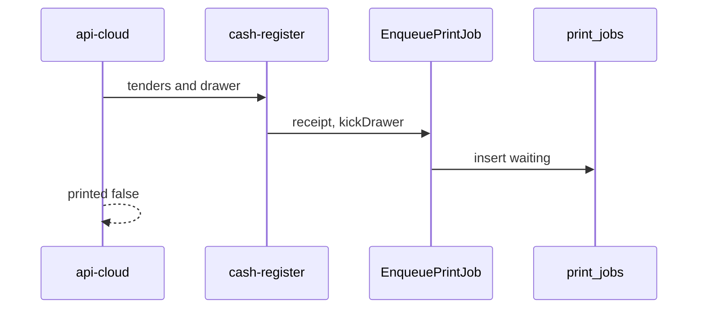

# Design: Printing

## Technical Approach

Cloud queue for [printing](specs/printing/spec.md) (TRD-00 §7, TRD-M3 §1 and §5, D-37). `shared/printing` (`@blackhole/printing`) owns templates, ESC/POS bytes, jobs, retries, and backup. No salon, cash, or tax rule lives there ([ADR-018](../../../docs/adr/ADR-018-screaming-y-bounded-context.md)). Producers call only `application/entry-port.ts`. `api-cloud` parses `@blackhole/contracts`, saves the sale, then enqueues. `RecordAuditEvent` runs after accept. Inside-out ([ADR-017](../../../docs/adr/ADR-017-tdd-sobre-hexagonal.md)). Domain has no Nest, SQL, or Zod.

p0-01 is blocking: `ticketLegible` and `drawerOpened` are null. Do not import `tools/spikes/escpos`. Widths 48 and 32 and pulse `1B 70 00 19 FA` are a render contract. Physical 80 mm and 58 mm proof is a later verification gate, after a concluded on-site report, not a task here.

## Architecture Decisions

| Option | Tradeoff | Decision |
| --- | --- | --- |
| Queue in `orders` | M2 and M3 also print | **`shared/printing`** |
| SQLite, outbox, node queue, `bridge` | D-37 | **Postgres on `api-cloud`.** Not apply tasks |
| Cloud opens TCP 9100 | No path to the venue LAN | **Enqueue `waiting`.** Memory transport in tests |
| Spike as proof | Visit not recorded | **Verification gate.** Do not copy it |
| Kick every register | Some have no drawer | **`drawer: present \| absent`.** A venue may mix both |
| Kick from M3 or kitchen | Drawer is an M2 command | **Cash tender, that register's invoice or offline receipt** |
| No-sale open or over-cap reprint | Both are 1.7 | **No route and no authorizer** |
| Invent a reprint count | §7 has no count | **`limit: number \| null`.** No cap returns `ReprintCapUnconfigured` |

`present` plus a `cash` tender sets `kickDrawer` on that register's printer. Accepting the job audits `cash.drawer-opened` on the payment: the command, not a physical open. `absent`: the receipt prints, no pulse, no opening audit, and open-drawer-without-sale is absent. `card`, `transfer`, `wallet`, `voucher`, `customer_credit`, and `corporate_credit` do not kick. Mixed tenders kick only with cash. Kitchen, pre-bill, cash close, transfer, and tips settlement never kick (`DrawerKickRejected`). Cash is still recorded and counted at close. Existing registers migrate to `absent`.

Jobs stay `waiting` until a future bridge claims them. HTTP returns `printed: false`. Test dispatch retries to `retryLimit`, then backup, then `failed`. The same `commandId` does not enqueue twice. `TakeOrder` publishes `printer_failed` for `failed` or `waiting`.

The offline receipt says it is not an invoice and has the lookup QR (D-10). The invoice has number, CUFE, and QR. Transfer and tips templates take caller payloads. Their real producers stay in 2.5 and 1.10.

## Data Flow

Kitchen jobs enqueue with `kickDrawer` false. `local-node` returns 403 `PrintingRejected` and stores nothing.

## File Changes

| File | Action | Description |
| --- | --- | --- |
| `shared/printing/**`, `adapters/postgres/0012_printing.sql` | Create | Entry port, enqueue, dispatch, reprint, configure, memory, Postgres. Role `printing_app`, RLS, `printers`, `print_jobs` |
| `shared/contracts/printing.ts`, `index.ts` | Create / Modify | Job, template, and printer schemas |
| `contexts/platform` organization, `0013_register_drawer.sql` | Modify | `drawer`, `printerId` on `cash_registers`; nullable `printerId` on `kitchen_stations`. No FK |
| `contexts/orders` `TakeOrder`, `RequestCheck`, printer port | Modify | `kitchen_ticket` and `pre_bill`. No pulse |
| `contexts/cash-register` charge and close | Modify | Cash kick on `present`. `cash_close` does not kick |
| `contexts/invoicing` application | Modify | Invoice and offline-receipt payloads. No kick |
| `apps/api-cloud` HTTP, composition, tests | Create / Modify | `safeParse`, enqueue, audit. `organization.structure` configures printers |
| `apps/local-node` `printing.controller.ts`, module, test | Create / Modify | 403, no repository, no drawer |
| `vitest.config.ts`, root `tsconfig.json`, `tools/skeleton/skeleton.test.ts` | Modify | Project `printing` |

## Interfaces / Contracts

Templates: `kitchen_ticket`, `pre_bill`, `invoice`, `offline_receipt`, `cash_close`, `transfer`, `tips_settlement`. Paper: `80`, `58`. Status: `waiting`, `printed`, `failed`. Drawer: `present`, `absent`. Errors: `PrintingRejected`, `ReprintNeedsAuthorization`, `ReprintCapUnconfigured`, `DrawerKickRejected`, `PrinterNotConfigured`.

At the injected cap, reprint does not print and does not ask for authorization. An accepted reprint audits `sale.reprint` with actor, device, document, and time.

## Testing Strategy

| Layer | What to Test | Approach |
| --- | --- | --- |
| Unit | Widths, pulse, absent drawer, non-cash, mixed registers | Domain |
| Application | One send, backup, `waiting`, reprint cap | Memory ports |
| Contract | Forced RLS | PGlite. No SQLite |
| HTTP | `printed: false`; node 403; 409 over cap or missing cap | `inject` |

Tests do not set legibility or `drawerOpened`.

## Migration / Rollout

`0012_printing.sql` adds printing tables. `0013_register_drawer.sql` adds `drawer` default `absent` and nullable `printerId`. Rollback drops them. No site flag.

## Open Questions

- [ ] PRD-01 §7 has no default reprint count. This design does not invent one.
