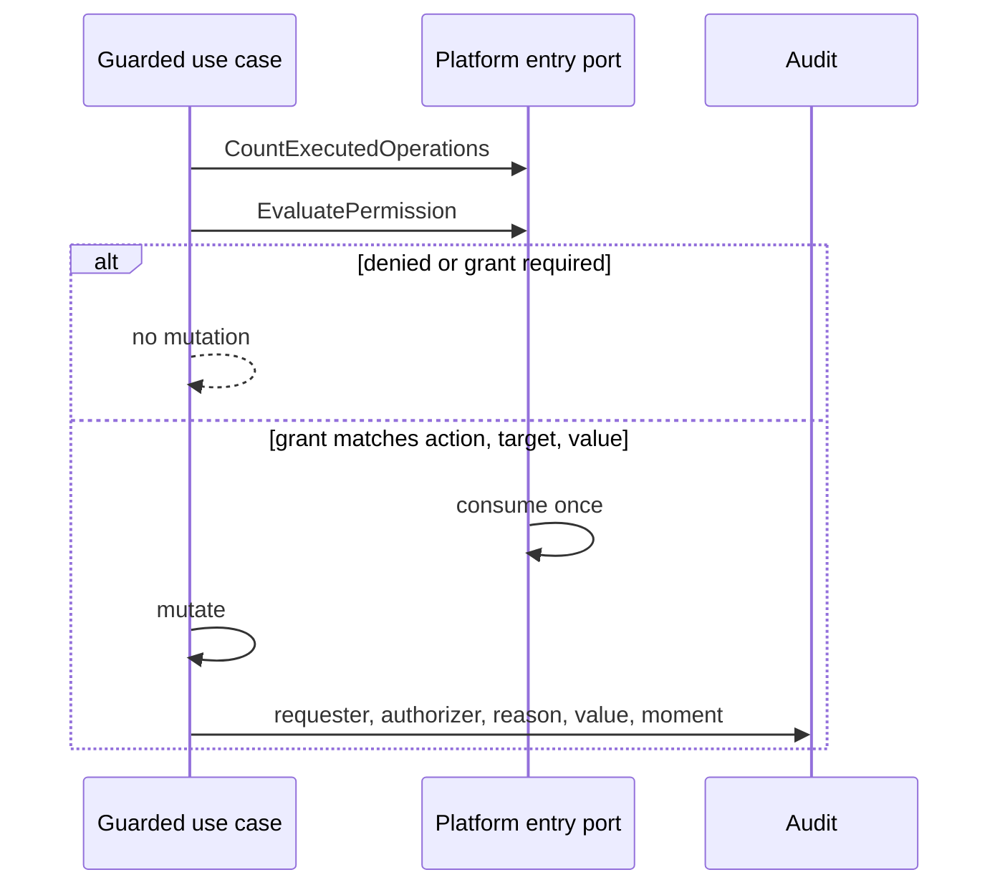
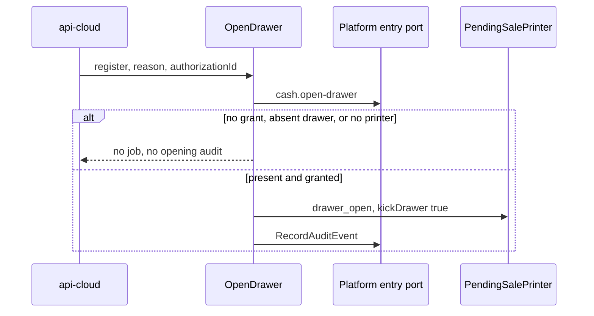

# Design: Anti-Theft Controls

## Technical Approach

Cloud slice for [sensitive-actions](specs/sensitive-actions/spec.md) and the [authorization](specs/authorization/spec.md) delta (PRD-01 §6 and §11, TRD-00 §10.2–10.3). Extends p0-05 `Authorization` and `EvaluatePermission` ([ADR-017](../../../docs/adr/ADR-017-tdd-sobre-hexagonal.md), [ADR-018](../../../docs/adr/ADR-018-screaming-y-bounded-context.md)). D-30 caps and the site-administrator authorizer stay. Thresholds are venue data (D-31).

Each new `orders` or `cash-register` use case calls `@blackhole/platform/application/entry-port` before any write, then `RecordAuditEvent` (`actorId`, authorizer, reason, value, moment). `api-cloud` uses Zod 4 `safeParse`. Contexts import entry ports only. `shared/printing` is unchanged. The reprint controller stays the only `@blackhole/printing` importer. `printing_app` stays `SELECT, INSERT`.

D-37 and D-10 exclude SQLite, outbox, node queue, deferred emission, and a contingency receipt. `local-node` returns 403 `{ error: "SensitiveActionRejected" }` with no constructor and no providers, matching `PrintingRejected`. Hybrid offline approval and post-sync rows stay deferred. No credit note, waste, schedule alert, or site UI.

## Architecture Decisions

| Option | Tradeoff | Decision |
| --- | --- | --- |
| HTTP `permit()` as in `ChargeCheck` | Route can skip the check | **Use case calls the entry port first** |
| New context | Copies `Authorization` | **Extend platform** |
| Printing owns the no-sale kick | cash-register would import printing | **`drawer_open` on cash-register `Printer`.** `PendingSalePrinter`, `RecordedDrawerAudit` |
| Client sends the total | Forgery resets the cap | **`CountExecutedOperations` counts successful audits** |
| Consume after write | Crash repeats the grant | **Consume first.** Failed write needs a new grant |
| Mutate the closed shift | Spec forbids it | **Reversals on the open shift, linked to the payment** |
| Over-cap reprint prints | 1.6 audits and does not print | **Audit only, with authorizer.** No enqueue |
| Fresh alert numbers | §11 publishes only voids over 5 | **Seed voids at 5.** Every self-authorization alerts. Other seeds are 5 (D-31) |

`held` and `sent` are before kitchen; `in_preparation` and later are after. A price change writes the line only. A missing drawer is `absent`. A null reprint cap stays 409 `ReprintCapUnconfigured`. `OperateAuthorization` still owns the PIN: `request` gains `targetId` and the shift totals, and a rejected PIN appends `pin.confirmation-failed` without the PIN.

## Data Flow





`local-node` returns 403 and stores nothing.

## File Changes

| File | Action | Description |
| --- | --- | --- |
| `contexts/platform/domain/authorization.ts`, `evaluate.ts` | Modify | `targetId`, one consume, `compShiftCop`. Matrix unchanged |
| `contexts/platform/application/consume-authorization/`, `count-executed-operations/`, `operate-authorization.ts`, `entry-port.ts` | Create / Modify | Consume, count, failed-PIN audit |
| `contexts/platform/application/detect-unusual-behavior/`, `read-control-report/` | Create | Detectors and projection. `audit.view` |
| `contexts/platform/adapters/postgres/0014_authorization_binding.sql` and drizzle | Create / Modify | `target_id`, `consumed_at`. Thresholds updatable. Alerts insert-only. RLS on `authorization_app` |
| `contexts/orders` void, discount, courtesy, price, billed `TakeOrder`, `ReassignCheck` | Create / Modify | Catalog permissions. `#application/<use-case>/*`. Depends on `@blackhole/platform` |
| `contexts/orders/application/ports/open-shift-reader.ts` | Create | Host confirms the open shift |
| `contexts/cash-register` `OpenDrawer`, `ReopenPaidAccount`, `ChangeTender`, `ports/printer.ts` | Create / Modify | `drawer_open` and open-shift reversals |
| `shared/contracts/authorization.ts` and sensitive-action schemas | Modify / Create | `targetId`, shift totals, Zod 4 |
| `apps/api-cloud` HTTP, composition, `sale-receipt.ts`, tests | Create / Modify | Wire ports. Over-cap reprint audits and does not print |
| `apps/local-node` controllers, module, tests | Create | 403 `SensitiveActionRejected`. No providers |

## Interfaces / Contracts

```ts
await consume.execute({ authorizationId, permission, targetId, value });
```

A mismatch leaves the grant unconsumed. A second consume throws. `after` is `{ value, shiftId, kitchen: "before" | "after" | null }`. The action is the permission code.

## Testing Strategy

RED then GREEN, one use-case pair per later apply. Projects: `platform`, `orders`, `cash-register`, `api-cloud`, `local-node`. PGlite covers `0014`. No SQLite.

Decision needed before apply: Yes
Chained PRs recommended: Yes
400-line budget risk: High

`sdd-tasks` gives each link one pair and its HTTP test.

## Threat Matrix

N/A. No shell, subprocess, git or pull-request automation, executable-file classification, or process integration. New routes are Nest controllers.

## Migration / Rollout

`0014` adds the columns. Existing rows copy `venue_id` into `target_id` and leave `consumed_at` null. Rollback drops the new objects. Prior role and venue rows restore caps and thresholds. Audit stays append-only.

## Open Questions

- [ ] Discount, pair, and failed-PIN seeds use 5, the only integer in PRD-01 §11. D-31 lets the venue change them.
