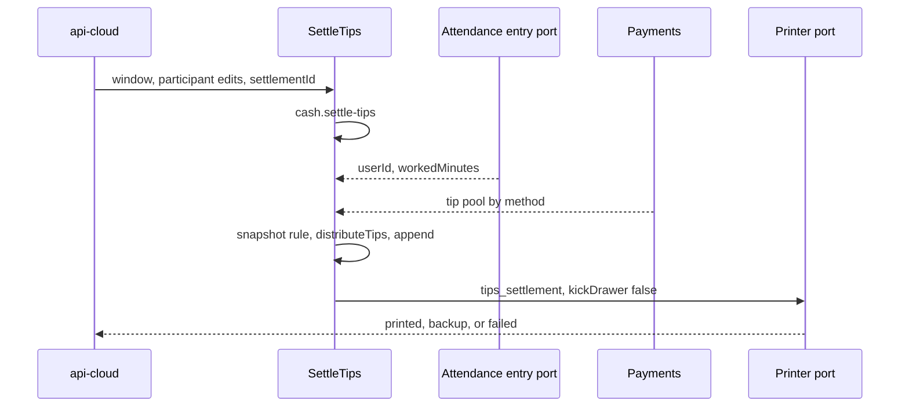

# Design: Tips

## Technical Approach

Cloud settlement for [tips](specs/tips/spec.md) (PRD-M2, TRD-M2 `SettleTips`, TRD-00 6.3; [ADR-017](../../../docs/adr/ADR-017-tdd-sobre-hexagonal.md), [ADR-018](../../../docs/adr/ADR-018-screaming-y-bounded-context.md)). Rule, distribution, and the settlement live in `contexts/cash-register`. Attendance supplies participants and minutes through its entry port. The pool sums existing `PaymentTip` and does not touch tax (D-08). Print reuses `tips_settlement` on 80 mm and 58 mm. `api-cloud` is the only writer. `cash.settle-tips` already allows owner, general manager, and site administrator. PA-37 does not apply. 1.8 is not started.

## Architecture Decisions

| Option | Tradeoff | Decision |
| --- | --- | --- |
| Settle on the local node in hybrid | Builds the node before the cloud MVP | **PostgreSQL on api-cloud only.** `local-node` returns 403 `{ error: "SensitiveActionRejected" }` and inserts nothing (D-37). No SQLite, outbox, queue, or deferred emission |
| Percentage per role | Fixes a rate on a role | **Percent per `employeeId`**, integers, sum 100. No role key (D-24). Modes: `equal`, `percentage`, `hours` |
| Hide the leftover inside shares | The leftover must stay visible | **`sum(baseCop) + residueCop = poolCop`.** Extra pesos follow `userId` order and are stored on the share |
| Cash-register reads attendance tables | Breaks the entry-port rule | **Port `TipParticipantSource`.** The host calls the attendance entry port |
| A second printer stack | Duplicates 1.6 | **`tips_settlement` on the cash-register `Printer` port, `kickDrawer: false`.** Host calls `EnqueuePrintJob`, then `DispatchPrintJobs` |
| Sync `TipSettlementClosed` | Outbox and hybrid | **`RecordAuditEvent` only:** `tips.rule-changed`, `tips.settlement-closed`, `tips.settlement-adjusted` |
| Update a closed row | The spec forbids it | **Append-only.** An adjustment is a new row with `adjustsSettlementId`, using the original rule snapshot |
| New permission or new UI apps | The matrix row exists; those apps are absent | **Reuse `cash.settle-tips`.** `EvaluatePermission` runs before any write. HTTP only |

Day and week windows are half-open America/Bogota (UTC−5), the same offset as attendance export. The week opens Monday 00:00 and closes the next Monday 00:00. A shift window is the caller's `from`/`to`. The pool is `payments.tip.amountCop` whose new `recorded_at` falls in that window, grouped by method. `saleCop` and tax are not added.

## Data Flow



A cloud outage leaves settlement unavailable. There is no queued node settlement. The hybrid scenario in the spec waits for the hybrid phase.

## File Changes

| File | Action | Description |
| --- | --- | --- |
| `contexts/cash-register/domain/tip-rule.ts`, `distribute-tips.ts`, `tip-settlement.ts`, `tip-period.ts`, `domain/index.ts` | Create / Modify | Rule, window, distribution, append-only settlement |
| `contexts/cash-register/application/configure-tip-rule/`, `settle-tips/`, `adjust-tip-settlement/`, `print-tip-settlement/`, `ports/tip-participant-source.ts`, `ports/tip-pool.ts`, `ports/printer.ts`, `entry-port.ts`, `package.json` | Create / Modify | Use cases and ports. Add each `#application/<folder>/*` import |
| `contexts/cash-register/application/charge-check/`, postgres schema, `0015_tips.sql`, ledger | Modify / Create | `recorded_at` from the platform clock. Backfill existing rows to `1970-01-01T00:00:00.000Z`. Role `cash_register_app` |
| `contexts/attendance/application/list-tip-participants/`, `entry-port.ts` | Create / Modify | Minutes via `projectHours`, same policy path as export |
| `shared/printing/domain/templates.ts`, `enqueue-print-job.ts`, `entry-port.ts` | Modify | Methods, rule, residue, signature. Export `DispatchPrintJobs` |
| `shared/contracts/tips.ts`, `index.ts` | Create / Modify | Zod 4 `.strict()` commands and views |
| `apps/api-cloud` HTTP, composition, tests | Create / Modify | `safeParse`, wire both entry ports |
| `apps/local-node` `sensitive-actions.controller.ts`, tests | Modify | 403 for rule, settle, adjust, and print. No providers |

No edits under `shared/sync` or invoicing.

## Interfaces / Contracts

```ts
distributeTips(input): { shares: { userId: string; baseCop: number; residueCop: number }[]; residueCop: number }
// sum(baseCop) + residueCop === poolCop; userId localeCompare; a zero-minute hours row stays 0
```

Percentage rows are `{ employeeId, percent }`. An add or a removal requires a reason; a removed employee is excluded and that percent stays in `residueCop`. A zero pool closes with no shares. The same `settlement_` id returns the first row.

HTTP under `tenants/:tenantId/venues/:venueId`: `PUT tip-rule`, `POST tip-settlements`, `POST tip-settlements/:id/adjustments`, `POST tip-settlements/:id/print`.

## Testing Strategy

| Layer | What to Test | Approach |
| --- | --- | --- |
| Unit | Distribution, percent sum, immutability, Bogota window | Vitest in `cash-register`, Given / When / Then |
| Integration | Pool ignores `saleCop`; minutes; backup printer | In-memory ports, Postgres contract, printing |
| HTTP | Cloud settle and print; node 403 stores nothing | `api-cloud` and `local-node` |

No browser E2E. Tests are still written first (ADR-017). `strict_tdd` stays false.

## Migration / Rollout

`0015_tips.sql` adds `tip_rules`, `tip_settlements`, and `payments.recorded_at`. Rollback hides HTTP. Closed rows stay. Tax rows are not rewritten.

## Open Questions

None. Role percentages and hybrid offline settlement are decided above.
