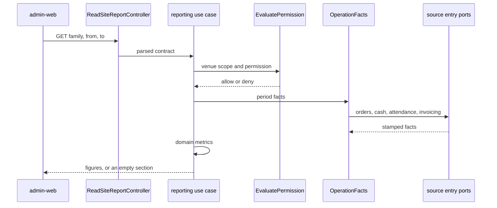

# Design: Site Reports

## Technical Approach

Cloud-only reports (D-37, roadmap 1.11): sales (PRD-00 8.2), dining-room times (8.1), cash (8.2 and the cash rows of 8.4), and hours (8.5). `contexts/reporting` owns the definitions and four read use cases. It reads orders, cash-register, attendance, invoicing, and platform only through `application/entry-port.ts` ([ADR-018](../../../docs/adr/ADR-018-screaming-y-bounded-context.md)). api-cloud composes those ports. admin-web replaces pending `/reports`. Day and history share one query. Cloud PostgreSQL is the operation owner, so an outage hides the report. Node day, SQLite, outbox, and sync stay in the hybrid remainder of 1.11. Reporting writes nothing (TRD-M6 §1, [ADR-017](../../../docs/adr/ADR-017-tdd-sobre-hexagonal.md)).

## Architecture Decisions

| Decision | Choice | Alternatives | Rationale |
|----------|--------|--------------|-----------|
| Where it runs | api-cloud over PostgreSQL | Node SQLite; inbox `ProjectFacts` | D-37. A sync cursor stays hybrid. |
| Module cut | `@blackhole/reporting` domain and application. `reporting-facts.ts` calls other entry ports | Foreign SQL; controller logic | Cruiser forbids interiors and a second dialect. `contexts/*` is already globbed. |
| Numbers | Nearest-rank `ceil(p/100*n)-1`. Empty sample yields no figures. Missing end drops the sample | SQL percentiles; zeros | TRD-M6 §2 and §10. |
| Net sales | `grossCop - discountCop - includedTaxCop - tipCop`. Added-on tax stays out | Subtract all tax from `saleCop` | `calculate-taxes` splits included and added-on. Tip is not sales. |
| Access | `report.view-sales` via `EvaluatePermission`. Other venue denied. Supervisor clamped to open cash shifts. Counts also need `cash.view-expected-total` | New permissions | The catalog already encodes these grants. |
| Missing stamps | The owning use case writes them. Reporting reads | Leave metrics empty | TRD-M6 §10. |
| Dependencies | No `qr_table`, QR tender, capture field, detectors, or exports | Invent them here | p1-12 and p1-08 own those writes. Channels are `waiter` and `fixed_point`. |

## Data Flow

Bands and weekdays use America/Bogota on the stored server instant.

## File Changes

| File | Action | Description |
|------|--------|-------------|
| `contexts/reporting/package.json`, `tsconfig.json`, `domain/metrics.ts`, `application/ports/operation-facts.ts`, `application/entry-port.ts`, `application/read-sales-report/read-sales-report.ts`, `application/read-time-report/read-time-report.ts`, `application/read-cash-report/read-cash-report.ts`, `application/read-staff-report/read-staff-report.ts`, `adapters/memory/in-memory-operation-facts.ts` | Create | Entry port only. No other-context dependency. Tsconfig has no references. |
| `contexts/orders/domain/check.ts`, `application/open-table/open-table.ts`, `application/release-table/release-table.ts`, `application/change-line-state/change-line-state.ts`, `adapters/postgres/schema.ts`, `adapters/postgres/drizzle-dining-room-repository.ts` | Modify | Check keeps `diners`. Stamp `releasedAt`. Snapshot `stationId` at preparation. Nullable columns. |
| `contexts/orders/application/list-service-facts/list-service-facts.ts`, `contexts/orders/application/entry-port.ts` | Create / Modify | Lines, channel, diners, discounts, voids. |
| `contexts/cash-register/application/charge-check/charge-check.ts`, `adapters/postgres/schema.ts`, `adapters/postgres/drizzle-cash-register-ledger.ts` | Modify | `chargedAt` from `ChargeClock`. |
| `contexts/cash-register/application/list-cash-facts/list-cash-facts.ts`, `application/entry-port.ts` | Create / Modify | Tenders, tips, settlement, expected, counted, difference. |
| `contexts/attendance/application/list-staff-hours/list-staff-hours.ts`, `application/entry-port.ts` | Create / Modify | `projectHours` plus corrections. Corrected clock wins. |
| `contexts/invoicing/application/list-invoice-facts/list-invoice-facts.ts`, `application/entry-port.ts` | Create / Modify | Generic versus identified buyer, taxes, approved reinvoices. |
| `shared/contracts/reporting.ts`, `shared/contracts/index.ts` | Create / Modify | Zod filters and responses. |
| `apps/api-cloud/src/composition/reporting-facts.ts`, `src/http/read-site-report.controller.ts`, `src/composition/application-module.ts`, `apps/api-cloud/tsconfig.json`, `tsconfig.json`, `vitest.config.ts` | Create / Modify | `GET .../reports/:family`. Wire facts. Add references and vitest project `reporting`. |
| `apps/admin-web/src/router.tsx`, `src/reports/reports-screen.tsx`, `src/reports/reports-source.ts` | Modify / Create | Replace pending `/reports`. Today in Bogota, plus history. |

Co-locate `*.test.ts` on each use case. No local-node, SQLite, sync, lockfile, or workspace edits.

## Interfaces / Contracts

Facts: `openedAt`, `sentAt`, `inPreparationAt`, `readyAt`, `deliveredAt`, `requestedAt`, `chargedAt`, `releasedAt`, `channel` (`waiter` or `fixed_point`), `diners`, `stationId`, money parts, tender, cash count, staff minutes, buyer (`generic` or `identified`), `capture` (`portal`, `register`, or `unspecified`), reinvoice count. `capture` stays `unspecified` until p1-08 stores it. Approved reinvoices are listed from `PortalRepository`, not a new portal event.

Drop a sample when either end is missing: open→first send, send→in preparation, in preparation→ready, send→ready, ready→delivered, send→delivered, open→released only if charged, request-check→charged.

## Testing Strategy

| Layer | What to Test | Approach |
|-------|-------------|----------|
| Unit | Missing end, net sales, nearest-rank, empty is not zero | `domain/metrics.test.ts`, Given / When / Then |
| Application | Other venue, previous shift, hidden counts, corrected hours, no double read | In-memory `OperationFacts` |
| HTTP | Routes and 403 | api-cloud, Fastify, no listen |
| UI | Day, history, empty section | admin-web, jsdom |
| E2E | Not in this change | No Playwright project |

## Threat Matrix

N/A — no routing, shell, subprocess, VCS/PR automation, executable-file classification, or process-integration boundary.

## Migration / Rollout

Additive nullable columns. No backfill. Dropping the route rolls back. No feature flag.

## Open Questions

- [ ] None block the design. Capture source waits on p1-08. `qr_table` and a QR tender wait on p1-12. Lagging-site and duplicate-batch stay hybrid.
