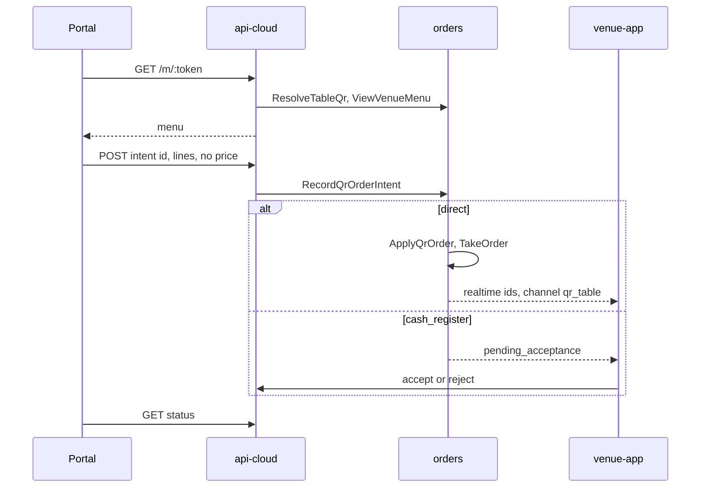

# Design: QR Table Ordering

## Technical Approach

Cloud-only MVP (D-37, ADR-017, ADR-018). A fixed QR opens `apps/customer-portal` at `/m/:token`, which calls only `apps/api-cloud`. `RecordQrOrderIntent` stores one PostgreSQL intent. Direct mode runs `ApplyQrOrder` in-process: open or append the `Check`, then `TakeOrder` with `qr_table`. Specs: `qr-table-ordering`, `dining-room`. Cross-context calls use entry ports.

`/m/:token` is neither pre-bill `/d/` nor invoice `/f/`. Invoicing stays untouched. PA-52 stays hybrid: no SQLite, outbox, local-node owner, or sync. `QrOrderPendingApply` is an unpublished contract for that phase. `StartQrTablePayment` is the 1.13 seam and is not built.

## Architecture Decisions

| Decision | Option | Tradeoff | Choice |
|----------|--------|----------|--------|
| Owner | In-process vs sync | Sync breaks D-37 | `ApplyQrOrder` in api-cloud |
| Token | Opaque vs HMAC `/f/` | p1-08 still applying; HMAC expires | SHA-256 in `table_qr_tokens`; plaintext only when issued |
| Price | Client vs menu | Client price can be forged | Snapshot from `Menu.viewAt`; recheck availability at apply |
| Acceptance | Always direct vs setting | D-23 starts direct | `qr_acceptance` default `direct`; `table_qr_enabled` is rollback |
| Open table | Ask size vs fixed | No party-size field | `diners: 1` if free; append if open; reject `to_clean` |
| Channel | Line field vs order | Lines follow the order channel | `ORDER_CHANNEL.qr_table` on floor, register, queue, ticket |
| Alert | Cron vs read | No scheduler | `ListStaleQrIntents` after 900s in `pending_acceptance` |
| Payment | Bold vs seam | 1.13 waits | No pay route; later `StartQrTablePayment` |

## Data Flow

A repeated intent id returns the stored result. Sold-out lines are not sent. The intent has no void, discount, courtesy, or price command. A disabled venue refuses visibly.

## File Changes

| File | Action | Description |
|------|--------|-------------|
| `contexts/orders/domain/qr-order-intent.ts`, `contexts/orders/domain/table-qr-token.ts` | Create | Intent and token |
| `contexts/orders/domain/check.ts`, `contexts/orders/domain/kitchen-ticket.ts` | Modify | Channel `qr_table` and ticket text |
| `contexts/orders/application/resolve-table-qr/resolve-table-qr.ts`, `contexts/orders/application/record-qr-order-intent/record-qr-order-intent.ts`, `contexts/orders/application/apply-qr-order/apply-qr-order.ts` | Create | Resolve, record, apply |
| `contexts/orders/application/review-qr-order-intent/review-qr-order-intent.ts`, `contexts/orders/application/list-stale-qr-intents/list-stale-qr-intents.ts`, `contexts/orders/application/issue-table-qr/issue-table-qr.ts` | Create | Review, alert, issue |
| `contexts/orders/application/ports/qr-order-intent-repository.ts`, `contexts/orders/application/ports/table-qr-repository.ts` | Create | Intent and token ports |
| `contexts/orders/application/ports/dining-room-repository.ts`, `contexts/orders/application/ports/printer.ts` | Modify | `loadOpenCheckByTable`; job channel |
| `contexts/orders/application/take-order/take-order.ts`, `contexts/orders/application/view-station-queue/view-station-queue.ts`, `contexts/orders/application/entry-port.ts` | Modify | Pass channel; export use cases |
| `contexts/orders/adapters/memory/in-memory-qr-order-intent-repository.ts`, `contexts/orders/adapters/memory/in-memory-table-qr-repository.ts` | Create | Memory stores |
| `contexts/orders/adapters/memory/in-memory-dining-room-repository.ts` | Modify | Open-check lookup |
| `contexts/orders/adapters/postgres/schema.ts` | Modify | Three `tenant_id` tables |
| `contexts/orders/adapters/postgres/drizzle-qr-order-intent-repository.ts`, `contexts/orders/adapters/postgres/drizzle-table-qr-repository.ts` | Create | Intent and token stores |
| `contexts/orders/adapters/postgres/drizzle-dining-room-repository.ts`, `contexts/orders/package.json` | Modify | Persist channel; exports and import maps |
| `shared/contracts/qr-table-ordering.ts` | Create | Zod commands and unpublished `QrOrderPendingApply` |
| `shared/contracts/dining-room.ts`, `shared/contracts/index.ts`, `shared/printing/domain/templates.ts` | Modify | Channel enum, export, printed channel |
| `apps/api-cloud/src/http/table-qr.controller.ts`, `apps/api-cloud/src/http/table-qr-admin.controller.ts` | Create | Public menu/submit/status; staff issue, review, stale list |
| `apps/api-cloud/src/composition/main.ts` | Modify | Wire Postgres adapters |
| `apps/customer-portal/src/table-order/table-order-screen.tsx` | Create | Cart screen |
| `apps/customer-portal/src/router.tsx` | Modify | `/m/$token` |
| `apps/venue-app/src/orders/floor-screen.tsx`, `apps/venue-app/src/kitchen/kitchen-screen.tsx`, `apps/venue-app/src/cash-register/register-screen.tsx` | Modify | Badge, badge, acceptance queue |

No admin-web, SQLite, or invoicing edits. Tests: colocated `*.test.ts`, repository contracts, `apps/api-cloud/test/http/table-qr.controller.test.ts`.

## Interfaces / Contracts

POST `{ intentId, lines: [{ productId, variantIds, modifierIds, note }] }`. No price. Empty lines write nothing. Status: `pending_acceptance`, `applied`, or `rejected`. `ResolveTableQr` returns `{ tenantId, venueId, tableId }` or a refusal. Accept uses `sale.charge`. Rotate uses `sale.reprint`.

## Testing Strategy

| Layer | What to Test | Approach |
|-------|-------------|----------|
| Unit | Channel, rotate, empty cart, idempotent apply, sold-out line, acceptance hold | Domain and in-memory use cases; Given/When/Then; Vitest `orders` |
| Integration | Unique intent, retired token, channel round-trip | Postgres contract style on both new repositories |
| HTTP | Portal cannot void; accept reaches the kitchen once | api-cloud Fastify inject |
| E2E | Pilot service | No Playwright project |

## Threat Matrix

N/A. No shell, subprocess, VCS or PR automation, executable-file classification, or process integration. `/m/:token` is an HTTP handler.

## Migration / Rollout

New tables only. Current orders stay `waiter` or `fixed_point`. Defaults keep direct send (D-23). Rollback sets `table_qr_enabled` false and rejects `pending_acceptance` intents. No backfill.

## Open Questions

None. Party size and venue-app printing are decided above. PA-52 stays deferred.
