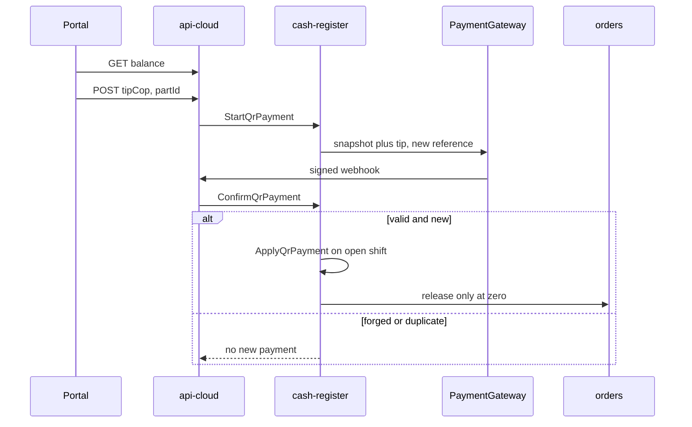

# Design: QR Table Payment

## Technical Approach

Cloud-only MVP (D-37, ADR-016, ADR-017, ADR-018). The portal calls only `apps/api-cloud`. `StartQrPayment`, `ConfirmQrPayment`, and `ApplyQrPayment` run in-process. Specs: `qr-table-payment`, `cash-register`. p1-12 has no payment type. This change creates `StartQrPayment` (TRD-M2). Imports are `#domain/`, `#application/`, `#adapters/`, or `@blackhole/...`.

The node never calls the gateway. No SQLite, outbox, or local-node files. PA-52 stays hybrid. `QrPaymentPendingApply` is unpublished and is not an acceptance test.

## Architecture Decisions

| Decision | Option | Tradeoff | Choice |
|----------|--------|----------|--------|
| Owner | In-process vs sync | Sync breaks D-37 | `ApplyQrPayment` in api-cloud |
| Gateway | Bold in domain vs port | Domain would see Bold | `PaymentGateway`; Bold is one adapter (D-46) |
| Existence | Start vs webhook | A start is not money | Confirmed only after `verifyWebhook`; same reference, same row |
| Amount | Client vs snapshot | Client can underpay | Balance or part plus `tipCop`. Sent amount ignored. Prefix `qrpay_` |
| Retry | New link vs same sheet | Two links can both clear | One `started` charge per account or part. New tip replaces it. Old reference confirms nothing |
| Tender | Fold into cash vs `qr` | Folding breaks the count | Method `qr`. `expectedCashCop` unchanged. Count shows `qrCop` vs the report |
| Closed shift | Edit vs wait | D-44 | `pending_application` until the earliest open shift. `OpenShift` applies it once |
| Table | Always release vs zero | A live table would free | `SplitAccount.pay` for a part. `MarkAccountPaid` only at zero sale |
| Invoice | New DIAN code vs worker | Factus has card and transfer | Tender stays `qr`. Card maps to `card`; wallets map to `transfer`. Tip is `tipCop`. Down leaves `pending_issuance` |
| Closure key | Per check vs per payment | One-check unique blocks splits | Unique `(tenant_id, payment_id)`. `ChargeCheck` still rejects a second cashier closure |

## Data Flow

No open shift stays pending on the register. A later line keeps the snapshot. `qr_payment_enabled` false hides the button. `ListStaleQrPayments` reads pending rows older than 900 seconds. No scheduler.

## File Changes

| File | Action | Description |
|------|--------|-------------|
| `contexts/cash-register/domain/qr-payment.ts` | Create | Charge and `QrPaymentConfirmed` |
| `contexts/cash-register/domain/payment.ts`, `contexts/cash-register/domain/cash-shift.ts`, `contexts/cash-register/domain/cash-count.ts` | Modify | Tender `qr`; cash expected unchanged |
| `contexts/cash-register/application/start-qr-payment/start-qr-payment.ts`, `contexts/cash-register/application/confirm-qr-payment/confirm-qr-payment.ts`, `contexts/cash-register/application/apply-qr-payment/apply-qr-payment.ts` | Create | Start, confirm, apply |
| `contexts/cash-register/application/reconcile-qr-payments/reconcile-qr-payments.ts`, `contexts/cash-register/application/list-stale-qr-payments/list-stale-qr-payments.ts` | Create | Reference diffs; stale list |
| `contexts/cash-register/application/ports/payment-gateway.ts`, `contexts/cash-register/application/ports/qr-payment-repository.ts` | Create | Gateway and store ports |
| `contexts/cash-register/application/open-shift/open-shift.ts`, `contexts/cash-register/application/submit-count/submit-count.ts`, `contexts/cash-register/application/entry-port.ts` | Modify | Drain pending; export use cases |
| `contexts/cash-register/adapters/memory/in-memory-qr-payment-repository.ts`, `contexts/cash-register/adapters/memory/scripted-payment-gateway.ts`, `contexts/cash-register/adapters/bold/bold-payment-gateway.ts` | Create | Memory doubles and Bold adapter |
| `contexts/cash-register/adapters/postgres/schema.ts`, `contexts/cash-register/adapters/postgres/drizzle-qr-payment-repository.ts`, `contexts/cash-register/adapters/postgres/drizzle-cash-register-ledger.ts`, `contexts/cash-register/package.json` | Modify / Create | `qr_payments`, unique reference, closure unique on `payment_id`, import maps |
| `shared/contracts/qr-table-payment.ts`, `shared/contracts/cash-register.ts`, `shared/contracts/index.ts` | Create / Modify | Commands, count fields, unpublished `QrPaymentPendingApply` |
| `apps/api-cloud/src/http/qr-payment.controller.ts`, `apps/api-cloud/src/http/cash-count.controller.ts`, `apps/api-cloud/src/composition/application-module.ts` | Create / Modify | Portal, webhook, `qrCop`, wiring |
| `apps/customer-portal/src/table-payment/table-payment-screen.tsx`, `apps/customer-portal/src/router.tsx` | Create / Modify | Pay screen for the table token and `/d/$token` |
| `apps/venue-app/src/cash-register/register-screen.tsx` | Modify | QR total and pending alert |

No local-node, SQLite, outbox, or invoicing edits. Tests: colocated `*.test.ts`, Postgres contract, `apps/api-cloud/test/http/qr-payment.controller.test.ts`.

## Interfaces / Contracts

`startCharge({ reference, amountCop })` returns a redirect. `verifyWebhook({ rawBody, signature })` returns `{ reference, amountCop, instrument }` or `null`. `report` returns reference rows. Bold is `POST /payments/bold/webhook` on the raw body, with no staff session. Portal body: `{ tipCop, partId? }`. Status: `started`, `confirmed`, `pending_application`, `applied`. `cashCountView` adds optional `qrCop` and `qrReportCop`.

## Testing Strategy

| Layer | What to Test | Approach |
|-------|-------------|----------|
| Unit | Ignored amount, one confirmation, forged signature, `qr` outside cash, closed shift, split, zero balance | In-memory use cases; Given/When/Then |
| Integration | Unique reference rejects a second insert | Postgres contract |
| HTTP | Two webhooks, one payment; bad signature, none | Fastify inject |
| E2E | Pilot service | No Playwright project |

No local-node or outbox test.

## Threat Matrix

N/A. No shell, subprocess, VCS or PR automation, executable-file classification, or process integration. The webhook is an HTTP handler. A bad signature writes nothing.

## Migration / Rollout

New `qr_payments` and a closure unique-key change. No backfill. `qr_payment_enabled` stays false until a gateway is configured. Rollback turns it off. Confirmed payments still apply.

## Open Questions

None. PA-52 stays deferred.
