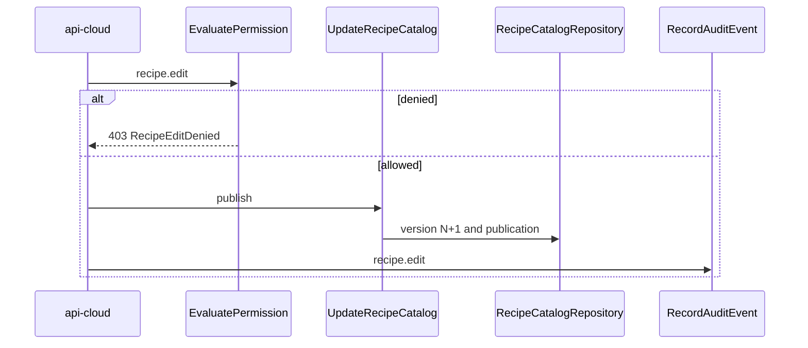

# Design: Ingredients and Recipes

## Technical Approach

New `contexts/inventory` (`@blackhole/inventory`), inside-out ([ADR-017](../../../docs/adr/ADR-017-tdd-sobre-hexagonal.md), [ADR-018](../../../docs/adr/ADR-018-screaming-y-bounded-context.md)). Spec: `specs/recipes/spec.md`. One `RecipeCatalog` per brand. Cloud (`api-cloud`, PostgreSQL) writes (TRD-00 5.1). `local-node` only reads. Domain imports no Nest, Drizzle, Zod, or `node:crypto`. `#` aliases, one `*` per segment. Cross-context calls use `entry-port.ts` only.

`shared/sync` stays absent. Publish inserts version N+1 and one `recipe_publications` row in the same transaction. `ApplyRecipeCopy` applies that payload. No cursor here.

## Architecture Decisions

| Option | Tradeoff | Decision |
|--------|----------|----------|
| `RecipeCatalog` aggregate | Cycle check needs one transaction | **Chosen.** Not one recipe aggregate |
| Base unit `g` / `ml` / `unit` | PRD says kg; TRD-00 wins | **Chosen.** `BASE_UNIT` |
| `QUANTITY_SCALE = 1000` | TRD-M4 sec. 5 forbids floats | **Chosen.** Milli-units. 2 × 50 kg = 100000 g |
| `referenceCostCop` per purchase unit | Average cost arrives in 2.3 | **Chosen.** 2.3 swaps the number, not `{ costCop, marginPercent }` |
| Matrix codes `recipe.edit`, `inventory.view-cost` | A new code forks PRD-01 | **Chosen.** No peso cap |
| Audit in the controller | Off platform interiors | **Chosen.** Action `recipe.edit`, versions before and after |
| Price and catalog ports | Site price and product ids live in orders | **Chosen.** api-cloud uses the orders entry port |
| Publication row | Cursor and outbox stay forbidden | **Chosen.** `ApplyRecipeCopy` on the node |
| Node margin (D-37) | Menu prices are not copied | Rejected. Cost HTTP is cloud-only |
| Stock commands | 2.2 owns the ledger | Rejected. `ExplodeRecipe` only reads |

## Data Flow

`publish` appends version N+1 and leaves N unchanged. `RecipeCycle` names the loop. Gross = `net * 100 / yieldPercent` (default 100), scaled. Non-stocked sub-recipes expand; a stocked line stays one line and is costed from its own ingredients. Deltas clamp at zero. One bad Excel row is `RecipeImportRejected` and saves nothing.

Cost GET checks `inventory.view-cost`. A waiter gets 403 `CostViewDenied`. Otherwise integer COP and margin `(price - cost) * 100 / price` (8000 and 20000 → 60). A missed publication leaves the SQLite copy. An older version is ignored.

## File Changes

| File | Action | Description |
|------|--------|-------------|
| `contexts/inventory/package.json`, `tsconfig.json` | Create | `@blackhole/inventory` and the `#` import map |
| `contexts/inventory/domain/recipe-catalog.ts`, test | Create | Units, yield, sub-recipes, deltas, `explode`, publish |
| `contexts/inventory/application/{update-recipe-catalog,import-recipes,view-theoretical-cost,explode-recipe,apply-recipe-copy}/*`, `entry-port.ts` | Create | Five use cases. No stock command |
| `contexts/inventory/application/ports/*.ts` | Create | Catalog, copy, price, directory, workbook. Memory runs both contracts |
| `contexts/inventory/adapters/postgres/0001_recipe_catalog.sql`, schema, Drizzle repository | Create | `inventory_app`, forced RLS, PGlite |
| `contexts/inventory/adapters/sqlite/drizzle-recipe-copy-repository.ts` | Create | Apply and read the copy |
| `shared/contracts/recipe-catalog.ts`, `index.ts` | Create / Modify | Zod command, import report, cost, publication |
| `apps/api-cloud` HTTP, composition, module, manifests | Create / Modify | `inject`, no `listen` |
| `apps/local-node` read controller, module, manifests | Create / Modify | GET copy. POST 403 `RecipeRejected`. No Zod |
| `apps/admin-web` router and three screens | Modify / Create | Cloud API. Cost only if the payload has it |
| `vitest.config.ts`, `tsconfig.json`, `tools/skeleton/skeleton.test.ts` | Modify | Project `inventory`. Allow this sqlite path. `shared/sync` stays absent |

No deletions and no stock tables. Tables: `ingredients`, `unit_conversions`, `recipes`, `recipe_lines`, `recipe_versions`, `recipe_version_lines`, `modifier_deltas`, `recipe_publications`.

## Interfaces / Contracts

`RecipeCatalog.open({ id: "recipe_catalog_<brandId>", tenantId, brandId })`. Commands: `upsertIngredient`, `upsertRecipe`, `publish`. No variant means the product recipe. `explode` returns `{ ingredientId, quantity }[]` in scaled base units. The workbook adapter lives in api-cloud.

`POST /tenants/:tenantId/brands/:brandId/recipe-catalog`, `POST .../import`, `GET .../recipe-catalog`, `GET /tenants/:tenantId/venues/:venueId/recipes/:productId/cost`. Zod is 400. Domain is 409. Import is 409 `{ error: "RecipeImportRejected", rows: [{ row, reason }] }`.

## Testing Strategy

Failing test first (ADR-017). `strict_tdd` stays false. Titles: given / when / then.

| Layer | What to Test | Approach |
|-------|----------------|----------|
| Domain | Zero factor, 2×50 kg, yield 150→200 g, variant, cycle, cheese and onion, floor at 0, frozen version | Pure |
| Use case | Row 17 unknown saves nothing; older copy ignored; stocked sub-recipe stays collapsed | Memory ports |
| Contract | Round-trip; other tenant hidden; copy apply | Memory, PGlite, SQLite. No Drizzle mock |
| HTTP | Owner 200; site admin publish 403; waiter cost 403 with no amounts; import 409; node POST 403; node GET last copy | `inject`. No `listen` |

## Migration / Rollout

`0001_recipe_catalog.sql` adds the tables, `inventory_app`, and forced RLS. Rollback unregisters the module in both apps. Drop the tables only when no version was published.

## Open Questions

None.
